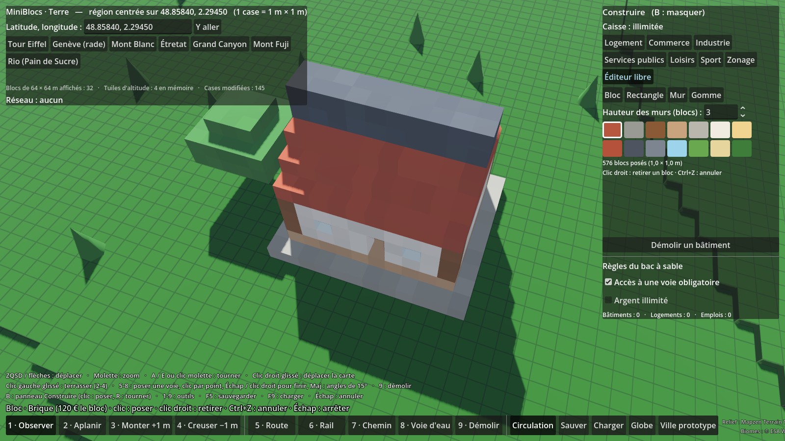

# MiniBlocs

Prototype de city builder en vue de dessus, style low-poly, mode bac à sable. Fait avec **Godot 4.3** (GDScript), sans aucun asset externe : tous les modèles (maisons, commerces, usines, arbres, routes) sont générés en code.


## Lancer le jeu

1. Installe [Godot 4.3 ou plus](https://godotengine.org/download) (version standard, pas .NET).
2. Ouvre Godot, clique sur **Importer** et choisis le fichier `project.godot` de ce dossier.
3. Appuie sur **F5** (ou le bouton ▶) pour lancer : le globe de départ s'ouvre. Le prototype de ville reste accessible avec le bouton **Ville prototype** (ou ouvre `scenes/main.tscn` et appuie sur **F6**).

## Commandes

| Action | Touches |
| --- | --- |
| Déplacer la caméra | ZQSD (WASD en QWERTY) ou flèches, ou clic droit maintenu + glisser |
| Zoomer | Molette |
| Tourner la caméra | A / E (Q / E en QWERTY), ou clic molette maintenu + glisser |
| Construire | Clic gauche maintenu + glisser |
| Choisir un outil | 1 Route · 2 Résidentiel · 3 Commercial · 4 Industriel · 5 Bulldozer |
| Annuler le tracé en cours | Échap |
| Sauvegarder / charger | F5 / F9 (ou les boutons en bas) |

## Mode Terre : choisis ton lieu sur le globe, puis joue sur le vrai relief

Au lancement (**F5**), un **globe 3D** coloré par les vrais biomes (forêts, champs, déserts, glaciers, lacs…) et le vrai relief s'affiche. Le joueur choisit son point de départ n'importe où sur Terre, puis joue sur une **terre vierge** (vrai relief et mers, sans routes ni bâtiments) découpée en cases de 1 m × 1 m.


- **Globe** : glisser pour tourner, molette pour zoomer, clic pour poser le point de départ. On peut aussi chercher dans la liste de lieux, coller des coordonnées (Google Maps : clic droit sur un lieu) ou cliquer sur **Lieu au hasard**.
- **Aperçu** : altitude du point et type de relief autour (plaine, collines, montagne, côte, mer), région de jeu de 10 × 10 km.
- **Commencer la partie** : ouvre la région en cases de 1 m. Survole une case pour voir ses coordonnées et son altitude. Outils : **2 Aplanir**, **3 Monter +1 m**, **4 Creuser −1 m** (clic gauche glissé). Bouton **Globe** pour changer de lieu.
- Le relief est téléchargé la première fois (Internet nécessaire), puis gardé en cache.


Comment ça marche, limites et prochaines étapes : [docs/terre-architecture.md](docs/terre-architecture.md).

## Transports : routes, rail, chemins et voies d'eau sur le vrai relief

Dans le mode Terre, la barre du bas propose **5 Route**, **6 Rail**, **7 Chemin** (piétons et vélos), **8 Voie d'eau** et **9 Démolir**.


- **Classe et largeur** : un panneau au-dessus de la barre permet de choisir la classe de voie et ses réglages, toujours dans les limites des normes françaises (guide ARP, ICTAAL, CEREMA, SNCF Réseau) :

  | Outil | Classes | Réglages |
  | --- | --- | --- |
  | Route | Rue de desserte (30 km/h), avenue urbaine (50), route départementale (80), voie express (110), autoroute (130) | Voies par sens, largeur d'une voie (2,75 à 3,50 m selon la classe) ; trottoirs, accotements, bandes d'arrêt d'urgence et terre-plein ajoutés d'office |
  | Rail | Tramway, ligne classique, ligne à grande vitesse | Voie unique ou double voie (écartement 1,435 m, entraxe 3,00 / 4,20 / 4,50 m) |
  | Chemin | Chemin piéton, piste cyclable bidirectionnelle, voie verte | Largeur (1,40 à 5,00 m selon la classe) |
  | Voie d'eau | Voie navigable, chenal maritime | Largeur (12 à 60 m, chenal 60 à 400 m pour les grands navires) |

  Chaque classe a aussi sa **pente maximale** (rue 12 %, autoroute 5 %, ligne classique 25 ‰…) et son **rayon de courbure minimal** (rue 15 m, départementale 240 m, autoroute 665 m, LGV 4 000 m).
- **Tracer droit** : clic pour commencer, puis un clic pour chaque point. **Échap** ou **clic droit** pour arrêter. **Maj** : angles par pas de 15°.
- **Tracer en courbe** : touche **C** (ou bouton **Courbe**). Clic de départ, clic qui donne la direction, clic d'arrivée. En prolongeant une voie, la courbe part dans son prolongement : un seul clic suffit. Un virage plus serré que le rayon minimal de la classe est refusé.
- **Aperçu** vert (possible) ou rouge avec la raison : pente trop forte, virage trop serré, chevauchement, croisement à mauvaise hauteur…
- **Relief** : la voie monte et descend avec le terrain dans la limite de sa pente. Le jeu fait la plate-forme, des **talus** en pente douce (1 pour 1,5) jusqu'au terrain naturel, les **ponts** (creux, mer) et les **tunnels** (collines).
- **Carrefours sans superposition** : clique sur une voie existante pour t'y raccrocher (carrefour en T) ou croise-la : le carrefour se crée tout seul, les voies s'arrêtent à son bord et un plateau les relie. Une voie qui en recouvre une autre sans s'y raccorder est refusée. Route et rail (ou chemin) se croisent par un passage à niveau.
- **Véhicules** : ils viennent d'un **catalogue de 131 modèles** (voir plus bas), tirés au hasard parmi ceux qui peuvent rouler sur chaque voie : tramways sur les voies de tram, TGV sur les LGV, vélos et piétons sur les chemins, péniches sur les canaux, paquebots dans les chenaux. Bouton **Circulation** pour les masquer, menu **Véhicules ▾** pour choisir l'**époque** et la **région** de ce qui circule (par exemple : XIXe – 1945, Amériques).
- **Sauver / Charger** gardent le réseau avec le terrain.


### Le catalogue de véhicules


131 modèles low-poly fabriqués en code, à l'échelle réelle, avec leur vitesse et leur nombre de places. Ils utilisent les **époques et régions de la bible** des bâtiments (Antiquité → futuriste, Europe, Amériques, Afrique, Moyen-Orient, Asie de l'Est, Asie du Sud…) :

| Catégorie | Exemples |
| --- | --- |
| Voitures (22) | voiture sans chevaux 1900, torpédo, berline des années 30, américaine à ailerons, mini citadine, taxi jaune de New York, taxi londonien, kei car japonaise, 4×4 de brousse, pick-up, électrique, supercar, capsule autonome |
| Utilitaires (12) | camionnette des années 30, semi-remorque, camion américain à long capot, citerne, grumier, porte-conteneur, pompiers, ambulance, camion décoré d'Asie du Sud, tracteur |
| Bus (12) | autobus à plateforme, bus à impériale, bus scolaire jaune, bus articulé, trolleybus, matatu, bus coloré d'Amérique centrale, jeepney, navette autonome |
| Deux et trois roues (11) | grand-bi, vélo, vélo cargo, trottinette, scooter, side-car, moto-taxi, tuk-tuk, cyclo-pousse, pousse-pousse |
| Attelages (5) | charrette, calèche, diligence, chariot bâché, omnibus à chevaux |
| Tramways (5) | tram 1900, tram à câble de San Francisco, tram des années 50, tram à étage, tram moderne articulé |
| Trains (13) et wagons | vapeur des débuts, américaine à chasse-buffles, Pacific, train de luxe, diesel de fret (et ses wagons), électrique, autorail, régional, métro, TGV, train japonais à nez long, train magnétique |
| Bateaux (20) | pirogue, pirogue à balancier, gondole, drakkar, jonque, sampan, felouque, boutre, caravelle, bateau à aubes, péniche, bateau-bus, remorqueur, voilier, ferry, porte-conteneurs, paquebot à quatre cheminées, navire de croisière |
| Aéronefs (12) | montgolfière, dirigeable, biplan, hydravion, avion à hélices, turbopropulseur, court-courrier, gros-porteur, supersonique, jet d'affaires, hélicoptère, taxi volant |


Pour voir tout le catalogue : `godot --path . --script res://tests/vehicules_vitrine.gd -- --screenshot v.png --cat bateau` (catégories : `voiture`, `utilitaire`, `bus`, `deux_roues`, `attelage`, `tram`, `train`, `wagon`, `bateau`, `avion`).

Architecture, feuille de route et questions ouvertes : [docs/transport-architecture.md](docs/transport-architecture.md).

## Bâtiments : poser des bâtiments à l'échelle réelle

Dans le mode Terre, le panneau **Construire** (à droite, **B** pour le masquer) propose **250 bâtiments** low-poly à l'échelle réelle (27 modèles classiques et une bible de 223 bâtiments de 29 styles du monde, voir plus bas) (1 case = 1 m), rangés en six catégories : **Logement**, **Commerce**, **Industrie**, **Services publics**, **Loisirs** et **Sport** (maison 10 × 12 m, tour d'habitation de 41 m, supermarché et son parking, hôpital, terrain de football de 105 × 68 m…).


- **Poser** : choisis un bâtiment dans la liste. Un fantôme suit la souris, vert si c'est possible, rouge sinon avec la raison. Clic gauche pour poser, **R** pour tourner d'un quart de tour, **clic droit** ou **Échap** pour arrêter.
- **Orientation** : tant que tu n'appuies pas sur R, la façade se tourne toute seule vers la route la plus proche. Un trait jaune relie la porte à la voie qui la dessert.
- **Terrassement** : le terrain est aplani sous le bâtiment, avec un petit talus autour. Refusé si le dénivelé dépasse 12 m, dans la mer, sur un lac ou une rivière, sur une voie ou sur un autre bâtiment. Une voie ne peut plus traverser un bâtiment.
- **Règles du bac à sable** (cases à cocher dans le panneau) : **accès à une voie obligatoire** (route, ou chemin pour les parcs, terrains de sport, écoles…, à moins de 10 m de la porte) et **caisse** de départ de 20 M€ : chaque bâtiment a un prix, plus le terrassement. **Argent illimité** pour construire librement.
- **Démolir un bâtiment** : bouton du panneau, puis clic sur le bâtiment (la moitié du prix est rendue, le terrain reste aplani).
- **Sauver / Charger** gardent les bâtiments, les zones, les blocs et la caisse avec le terrain et le réseau.

### Zonage : laisser la ville pousser

L'onglet **Zonage** du même panneau permet de peindre des zones **résidentielles**, **commerciales** ou **industrielles** (clic gauche glissé, 2 € le m², 300 m de côté au maximum). Tu choisis librement entre poser toi-même et laisser pousser, et tu peux mélanger les deux.


- Les bâtiments **poussent tout seuls le long des routes** de la zone, façade vers la rue, sur le relief aplani. Ils ne coûtent rien au joueur (ce sont des constructions privées).
- **Demande** affichée dans le panneau : il vient toujours des habitants, d'autant plus qu'il y a du travail ; commerces et industries s'installent selon la population.
- **Retirer des zones** : glisser sur la zone à effacer (une zone coupée en partie est redécoupée). Les bâtiments déjà construits restent.
- Case **Croissance automatique** pour mettre la ville en pause.

### La bible : styles du monde, de l'Antiquité au futur

Les listes du panneau mélangent les modèles classiques et la **bible** : 29 styles d'architecture, chacun décliné en archétypes (maison, immeuble, boutique, marché, usine, ferme, lieu de culte, palais, école, gare, théâtre, jardin…).


- **Régions** : Europe, Méditerranée, Moyen-Orient et Maghreb, Afrique, Asie de l'Est, Asie du Sud et du Sud-Est, Amériques, Monde.
- **Époques** : Antiquité, Traditionnel, XIXe – 1945, Moderne, Contemporain, Futuriste.
- **Exemples** : colombages, gothique (cathédrale), haussmannien, briques industrielles, scandinave (stavkirke), isba (église à bulbes, kremlin), Grèce antique (temple, amphithéâtre), méditerranéen, Maghreb (kasbah), persan, Golfe, Sahel (mosquée en terre, cases rondes), Afrique australe (kraal), Afrique moderne, chinois (pagode, Cité interdite), japonais (sanctuaire, château), Asie dense (néons), Inde (temple shikhara, palais moghol), Asie du Sud-Est (maisons sur pilotis, wat), pueblo, précolombien (pyramide), colonial, latino, Art déco, banlieue américaine, style international, tours de verre, futuriste.
- **Filtres** en haut de la liste : région, époque et recherche par nom (« pagode », « gare », « japonais »…).
- **Zonage par style** : dans l'onglet Zonage, choisis le **Style** avant de peindre une zone. Les bâtiments qui y poussent suivent ce style (« Classique MiniBlocs » par défaut, ou « Mélange de tous les styles »). Chaque zone garde son style.


Pour ajouter un style : une entrée dans `Styles.STYLES` (`scripts/catalogue/styles.gd`) avec sa région, son époque, ses couleurs, son toit et ses archétypes ; le modèle 3D est fabriqué par `StyleBuilder`.

### Éditeur libre : construire bloc par bloc

L'onglet **Éditeur libre** permet de construire ce que tu veux avec des blocs de 1 m × 1 m × 1 m, posés sur le relief ou les uns contre les autres.



- **Outils** : **Bloc** (un clic = un bloc, sur le sol ou sur la face visée d'un autre bloc), **Rectangle** (clic glissé : dalle, plancher, toit plat), **Mur** (clic glissé en ligne, hauteur réglable) et **Gomme** (clic sur un bloc, ou glissé pour effacer un étage).
- **Clic droit** court : retirer le bloc visé. **Ctrl+Z** : annuler. **Échap** : arrêter.
- **14 matériaux** : brique, pierre, bois, planches, béton, enduits, tuile, ardoise, métal, verre (transparent), herbe, sable, feuillage. Chaque bloc a un prix payé par la caisse (moitié rendue quand on le retire).
- Pas de bloc sous terre, sur une voie ou dans un bâtiment. Inversement, ni bâtiment ni voie ne peuvent passer sur des blocs.
- La taille des blocs est une constante (`BlockEditor.SIZE`) : on pourra passer à 50 cm pour plus de détails.

## Vue au sol : marcher à la 3e ou à la 1re personne

Dans le mode Terre, appuie sur **V** (ou les boutons **Dessus / 3e pers. / 1re pers.** en haut au centre) : un personnage apparaît au sol, au centre de la vue de gestion.


| Action | Touches |
| --- | --- |
| Changer de vue (dessus → 3e → 1re → dessus) | V |
| Marcher / courir | ZQSD (WASD en QWERTY) ou flèches / Maj maintenue |
| Sauter, remonter en nageant | Espace |
| Regarder | Souris |
| Rapprocher / éloigner la caméra | Molette (tout près : 1re personne, molette arrière : 3e personne) |
| Libérer la souris (pour cliquer sur l'interface) | Échap, puis clic dans la vue pour la reprendre |

- **Collisions** : le personnage marche sur le relief (et sur les cases que tu as aplanies ou creusées), sur les routes, rails, chemins et ponts (les parapets empêchent de tomber). Les bâtiments et les constructions de l'éditeur libre l'arrêtent.
- **Caméra 3e personne** : elle se rapproche toute seule quand un mur, une colline ou le sol passerait entre elle et le personnage.
- **Eau** : dans l'eau profonde, il nage à la surface.
- **Retour en vue de dessus** : la caméra de gestion se recentre sur le personnage.
- Limites actuelles : on traverse encore les arbres et les véhicules, et les tunnels ne sont pas praticables à pied.


## Ambiance : cycle jour/nuit, vrai Soleil et vraie Lune

Le mode Terre a maintenant une **horloge** : le Soleil et la Lune sont à leur vraie place dans le ciel pour le lieu, la date et l'heure (saisons, durée du jour, phases de la Lune, nuit polaire…). Le ciel passe du bleu de midi à l'orangé du couchant, puis à la nuit étoilée.


- **La nuit**, des **lampadaires** s'allument le long des routes et des chemins (posés tout seuls), et les **fenêtres** des bâtiments s'éclairent, plus ou moins selon l'heure.
- **Panneau Horloge** (en bas à droite) : heure et date du lieu, lever et coucher du Soleil, phase de la Lune. Barre pour choisir l'heure, ◀ ▶ pour changer de mois (et donc de saison).
- **T** : pause / reprise. **Maj + T** : vitesse suivante (temps réel, 1 min/s, 10 min/s, 1 h/s).
- **Heure officielle du lieu**, avec les vrais fuseaux horaires du monde et l'heure d'été.
- **Météo** selon le climat réel du lieu et la saison : nuages, pluie, neige, brouillard, orages avec éclairs. La liste « Météo » du panneau Horloge permet de forcer un temps.
- **Phares** des véhicules allumés la nuit et par mauvais temps.


- **Sauver / Charger** gardent la date, l'heure et la météo choisie.


Détails et limites : [docs/ambiance.md](docs/ambiance.md).

## Comment ça marche

- **Routes** : se tracent en L entre le point de départ et la souris. Le marquage s'adapte aux routes voisines (lignes droites, virages, carrefours).
- **Zones** : se peignent en rectangle. Une zone ne recouvre jamais une route.
- **Croissance** : les bâtiments poussent tout seuls sur les cases zonées situées à 2 cases maximum d'une route, orientés vers celle-ci.
- **Statistiques** : habitants (4 par maison) et emplois (3 par commerce, 6 par usine), affichés en haut à gauche.
- **Sauvegarde** : un fichier JSON dans le dossier utilisateur de Godot (`user://miniblocs_save.json`).

## Organisation du code

| Fichier | Rôle |
| --- | --- |
| `scenes/main.tscn` | Scène principale : lumière, ciel, caméra, ville, interface |
| `scripts/main.gd` | Relie l'interface à la ville |
| `scripts/camera_rig.gd` | Caméra de gestion (déplacement, zoom, rotation) |
| `scripts/city_grid.gd` | Grille, outils de pose, croissance, sauvegarde |
| `scripts/low_poly.gd` | Fabrique des modèles low-poly |
| `scripts/ground_grid.gdshader` | Sol herbeux quadrillé |
| `scripts/hud.gd` | Barre d'outils, statistiques, aide |
| `tests/smoke_test.gd` | Test automatique de bout en bout |
| `scenes/globe.tscn` | Écran de départ : globe 3D pour choisir le lieu |
| `scripts/terre/globe_menu.gd` | Globe : rotation, clic, recherche, hasard, aperçu, lancement |
| `scripts/terre/game_start.gd` | Choix du joueur transmis à la partie (lieu, mode) |
| `scenes/terre.tscn` | Mode Terre : relief réel en cases de 1 m |
| `scripts/personnage/vue_sol.gd` | Bascule vue de dessus / 3e / 1re personne, caméra au sol |
| `scripts/personnage/personnage.gd` | Personnage qui marche (piloté par des ordres, prêt pour le multijoueur) |
| `scripts/personnage/collisions_sol.gd` | Collisions du relief et des voies autour du personnage |
| `tests/personnage_test.gd` | Test de la vue au sol (marche, pont, mur, caméra, nage) |
| `scripts/terre/geo.gd` | Conversions latitude / longitude ↔ mètres ↔ tuiles |
| `scripts/terre/land_cover.gd` | Biomes réels (ESA WorldCover) lus par blocs autour du lieu |
| `assets/biomes_monde.png` | Carte mondiale des biomes du globe (fabriquée par `tools/build_biome_map.py`) |
| `scripts/ambiance/` | Cycle jour/nuit, Soleil et Lune réels, ciel, lampadaires, fenêtres allumées (voir [docs/ambiance.md](docs/ambiance.md)) |
| `scripts/terre/elevation_tiles.gd` | Téléchargement, cache et lecture des tuiles d'altitude |
| `scripts/terre/terrain_world.gd` | Blocs de 64 × 64 cases autour de la caméra, outils, sauvegarde |
| `scripts/terre/terre_hud.gd` | Interface du mode Terre |
| `tests/terre_test.gd` | Test automatique du mode Terre (sans réseau) |
| `tests/globe_test.gd` | Test automatique du globe (sans réseau) |
| `scripts/transport/transport_types.gd` | Catalogue des types de voies (largeur, pente maxi, vitesse…) |
| `scripts/transport/transport_network.gd` | Graphe commun à tous les réseaux, itinéraires A*, sauvegarde |
| `scripts/transport/route_planner.gd` | Tracé sur le relief : pente, ponts, tunnels, terrassement |
| `scripts/transport/transport_view.gd` | Modèles low-poly des voies, ponts et tunnels |
| `scripts/transport/traffic.gd` | Véhicules qui circulent (modèles tirés du catalogue, filtre époque / région) |
| `scripts/transport/vehicle_catalog.gd` | Catalogue des 131 véhicules : catégories, époques, régions, chiffres, modèles low-poly |
| `scripts/transport/vehicle_mesh.gd` | Formes des véhicules (roues, coques, ailes, voiles, chevaux…) en plus de BlocMesh |
| `tests/vehicules_vitrine.gd` | Aligne une ou plusieurs catégories du catalogue et prend une capture |
| `scripts/transport/transport_system.gd` | Outils de pose et de démolition dans le mode Terre |
| `tests/transport_test.gd` | Test automatique des transports (sans réseau) |
| `scripts/batiments/building_catalog.gd` | Catalogue des bâtiments : catégories, emprises, prix, modèles low-poly |
| `scripts/batiments/bloc_mesh.gd` | Formes low-poly (boîtes, toits, cylindres) assemblées en un seul maillage |
| `scripts/batiments/building_system.gd` | Pose, règles, terrassement, démolition et sauvegarde des bâtiments |
| `scripts/batiments/building_panel.gd` | Panneau « Construire » |
| `scripts/batiments/zone_system.gd` | Zonage : zones peintes, demande, croissance le long des routes |
| `scripts/batiments/block_editor.gd` | Éditeur libre bloc par bloc : outils, matériaux, annulation, rendu par blocs de 16 × 16 m |
| `scripts/catalogue/styles.gd` | Bible : régions, époques, archétypes et les 29 styles d'architecture |
| `scripts/catalogue/style_builder.gd` | Fabrique les bâtiments de la bible (emprise, chiffres, modèle 3D) d'après style + archétype |
| `tests/batiments_test.gd` | Test automatique des bâtiments (sans réseau) |
| `tests/batiments_vitrine.gd` | Pose tout le catalogue (ou fait pousser un quartier avec `--zones`, ou construit une maison en blocs avec `--blocs`) et prend une capture. `--styles japonais,chinois` ou `--arch culte` filtrent la bible, `--zone-style` choisit le style du zonage |

## Test automatique

```bash
godot --headless --path . --script res://tests/smoke_test.gd
```

Le test pose des routes et des zones, attend la croissance, puis vérifie la sauvegarde, le chargement et le bulldozer. Il affiche `SMOKE TEST OK` si tout va bien.

```bash
godot --headless --path . --script res://tests/terre_test.gd
```

Vérifie les conversions de coordonnées, le décodage des tuiles, la génération des blocs, le terrassement et la sauvegarde. Il affiche `TERRE TEST OK`. De même, `tests/globe_test.gd` affiche `GLOBE TEST OK`, `tests/transport_test.gd` affiche `TRANSPORT TEST OK` et `tests/batiments_test.gd` affiche `BATIMENTS TEST OK`.

```bash
godot --headless --path . --script res://tests/perf_bench.gd [-- --big] [--reseau]
```

Banc d'essai des performances sur une région de 10 × 10 km : chargement du terrain, survol de 4 km, grande ville en grille (routes, zonage, circulation), sauvegarde et chargement. Affiche les temps par image et `PERF BENCH OK`. `--reseau` utilise le vrai relief d'Annecy, `--big` une ville deux fois plus grande.

## Pistes pour la suite

- Remplacer les modèles générés par des packs CC0 (Kenney City Kit, Quaternius) en gardant la même logique.
- Besoins entre zones (les habitants ont besoin d'emplois et de commerces), argent et budget.
- Services : électricité, eau, parcs.
