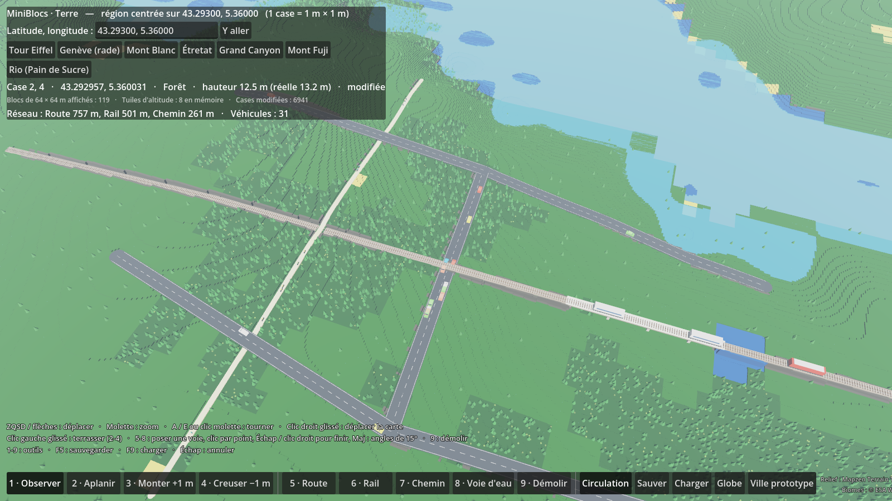

# MiniBlocs

Prototype de city builder en vue de dessus, style low-poly, mode bac à sable. Fait avec **Godot 4.3** (GDScript), sans aucun asset externe : tous les modèles (maisons, commerces, usines, arbres, routes) sont générés en code.


## Lancer le jeu

1. Installe [Godot 4.3 ou plus](https://godotengine.org/download) (version standard, pas .NET).
2. Ouvre Godot, clique sur **Importer** et choisis le fichier `project.godot` de ce dossier.
3. Appuie sur **F5** (ou le bouton ▶) pour lancer : le globe de départ s'ouvre. Le prototype de ville reste accessible avec le bouton **Ville prototype** (ou ouvre `scenes/main.tscn` et appuie sur **F6**).

## Commandes

| Action | Touches |
| --- | --- |
| Déplacer la caméra | ZQSD (WASD en QWERTY) ou flèches, ou clic droit maintenu + glisser |
| Zoomer | Molette |
| Tourner la caméra | A / E (Q / E en QWERTY), ou clic molette maintenu + glisser |
| Construire | Clic gauche maintenu + glisser |
| Choisir un outil | 1 Route · 2 Résidentiel · 3 Commercial · 4 Industriel · 5 Bulldozer |
| Annuler le tracé en cours | Échap |
| Sauvegarder / charger | F5 / F9 (ou les boutons en bas) |

## Mode Terre : choisis ton lieu sur le globe, puis joue sur le vrai relief

Au lancement (**F5**), un **globe 3D** coloré par les vrais biomes (forêts, champs, déserts, glaciers, lacs…) et le vrai relief s'affiche. Le joueur choisit son point de départ n'importe où sur Terre, puis joue sur une **terre vierge** (vrai relief et mers, sans routes ni bâtiments) découpée en cases de 1 m × 1 m.


- **Globe** : glisser pour tourner, molette pour zoomer, clic pour poser le point de départ. On peut aussi chercher dans la liste de lieux, coller des coordonnées (Google Maps : clic droit sur un lieu) ou cliquer sur **Lieu au hasard**.
- **Aperçu** : altitude du point et type de relief autour (plaine, collines, montagne, côte, mer), région de jeu de 10 × 10 km.
- **Commencer la partie** : ouvre la région en cases de 1 m. Survole une case pour voir ses coordonnées et son altitude. Outils : **2 Aplanir**, **3 Monter +1 m**, **4 Creuser −1 m** (clic gauche glissé). Bouton **Globe** pour changer de lieu.
- Le relief est téléchargé la première fois (Internet nécessaire), puis gardé en cache.


Comment ça marche, limites et prochaines étapes : [docs/terre-architecture.md](docs/terre-architecture.md).

## Transports : routes, rail, chemins et voies d'eau sur le vrai relief

Dans le mode Terre, la barre du bas propose **5 Route**, **6 Rail**, **7 Chemin** (piétons et vélos), **8 Voie d'eau** et **9 Démolir**.



- **Tracer** : clic gauche pour commencer, puis un clic pour chaque point suivant. Le tracé continue depuis le dernier point ; **Échap** ou **clic droit** pour arrêter. **Maj** maintenue : angles par pas de 15°.
- **Aperçu** vert (possible) ou rouge (impossible, avec la raison : pente trop forte, voie d'eau hors de l'eau…), avec la longueur, la pente maxi et les mètres de pont et de tunnel.
- **Relief** : la voie respecte une pente maximale (route 10 %, rail 4 %, chemin 15 %). Le jeu fait tout seul les **remblais et déblais**, les **ponts** (creux, mer) et les **tunnels** (collines).
- **Carrefours** : clique sur une voie existante pour t'y raccrocher (carrefour en T), ou croise-la : le carrefour se crée tout seul. Route et rail se croisent par un passage à niveau.
- **Véhicules** : voitures, trains, piétons, cyclistes et bateaux circulent dès qu'un réseau existe. Bouton **Circulation** pour les masquer.
- **Sauver / Charger** gardent le réseau avec le terrain.


Architecture, feuille de route et questions ouvertes : [docs/transport-architecture.md](docs/transport-architecture.md).

## Vue au sol : marcher à la 3e ou à la 1re personne

Dans le mode Terre, appuie sur **V** (ou les boutons **Dessus / 3e pers. / 1re pers.** en haut à droite) : un personnage apparaît au sol, au centre de la vue de gestion.


| Action | Touches |
| --- | --- |
| Changer de vue (dessus → 3e → 1re → dessus) | V |
| Marcher / courir | ZQSD (WASD en QWERTY) ou flèches / Maj maintenue |
| Sauter, remonter en nageant | Espace |
| Regarder | Souris |
| Rapprocher / éloigner la caméra | Molette (tout près : 1re personne, molette arrière : 3e personne) |
| Libérer la souris (pour cliquer sur l'interface) | Échap, puis clic dans la vue pour la reprendre |

- **Collisions** : le personnage marche sur le relief (et sur les cases que tu as aplanies ou creusées), sur les routes, rails, chemins et ponts (les parapets empêchent de tomber). Tout objet qui a une collision (bâtiments…) l'arrête.
- **Caméra 3e personne** : elle se rapproche toute seule quand un mur, une colline ou le sol passerait entre elle et le personnage.
- **Eau** : dans l'eau profonde, il nage à la surface.
- **Retour en vue de dessus** : la caméra de gestion se recentre sur le personnage.
- Limites actuelles : on traverse encore les arbres et les véhicules, et les tunnels ne sont pas praticables à pied.


## Comment ça marche

- **Routes** : se tracent en L entre le point de départ et la souris. Le marquage s'adapte aux routes voisines (lignes droites, virages, carrefours).
- **Zones** : se peignent en rectangle. Une zone ne recouvre jamais une route.
- **Croissance** : les bâtiments poussent tout seuls sur les cases zonées situées à 2 cases maximum d'une route, orientés vers celle-ci.
- **Statistiques** : habitants (4 par maison) et emplois (3 par commerce, 6 par usine), affichés en haut à gauche.
- **Sauvegarde** : un fichier JSON dans le dossier utilisateur de Godot (`user://miniblocs_save.json`).

## Organisation du code

| Fichier | Rôle |
| --- | --- |
| `scenes/main.tscn` | Scène principale : lumière, ciel, caméra, ville, interface |
| `scripts/main.gd` | Relie l'interface à la ville |
| `scripts/camera_rig.gd` | Caméra de gestion (déplacement, zoom, rotation) |
| `scripts/city_grid.gd` | Grille, outils de pose, croissance, sauvegarde |
| `scripts/low_poly.gd` | Fabrique des modèles low-poly |
| `scripts/ground_grid.gdshader` | Sol herbeux quadrillé |
| `scripts/hud.gd` | Barre d'outils, statistiques, aide |
| `tests/smoke_test.gd` | Test automatique de bout en bout |
| `scenes/globe.tscn` | Écran de départ : globe 3D pour choisir le lieu |
| `scripts/terre/globe_menu.gd` | Globe : rotation, clic, recherche, hasard, aperçu, lancement |
| `scripts/terre/game_start.gd` | Choix du joueur transmis à la partie (lieu, mode) |
| `scenes/terre.tscn` | Mode Terre : relief réel en cases de 1 m |
| `scripts/personnage/vue_sol.gd` | Bascule vue de dessus / 3e / 1re personne, caméra au sol |
| `scripts/personnage/personnage.gd` | Personnage qui marche (piloté par des ordres, prêt pour le multijoueur) |
| `scripts/personnage/collisions_sol.gd` | Collisions du relief et des voies autour du personnage |
| `tests/personnage_test.gd` | Test de la vue au sol (marche, pont, mur, caméra, nage) |
| `scripts/terre/geo.gd` | Conversions latitude / longitude ↔ mètres ↔ tuiles |
| `scripts/terre/land_cover.gd` | Biomes réels (ESA WorldCover) lus par blocs autour du lieu |
| `assets/biomes_monde.png` | Carte mondiale des biomes du globe (fabriquée par `tools/build_biome_map.py`) |
| `scripts/terre/elevation_tiles.gd` | Téléchargement, cache et lecture des tuiles d'altitude |
| `scripts/terre/terrain_world.gd` | Blocs de 64 × 64 cases autour de la caméra, outils, sauvegarde |
| `scripts/terre/terre_hud.gd` | Interface du mode Terre |
| `tests/terre_test.gd` | Test automatique du mode Terre (sans réseau) |
| `tests/globe_test.gd` | Test automatique du globe (sans réseau) |
| `scripts/transport/transport_types.gd` | Catalogue des types de voies (largeur, pente maxi, vitesse…) |
| `scripts/transport/transport_network.gd` | Graphe commun à tous les réseaux, itinéraires A*, sauvegarde |
| `scripts/transport/route_planner.gd` | Tracé sur le relief : pente, ponts, tunnels, terrassement |
| `scripts/transport/transport_view.gd` | Modèles low-poly des voies, ponts et tunnels |
| `scripts/transport/traffic.gd` | Véhicules qui circulent |
| `scripts/transport/transport_system.gd` | Outils de pose et de démolition dans le mode Terre |
| `tests/transport_test.gd` | Test automatique des transports (sans réseau) |

## Test automatique

```bash
godot --headless --path . --script res://tests/smoke_test.gd
```

Le test pose des routes et des zones, attend la croissance, puis vérifie la sauvegarde, le chargement et le bulldozer. Il affiche `SMOKE TEST OK` si tout va bien.

```bash
godot --headless --path . --script res://tests/terre_test.gd
```

Vérifie les conversions de coordonnées, le décodage des tuiles, la génération des blocs, le terrassement et la sauvegarde. Il affiche `TERRE TEST OK`. De même, `tests/globe_test.gd` affiche `GLOBE TEST OK` et `tests/transport_test.gd` affiche `TRANSPORT TEST OK`.

## Pistes pour la suite

- Remplacer les modèles générés par des packs CC0 (Kenney City Kit, Quaternius) en gardant la même logique.
- Besoins entre zones (les habitants ont besoin d'emplois et de commerces), argent et budget.
- Services : électricité, eau, parcs.
