# MiniBlocs

Prototype de city builder en vue de dessus, style low-poly, mode bac à sable. Fait avec **Godot 4.3** (GDScript), sans aucun asset externe : tous les modèles (maisons, commerces, usines, arbres, routes) sont générés en code.

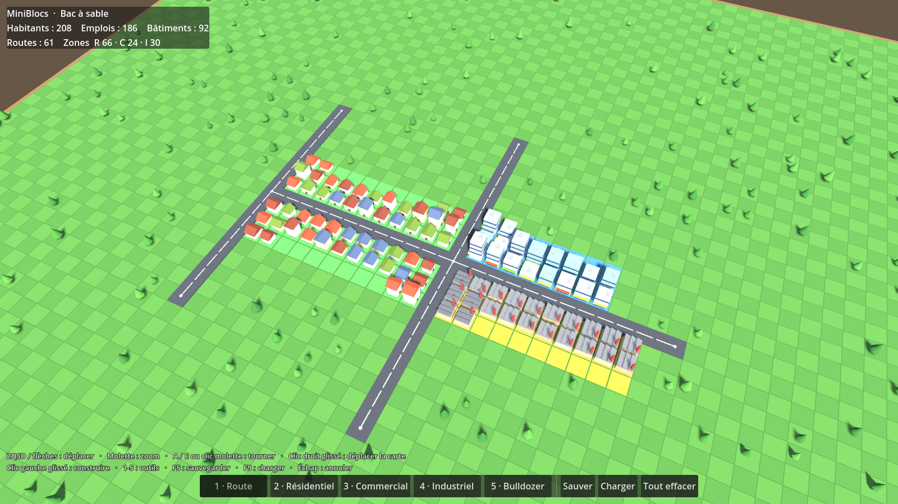

## Lancer le jeu

1. Installe [Godot 4.3 ou plus](https://godotengine.org/download) (version standard, pas .NET).
2. Ouvre Godot, clique sur **Importer** et choisis le fichier `project.godot` de ce dossier.
3. Appuie sur **F5** (ou le bouton ▶) pour lancer : le **menu principal** s'ouvre (Continuer, Nouvelle partie → globe, Charger, Atelier, Options, Crédits, Quitter). Détails : [docs/menus.md](docs/menus.md). Le prototype de ville reste accessible avec le bouton **Ville prototype** du globe (ou ouvre `scenes/main.tscn` et appuie sur **F6**).

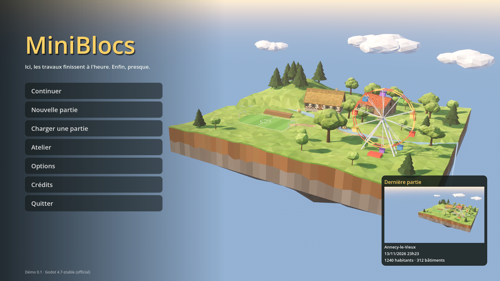

## Commandes

Dans le jeu, **F1** (ou le bouton **?** en haut à gauche) affiche toutes les commandes.

L'écran a une barre en haut (lieu, partie, heure et vitesse du temps, chiffres de la ville) et une barre de catégories en bas, avec des icônes : Observer, Terrain, Voies, Paysage, Construire, Lignes, Habitants, Circulation, Véhicules, Vue. Les outils de la catégorie choisie s'affichent juste au-dessus. Détails : [docs/interface.md](docs/interface.md).

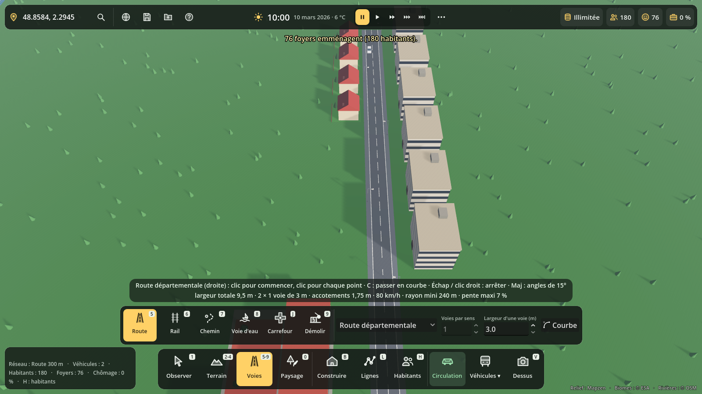

| Action | Touches |
| --- | --- |
| Déplacer la caméra | ZQSD (WASD en QWERTY) ou flèches, ou clic droit maintenu + glisser |
| Zoomer | Molette |
| Tourner la caméra | A / E (Q / E en QWERTY), ou clic molette maintenu + glisser |
| Outils (barre du bas) | 1 Observer · 2 Aplanir · 3 Monter · 4 Creuser · 5 Route · 6 Rail · 7 Chemin · 8 Voie d'eau · 9 Démolir |
| Tracer une voie | un clic par point, **C** courbe, **Maj** angles de 15°, **Échap** / clic droit pour finir |
| Panneau Construire | **B** (bâtiments, zonage, éditeur libre ; **R** tourne le bâtiment, **Ctrl + Z** annule ; **Page haut / Page bas** : étage actif en mode Murs et étages) |
| Transports publics | **L** (stations, gares, ports, aéroports, lignes) |
| Habitants | **H** (la ville en chiffres, liste des habitants, budget) ; clic sur un bâtiment avec l'outil 1 |
| Habitants au travail | **K** vue métiers (zoome sur un commerce, une école, un hôpital : il s'ouvre en coupe), **Maj + K** coupe automatique oui/non |
| Internet et téléphone | **Maj + O** (antennes 2G / 4G / 5G, central, cuivre, fibre, calques de couverture et de débit) |
| Temps | **T** pause, **Maj + T** vitesse suivante |
| Vue au sol | **V** (dessus, 3e personne, 1re personne) |
| Sauvegarder / recharger | **F5** / **F9** ; icônes Sauver, Charger (liste des parties) et Globe en haut à gauche |
| Menu pause | **Échap** (quand aucun outil n'est en cours) : le temps s'arrête ; sauvegarder, charger, options, menu principal |
| Aide | **F1** |
| Son et musique | **F2** (volumes général, musique, ambiance, effets, interface ; morceaux) |

L'interface s'adapte à la taille de la fenêtre (elle est dessinée pour 1600 × 900 puis agrandie ou réduite).

### Tutoriel guidé et objectifs à l'écran

Une nouvelle partie commence par un tutoriel guidé (case cochée par défaut sur le globe, F10 → Aide pour le couper ou le relancer) : une étape à la fois en haut à gauche, de la fondation du village à l'école. Dessous, les objectifs restent visibles : rang de la ville et missions du pays. Détails : [docs/tutoriel.md](docs/tutoriel.md).

## Mode Terre : choisis ton lieu sur le globe, puis joue sur le vrai relief

Au lancement (**F5**), un **globe 3D** coloré par les vrais biomes (forêts, champs, déserts, glaciers, lacs…) et le vrai relief s'affiche. Le joueur choisit son point de départ n'importe où sur Terre, puis joue sur une **terre vierge** (vrai relief et mers, sans routes ni bâtiments) découpée en cases de 1 m × 1 m.

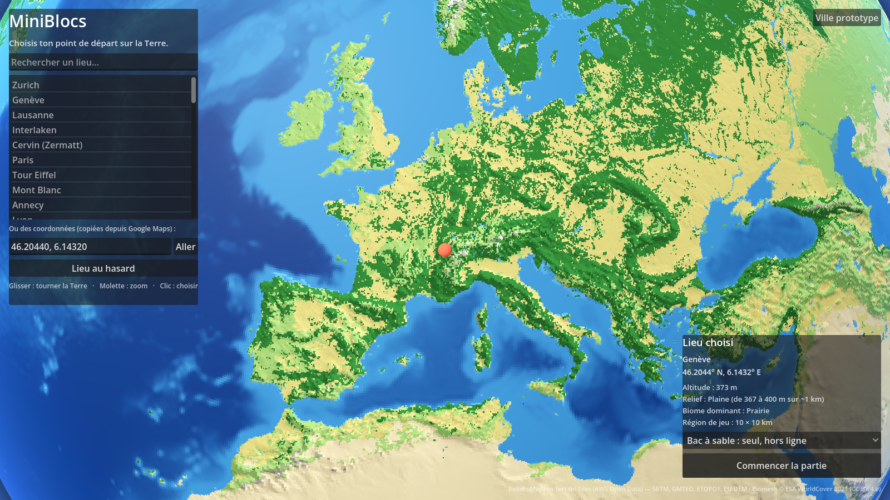

- **Globe** : glisser pour tourner, molette pour zoomer, clic pour poser le point de départ. La **recherche** trouve n'importe quelle ville de la planète : 135 000 villes de plus de 1 000 habitants (GeoNames), avec leur drapeau ; les accents sont facultatifs et les noms français des grandes villes marchent (Londres, Pékin, Genève). **Entrée** choisit la première. On peut aussi taper des coordonnées (Google Maps : clic droit sur un lieu), ou **Chercher en ligne** (OpenStreetMap) pour un hameau ou un lieu-dit. Le pays choisi propose le drapeau du premier village.
- **Aperçu** : altitude du point et type de relief autour (plaine, collines, montagne, côte, mer), région de jeu de 40 × 40 km (1 600 km², soit 1,6 milliard de cases).
- **Commencer la partie** : ouvre la région en cases de 1 m. Survole une case pour voir ses coordonnées et son altitude. Outils : **2 Aplanir**, **3 Monter +1 m**, **4 Creuser −1 m** (clic gauche glissé). Bouton **Globe** pour changer de lieu.
- Le relief est téléchargé la première fois (Internet nécessaire), puis gardé en cache.

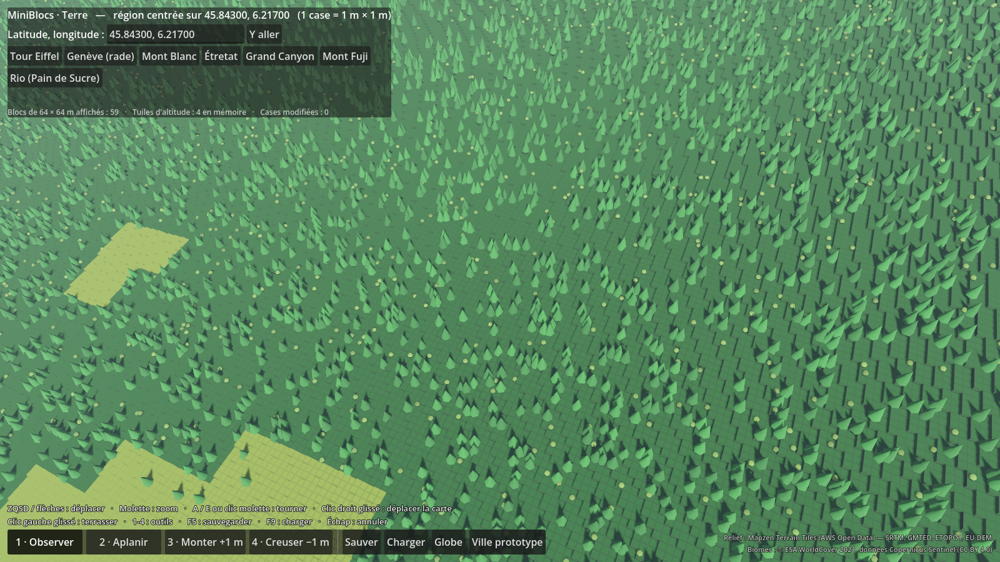

### Paysage : façonner la terre au pinceau (outil 0)

La touche **0** ouvre le panneau **Paysage**. Clic gauche glissé avec un pinceau rond de 1 à 31 m :

- **Colline** et **Lisser** : modeler le relief en douceur.
- **Lac / canal** : creuse et remplit d'eau animée. L'eau garde le niveau du premier clic, donc un canal qui monte est creusé plus profond, comme un vrai canal. Les routes posées par-dessus passent sur un pont, et les bateaux peuvent y naviguer. **Combler l'eau** rebouche.
- **Peindre un biome** : forêt (qui se remplit d'arbres), prairie, champs, broussailles, désert, plage, roche, neige, marais, toundra.
- **Planter** ou **arracher** des arbres.

Les plantes (46 espèces modélisées dans Blender : arbres, arbustes, herbes, fleurs, cultures, rochers) et les textures du sol (herbe, roche, sable, champs en patchwork…) changent selon le biome, le climat et l'altitude, et vivent au fil des saisons (feuilles d'automne, neige, moissons) et des âges (de la jeune pousse à l'arbre mort) : voir [docs/plantes-et-sols.md](docs/plantes-et-sols.md).

Tout est sauvegardé avec la partie.

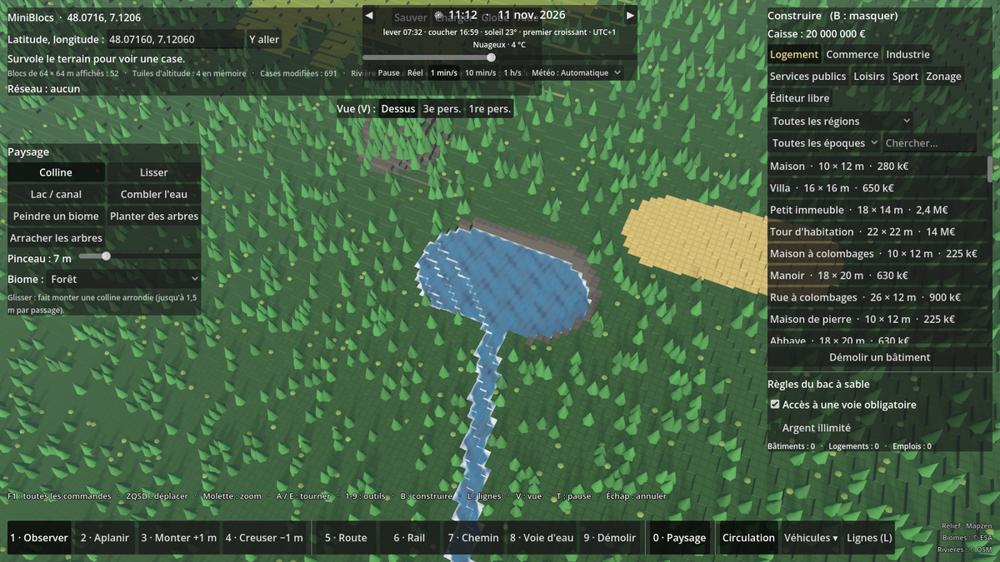

### Mer et côtes

La mer a une **houle** douce (la surface monte et descend), un **ressac** : des bandes d'écume qui roulent vers le rivage sur une bande de 4 m, et des **plages de sable** là où la terre basse (moins de 2,5 m) et peu pentue touche la mer. Les falaises et les rochers restent tels quels.

**Marées** : la mer monte et descend avec la vraie Lune, deux fois par jour (pleine mer environ toutes les 12 h 25), plus fort à la pleine et à la nouvelle lune (vives-eaux). Le marnage dépend du lieu : presque rien en Méditerranée, jusqu'à 6 m en Manche. À marée basse, l'estran se découvre (sable, cuvettes qui restent en eau) et l'écume suit le bord de l'eau. Les ponts sur la mer passent au-dessus des plus hautes mers et les bateaux flottent avec la marée. Le niveau actuel s'affiche dans la barre d'état (« Marée : +1,2 m, montante ») ; pour voir la marée bouger, accélère le temps (Maj+T).

| Marée basse | Marée haute |
| --- | --- |
| 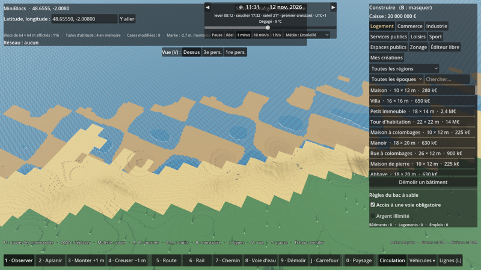 | 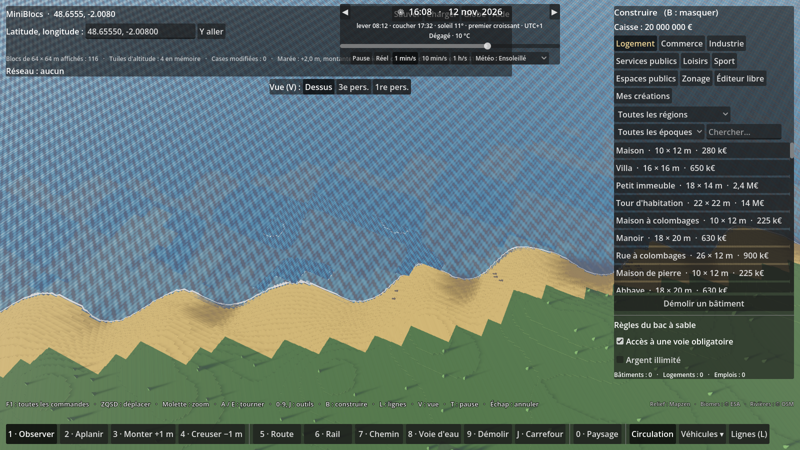 |

### Rivières, ruisseaux et lacs

Les cours d'eau sont de vraies cases d'eau creusées dans le relief (berges d'une ou deux marches), avec une eau animée : vagues, reflets, écume le long des berges et petites cascades quand le lit descend d'une marche. Les lacs viennent d'ESA WorldCover. Les rivières viennent d'OpenStreetMap (avec leur nom, même les ruisseaux de 1 m) quand le jeu peut joindre le service Overpass ; sinon le jeu les **calcule sur le vrai relief** en faisant « couler la pluie » : elles suivent les vraies vallées et s'élargissent vers l'aval. Les routes, rails et chemins posés au-dessus passent automatiquement **sur un pont**.

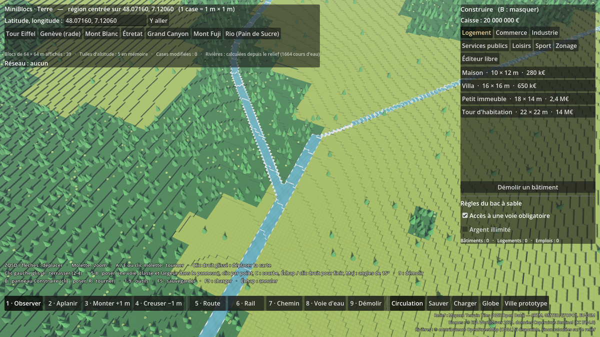

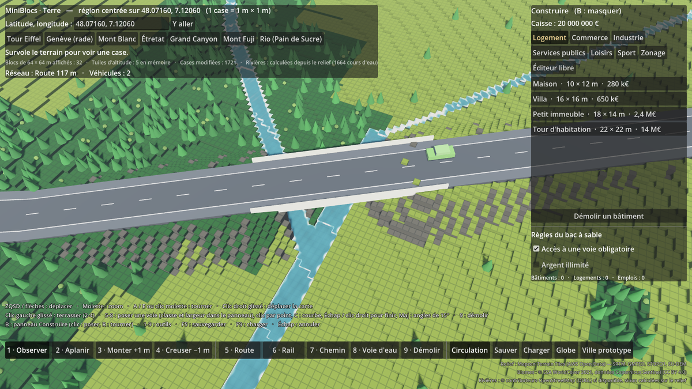

Comment ça marche, limites et prochaines étapes : [docs/terre-architecture.md](docs/terre-architecture.md).

## Transports : routes, rail, chemins et voies d'eau sur le vrai relief

Dans le mode Terre, la barre du bas propose **5 Route**, **6 Rail**, **7 Chemin** (piétons et vélos), **8 Voie d'eau**, **9 Démolir** et **J Carrefour**.

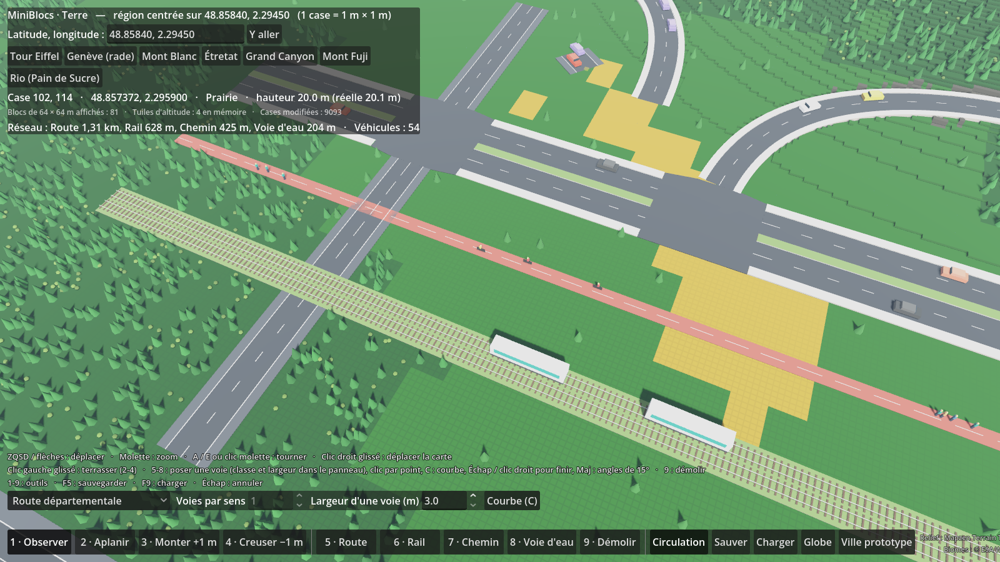

- **Classe et largeur** : un panneau au-dessus de la barre permet de choisir la classe de voie et ses réglages, toujours dans les limites des normes françaises (guide ARP, ICTAAL, CEREMA, SNCF Réseau) :

  | Outil | Classes | Réglages |
  | --- | --- | --- |
  | Route | Rue de desserte (30 km/h), avenue urbaine (50), route départementale (80), voie express (110), autoroute (130) | Voies par sens, largeur d'une voie (2,75 à 3,50 m selon la classe) ; trottoirs, accotements, bandes d'arrêt d'urgence et terre-plein ajoutés d'office |
  | Rail | Tramway, ligne classique, ligne à grande vitesse | Voie unique ou double voie (écartement 1,435 m, entraxe 3,00 / 4,20 / 4,50 m) |
  | Chemin | Chemin piéton, piste cyclable bidirectionnelle, voie verte | Largeur (1,40 à 5,00 m selon la classe) |
  | Voie d'eau | Voie navigable, chenal maritime | Largeur (12 à 60 m, chenal 60 à 400 m pour les grands navires) |

  Chaque classe a aussi sa **pente maximale** (rue 12 %, autoroute 5 %, ligne classique 25 ‰…) et son **rayon de courbure minimal** (rue 15 m, départementale 240 m, autoroute 665 m, LGV 4 000 m).
- **Tracer droit** : clic pour commencer, puis un clic pour chaque point. **Échap** ou **clic droit** pour arrêter. **Maj** : angles par pas de 15°.
- **Tracer en courbe** : touche **C** (ou bouton **Courbe**). Clic de départ, clic qui donne la direction, clic d'arrivée. En prolongeant une voie, la courbe part dans son prolongement : un seul clic suffit. Un virage plus serré que le rayon minimal de la classe est refusé.
- **Aperçu** vert (possible) ou rouge avec la raison : pente trop forte, virage trop serré, chevauchement, croisement à mauvaise hauteur…
- **Relief** : la voie monte et descend avec le terrain dans la limite de sa pente. Le jeu fait la plate-forme, des **talus** en pente douce (1 pour 1,5) jusqu'au terrain naturel, les **ponts** (creux, mer) et les **tunnels** (collines).
- **Carrefours sans superposition** : clique sur une voie existante pour t'y raccrocher (carrefour en T) ou croise-la : le carrefour se crée tout seul, les voies s'arrêtent à son bord et un plateau les relie. Une voie qui en recouvre une autre sans s'y raccorder est refusée. Route et rail (ou chemin) se croisent par un passage à niveau.
- **Véhicules** : ils viennent d'un **catalogue de 139 modèles** (voir plus bas), tirés au hasard parmi ceux qui peuvent rouler sur chaque voie : tramways sur les voies de tram, TGV sur les LGV, vélos et piétons sur les chemins, péniches sur les canaux, paquebots dans les chenaux. Bouton **Circulation** pour les masquer, menu **Véhicules ▾** pour choisir l'**époque** et la **région** de ce qui circule (par exemple : XIXe – 1945, Amériques).
- **Sauver / Charger** gardent le réseau avec le terrain.

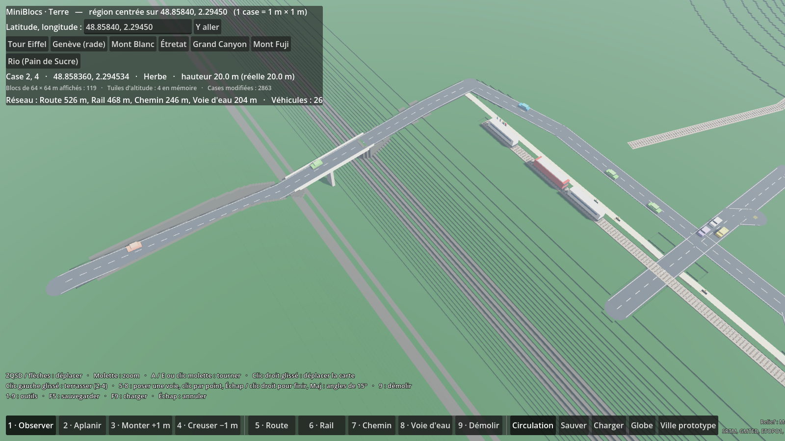

### Raccords des voies

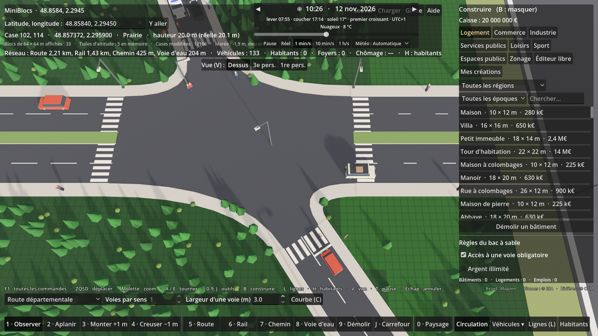

Quand deux tronçons se suivent presque en ligne droite (moins de 30° d'écart), ils se rejoignent bord à bord, sans joint. Leur chaussée, leurs trottoirs et leurs marquages sont coupés en onglet. Dans un virage plus serré et dans les carrefours, le plateau suit les bordures. Les trottoirs tournent à chaque angle en arc de cercle, d'une branche à la voisine. Aucun lampadaire ne se retrouve sur un plateau de carrefour. Sous un carrefour, le sol est mis au niveau de la chaussée, même en pente : il ne perce plus ni le plateau ni les trottoirs des angles, et aucun arbre n'y pousse. Le plateau est éclairé d'un seul ton, sans facettes. Les marquages s'arrêtent avant les passages piétons.  Une route en courbe (touche C) se raccorde aussi bord à bord au plateau.

### Carrefours : feux, stop, cédez-le-passage, priorité à droite

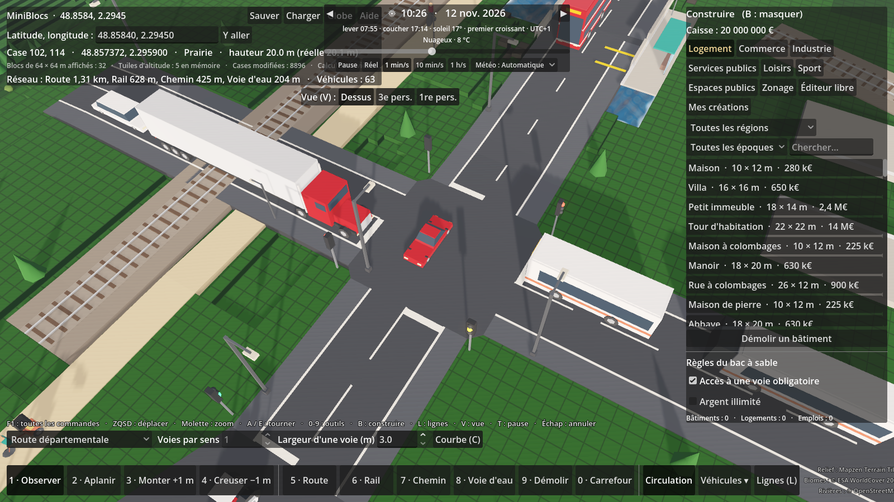

Chaque carrefour routier (3 branches ou plus) a un **régime**, choisi tout seul d'après les voies qui s'y croisent :

| Voies qui se croisent | Régime automatique |
| --- | --- |
| Rues de desserte entre elles | Priorité à droite |
| Avenues, départementales de même rang | Feux tricolores |
| Une voie secondaire sur une voie principale | Cédez-le-passage (stop si la principale roule à 80 km/h ou plus) |

L'outil **J Carrefour** change le régime d'un clic (automatique → feux → stop → cédez-le-passage → priorité à droite). Les feux, les panneaux et les lignes d'arrêt sont posés sur la chaussée.

**Giratoires** : avec l'outil **J Carrefour**, **Maj + clic** sur un carrefour le transforme en giratoire. Les branches sont coupées sur un cercle (rayon de 14 à 34 m selon la largeur des voies), un anneau à deux voies à sens unique les relie et un îlot central planté occupe le milieu. On tourne dans le sens inverse des aiguilles d'une montre, et on cède le passage à l'anneau en entrant.

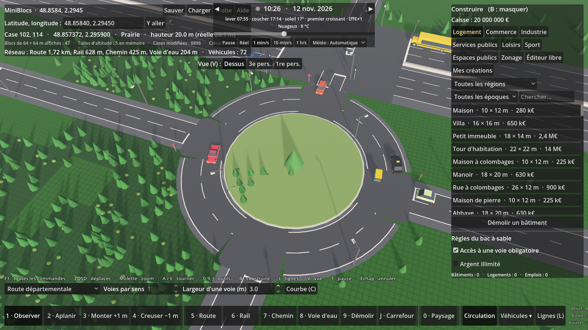

L'outil **J Carrefour** a trois boutons dans la barre du bas : **Régime**, **Rond-point** (un clic sur un carrefour suffit, sans Maj) et **Échangeur**.

### Ponts, tunnels et échangeurs d'autoroute

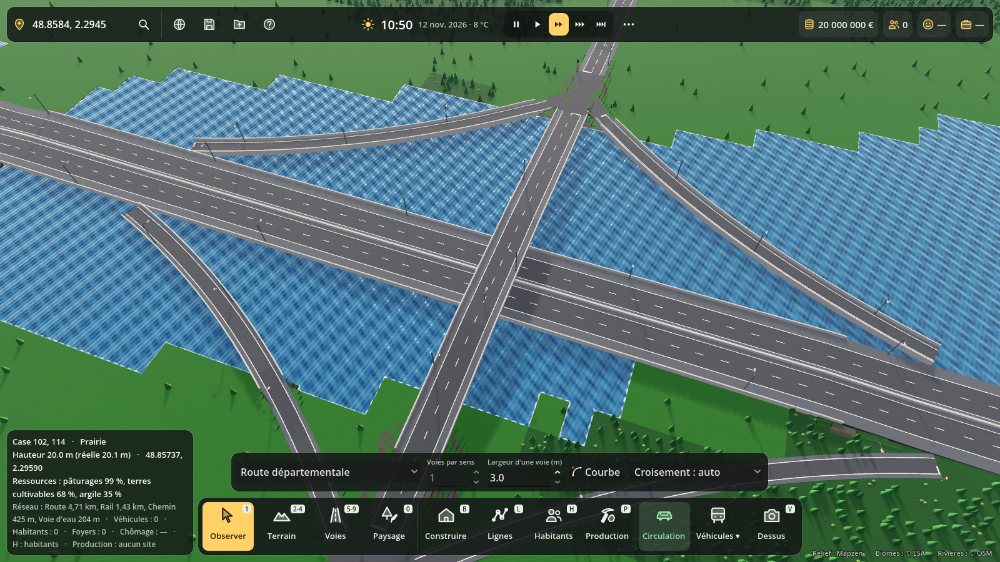

Les ponts et les tunnels se posent tout seuls quand le relief l'exige. Quand ta voie croise une autre voie, la touche **N** (ou la liste « Croisement » à côté du bouton Courbe) choisit ce qui se passe :

| Réglage | Au croisement |
| --- | --- |
| Automatique | Carrefour à niveau. Une autoroute ou une voie express n'est jamais coupée : on passe dessus par un pont (ou dessous si on arrive plus bas). |
| Passer dessus | Pont au-dessus de l'autre voie, avec 4,5 m de hauteur libre. Les rampes suivent la pente maximale de la classe. |
| Passer dessous | Tunnel sous l'autre voie, avec des tranchées d'accès de chaque côté. |

S'il n'y a pas la place pour les rampes avant le croisement, le tracé est refusé et le message donne la longueur qu'il faut.

**Bretelles** : la classe **Bretelle d'autoroute** (outil Route) est une voie à sens unique de 3,50 m. Elle part de l'autoroute en biais, sans carrefour : elle longe la bande d'arrêt d'urgence puis s'en écarte. Le sens de circulation est celui du tracé. Pour une sortie, on part de l'autoroute ; pour une entrée, on part de la route et on finit sur l'autoroute. On s'insère en cédant le passage, et on ne fait jamais demi-tour par-dessus le terre-plein. Une rue ne peut pas se raccorder directement à une autoroute.

**Échangeur tout prêt** : pose une route en travers d'une autoroute (elle passe dessus toute seule), puis outil **J > Échangeur** et clic sur le pont. Quatre bretelles se posent en losange : une sortie et une entrée dans chaque sens. Il faut au moins 220 m d'autoroute de part et d'autre du pont et 90 m de route.

Les véhicules **gardent leurs distances** (files d'attente), **freinent et accélèrent**, s'arrêtent à la ligne au rouge, marquent le stop, laissent passer les prioritaires et ne s'engagent pas si la sortie est bouchée. Les feux marchent par phases : deux branches face à face ont le vert ensemble, puis orange, rouge intégral et phase suivante.

### Stations et lignes de transport en commun

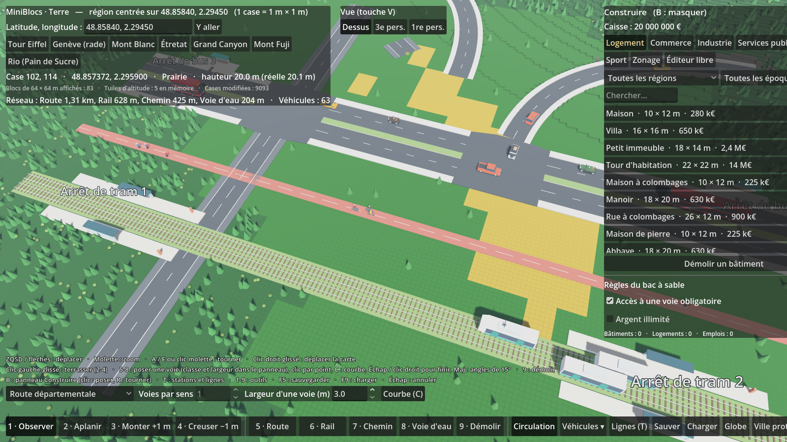

Bouton **Lignes (L)** (ou touche **L**) : le panneau des transports publics.

1. **Pose des stations** : arrêt de bus (sur une route), arrêt de tram (sur une voie de tram), gare (ligne classique ou LGV : quais, marquise et bâtiment voyageurs de la bible), port (jetée, grue et gare maritime sur une voie d'eau), **héliport**, **aérodrome** (piste en herbe de 600 m) et **aéroport** (piste de 1 000 m, aire de stationnement, aérogare, tour de contrôle ; **R** pour tourner, le terrain est aplani). Les stations du réseau coupent la voie à cet endroit ; les quais et les pistes sont réservés (pas d'arbres ni de bâtiments).
2. **Nouvelle ligne** : clique les stations dans l'ordre, puis **Entrée** (ou clic droit). Une ligne relie des stations du même genre, avec une voie entre chaque.
3. **Choisis le véhicule** dans le catalogue (bus à impériale, tram 1900, locomotive Pacific, bateau-bus, hélicoptère, gros-porteur…) et leur **nombre**. Ils font la navette d'un bout à l'autre et marquent l'arrêt 12 s à chaque station ; les avions roulent sur la piste, décollent, volent à 260 m et atterrissent.

Tout est gardé par **Sauver / Charger**.

### Métro souterrain

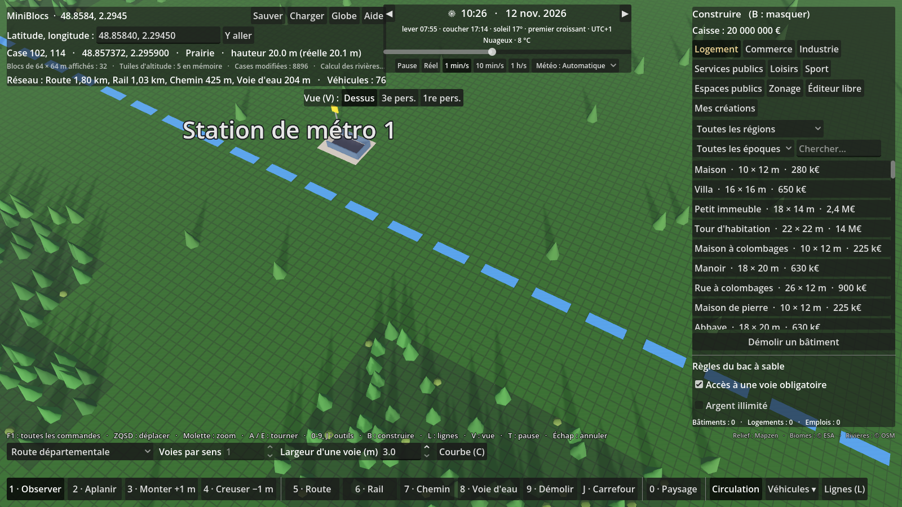

Dans l'outil **Rail**, choisis la voie **Métro** : elle est creusée à **14 m sous le sol** (tout en tunnel, sans terrassement en surface) et son tracé apparaît en **pointillés bleus** sur le sol. Les rues et les bâtiments passent au-dessus sans carrefour. Dans le panneau **Lignes**, pose des **stations de métro** sur la voie (quais souterrains de 80 m, bouche d'entrée en surface) et relie-les par une ligne : métro des débuts (1900), métro sur pneus, métro contemporain ou métro automatique.

### Montagne : crémaillère et viaducs

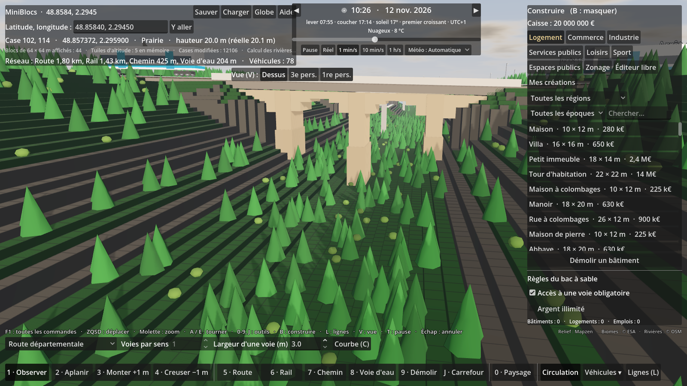

- **Chemin de fer à crémaillère** (outil **Rail**) : il monte jusqu'à **25 %** de pente, là où une ligne classique s'arrête à 2,5 %. Un rail denté court au milieu de la voie. Trois trains : locomotive à vapeur de 1891, rame électrique rouge des années 50, rame panoramique moderne. Une gare posée sur la crémaillère n'accueille que ces trains.
- **Viaducs** : quand une voie ferrée franchit une vallée, le pont est découpé en travées égales. Lignes classiques, tram et crémaillère ont des **piles en pierre avec fruit et des arches en plein cintre** (travées de 8 à 18 m selon la hauteur) ; la LGV a de grandes travées (jusqu’à 40 m) sur piles de béton. Les routes gardent leurs piles de béton.

### Itinéraires des habitants

Le jeu sait calculer le meilleur trajet d'un point à un autre : marche jusqu'à une station (800 m au plus), une ou plusieurs lignes de bus, tram, métro, train, bateau ou avion (correspondances à pied jusqu'à 250 m), puis marche jusqu'à l'arrivée. Il compte la vitesse des véhicules et des voies, l'attente moyenne (plus il y a de véhicules sur une ligne, moins on attend) et l'arrêt en station, et garde la marche seule quand elle est plus rapide. Les lignes de fret ne prennent pas de voyageurs. Chaque ligne affiche son **nombre de voyageurs** dans le panneau. Ce sont les habitants simulés qui s'en serviront pour aller à l'école, au travail ou à leurs loisirs.

### Fret : marchandises par la route, le rail et l'eau

- **Dépôt de marchandises** (panneau **Lignes**) : entrepôt, quai de chargement et conteneurs au bord d'une route. Une ligne entre deux dépôts fait rouler des **camions** (camionnettes, semi-remorques, citernes, grumiers, porte-conteneurs… ou charrettes pour les époques anciennes).
- **Trains et bateaux** : la case **Fret** d'une ligne de train ou de bateau la passe aux marchandises. Les trains deviennent des trains de fret (vapeur 1905, diesel américain, électrique moderne) et les bateaux des péniches, cargos ou porte-conteneurs.
- Chaque ligne de fret compte les **tonnes transportées** : chaque véhicule qui arrive à une station décharge sa charge utile (environ 22 t pour un semi-remorque, 50 t par wagon, 1 000 t pour une péniche).

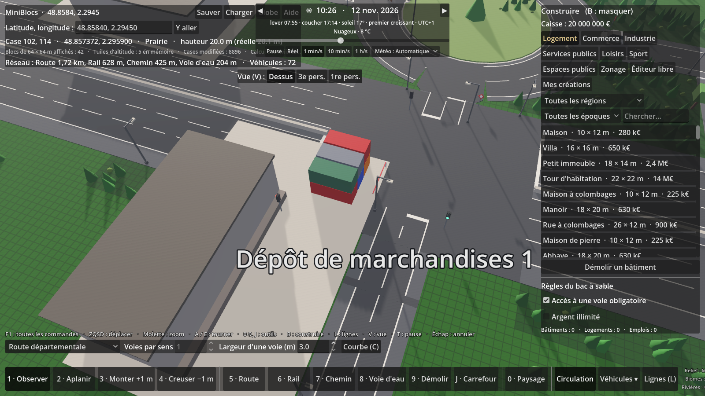

### Piétons, passages piétons et vélos

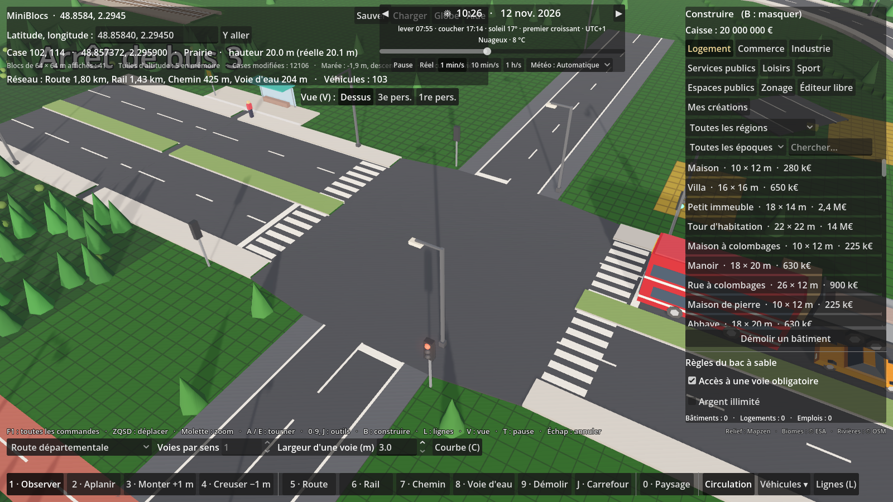

- **Piétons sur les trottoirs** : les rues et les avenues ont leurs promeneurs (un tous les 20 m environ, 120 au plus), au milieu du trottoir. Ils vont de rue en rue et ne font demi-tour qu'au bout d'une impasse.
- **Passages piétons** : chaque branche à trottoirs d'un carrefour géré (feux, stop, cédez-le-passage, priorité à droite, giratoire) a ses bandes blanches, avec la ligne d'arrêt reculée juste derrière. Les piétons y traversent :
  - aux feux, quand les voitures de leur branche ont le rouge ;
  - ailleurs, quand aucune voiture n'arrive.
  Une fois un piéton engagé, les voitures s'arrêtent avant le passage et n'entrent pas dans le carrefour pour sortir par cette branche.
- **Vélos sur la chaussée** : vélos de ville, vélos cargos, grands-bis et cyclo-pousses roulent aussi sur les rues et les avenues, serrés à droite de la voie de droite (jamais sur les départementales rapides, voies express et autoroutes). Ils ralentissent les voitures derrière eux, comme en vrai.

### Parkings

Le panneau **Lignes (L)** propose aussi le **Parking** : 26 places en épi droit au bord d'une rue, d'une avenue ou d'une départementale. Une partie des voitures, utilitaires et deux-roues de passage y vont, se garent sur une place libre de 40 s à 2 min 40, puis repartent quand la voie est libre.

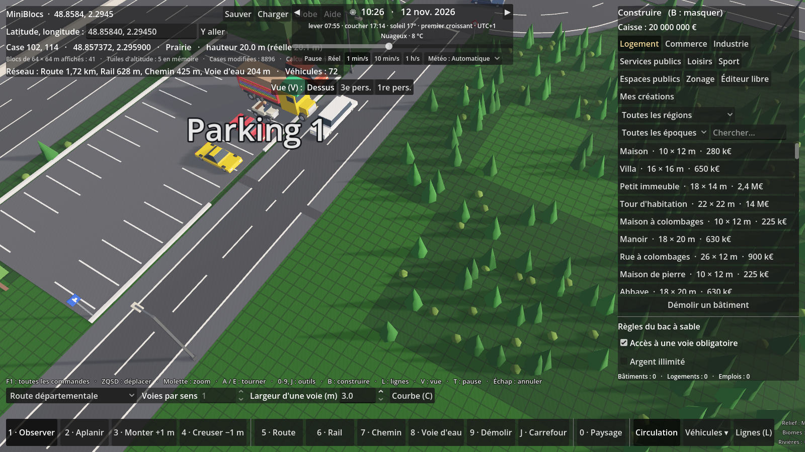

### Le catalogue de véhicules

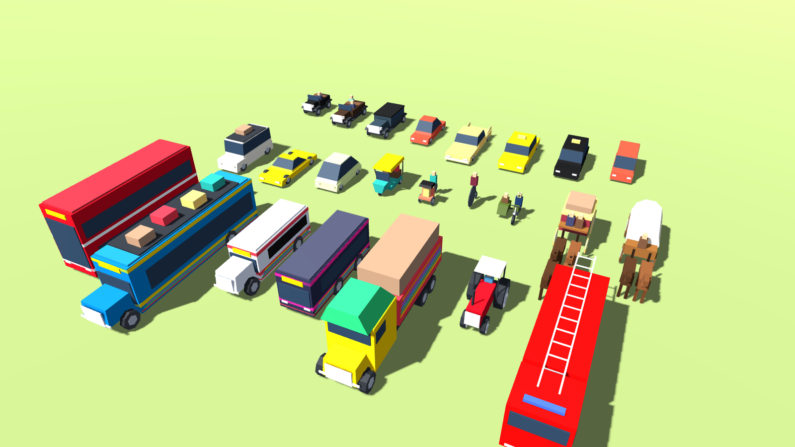

139 modèles low-poly fabriqués en code, à l'échelle réelle, avec leur vitesse et leur nombre de places. Ils utilisent les **époques et régions de la bible** des bâtiments (Antiquité → futuriste, Europe, Amériques, Afrique, Moyen-Orient, Asie de l'Est, Asie du Sud…) :

| Catégorie | Exemples |
| --- | --- |
| Voitures (22) | voiture sans chevaux 1900, torpédo, berline des années 30, américaine à ailerons, mini citadine, taxi jaune de New York, taxi londonien, kei car japonaise, 4×4 de brousse, pick-up, électrique, supercar, capsule autonome |
| Utilitaires (12) | camionnette des années 30, semi-remorque, camion américain à long capot, citerne, grumier, porte-conteneur, pompiers, ambulance, camion décoré d'Asie du Sud, tracteur |
| Bus (12) | autobus à plateforme, bus à impériale, bus scolaire jaune, bus articulé, trolleybus, matatu, bus coloré d'Amérique centrale, jeepney, navette autonome |
| Deux et trois roues (11) | grand-bi, vélo, vélo cargo, trottinette, scooter, side-car, moto-taxi, tuk-tuk, cyclo-pousse, pousse-pousse |
| Attelages (5) | charrette, calèche, diligence, chariot bâché, omnibus à chevaux |
| Tramways (5) | tram 1900, tram à câble de San Francisco, tram des années 50, tram à étage, tram moderne articulé |
| Trains (13) et wagons | vapeur des débuts, américaine à chasse-buffles, Pacific, train de luxe, diesel de fret (et ses wagons), électrique, autorail, régional, métro, TGV, train japonais à nez long, train magnétique |
| Bateaux (20) | pirogue, pirogue à balancier, gondole, drakkar, jonque, sampan, felouque, boutre, caravelle, bateau à aubes, péniche, bateau-bus, remorqueur, voilier, ferry, porte-conteneurs, paquebot à quatre cheminées, navire de croisière |
| Aéronefs (12) | montgolfière, dirigeable, biplan, hydravion, avion à hélices, turbopropulseur, court-courrier, gros-porteur, supersonique, jet d'affaires, hélicoptère, taxi volant |

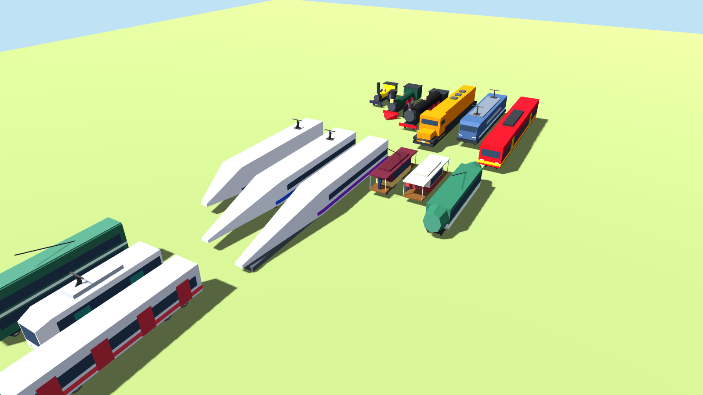

Pour voir tout le catalogue : `godot --path . --script res://tests/vehicules_vitrine.gd -- --screenshot v.png --cat bateau` (catégories : `voiture`, `utilitaire`, `bus`, `deux_roues`, `attelage`, `tram`, `train`, `wagon`, `bateau`, `avion`).

Architecture, feuille de route et questions ouvertes : [docs/transport-architecture.md](docs/transport-architecture.md).

## Bâtiments : poser des bâtiments à l'échelle réelle

Dans le mode Terre, le panneau **Construire** (à droite, **B** pour le masquer) propose **près de 400 bâtiments** low-poly à l'échelle réelle (27 modèles classiques, 33 espaces publics et une bible de 334 bâtiments de 43 styles du monde, voir plus bas) (1 case = 1 m), rangés en sept catégories : **Logement**, **Commerce**, **Industrie**, **Services publics**, **Loisirs**, **Sport** et **Espaces publics** (maison 10 × 12 m, tour d'habitation de 41 m, supermarché et son parking, hôpital, terrain de football de 105 × 68 m…).

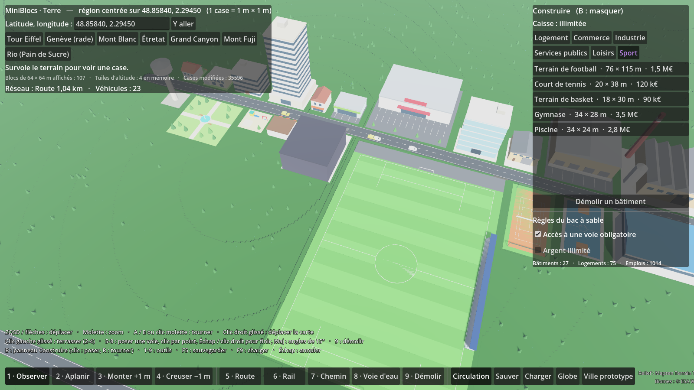

- **Poser** : choisis un bâtiment dans la liste. Un fantôme suit la souris, vert si c'est possible, rouge sinon avec la raison. Clic gauche pour poser, **R** pour tourner d'un quart de tour, **clic droit** ou **Échap** pour arrêter.
- **Orientation** : tant que tu n'appuies pas sur R, la façade se tourne toute seule vers la route la plus proche. Un trait jaune relie la porte à la voie qui la dessert.
- **Terrassement** : le terrain est aplani sous le bâtiment, avec un petit talus autour. Refusé si le dénivelé dépasse 12 m, dans la mer, sur un lac ou une rivière, sur une voie ou sur un autre bâtiment. Une voie ne peut plus traverser un bâtiment.
- **Règles du bac à sable** (cases à cocher dans le panneau) : **accès à une voie obligatoire** (route, ou chemin pour les parcs, terrains de sport, écoles…, à moins de 10 m de la porte) et **caisse** de départ de 30 M€ en mode Normal : chaque bâtiment a un prix, plus le terrassement. **Argent illimité** pour construire librement.
- **Démolir un bâtiment** : bouton du panneau, puis clic sur le bâtiment (la moitié du prix est rendue, le terrain reste aplani).
- **Sauver / Charger** gardent les bâtiments, les zones, les blocs et la caisse avec le terrain et le réseau.

### Zonage : laisser la ville pousser

L'onglet **Zonage** du même panneau permet de peindre des zones **résidentielles**, **commerciales** ou **industrielles** (clic gauche glissé, 2 € le m², 300 m de côté au maximum). Tu choisis librement entre poser toi-même et laisser pousser, et tu peux mélanger les deux.

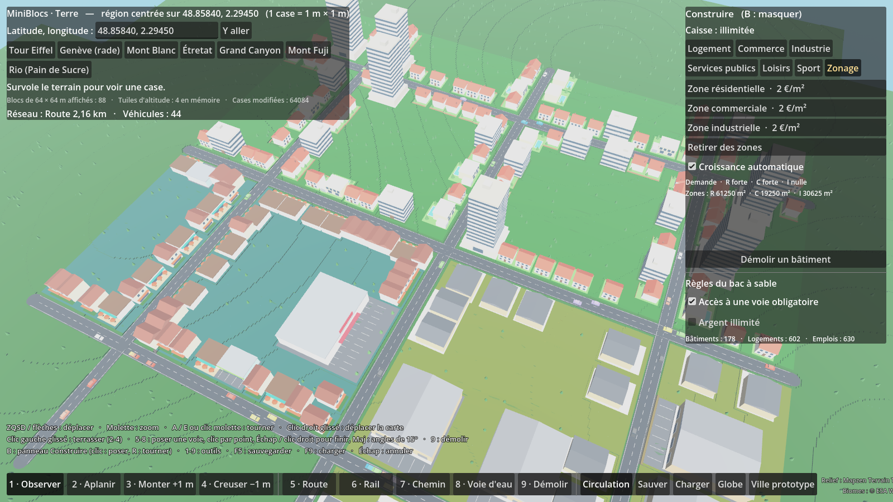

- Les bâtiments **poussent tout seuls le long des routes** de la zone, façade vers la rue, sur le relief aplani. Ils ne coûtent rien au joueur (ce sont des constructions privées).
- **Demande** affichée dans le panneau : il vient toujours des habitants, d'autant plus qu'il y a du travail ; commerces et industries s'installent selon la population.
- **Retirer des zones** : glisser sur la zone à effacer (une zone coupée en partie est redécoupée). Les bâtiments déjà construits restent.
- Case **Croissance automatique** pour mettre la ville en pause.

### La bible : styles du monde, de l'Antiquité au futur

Les listes du panneau mélangent les modèles classiques et la **bible** : 43 styles d'architecture, chacun décliné en archétypes (maison, immeuble, boutique, marché, usine, ferme, lieu de culte, palais, école, gare, théâtre, jardin…).

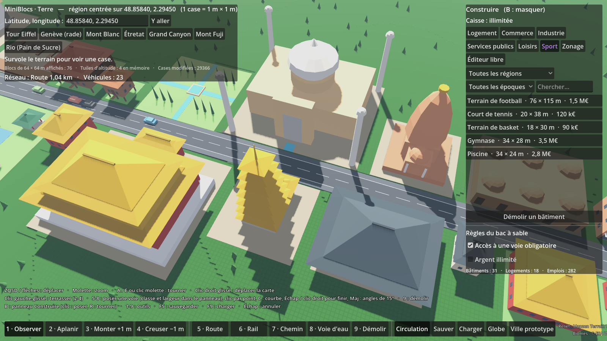
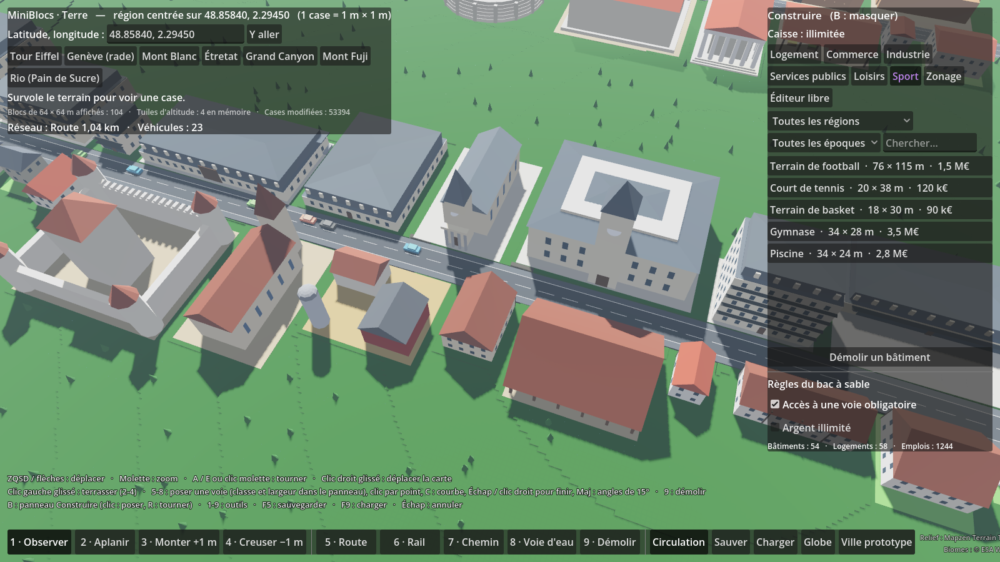

- **Régions** : Europe, Méditerranée, Moyen-Orient et Maghreb, Afrique, Asie de l'Est, Asie du Sud et du Sud-Est, Amériques, Océanie, Monde.
- **Époques** : Antiquité, Traditionnel, XIXe – 1945, Moderne, Contemporain, Futuriste.
- **Exemples** : colombages, gothique (cathédrale), haussmannien, briques industrielles, scandinave (stavkirke), isba (église à bulbes, kremlin), Grèce antique (temple, amphithéâtre), méditerranéen, Maghreb (kasbah), persan, Golfe, Sahel (mosquée en terre, cases rondes), Afrique australe (kraal), Afrique moderne, chinois (pagode, Cité interdite), japonais (sanctuaire, château), Asie dense (néons), Inde (temple shikhara, palais moghol), Asie du Sud-Est (maisons sur pilotis, wat), pueblo, précolombien (pyramide), colonial, latino, Art déco, banlieue américaine, style international, tours de verre, futuriste.
- **Deuxième vague** : chalet alpin, pignons hollandais, Tudor anglais, soviétique, Rome antique (domus, insula, Colisée, forum), Égypte antique, ottoman (grand bazar, mosquée impériale), côte swahilie, hanok coréen, khmer (temple d'Angkor), Far West (saloon, ranch), brutaliste, polynésien (faré), Queenslander australien, maori (wharenui).

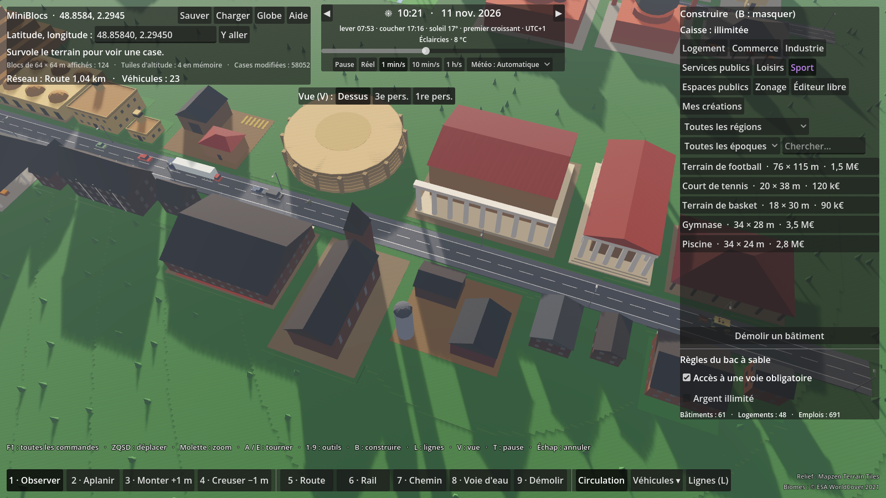

- **Filtres** en haut de la liste : région, époque et recherche par nom (« pagode », « gare », « japonais »…).
- **Zonage par style** : dans l'onglet Zonage, choisis le **Style** avant de peindre une zone. Les bâtiments qui y poussent suivent ce style (« Classique MiniBlocs » par défaut, ou « Mélange de tous les styles »). Chaque zone garde son style.

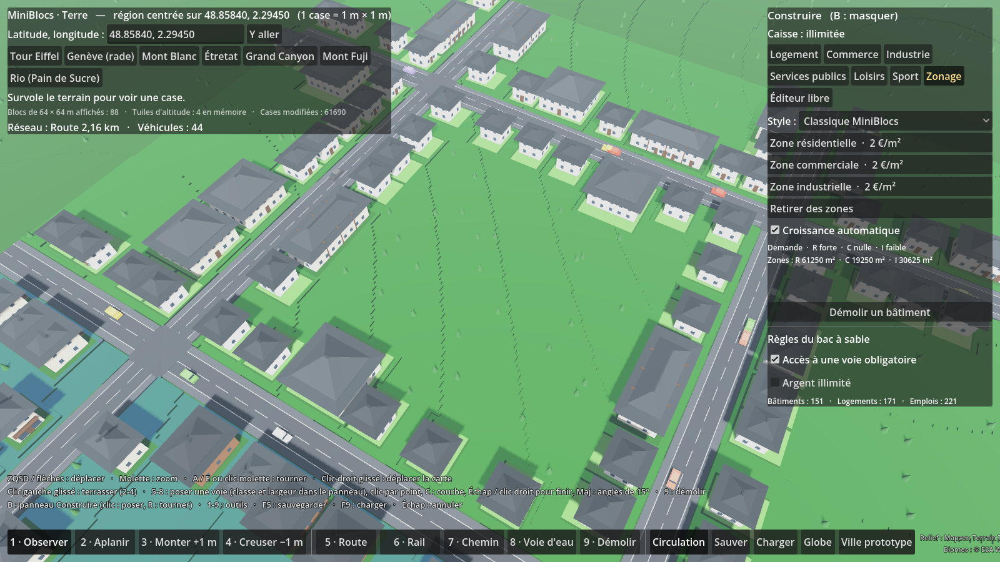

Pour ajouter un style : une entrée dans `Styles.STYLES` (`scripts/catalogue/styles.gd`) avec sa région, son époque, ses couleurs, son toit et ses archétypes ; le modèle 3D est fabriqué par `StyleBuilder`.

### Espaces publics : places, parcs, monuments et mobilier

L'onglet **Espaces publics** regroupe :

- **Places et parcs** : place pavée avec fontaine, piazza à obélisque, square, kiosque à musique, jardin à la française, parc et son lac, aire de pique-nique, skatepark, jardin partagé, esplanade moderne.
- **Monuments** : obélisque, statue équestre, arc de triomphe, torii, stupa, mâts totémiques, sculpture moderne.
- **Mobilier urbain** : bancs, lampadaires, réverbères, lanternes de pierre, arbres d'alignement, palmiers, cerisiers, fontaine à boire, abribus, corbeilles, cabine téléphonique, colonne d'affichage, station de vélos, terrasse de café, jardinières, kiosque à journaux. Le mobilier se pose **sans voie d'accès**.

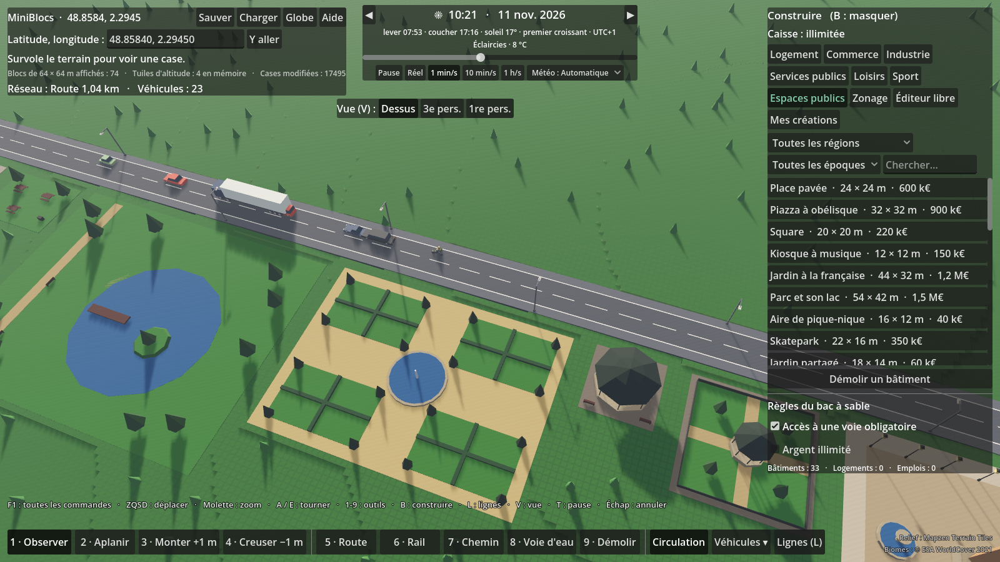

### Poser le long d'une route

Près d'une route (ou d'un chemin pour les bâtiments qui en demandent un), le bâtiment se cale tout seul : façade parallèle à la route au point le plus proche, même dans un virage, porte à 1,5 m du bord de la chaussée. Le rez-de-chaussée se met à la hauteur de la route, et un parvis de 3 m de large relie la porte à la chaussée (terrassement compris dans le prix). **R** reprend la main : quarts de tour sur la grille, sans calage.

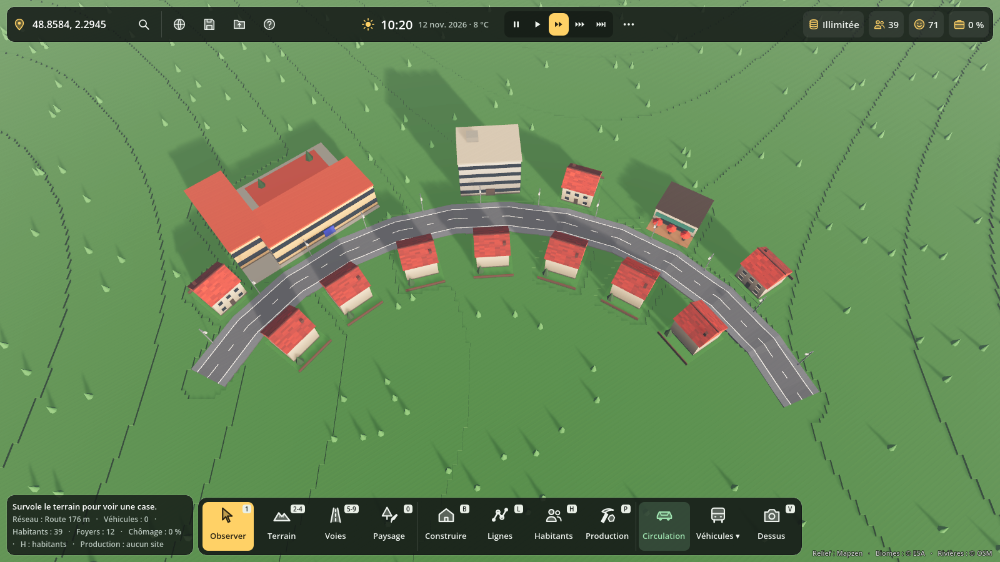

### Éditeur libre : murs, étages et intérieurs

L'onglet **Éditeur libre** a deux modes : **Murs et étages** (par défaut) et **Blocs**. Les cases du terrain font 1 m, mais un vrai mur fait 20 cm : en mode Murs et étages, les murs se posent **sur les lignes de la grille**, entre deux cases. Une pièce de 4 × 4 cases garde donc 4 m de côté, et une cloison ne mange aucune case.

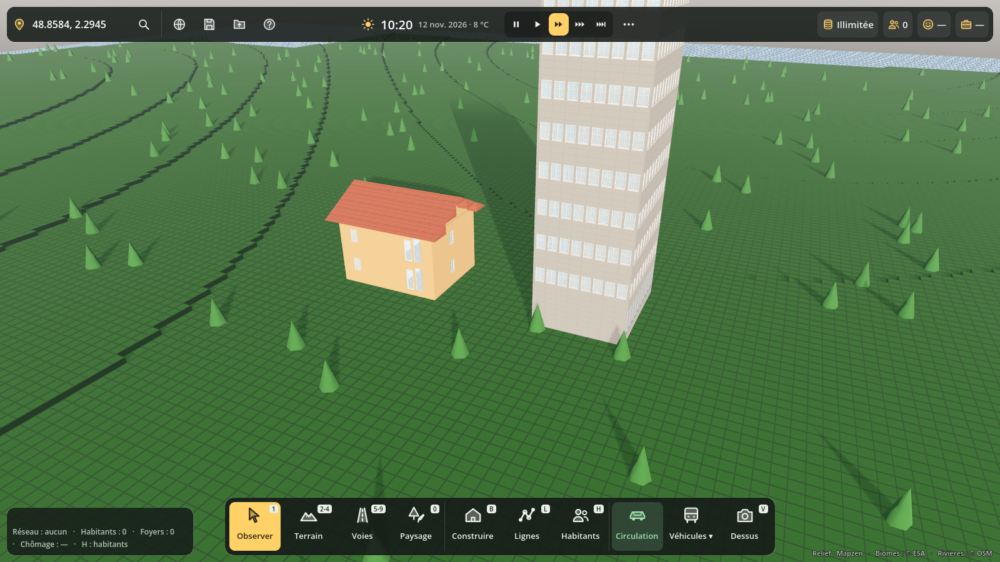

- **Mur** : clic glissé d'un coin de case à l'autre. **Pièce** : clic glissé en rectangle, qui pose les quatre murs et le plancher d'un coup. **Sol** : plancher, terrasse ou balcon.
- **Portes et fenêtres** dans les murs : porte, porte vitrée, porte-fenêtre, passage, fenêtre à croisillons, fenêtre haute, baie vitrée, vitrine. Un clic près d'un mur ; clic droit pour retirer l'ouverture. En vue au sol, **E** ouvre ou ferme les portes.
- **Peinture** : chaque côté d'un mur a son matériau et sa teinte (crépi dehors, plâtre ou carrelage dedans). Un clic peint un côté de mur ou un sol ; un clic glissé peint toute une pièce (un matériau de sol peint les sols, les autres peignent les murs).
- **Étages** : **Page haut / Page bas** (ou ▲ ▼ dans le panneau) changent l'étage actif, de 5 sous-sols à 59 étages, 3 m par étage. Les étages du dessus sont masqués pendant l'édition (**Vue en coupe**), toit compris. Sous le rez-de-chaussée et les sous-sols, le terrain est creusé tout seul, et rebouché si on efface.
- **Escalier** : 4 cases de long, 12 marches, vers l'étage du dessus (la trémie est ouverte toute seule) ; **R** le tourne.
- **De plain-pied** : le plancher du rez-de-chaussée affleure le sol, ou la chaussée si une route passe à moins de 12 m ; la porte est donc au niveau du trottoir. **Au ras du sol** remet un bâtiment déjà construit à ce niveau (le toit suit).
- **Murs et pièces sur N étages** : un réglage du panneau fait monter un trait de Mur ou un rectangle de Pièce sur plusieurs étages d'un coup, à partir de l'étage actif.
- **Copier l'étage ↑** recopie l'étage actif au-dessus, autant de fois que demandé : un immeuble de 12 étages se fait en quelques clics.
- **Toit** : deux pans, quatre pans ou plat, posé en blocs sur le dernier étage (le matériau de toit choisi, ou de la tuile), avec un débord d'un mètre et des pignons. On le retouche ensuite avec les blocs.
- Mêmes règles que le reste : chaque mètre de mur, de sol, chaque ouverture a un prix ; **Ctrl+Z** annule ; ni voie ni bâtiment dans un bâtiment en murs fins.

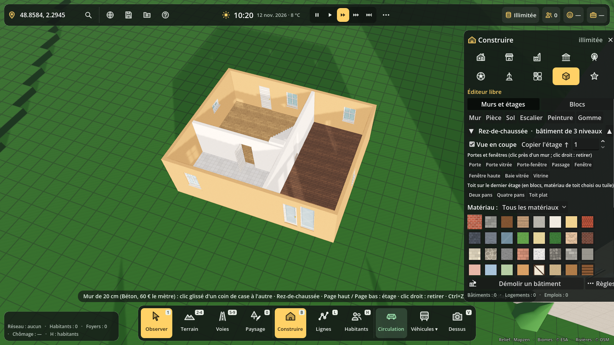

### Intérieurs : meubles, pièces et bâtiments meublés

L'onglet **Intérieur** (icône fauteuil) du panneau Construire aménage les bâtiments en murs fins :

- **Bâtiments meublés, prêts à visiter** : maison familiale, petit immeuble (4 niveaux), école, boutique, bureaux, café. Un clic les pose avec leurs pièces, portes, fenêtres, escaliers, toit et tous leurs meubles, dans le style choisi. On y entre en vue au sol (**V**) et les portes s'ouvrent avec **E**.
- **Meubler une pièce** : un clic dans une pièce la meuble selon sa fonction (séjour, cuisine, chambre, chambre d'enfant, salle de bain, entrée, bureau, salle de classe, boutique, salle de restaurant, réserve). La fonction est devinée (taille, carrelage, place dans le bâtiment) ou choisie avec l'outil **Fonction**. **Meubler tout** aménage tout le bâtiment.
- **Pose libre, à la manière des Sims** : chaque meuble du catalogue se pose case par case, comme les blocs (**R** tourne, clic droit retire, **Ctrl+Z** annule, **Page haut / Page bas** change d'étage). Trois couches : au sol (tapis), les meubles, au mur (cadres, étagères, appliques). Un meuble ne traverse pas un mur et ne bouche pas un escalier.
- **La bible des meubles** : 79 types de meubles et d'objets × 32 styles du monde et de toutes les époques (romain, égyptien, Louis XV, victorien, rustique, provençal, marocain, persan, majlis, Afrique de l'Ouest, swahili, japonais, chinois, coréen, indien, balinais, mexicain, andin, polynésien, far west, art déco, mid-century, années 70, scandinave, industriel, contemporain, luxe, futuriste…), soit plus de 2 000 meubles, filtrables par pièce, par style et par nom.
- **Les meubles comptent** : chaque meuble apporte du confort, de l'attractivité et de la valeur. Le panneau montre les logements, lits, emplois et places d'un bâtiment, ce qui manque (pas de lit, pas de cuisine…), sa valeur et son loyer. Le confort change la satisfaction des habitants, l'attractivité attire les clients des boutiques et des cafés, la valeur pèse sur le loyer et la taxe foncière.
- **Les habitants y vivent** : ils emménagent dans les logements meublés, travaillent dans les boutiques, bureaux et écoles meublés, et on les voit dans les pièces à leurs heures : couchés dans leur lit la nuit, assis au séjour ou à table, au bureau, au tableau, à la caisse, à leur pupitre.

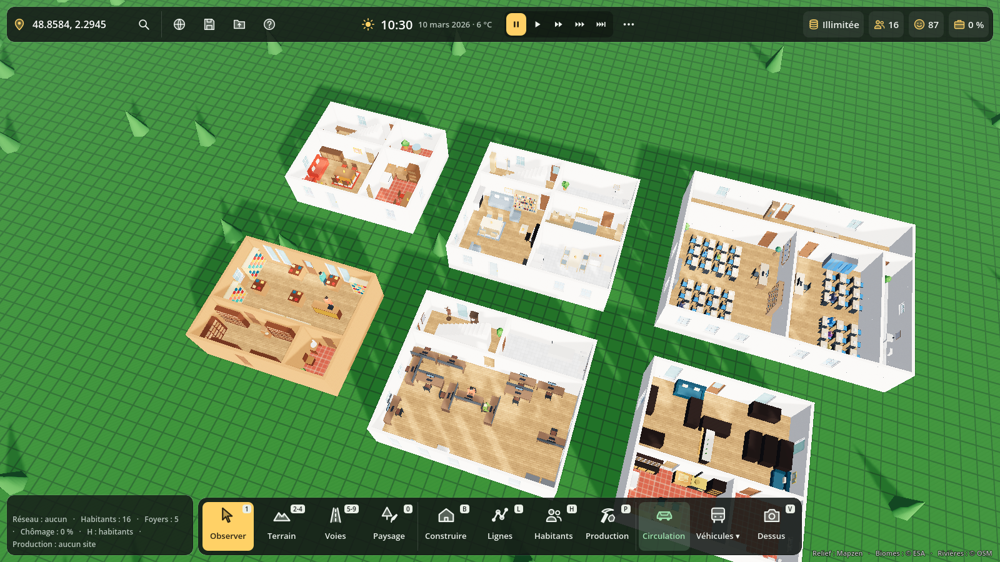
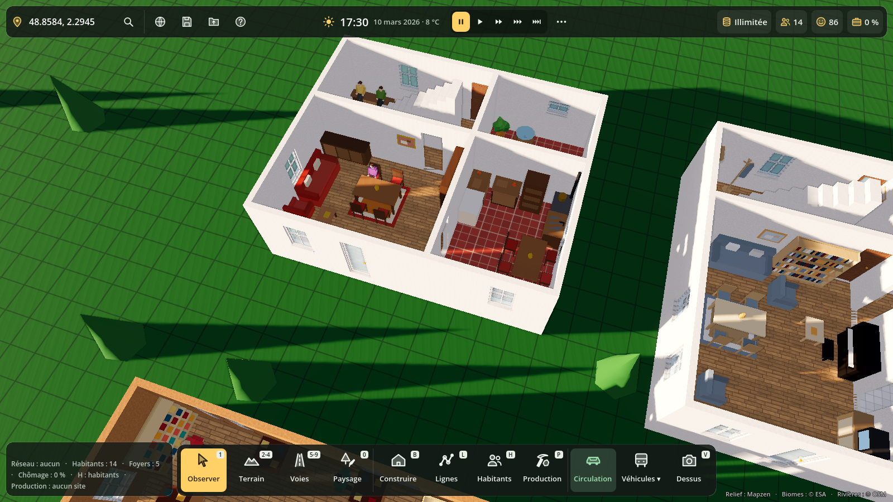
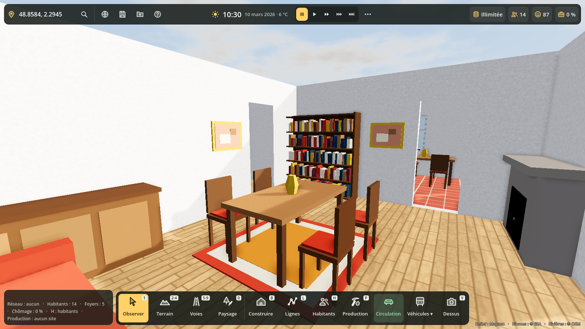
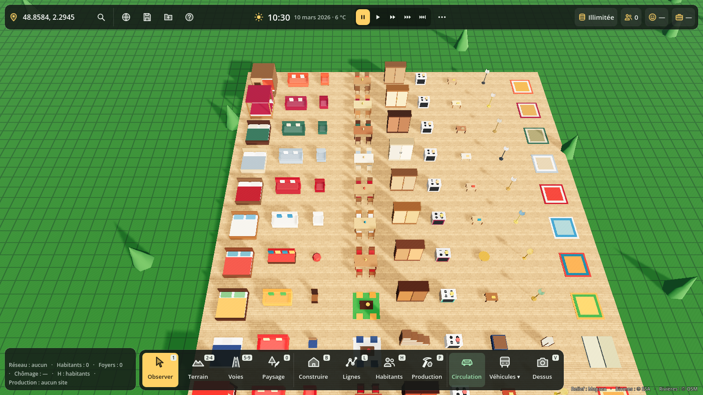

### Personnaliser un bâtiment, banque de modèles et atelier

- **Personnaliser** : clic sur un bâtiment du catalogue (outil 1), puis « Personnaliser » sur sa fiche. On change les couleurs (murs, toit, boiseries, volets, porte, vitres) dans le nuancier du style ou en couleur libre, la forme du toit (deux pans, quatre pans, terrasse, mansarde, bords relevés, appentis, chaume), le nombre d'étages, la pente du toit et la variante. Seul ce bâtiment change ; un bouton applique le même réglage à tous les bâtiments du même modèle. Tout est gardé dans la partie.
- **Ouvrir l'intérieur** (maisons, immeubles, boutiques, restaurants, bureaux, ateliers, écoles) : le bâtiment est reconstruit en murs fins à sa place, avec ses couleurs (matériaux les plus proches), découpé en pièces (entrée et escalier, séjour, cuisine, chambres, salle de bains ; salle de vente et réserve pour une boutique, logement au-dessus) et meublé dans un style proche du sien. On y entre (V), on le meuble (onglet Intérieur) et on peut déplacer ses murs. Les petits ornements du modèle (corniches, cheminée) disparaissent.
- **Bâtiments modélisés dans Blender** : ils se personnalisent aussi (couleurs des murs, du toit, des encadrements, des volets, de la porte et des vitres ; la forme reste celle du modèle). Les maisons, immeubles, hôtels, boutiques, cafés, restaurants, bureaux et écoles (79 modèles) s'ouvrent en murs fins : le volume des murs et le nombre d'étages sont lus dans le modèle.
- **Vue par étage** (mode Gérer) : **Page bas** enlève l'étage du haut de tous les bâtiments en murs fins autour de la caméra, toit compris ; **Page haut** le remet ; **Origine** montre tout. Une petite échelle s'affiche en haut de l'écran (▼ ▲ « Tout voir »). Les meubles et les habitants suivent : on voit qui dort, mange ou travaille à chaque niveau. Les bâtiments encore fermés (catalogue, Blender) s'ouvrent avec « Ouvrir l'intérieur ».
- **Banque de modèles** (mode Créer, touche 6) : chaque bâtiment personnalisé ou en murs fins s'enregistre avec un nom et des étiquettes (type, style, région, époque, couleurs, étages, pièces, taille). On cherche, on filtre, on repose. « Exporter » crée un fichier à envoyer, « Importer » lit ceux reçus (dossier d'échange). Chaque modèle est rangé comme un objet du Steam Workshop (un dossier avec `modele.json` et `apercu.png`), pour le partage entre joueurs quand le jeu sera sur Steam.
- **Atelier** (bouton du globe, ou touche 7 en mode Créer) : un terrain plat, sans habitants ni argent ni météo, pour créer et retoucher des bâtiments, puis les ranger dans la banque. Depuis une partie, elle est sauvegardée avant d'ouvrir l'atelier, et « Quitter » (7) y ramène. L'atelier garde ce qu'on y a laissé.

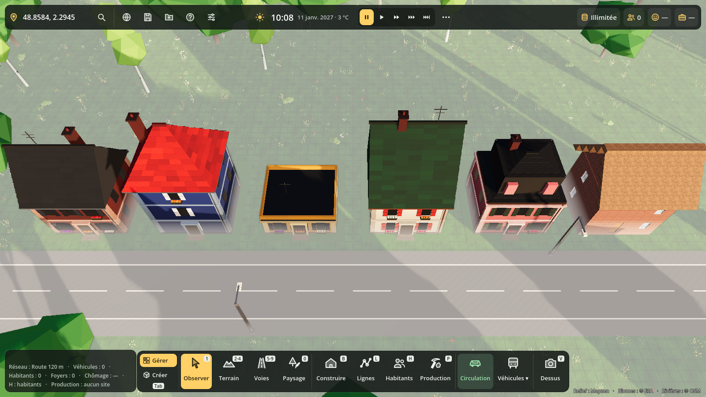
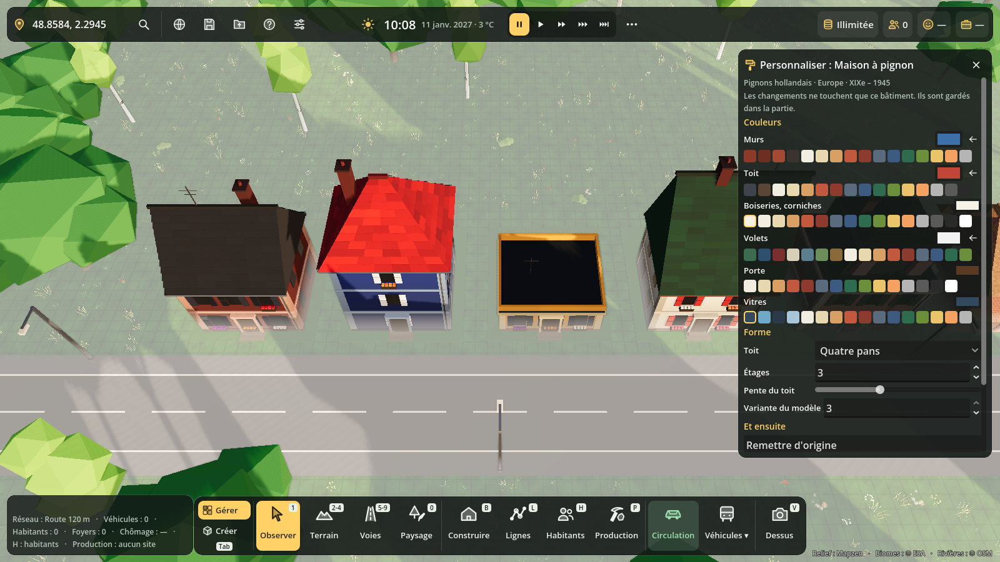
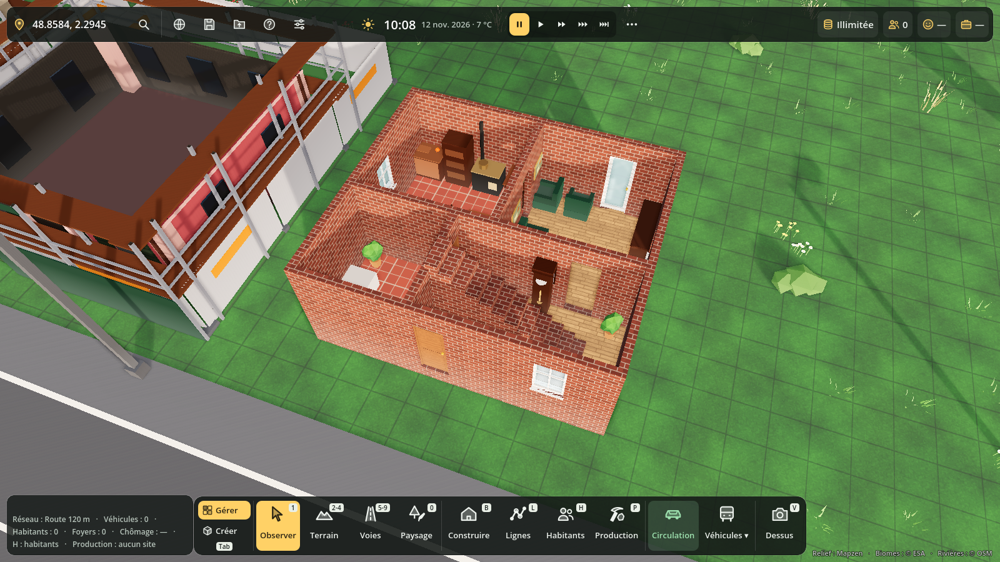
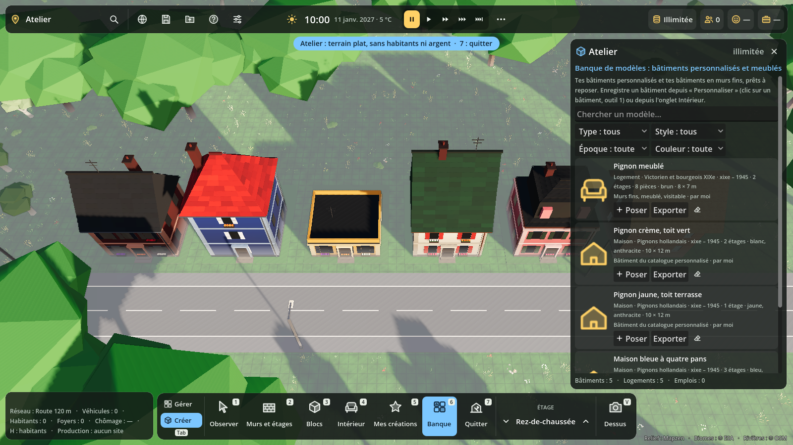
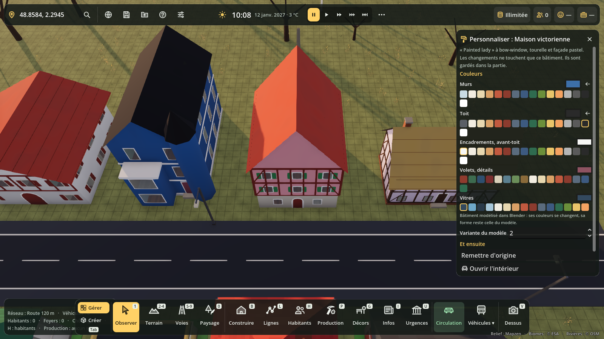
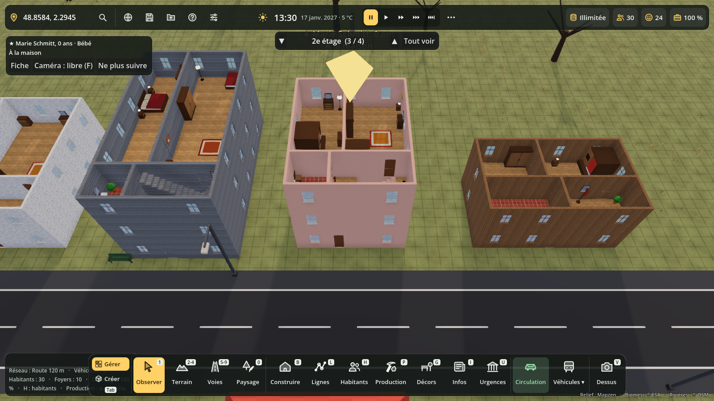
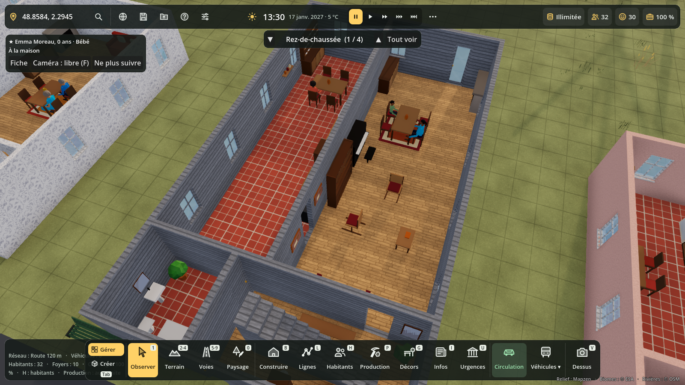

### Éditeur libre : construire bloc par bloc

L'onglet **Éditeur libre** permet de construire ce que tu veux avec des blocs de 1 m × 1 m × 1 m, posés sur le relief ou les uns contre les autres.

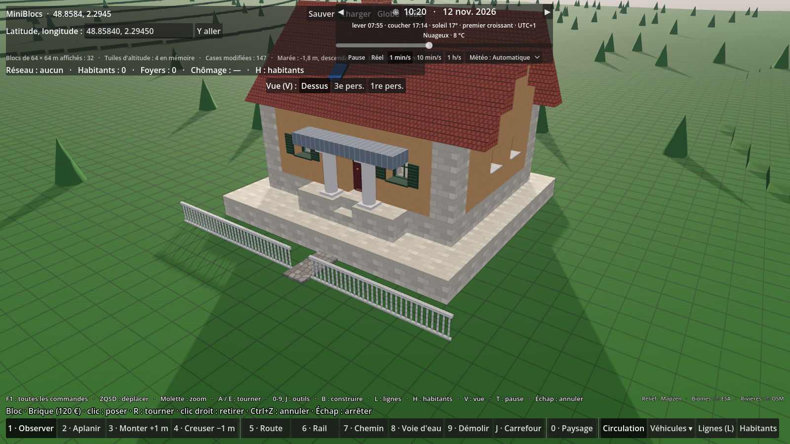

- **Outils** : **Poser** (un clic = un élément de la forme choisie, sur le sol ou sur la face visée d'un autre bloc), **Rectangle** (clic glissé : dalle, plancher, toit plat), **Mur** (clic glissé en ligne, hauteur réglable) et **Gomme** (clic sur un bloc, ou glissé pour effacer un étage).
- **Clic droit** court : retirer le bloc visé. **Ctrl+Z** : annuler. **Échap** : arrêter.
- **58 matériaux texturés**, dessinés par le jeu (aucun fichier image) et rangés par famille (menu **Matériau**) :
  - murs : briques, pierre de taille, moellons, granit, grès, marbre, parpaing, béton brut, crépis de couleur, colombage, torchis, terre crue ;
  - toits : tuile canal, tuile plate, tuile vernissée, ardoise, bardeaux, chaume, tôle ondulée, zinc ;
  - sols : parquets, carrelage, damier, tomettes, moquette, pavés ;
  - bois : rondins, bardages, bois peint, bambou ;
  - métal et verre : métal, fer forgé, cuivre, or, verre clair, verre fumé, vitrail ;
  - nature : herbe, sable, gravier, terre, neige, feuillage.
- **Teinte** : 16 couleurs de peinture, appliquées à n'importe quel matériau (porte rouge, volets verts…).
- **Formes** :
  - bloc, demi-bloc (visé sur le haut d'une face : demi-bloc du haut), escalier, revêtement de 10 cm, cloison, poteau, colonne, poutre, vitre ou panneau, garde-corps ;
  - toits : pente à 45°, pente douce en deux moitiés, arêtier, noue ;
  - portes et fenêtres : fenêtre à croisillons, fenêtre à volets, baie vitrée, fenêtre de toit, porte à panneaux (2 m), porte-fenêtre, porte de garage (à assembler avec l'outil Mur).
- **Orientation** : escaliers, pentes, portes et fenêtres se tournent tout seuls selon la direction de la caméra ; **R** ajoute un quart de tour.
- **Ouvrir une porte** : en vue au sol (V), **E** ou **clic gauche** en regardant la porte. Les portes de garage s'ouvrent d'un bloc.
- Chaque élément a un prix (matériau × forme), payé par la caisse ; la moitié est rendue quand on le retire.

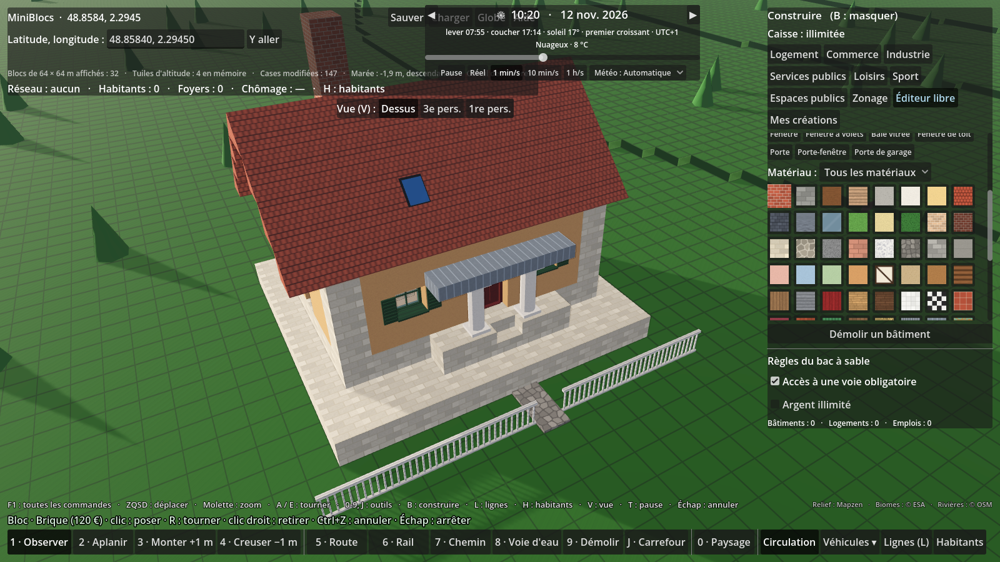
- Pas de bloc sous terre, sur une voie ou dans un bâtiment. Inversement, ni bâtiment ni voie ne peuvent passer sur des blocs.
- **Mes créations** : écris un nom, clique sur **Enregistrer** puis fais un clic glissé autour de ta construction (toutes les hauteurs sont prises). Elle devient un bâtiment de l'onglet **Mes créations**, que tu poses ailleurs comme n'importe quel bâtiment (fantôme, rotation R, terrassement, prix). La bibliothèque est commune à toutes tes parties, et chaque sauvegarde garde une copie des créations qu'elle utilise. La croix ✕ retire une création de la liste (les exemplaires posés restent).
- La taille des blocs est une constante (`BlockEditor.SIZE`) : on pourra passer à 50 cm pour plus de détails.

## Habitants : une vie pour chaque personnage

Chaque logement accueille un **foyer** (personne seule, couple, famille, famille monoparentale, retraités) dont les membres ont un prénom et un nom selon le style du logement ou la région du monde, un âge, des loisirs et un budget. Les foyers emménagent peu à peu quand le temps avance.

- **Étapes de la vie** : bébé (0-2 ans, chez l'assistante maternelle quand les parents travaillent), élève (3-17 ans, de la petite section à la terminale), adulte (emploi ou recherche d'emploi), retraité (64 ans). Naissances, décès, jeunes qui quittent leurs parents. La **vitesse de la vie** se règle : réaliste, rapide (1 an = 1 mois) ou très rapide (1 an = 1 jour).
- **École** : chaque enfant est inscrit dans l'école la plus proche qui a de la place. S'il y a 12 enfants dans une école, ce sont 12 profils qui y vont, et ils y sont bien pendant les heures de classe (pas le mercredi après-midi, ni le week-end, ni en juillet-août).
- **Travail** : chaque emploi d'un bâtiment reçoit un métier (enseignant, boulanger, caissier, ouvrier, infirmier, pompier…) avec son salaire et ses horaires (semaine, lundi-samedi, gardes un jour sur deux…).
- **Trajets** : à pied, à vélo, en voiture, ou en **transports publics** quand une ligne est plus rapide (itinéraires du jeu, voyageurs comptés chaque jour sur les lignes).
- **Rues** : sans bâtiment, personne dans les rues. Les premiers piétons, vélos et voitures arrivent avec les premiers habitants, et leur nombre suit leurs trajets de l'heure (pointe le matin et le soir, rues vides la nuit) et les emplois (livraisons). Les bus ne roulent que sur les lignes créées par le joueur.
- **Journée** : dormir, trajet, école ou travail, courses, loisir (football, cinéma, café, promenade au parc…) dans le lieu le plus proche, retour à la maison.
- **Économie (débuts)** : chaque foyer a ses revenus (salaire, pension, allocation), son loyer, ses courses, ses voitures et son épargne ; un foyer trop endetté quitte la ville. La ville touche la taxe foncière, les impôts des entreprises et la dotation de l'État, et paie ses agents (ATSEM, agents municipaux, pompiers) et l'entretien des bâtiments publics. Le solde est versé chaque jour dans la caisse.

Touche **H** : la ville en chiffres, la liste des habitants (filtre et recherche) et le budget. Un **clic sur un bâtiment** (outil 1 · Observer) montre qui y vit, y travaille, y étudie et qui s'y trouve en ce moment ; un clic sur un nom ouvre le **profil** (foyer, travail ou école, trajet, loisirs, budget, journée heure par heure).

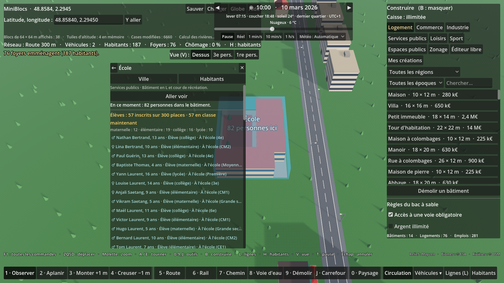

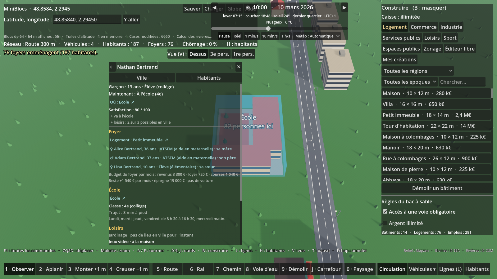

Détails : [docs/habitants.md](docs/habitants.md).

## Internet et téléphone : antennes, cuivre et fibre

Antennes relais 2G, 4G et 5G (portées réelles, saturation quand trop d'abonnés), central téléphonique dont le cuivre suit les routes (ADSL de plus en plus lent avec la distance), fibre posée rue par rue ou sur poteaux jusqu'aux fermes. Sans internet ni réseau mobile, les habitants sont moins satisfaits et les entreprises produisent moins (réglage Admin pour couper). Détails : [docs/telecom.md](docs/telecom.md).

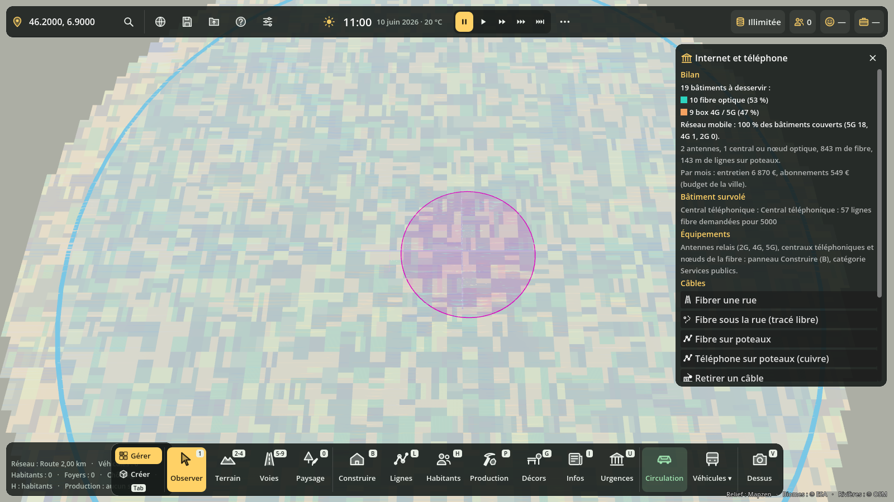
## Villages et territoire : fonder sa commune

Une partie commence par la **fondation du village** : on lui donne un nom, puis on pose sa **Maison de commune**, n'importe où et sans route. Avant, on ne peut que regarder et modeler le paysage. Le village reçoit un **territoire** en carrés de 100 m (500 m autour de la mairie), qui **grandit avec la population** (jusqu'à 3 km pour une grande ville). On peut aussi acheter un carré voisin ou en céder un. Bâtiments et zonage restent sur le territoire, alors que voies et réseaux vont partout. Une Maison de commune posée à 2 km d'un autre village **fonde un nouveau village**, et deux villages qui se touchent peuvent **fusionner**. Touche **Maj+M** (menu Ville). Détails : [docs/villages.md](docs/villages.md).

Avec la Maison de commune arrivent **100 fondateurs** (réglable dans l'Admin, F10). Ils campent à côté et sont les **ouvriers des premiers chantiers** : chaque chantier veut une équipe complète (une maison ≈ 8 à 10 ouvriers), donc on ne peut pas tout construire à la fois. Dans le panneau **Maj+H**, on met un chantier en pause ou en premier, et on envoie des fondateurs vers n'importe quel métier (ferme, boulangerie…). Ils ont 90 jours de vivres, puis le campement coûte un ravitaillement ; dès qu'une maison est finie, ils y emménagent. Détails : [docs/fondateurs.md](docs/fondateurs.md).


## Quartiers et arrêtés municipaux

Touche **Maj+Y** (menu Ville) : le maire **peint ses quartiers** sur la carte (îlots de 50 m), leur donne un nom, puis y prend des **arrêtés** : zone 30, rues piétonnes, interdiction des poids lourds, tranquillité la nuit, tri obligatoire, détecteurs de fumée, éclairage renforcé ou éteint, stationnement payant, fleurissement. Chacun coûte une mise en place et un montant par mois selon la surface, et agit vraiment : itinéraires et vitesse des voitures, camions, bruit, air, valeur des terrains, tri, départs de feu, recettes de stationnement, avis des habitants. Si tu perds la mairie, le conseil élu décide des arrêtés selon son programme. Détails : [docs/quartiers.md](docs/quartiers.md).

## Budget de la commune : impôts, emprunts, entretien des voies

Touche **M** : le maire vote la taxe foncière, l'impôt des entreprises et l'impôt sur les bénéfices (0 à 200 %, les habitants râlent quand c'est haut), emprunte de 100 k€ à 20 M€ sur 5 à 30 ans, et règle l'entretien de chaque réseau. Routes, rails, chemins et voies d'eau **s'usent** avec l'âge et le trafic (les camions surtout) : sous 50 %, nids-de-poule et véhicules ralentis, à 0 % la voie ferme. Les réfections sont des chantiers visibles. Caisse dans le rouge 90 jours : le préfet met la ville sous tutelle.


Détails : [docs/budget.md](docs/budget.md).

## Statistiques et conseiller

Touche **Maj + I** (menu *Infos*, bouton *Statistiques*) : les **courbes dans le temps** de chaque ville et du pays (habitants, satisfaction, chômage, caisse, solde du mois, logements et emplois libres, pollution ; électricité, eau, bouchons et déchets pour tout le pays), sur 30 jours, 1 an ou toute la partie, avec la **comparaison des villes**. Le tableau donne le chiffre du jour et son évolution sur 30 jours. L'onglet **Conseiller** liste les problèmes du moment, du plus urgent au plus anodin, et propose quoi faire, avec un bouton vers le bon panneau. Il est sérieux sur le fond, un peu moins sur la forme.


Détails : [docs/statistiques.md](docs/statistiques.md).

## Trafic : bouchons, stationnement et transports en commun

Touche **Maj + L** (bouton *Trafic*) : comment les habitants vont au travail et à l'école, temps perdu dans les **bouchons** et pour **se garer**, routes saturées, **parkings** (gratuits ou payants) et **remplissage des lignes** (ticket à 1,50 € par défaut). Chaque rue a une capacité ; à l'heure de pointe, les rues trop chargées ralentissent (voitures visibles comprises) et les habitants changent de route ou passent au bus, au tram, au vélo. Les bus pleins font attendre le suivant. **Voies de bus et de tram** et fermetures de routes : *Choisir une route* dans le panneau. La **carte du trafic** colore les routes du vert au rouge.


Détails : [docs/trafic.md](docs/trafic.md).

## Services publics : écoles, hôpitaux, police

Touche **Maj+U** : chaque logement est relié à l'école, l'hôpital et le commissariat les plus rapides **par les routes**. Bien couvert : école à 15 min (25 min pour le collège, 40 min pour le lycée), hôpital à 30 min, police à 10 min ; au double, plus rien. Il faut aussi de la place : pupitres, 3 lits pour 1 000 habitants, 1 agent pour 400 habitants. Un élève trop loin reste sans école ; un hôpital loin ou saturé abîme la santé ; un quartier sans police a plus de cambriolages. Carte colorée dans le panneau ou dans **Cartes** (N).


Détails : [docs/services.md](docs/services.md).

## Vue au sol : marcher à la 3e ou à la 1re personne

Dans le mode Terre, appuie sur **V** (ou les boutons **Dessus / 3e pers. / 1re pers.** en haut au centre) : un personnage apparaît au sol, au centre de la vue de gestion.


| Action | Touches |
| --- | --- |
| Changer de vue (dessus → 3e → 1re → dessus) | V |
| Marcher / courir | ZQSD (WASD en QWERTY) ou flèches / Maj maintenue |
| Sauter, remonter en nageant | Espace |
| Regarder | Souris |
| Rapprocher / éloigner la caméra | Molette (tout près : 1re personne, molette arrière : 3e personne) |
| Libérer la souris (pour cliquer sur l'interface) | Échap, puis clic dans la vue pour la reprendre |

- **Collisions** : le personnage marche sur le relief (et sur les cases que tu as aplanies ou creusées), sur les routes, rails, chemins et ponts (les parapets empêchent de tomber). Les bâtiments et les constructions de l'éditeur libre l'arrêtent.
- **Caméra 3e personne** : elle se rapproche toute seule quand un mur, une colline ou le sol passerait entre elle et le personnage.
- **Eau** : dans l'eau profonde, il nage à la surface.
- **Retour en vue de dessus** : la caméra de gestion se recentre sur le personnage.
- **Arbres et véhicules** : on ne traverse plus les troncs (on passe à travers les buissons). Les voitures, trains, vélos, piétons et bateaux proches ont une collision : on ne peut pas leur rentrer dedans, et un véhicule qui arrive sur le personnage l'écarte sur le côté.
- **Tunnels** : on peut y entrer à pied et les traverser (sol, murs et voûte éclairés). Au-dessus, la colline reste praticable.


## Ambiance : cycle jour/nuit, vrai Soleil et vraie Lune

Le mode Terre a maintenant une **horloge** : le Soleil et la Lune sont à leur vraie place dans le ciel pour le lieu, la date et l'heure (saisons, durée du jour, phases de la Lune, nuit polaire…). Le ciel passe du bleu de midi à l'orangé du couchant, puis à la nuit étoilée.


- **La nuit**, des **lampadaires** s'allument le long des routes et des chemins (posés tout seuls), et les **fenêtres** des bâtiments s'éclairent, plus ou moins selon l'heure.
- **Panneau Horloge** (en bas à droite) : heure et date du lieu, lever et coucher du Soleil, phase de la Lune. Barre pour choisir l'heure, ◀ ▶ pour changer de mois (et donc de saison).
- **T** : pause / reprise. **Maj + T** : vitesse suivante (temps réel, 1 min/s, 10 min/s, 1 jour/min par défaut, 100 min/s).
- **Heure officielle du lieu**, avec les vrais fuseaux horaires du monde et l'heure d'été.
- **Météo** selon le climat réel du lieu et la saison : nuages, pluie, neige, brouillard, orages avec éclairs. La liste « Météo » du panneau Horloge permet de forcer un temps.
- **Phares** des véhicules allumés la nuit et par mauvais temps.


- **Sauver / Charger** gardent la date, l'heure et la météo choisie.


Détails et limites : [docs/ambiance.md](docs/ambiance.md).

## Son et musique

Le jeu s'entend : **ambiances** selon ce que regarde la caméra (oiseaux ou grillons à la campagne, rue animée en ville, trafic près des routes, chantiers en activité, pluie, vent, orage, mer ; en prenant de la hauteur, le vent couvre le reste), **sons** des constructions, des démolitions, des nouvelles et des élections, et **7 morceaux** qui suivent l'heure de la ville (journée, soirée, nuit, et un thème pour le globe), dont la *Valse du permis de construire* et le *Nids-de-poule blues*. **F2** (ou le haut-parleur de la barre du haut) ouvre le panneau des volumes. Tout est fabriqué par `tools/build_sons.py` (synthèse, libre de droits CC0).

Détails : [docs/son.md](docs/son.md).

## Démo : le low-poly poussé au maximum

Une ferme entièrement générée en code (longère à colombages et toit de chaume, grange, puits, charrette, potager, champ de blé au vent, mare, brume du matin, soir aux lanternes) pour voir jusqu'où le style peut aller. Ouvre `scenes/demo_ferme.tscn` et appuie sur **F6** ; **1** à **4** changent la lumière, **C** le point de vue. Détails et ce qui est généralisable à tous les bâtiments : [docs/demo-low-poly.md](docs/demo-low-poly.md).


## Comment ça marche

- **Routes** : se tracent en L entre le point de départ et la souris. Le marquage s'adapte aux routes voisines (lignes droites, virages, carrefours).
- **Zones** : se peignent en rectangle. Une zone ne recouvre jamais une route.
- **Croissance** : les bâtiments poussent tout seuls sur les cases zonées situées à 2 cases maximum d'une route, orientés vers celle-ci.
- **Statistiques** : habitants (4 par maison) et emplois (3 par commerce, 6 par usine), affichés en haut à gauche.
- **Sauvegarde** : un fichier JSON dans le dossier utilisateur de Godot (`user://miniblocs_save.json`).

## Organisation du code

| Fichier | Rôle |
| --- | --- |
| `scenes/main.tscn` | Scène principale : lumière, ciel, caméra, ville, interface |
| `scripts/main.gd` | Relie l'interface à la ville |
| `scripts/camera_rig.gd` | Caméra de gestion (déplacement, zoom, rotation) |
| `scripts/city_grid.gd` | Grille, outils de pose, croissance, sauvegarde |
| `scripts/low_poly.gd` | Fabrique des modèles low-poly |
| `scripts/ground_grid.gdshader` | Sol herbeux quadrillé |
| `scripts/hud.gd` | Barre d'outils, statistiques, aide |
| `tests/smoke_test.gd` | Test automatique de bout en bout |
| `scenes/globe.tscn` | Écran de départ : globe 3D pour choisir le lieu |
| `scripts/terre/globe_menu.gd` | Globe : rotation, clic, recherche de ville, aperçu, lancement |
| `scripts/terre/villes.gd` | Recherche dans l'index des villes du monde |
| `assets/villes_monde.tsv.gz` | 135 000 villes (GeoNames, CC BY 4.0, via le paquet all-the-cities ; fabriqué par `tools/build_villes.py`) |
| `assets/drapeaux.png`, `assets/drapeaux.json` | Atlas des 268 drapeaux (flag-icons, MIT ; fabriqué par `tools/build_drapeaux.gd`) ; `scripts/communes/drapeaux.gd` |
| `assets/pays.json` | Noms français des pays |
| `scripts/terre/game_start.gd` | Choix du joueur transmis à la partie (lieu, mode) |
| `scenes/terre.tscn` | Mode Terre : relief réel en cases de 1 m |
| `scripts/personnage/vue_sol.gd` | Bascule vue de dessus / 3e / 1re personne, caméra au sol |
| `scripts/personnage/personnage.gd` | Personnage qui marche (piloté par des ordres, prêt pour le multijoueur) |
| `scripts/personnage/collisions_sol.gd` | Collisions autour du personnage : relief, arbres, voies, tunnels, véhicules |
| `tests/personnage_test.gd` | Test de la vue au sol (marche, pont, bâtiment, arbre, tunnel, véhicule, caméra, nage) |
| `scripts/terre/geo.gd` | Conversions latitude / longitude ↔ mètres ↔ tuiles |
| `scripts/terre/land_cover.gd` | Biomes réels (ESA WorldCover) lus par blocs autour du lieu |
| `assets/biomes_monde.png` | Carte mondiale des biomes du globe (fabriquée par `tools/build_biome_map.py`) |
| `scripts/ambiance/` | Cycle jour/nuit, Soleil et Lune réels, ciel, lampadaires, fenêtres allumées (voir [docs/ambiance.md](docs/ambiance.md)) |
| `scripts/terre/paysage_panel.gd` | Panneau Paysage : pinceaux colline, lisser, lac / canal, biomes, arbres |
| `scripts/terre/water_map.gd` | Rivières et étangs : OpenStreetMap, sinon calcul d'écoulement sur le relief |
| `scripts/terre/water.gdshader` | Eau animée (rivières, lacs, mer) : vagues, reflets, écume |
| `scripts/terre/elevation_tiles.gd` | Téléchargement, cache et lecture des tuiles d'altitude |
| `scripts/terre/terrain_world.gd` | Blocs de 64 × 64 cases autour de la caméra, outils, sauvegarde |
| `scripts/terre/terre_hud.gd` | Interface du mode Terre : barre du haut, barre de catégories, plateau d'outils |
| `scripts/interface/icones.gd` | Les 61 icônes SVG du jeu, rendues à la taille voulue |
| `scripts/interface/ui_style.gd` | Style commun des menus (panneaux, boutons à icône, pastilles de touche) |
| `scripts/interface/vignettes.gd` | Vignettes des bâtiments du panneau Construire |
| `scripts/interface/aide_panel.gd` | Fenêtre d'aide (F1) |
| `tests/terre_test.gd` | Test automatique du mode Terre (sans réseau) |
| `tests/globe_test.gd` | Test automatique du globe (sans réseau) |
| `scripts/transport/transport_types.gd` | Catalogue des types de voies (largeur, pente maxi, vitesse…) |
| `scripts/transport/transport_network.gd` | Graphe commun à tous les réseaux, itinéraires A*, sauvegarde |
| `scripts/transport/route_planner.gd` | Tracé sur le relief : pente, ponts, tunnels, terrassement |
| `scripts/transport/transport_view.gd` | Modèles low-poly des voies, ponts et tunnels |
| `scripts/transport/traffic.gd` | Véhicules qui circulent (modèles tirés du catalogue, filtre époque / région), files d'attente, freinage, passage des carrefours |
| `scripts/transport/junction_control.gd` | Régime des carrefours (feux et leurs phases, stop, cédez-le-passage, priorité à droite), signalisation |
| `scripts/transport/transit_planner.gd` | Itinéraires des habitants : marche, lignes, correspondances, temps estimés, voyageurs par ligne |
| `scripts/transport/station_system.gd` | Stations (arrêts, gares, ports, héliports, aérodromes, aéroports), lignes, trajets des avions, sauvegarde |
| `scripts/transport/station_panel.gd` | Panneau « Transports publics » (touche L) |
| `scripts/transport/vehicle_catalog.gd` | Catalogue des 133 véhicules : catégories, époques, régions, chiffres, modèles low-poly |
| `scripts/transport/vehicle_mesh.gd` | Formes des véhicules (roues, coques, ailes, voiles, chevaux…) en plus de BlocMesh |
| `tests/vehicules_vitrine.gd` | Aligne une ou plusieurs catégories du catalogue et prend une capture |
| `scripts/transport/transport_system.gd` | Outils de pose et de démolition dans le mode Terre |
| `tests/transport_test.gd` | Test automatique des transports (sans réseau) |
| `scripts/batiments/building_catalog.gd` | Catalogue des bâtiments : catégories, emprises, prix, modèles low-poly |
| `scripts/batiments/bloc_mesh.gd` | Formes low-poly (boîtes, toits, cylindres) assemblées en un seul maillage |
| `scripts/batiments/building_system.gd` | Pose, règles, terrassement, démolition et sauvegarde des bâtiments |
| `scripts/batiments/building_panel.gd` | Panneau « Construire » |
| `scripts/batiments/zone_system.gd` | Zonage : zones peintes, demande, croissance le long des routes |
| `scripts/batiments/plan_editor.gd` | Éditeur libre, mode Murs et étages : murs de 20 cm sur les lignes, ouvertures, sols, escaliers, étages et sous-sols, vue en coupe, toit automatique |
| `scripts/batiments/block_editor.gd` | Éditeur libre bloc par bloc : outils, matériaux, annulation, rendu par blocs de 16 × 16 m |
| `scripts/catalogue/styles.gd` | Bible : régions, époques, archétypes et les 43 styles d'architecture |
| `scripts/catalogue/style_builder.gd` | Fabrique les bâtiments de la bible (emprise, chiffres, modèle 3D) d'après style + archétype |
| `scripts/catalogue/espaces_publics.gd` | Places, parcs, monuments et mobilier urbain |
| `scripts/batiments/bloc_materiaux.gd` | Matériaux de l'éditeur libre, textures dessinées par le jeu, teintes |
| `scripts/batiments/bloc_formes.gd` | Formes de l'éditeur libre : demi-blocs, escaliers, pentes, portes, fenêtres… |
| `scripts/batiments/bloc_mesher.gd` | Maillage texturé des blocs (deux surfaces : opaque et verre) |
| `scripts/catalogue/creations.gd` | Mes créations : constructions de l'éditeur libre enregistrées comme bâtiments |
| `tests/batiments_test.gd` | Test automatique des bâtiments (sans réseau) |
| `tests/plans_test.gd` | Test des murs fins, étages, sous-sols, toit et sauvegarde (sans réseau) |
| `scripts/interieurs/meubles.gd` | La bible des meubles : types, pièces, styles du monde |
| `scripts/interieurs/meubles_modeles.gd` | Modèles low-poly des meubles |
| `scripts/interieurs/mobilier.gd` | Meubles dans les bâtiments en murs fins : pose, pièces et fonctions, aménagement automatique, effets, sauvegarde |
| `scripts/interieurs/gabarits.gd` | Bâtiments meublés prêts à visiter |
| `scripts/interieurs/occupants.gd` | Les habitants dans les pièces, à leurs heures |
| `scripts/interieurs/vue_etages.gd` | Vue par étage en mode Gérer (Page bas/haut, Origine) : coupe les bâtiments en murs fins autour de la caméra |
| `scripts/interieurs/interieur_panel.gd` | Onglet « Intérieur » du panneau Construire |
| `tests/interieurs_test.gd` | Test des intérieurs (bible, pose, aménagement, habitants, sauvegarde, panneau) |
| `tests/interieurs_vitrine.gd` | Bâtiments meublés en coupe et captures (`--vue dessus`, `proche`, `sol`, `bible`, `panneau`, `--style japonais`) |
| `scripts/atelier/personnalisation.gd` | Personnalisation d'un bâtiment du catalogue (couleurs, toit, étages) |
| `scripts/atelier/perso_panel.gd` | Panneau « Personnaliser » |
| `scripts/atelier/conversion.gd` | « Ouvrir l'intérieur » : bâtiment du catalogue refait en murs fins, découpé en pièces, meublé |
| `scripts/atelier/banque_modeles.gd` | Banque de modèles : enregistrer, étiqueter, chercher, poser, exporter, importer |
| `scripts/atelier/banque_panel.gd` | Onglet « Banque de modèles » |
| `scripts/atelier/banque_pose.gd` | Outil de pose d'un modèle en murs fins |
| `tests/atelier_test.gd` | Test de la personnalisation, de l'ouverture des intérieurs, de la banque et de l'atelier |
| `tests/atelier_vitrine.gd` | Captures : rue personnalisée, panneau, maison ouverte, atelier (`--vue rue`, `panneau`, `coupe`, `atelier`) |
| `scripts/habitants/population.gd` | Habitants : foyers, étapes de la vie, écoles, emplois, emploi du temps, trajets, économie, sauvegarde |
| `scripts/habitants/habitants_panel.gd` | Panneau « Habitants » (touche H) : ville, liste, bâtiment, profil |
| `scripts/habitants/metiers.gd` | Métiers (salaires, horaires), métiers par bâtiment, loisirs et leurs lieux, classes |
| `scripts/habitants/prenoms.gd` | Prénoms et noms par région du monde |
| `tests/habitants_test.gd` | Test des habitants (école, emplois, journée, budget, transports, sauvegarde, panneau) |
| `tests/habitants_vitrine.gd` | Petit quartier et captures du panneau Habitants |
| `scripts/metiers/gestes.gd` | Gestes de métier (pétrir, écrire au tableau, ausculter…) : texte, animation, outil, poste ; gestes devinés pour les nouveaux métiers |
| `scripts/metiers/figurine.gd` | Habitant articulé qui fait les gestes (personnage arrondi de Blender, ou en blocs), tenues de métier |
| `scripts/metiers/accessoires.gd` | Outils en main et postes de travail low-poly (four, pétrin, tableau, lits, caisses, machines…) |
| `scripts/metiers/effectif.gd` | Personnel des bâtiments : fermé faute d'employés, sous-effectif, ouvert maintenant, conséquences |
| `scripts/metiers/metiers_vivants.gd` | Vue métiers (K) : bâtiments en coupe, employés dehors, enseignes, rideaux de fer, pancartes, clic sur un employé |
| `tests/quartiers_test.gd` | Test des quartiers et arrêtés municipaux (pinceau, coûts, effets, mairie perdue, conseil élu, pilote, sauvegarde, panneau) |
| `tests/metiers_test.gd` | Test des métiers visibles et des conséquences du manque de personnel |
| `tests/metiers_vitrine.gd` | Captures : boulangerie, école, hôpital, ferme, supérette la nuit (`--seulement boulangerie`…) |
| `tests/batiments_vitrine.gd` | Pose tout le catalogue (ou fait pousser un quartier avec `--zones`, ou construit une maison en blocs avec `--blocs`) et prend une capture. `--styles japonais,chinois` ou `--arch culte` filtrent la bible, `--zone-style` choisit le style du zonage, `--cat espaces` une catégorie, `--maison` construit la maison de démonstration de l'éditeur libre, `--courbe` des bâtiments calés le long d'une route courbe, `--murs` une maison et un immeuble en murs fins (`--coupe 0` : vue en coupe du rez-de-chaussée) |

## Sauvegarde des parties

Chaque partie a son propre dossier : on peut en garder autant qu'on veut.

- **Sauver** ou **F5** : sauvegarde la partie en cours (la première fois, une partie est créée au nom du lieu).
- **Charger** : liste des parties (charger, supprimer, sauvegarder sous un autre nom). **F9** : recharge la partie en cours.
- Sur le globe : **Continuer** reprend la dernière partie, **Parties…** ouvre la liste.
- Sauvegarde automatique toutes les 5 minutes (partie « Sauvegarde automatique »), si quelque chose a changé.
- Seuls les changements du joueur sont gardés (le relief réel se recalcule) ; format versionné, prêt pour le multijoueur : [docs/sauvegarde.md](docs/sauvegarde.md).

## Test automatique

Tous les tests d'un coup : `sh tests/tous.sh` (affiche une ligne « … TEST OK » par test).

```bash
godot --headless --path . --script res://tests/smoke_test.gd
```

Le test pose des routes et des zones, attend la croissance, puis vérifie la sauvegarde, le chargement et le bulldozer. Il affiche `SMOKE TEST OK` si tout va bien.

```bash
godot --headless --path . --script res://tests/terre_test.gd
```

Vérifie les conversions de coordonnées, le décodage des tuiles, la génération des blocs, les rivières (calcul sur une vallée, lecture d'OpenStreetMap, lit creusé, surface d'eau, ponts), le terrassement et la sauvegarde. Il affiche `TERRE TEST OK`. De même, `tests/globe_test.gd` affiche `GLOBE TEST OK`, `tests/transport_test.gd` affiche `TRANSPORT TEST OK` et `tests/batiments_test.gd` affiche `BATIMENTS TEST OK`.

`tests/partie_test.gd` joue une **partie complète accélérée** en mode Normal : globe, fondation, 100 fondateurs, rues, éoliennes et parc solaire, forage, lagunage, école, entreprises du bâtiment, zones, puis la ville grandit (pas de 10 minutes de jeu) jusqu'à 1 000 habitants ; il prend un emprunt si la caisse est vide, relève chaque jour habitants, caisse, chantiers, chômage, logements sans courant ou sans eau et temps par image, compte toutes les erreurs de script, puis sauvegarde et recharge la partie. Il affiche `PARTIE TEST OK` (une vingtaine de minutes). Options : `-- --jours 250 --cible 1000 --rapport partie.csv` (courbe jour par jour), `--messages` (messages du jeu datés), `--diag` (état des chantiers tous les 5 jours).

`tests/statistiques_test.gd` vérifie les relevés quotidiens, les courbes, le regroupement des vieux jours, le conseiller, la sauvegarde et le panneau Maj+I, et affiche `STATISTIQUES TEST OK`.

`tests/parcours_test.gd` joue une partie comme un joueur, avec de vraies touches (globe, outils 1-9, B, L, T, V, F1, F5, Continuer) et affiche `PARCOURS TEST OK`. `tests/habitants_test.gd` vérifie les habitants (école, emplois, emploi du temps, budget, bus, sauvegarde, panneau) et affiche `HABITANTS TEST OK`. `tests/sauvegarde_test.gd` vérifie le format des parties (écriture, relecture, section abîmée, import de l'ancienne sauvegarde) et affiche `SAUVEGARDE TEST OK`. `tests/interface_test.gd` vérifie les menus (icônes, barre de catégories, panneaux un à la fois, vignettes, fiche d'un bâtiment) et affiche `INTERFACE TEST OK`. `tests/son_test.gd` vérifie le son (fichiers, bus et volumes, réglages du joueur, musique selon l'heure, ambiances selon la caméra, chantiers, tonnerre, panneau F2) et affiche `TEST OK`. `tests/demo_ferme_test.gd` vérifie la démo low-poly (kit de modelage, objets, lumières, vues) et affiche `DEMO TEST OK`.

```bash
godot --headless --path . --script res://tests/perf_bench.gd [-- --big] [--reseau]
```

Banc d'essai des performances sur une région de 10 × 10 km : chargement du terrain, survol de 4 km, grande ville en grille (routes, zonage, circulation), sauvegarde et chargement. Affiche les temps par image et `PERF BENCH OK`. `--reseau` utilise le vrai relief d'Annecy, `--big` une ville deux fois plus grande.

## Pistes pour la suite

- Remplacer les modèles générés par des packs CC0 (Kenney City Kit, Quaternius) en gardant la même logique.
- Besoins entre zones (les habitants ont besoin d'emplois et de commerces), argent et budget.
- Services : électricité, eau, parcs.
