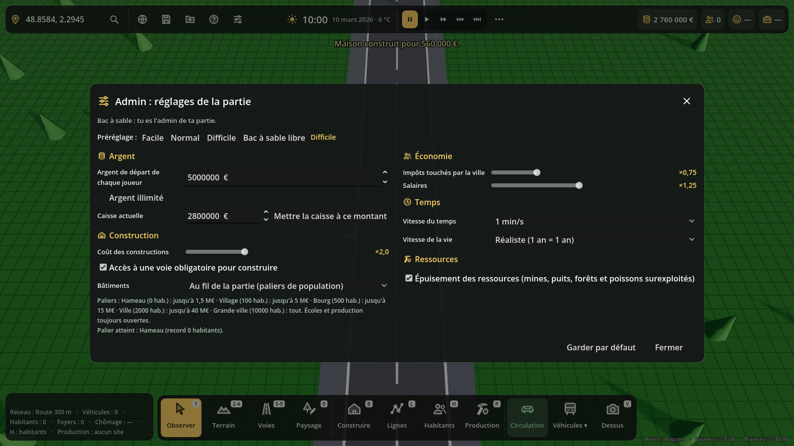
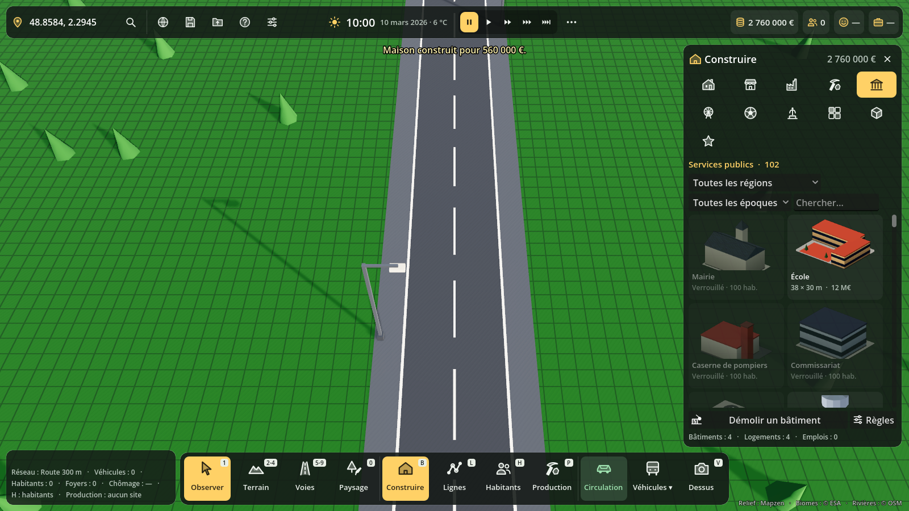

# Panneau Admin : réglages de la partie

**F10**, ou l'icône réglages de la barre du haut, ou le bouton **Règles** du panneau
Construire. Sur le globe, le bouton **Réglages…** ouvre le même panneau avant de
commencer la partie.

## Réglages

| Réglage | Effet |
|---|---|
| Argent de départ | ce que reçoit chaque joueur en arrivant sur la carte (en solo : la caisse de départ) |
| Argent illimité | plus rien n'est payé |
| Caisse actuelle | en cours de partie, l'admin peut mettre la caisse à un montant |
| Coût des constructions (×0,5 à ×5) | bâtiments, terrassement, zonage, blocs, murs et étages |
| Accès à une voie obligatoire | règle de pose des bâtiments |
| Bâtiments | tout débloqué d'office, ou au fil de la partie par paliers de population |
| Impôts (×0 à ×3) | taxe foncière et impôts des entreprises touchés par la ville |
| Usure des routes et réseaux | Aucune, Lente, Normale, Rapide (voir [budget.md](budget.md)) |
| Salaires (×0,5 à ×2) | salaires des habitants, des agents de la ville et de la production |
| Vitesse du temps, de la vie | vitesse de l'horloge (comme T / Maj+T, par défaut 1 jour de jeu par minute) et du vieillissement |
| Rythme des chantiers (réaliste ×1 à ×10) | vitesse de tous les chantiers (bâtiments, voies, réseaux) ; ×3 par défaut : premières maisons des fondateurs en 2 à 3 semaines de jeu |
| Événements automatiques | marchés du samedi, fêtes de quartier, matchs au stade |
| Catastrophes (Rares, Normales, Fréquentes) | incendies, tempêtes et épidémies au hasard ; décoché : seulement à la main (panneau Infos) |
| Épuisement des ressources | sans épuisement : mines et puits inépuisables, forêts et poissons ne s'abîment pas |

Préréglages : **Facile**, **Normal** (les règles d'avant : 20 M€, prix ×1), **Difficile**,
**Bac à sable libre**. « Garder par défaut » écrit `user://reglages_defaut.json`,
proposé pour les nouvelles parties.

## Paliers de déblocage

| Palier | Habitants | Bâtiments jusqu'à |
|---|---|---|
| Hameau | 0 | 1,5 M€ |
| Village | 100 | 5 M€ |
| Bourg | 500 | 15 M€ |
| Ville | 2 000 | 40 M€ |
| Grande ville | 10 000 | tout |

Écoles et bâtiments de production toujours ouverts. On compte le record de population :
une démolition ne rebloque rien. Le zonage fait toujours pousser ses modèles.

## Qui est admin

- **Bac à sable** : le joueur.
- **Entre amis** : le créateur de la carte seulement (`createur` = identifiant du joueur, `SaveGame.player_id()`).
- **Carte mondiale** : le développeur seulement. Pour l'instant : jeu lancé depuis l'éditeur
  Godot ou avec `-- --dev` ; le serveur fera la vraie vérification.

Les autres joueurs ne voient ni l'icône ni le bouton Règles.

## Code

- `scripts/admin/reglages_partie.gd` (`ReglagesPartie`) : valeurs, préréglages, droits,
  paliers, `ReglagesPartie.prix()`. `ReglagesPartie.actuel` = partie en cours.
- `scripts/admin/admin_panel.gd` (`AdminPanel`) : le panneau.
- Section de sauvegarde `reglages`. Une ancienne sauvegarde sans section garde ses règles
  (accès, argent illimité).
- Test : `tests/admin_test.gd` ; captures : `tests/admin_vitrine.gd`.

À faire avec le multijoueur : une caisse par joueur (le réglage d'argent de départ est
déjà pensé pour ça), vérification des droits côté serveur.
