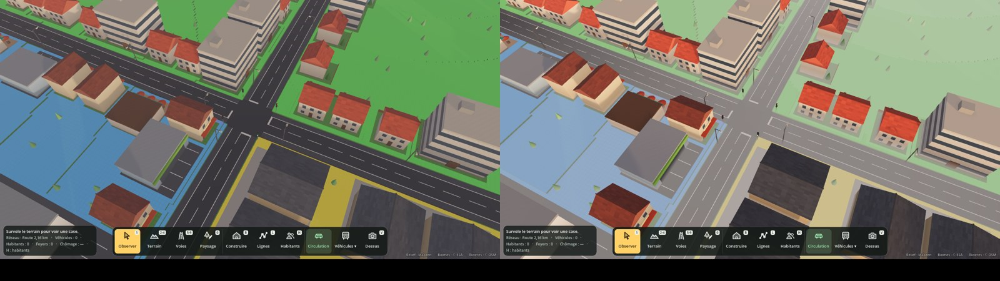
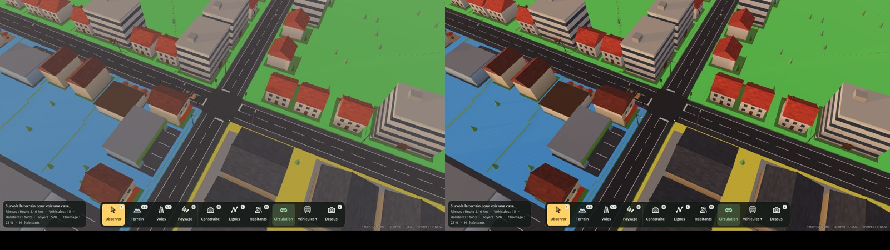

# Ambiance : cycle jour/nuit, Soleil et Lune réels, éclairage nocturne

## Ce que fait le jeu

- **Horloge de jeu** : date et heure du lieu choisi sur le globe. Au lancement : aujourd'hui (date de l'ordinateur), 10 h, heure locale.
- **Soleil réel** : sa hauteur et sa direction sont calculées pour la latitude, la longitude, la date et l'heure. On retrouve les vraies durées du jour (à Paris : lever 05:47 et coucher 21:58 le 21 juin, 08:41 et 16:56 le 21 décembre), la nuit polaire et le soleil de minuit en Laponie.
- **Lune réelle** : position et phase (nouvelle lune, croissant, quartier, pleine lune…). Elle éclaire faiblement la nuit, plus fort quand elle est pleine. Son disque est dessiné avec la bonne partie éclairée.
- **Ciel** : dégradé qui suit la hauteur du Soleil (journée, lueur orangée au lever et au coucher, crépuscule bleu, nuit étoilée). Les étoiles tournent autour de l'étoile Polaire au fil de la nuit.
- **Lumière et ombres** : couleur du Soleil (orange au ras de l'horizon, blanc à midi), lumière ambiante et brume assorties au ciel. Ombres en 4 niveaux de détail, dont la portée suit le zoom de la caméra.
- **La nuit** :
  - **Lampadaires** posés tout seuls le long des routes (un tous les 32 m, en quinconce) et des chemins (plus petits, tous les 24 m). Rien dans les tunnels. Ils suivent les routes qu'on construit et qu'on démolit.
  - **Fenêtres allumées** sur tous les bâtiments : plus nombreuses le soir, quelques-unes au milieu de la nuit, un regain au réveil. Toujours les mêmes fenêtres pour un même bâtiment.

- **Fuseaux horaires réels** : l'heure affichée est l'heure officielle du lieu (heure d'été comprise), partout sur Terre, sans Internet. En mer, c'est le fuseau de la côte la plus proche, sinon l'heure « nautique ».
- **Météo** (voir plus bas) : nuages, pluie, neige, brouillard et orages selon le climat réel du lieu et la saison.
- **Phares** : la nuit, et par brouillard ou forte pluie, les véhicules allument leurs phares (blancs à l'avant) et leurs feux (rouges à l'arrière). Les plus proches de la caméra éclairent la route devant eux.

## Jour permanent

Pour construire sans être gêné par la nuit : l'image reste de jour, mais **le temps continue** (l'heure de l'horloge, les habitants, l'école et le travail, la production, la météo).

- **Tout seul en construction** : dès que Construire ou l'éditeur libre est ouvert, l'image passe en jour permanent ; la nuit revient à la fermeture. Ctrl + T pendant la construction rend la vraie nuit jusqu'à la fermeture. La case « Jour permanent tout seul… » du panneau Horloge coupe ce comportement.
- Le jour, le Soleil suit l'heure comme d'habitude.
- Le soir, quand le Soleil descend sous 20°, il s'arrête sur cette lumière d'après-midi jusqu'à minuit, puis glisse en 1 à 2 secondes vers la lumière du matin, qu'il garde jusqu'à ce que le vrai Soleil le rattrape.
- Pas de lampadaires ni de fenêtres allumées pendant ce temps, puisque l'image est de jour.
- Nuit polaire ou Soleil trop bas en hiver (moins de 12° à midi) : on prend la lumière du jour le plus proche où le Soleil monte à 20°.
- L'icône de l'horloge garde la vraie heure du ciel : la Lune quand il fait nuit pour de vrai, enfoncée quand le jour permanent est actif.
- Réglage gardé dans la sauvegarde. C'est un choix d'affichage de chaque joueur, pas un réglage de partie.

## Météo

- **Climat du lieu** :
  - température moyenne d'après la latitude, avec les saisons (inversées dans l'hémisphère sud), le cycle du jour et l'altitude (−6,5 °C par 1 000 m) ;
  - humidité d'après les biomes réels autour du point de départ (forêt, marais : humide ; désert, roche : sec).
- **Le temps qu'il fait** change toutes les quelques heures et passe en douceur d'un état à l'autre. Il dépend seulement de la date et du lieu : deux joueurs au même endroit au même moment ont le même temps (prêt pour le multijoueur).
- **Neige** sous 1 °C au lieu de la pluie. **Brouillard** surtout le matin, par temps frais et humide. **Orages** avec éclairs par temps chaud et très pluvieux.
- **Effets** :
  - nuages qui défilent dans le ciel et cachent le Soleil, la Lune et les étoiles ;
  - lumière plus douce et ombres plus pâles quand c'est couvert ;
  - gouttes ou flocons autour de la caméra ;
  - brume qui réduit la visibilité.
- **Mode manuel** (bac à sable) : la liste « Météo » du panneau Horloge force un temps (Ensoleillé, Nuageux, Couvert, Pluie, Orage, Neige, Brouillard). « Automatique » revient au climat réel. Le choix est gardé dans la sauvegarde.
- Le panneau Horloge affiche le temps et la température.

## Commandes

| Action | Comment |
| --- | --- |
| Pause / reprise | **T**, ou bouton **Pause** du panneau Horloge (en bas à droite) |
| Vitesse suivante | **Maj + T**, ou boutons **Réel**, **1 min/s** (par défaut : une journée en 24 min), **10 min/s**, **100 min/s** (100 jours en 24 min, une année de partie en 2 h) |
| Choisir l'heure | Glisser la barre du panneau Horloge |
| Changer de saison | Boutons ◀ ▶ (un mois avant ou après) |
| Choisir la météo | Liste « Météo » du panneau Horloge |
| Jour permanent | **Ctrl + T**, clic sur le Soleil (ou la Lune) de l'horloge, ou case « Jour permanent » du panneau Horloge |

L'heure, la date et la vitesse sont gardées par **Sauver / Charger**.

## Comment c'est fait

| Fichier | Rôle |
| --- | --- |
| `scripts/ambiance/astro.gd` | Calculs astronomiques (Soleil, Lune, phase, lever et coucher, fuseau horaire approximatif) |
| `scripts/ambiance/day_night.gd` | Horloge de jeu, lumières du Soleil et de la Lune, ciel, ambiance, ombres, sauvegarde |
| `scripts/ambiance/ciel.gdshader` | Ciel : dégradé, halo, disque du Soleil, Lune avec sa phase, étoiles |
| `scripts/ambiance/street_lights.gd` | Lampadaires le long des voies |
| `scripts/ambiance/batiment.gdshader`, `night_windows.gd` | Matériau des bâtiments : fenêtres qui s'allument la nuit |
| `scripts/ambiance/clock_hud.gd` | Panneau Horloge |
| `scripts/ambiance/fuseaux.gd` | Fuseaux horaires réels |
| `assets/fuseaux_monde.png`, `assets/fuseaux.json` | Carte des fuseaux (0,1° par pixel) et changements d'heure de 2000 à 2055, fabriqués par `tools/build_timezones.py` |
| `scripts/ambiance/meteo.gd` | Climat, météo, pluie, neige, éclairs |
| `scripts/ambiance/headlights.gd` | Phares et feux des véhicules |
| `tests/ambiance_test.gd` | Test automatique (et captures jour, coucher, nuit) |

- **Précision** : formules « basse précision » de l'Almanach astronomique, environ 0,01° pour le Soleil et 0,5° pour la Lune.
- **Fuseaux horaires** :
  - frontières de [timezone-boundary-builder](https://github.com/evansiroky/timezone-boundary-builder) (licence ODbL, © contributeurs OpenStreetMap) et règles de la base IANA ;
  - la carte embarquée ne pèse que 150 Ko ;
  - au-delà de 2055, le jeu reprend les règles connues (le calendrier se répète tous les 28 ans) ;
  - pour exporter le jeu, ajoute `*.json` aux fichiers non-ressources à exporter (Projet > Exporter > Ressources).
- **Performances** :
  - tous les lampadaires sont dessinés en une seule fois (MultiMesh) ;
  - seuls les 48 plus proches de la caméra projettent une vraie lumière au sol, les autres brillent sans éclairer ;
  - les fenêtres sont calculées par le matériau des bâtiments, sans lumière supplémentaire.
- **Fenêtres** : toute face d'un bâtiment de la couleur `BuildingCatalog.GLASS` (vitres) devient une fenêtre la nuit, ainsi que les vitres de chaque style de la bible (`"glass"` dans `Styles.STYLES`) et quelques façades vitrées, même assombries. Pour un nouveau bâtiment, il suffit d'utiliser `GLASS` pour ses fenêtres.

## Prochaines étapes possibles

- Éclairage des gares, ports et aéroports.
- Lumières propres à certains bâtiments (enseignes du cinéma, projecteurs du stade).
- Neige qui blanchit le sol et les toits, sol mouillé qui brille sous la pluie.
- Bruits de pluie et de tonnerre.
- Simulation liée à l'heure (trajets domicile-travail, horaires d'ouverture) : à décider avec le game design.

## Rendu poussé (lumière et brume)

Inspiré de la démo low-poly ([demo-low-poly.md](demo-low-poly.md)), activé par défaut (`DayNight.rendu_pousse`) :

- **Tons ACES** et exposition ajustée (jour un peu plus lumineux, nuit relevée) : couleurs plus riches et contrastées.
- **Heures dorées** : quand le Soleil est bas (sous 22°), sa lumière est plus chaude et un peu plus forte.
- **Ombres aux bords doux** (taille apparente du Soleil) et occlusion ambiante (SSAO) plus marquée.
- **Perspective aérienne** : le lointain prend la couleur du ciel.
- **Brume au ras du sol** : environ un matin sur deux, du lever du Soleil à 3 h après, et toujours par temps de brouillard. Elle reste sous 5 m au-dessus du sol (les toits et les arbres en sortent), et la pluie la dissipe.
- **Rayons de soleil** (brume volumétrique, rendu Forward+) en vue au sol seulement.

Vue d'ensemble, avant à gauche, après à droite (matin brumeux, puis fin d'après-midi) :

Comparer : `godot --path . --script res://tests/batiments_vitrine.gd -- --zones --heure 9 --screenshot a.png [--rendu-simple]`.
