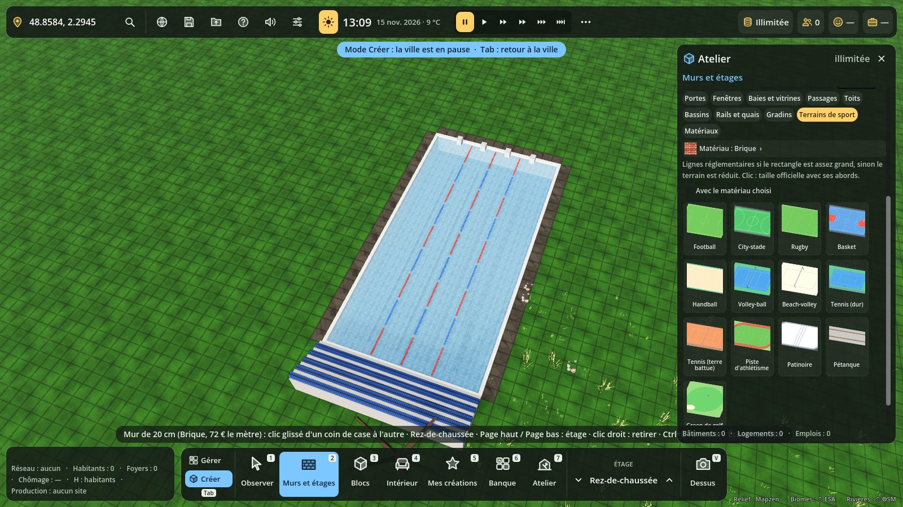
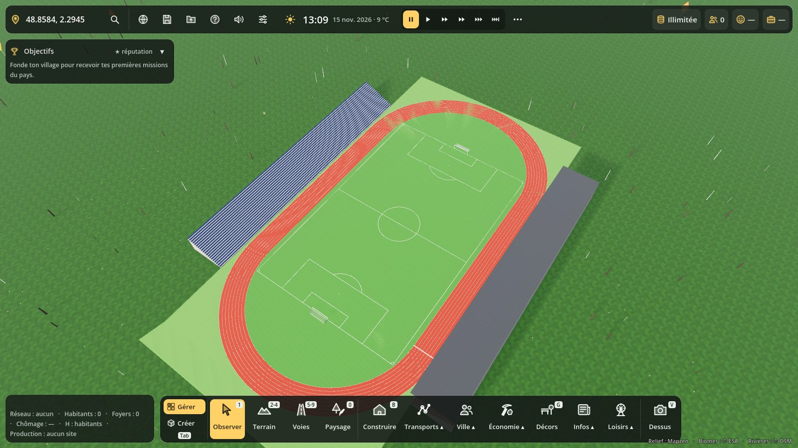
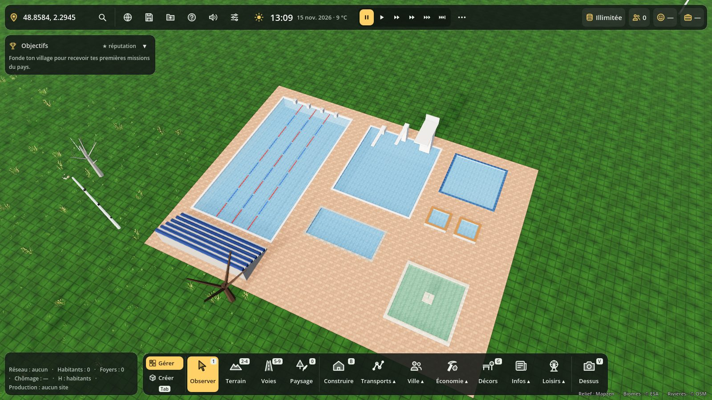
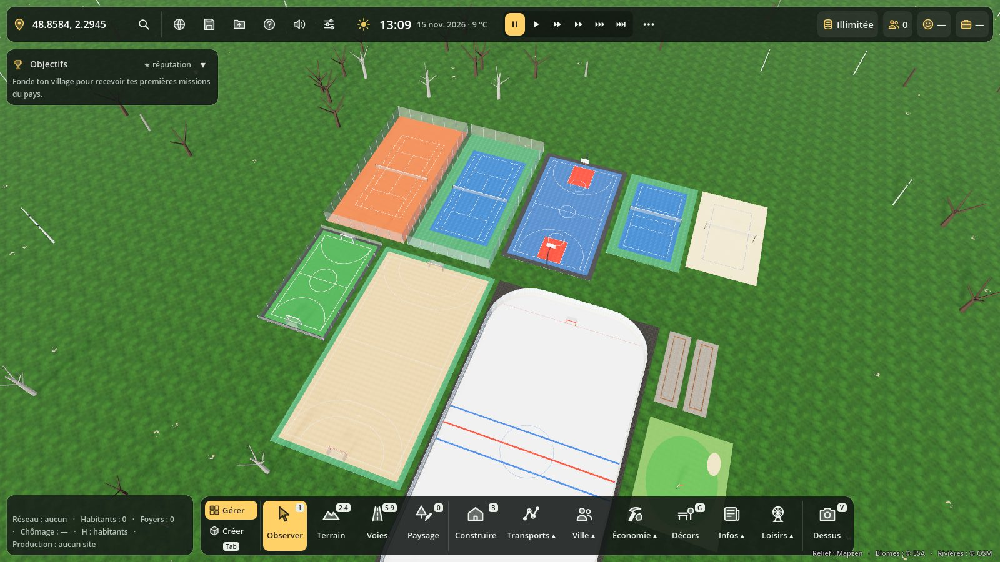
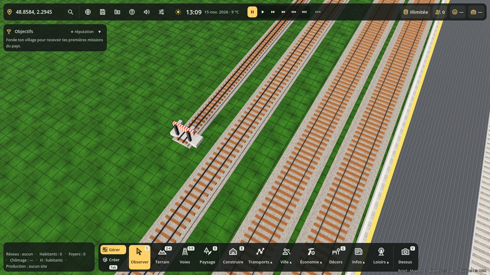
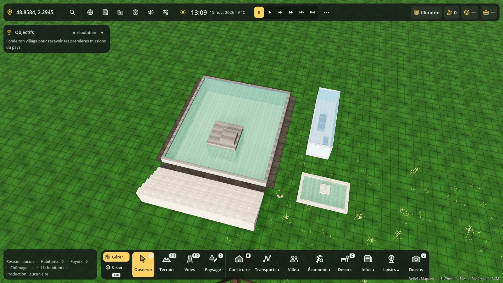

# Aménagements de l'atelier : bassins, rails, gradins, terrains de sport

Dans l'Atelier (mode Créer, **Murs et étages**), quatre onglets s'ajoutent à Portes, Fenêtres, Baies, Passages et Toits : **Bassins**, **Rails et quais**, **Gradins** et **Terrains de sport**. Chaque modèle est montré en maquette 3D avec son nom ; un clic choisit l'outil.

## Poser

- **Un clic** : le modèle à sa taille réelle (piscine de 4 × 8 m, bassin de 25 m, terrain de football de 105 × 68 m avec ses abords…), centré sur la case.
- **Clic glissé** : un rectangle de la taille voulue (bornes mini et maxi par modèle, affichées si elles ne vont pas).
- **R** tourne : les gradins montent en s'éloignant de la caméra (une flèche dans le fantôme montre le sens), et la taille d'un clic pivote d'un quart.
- **Avec le matériau choisi** (case dans l'onglet) : carrelage du bassin, surface du terrain, marches des gradins, pavage du tram… dans le matériau et la teinte de l'onglet Matériaux.
- **Gomme** ou **clic droit** : retire tout l'aménagement (moitié du prix rendue). **Ctrl+Z** annule.
- Un aménagement appartient à un bâtiment en murs fins et à un étage : piscine sur un toit-terrasse, gradins dans un gymnase, aquarium au 2e étage. Posé au sol, il crée le bâtiment.

## Les 34 modèles

| Onglet | Modèles |
|---|---|
| Bassins (8) | piscine (1,50 m), bassin de nage 25 ou 50 m (couloirs, lignes d'eau, plots), fosse à plongeon (4,50 m, tremplins 1 et 3 m, plateforme 5 m), pataugeoire, spa surélevé avec banquette, bassin d'ornement avec jet d'eau, bassin pour animaux (rochers, îlot, vitre de vision sous l'eau), aquarium vitré |
| Rails et quais (8) | voie ferrée (1,435 m, traverses bois), voie à grande vitesse (traverses béton), voie métrique, petit train (60 cm), voie de tram encastrée dans les pavés, quai de 55 cm (bandes d'éveil), quai couvert (marquise, bancs), heurtoir |
| Gradins (5) | gradins en béton à sièges bleus, tribune couverte (sièges rouges, mur du fond, toit en porte-à-faux), gradins en bois sur structure métallique, gradins antiques en pierre, talus en gazon |
| Terrains (13) | football, city-stade, rugby, basket, handball, volley-ball, beach-volley, tennis en dur et en terre battue, piste d'athlétisme 400 m (8 couloirs, terrain de foot au milieu), patinoire (angles arrondis, bandes et vitres, lignes de hockey), pétanque, green de golf |

- **Bassins** : le terrain est creusé dessous (et rebouché si on l'efface) ; pas de plancher sur l'eau. L'eau est transparente.
- **Rails** : ils suivent le grand côté du rectangle ; plus large, plusieurs voies côte à côte (4,50 m d'entraxe pour la voie normale). Le heurtoir se pose au bout d'une voie. Ce sont des décors de l'atelier : les trains du jeu roulent sur le réseau de transport (touche L).
- **Terrains** : lignes réglementaires (surfaces de réparation, raquettes et ligne à 3 points, carrés de service…) quand le rectangle est assez grand, sinon le terrain est réduit pour tenir dedans. Buts, paniers, poteaux en H, filets.
- **Gradins** : un rang tous les 80 cm (70 cm en bois, 1 m en gazon), un spectateur tous les 50 cm de rang.

## Avec les fonctions de bâtiment (banque de modèles)

Enregistré dans la **Banque**, un bâtiment avec des aménagements les garde (sauvegarde `am` du modèle), et :

- **Fonction proposée** : si l'usage du bâtiment n'a pas été choisi, celle de son plus grand aménagement : Piscine (bassins), Terrain de football (foot, rugby, city-stade, athlétisme), Court de tennis, Terrain de basket, Gymnase (handball, volley, patinoire), Parc (pétanque, golf, beach-volley, petit train, bassin d'ornement). On la change toujours avec le bouton Fonction.
- **Places assises** : les places des gradins sont gardées dans le modèle (`places`) ; posé comme bâtiment, il reçoit au moins autant de visiteurs que de places, et un stade (fonction Terrain de football) les utilise comme jauge des matchs.
- **Prix** : celui des aménagements s'ajoute aux matériaux.
- **Posé et tourné** : bassins, voies, gradins et terrains tournent avec le bâtiment et se visitent une fois le chantier fini.

## Pour les développeurs

- `scripts/batiments/amenagements.gd` (`Amenagements`) : catalogue `KINDS`, `ORDER`, `FAMILLES`, prix, places, fonction suggérée, maillage (`emit`, dans le même `BlocMesher` que les murs).
- Données d'un plan : `p.am = {Vector3i(x, étage, z): {k, w, d, r, m}}` ; sauvegarde en tableau plat de 8 valeurs par aménagement (`to_array` / `from_array`), dans la section `plans` et dans la banque.
- `PlanEditor.Tool.AMENAG`, `add_amenagement`, `amenag_rect` ; terrain creusé par `_sync_terrain` (`depth_below`).
- Tests : `tests/amenagements_test.gd` ; captures : `tests/amenagements_vitrine.gd --vue stade|piscines|gare|terrains|zoo|panneau`.
