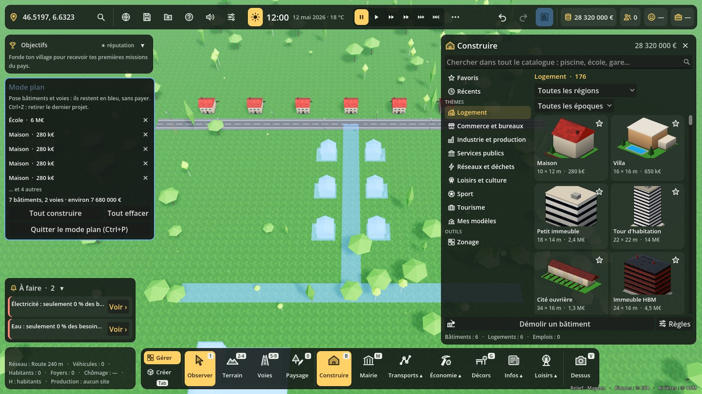
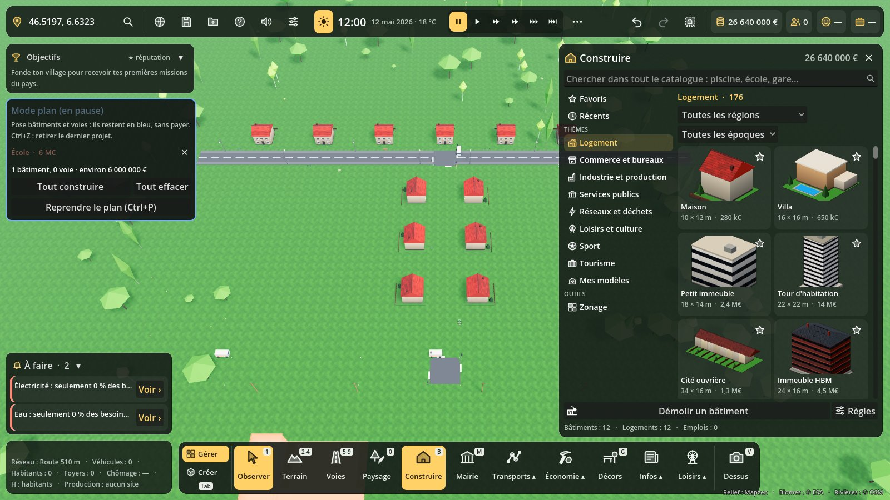

# Annuler (Ctrl+Z) et mode plan (Ctrl+P)

Demande de Gaël du 17 novembre 2026 : annuler avec Ctrl+Z partout en ville, et
un mode plan pour dessiner un quartier avant de le payer.

Captures refaites avec `tests/historique_vitrine.gd` (voir son en-tête).

## Annuler et rétablir

| Touche | Effet |
| --- | --- |
| Ctrl + Z | annule le dernier geste |
| Ctrl + Y, ou Ctrl + Maj + Z | rétablit ce qui vient d'être annulé |
| flèches ↶ ↷ en haut à droite, à côté de la caisse | pareil, la bulle dit ce qui sera défait |

Un **geste** est tout ce que fait un clic : du bouton enfoncé jusqu'à un
instant après le relâcher. Peindre une zone en glissant, semer des décors au
pinceau, tracer un tronçon ou valider tout un plan : chaque fois un seul
Ctrl+Z. On garde les 60 derniers gestes.

Ce qui s'annule :

- **Bâtiment posé** : il disparaît et **tout ce qui a été payé revient** (le
  prix, ou ce que le chantier a déjà coûté). Rétablir le repose, chantier
  repris à zéro.
- **Bâtiment démoli** : il revient tel qu'il était (même numéro, même
  avancement de chantier) et la moitié remboursée
  est reprise.
- **Voies** : tronçon tracé, tronçon démoli, giratoire, échangeur. C'est la
  différence exacte du réseau qui est défaite : une route branchée au milieu
  d'une autre la coupait en deux ; Ctrl+Z ôte la nouvelle et recolle
  l'ancienne avec son numéro d'origine et son usure.
- **Relief** touché pendant le geste : terrassement sous un bâtiment ou une
  route, outils de terrain (aplanir, monter, creuser), collines, canaux.
- **Zones**, **décors**, **conduites** d'électricité, d'eau, d'égouts et de
  gaz, **télécoms**, **allées du parc**, **pièces souterraines** : avec
  l'argent que le geste a coûté.
- **Projets du mode plan** (voir plus bas).

Ce qui ne s'annule pas : la **fondation d'un village** (Maison de commune,
kit de l'État, rue offerte) remet l'historique à zéro ; l'éditeur libre, les
murs et étages et les meubles gardent leur propre Ctrl+Z tant que leur outil
est ouvert. L'historique n'est pas sauvegardé : il repart à zéro au
chargement d'une partie. Si quelque chose a changé entre-temps (la place
d'un bâtiment à remettre est prise), Ctrl+Z le dit et fait le reste.

## Mode plan

Ctrl + P, ou le bouton en pointillés à droite des flèches ↶ ↷.

- Ce que tu poses (bâtiments du catalogue, voies) reste un **projet** dessiné
  en **bleu** : rien n'est payé, aucun chantier ne démarre. Les projets ne se
  chevauchent pas ; une maison peut être prévue le long d'une route
  elle-même en projet.
- L'encadré à gauche (sous les objectifs) liste les projets (✕ pour en retirer un), le
  nombre de bâtiments et de voies et le **total estimé**.
- **Tout construire** pose les voies d'abord, puis les bâtiments (ils ont
  ainsi leur accès), avec les vrais prix et les vrais chantiers. Ce qui ne
  passe pas (argent, place prise) reste en projet, en rouge, avec sa raison
  dans la bulle.
- **Ctrl+Z** retire le dernier projet posé ; juste après « Tout construire »,
  il défait toute la validation d'un coup (argent compris) et les projets
  reviennent en bleu.
- Quitter le mode plan garde les projets visibles ; Ctrl+P les reprend.
- Les zones, décors et conduites se posent normalement en mode plan.
- La Maison de commune se pose hors du mode plan.
- Les projets sont **sauvegardés** avec la partie (section `projets`).

## Carte entre amis

- Ctrl+Z ne défait que **ce que le joueur a fait lui-même**. Une pose
  annulée part au serveur comme une démolition « annulée » : tout ce qui a
  été payé revient. Une démolition annulée repose le bâtiment (au prix d'une
  pose neuve, la moitié remboursée ayant été rendue).
- Les voies : le serveur dit qui a tracé quoi (`rejouer` avec `par`) ; Ctrl+Z
  envoie l'action `voie_histo`, rejouée à l'identique chez tous (mêmes
  numéros de tronçons).
- Zones, décors, conduites : défaits sur place, puis envoyés comme tout
  changement de section partagée.
- Les projets du mode plan restent propres à chaque joueur jusqu'à la
  validation, qui part comme des poses ordinaires.

## Code

- `scripts/historique/historique_ville.gd` (`HistoriqueVille`, nœud
  « Historique » de la scène) : gestes, entrées, annuler / rétablir.
  Les systèmes notent leurs gestes avec `noter_pose`, `noter_demolition`,
  `noter_voies` ou `noter(nom, op)`.
- `TransportSystem.photo_reseau()`, `diff_reseau()`, `appliquer_diff()` :
  différence du réseau.
- `TerrainWorld.journal`, `noter_case()`, `remettre_cases()` : relief.
- Sections suivies : `HistoriqueVille.SECTIONS`, par `SectionsPartagees`
  (comme la carte entre amis). Seules les sections dont l'outil est ouvert
  sont photographiées au clic (0,03 ms sans outil, environ 8 ms avec 4 000
  décors et l'outil Décors ouvert).
- `scripts/historique/mode_plan.gd` (`ModePlan`) et `mode_plan_panel.gd`.
- Test : `tests/historique_test.gd`.
