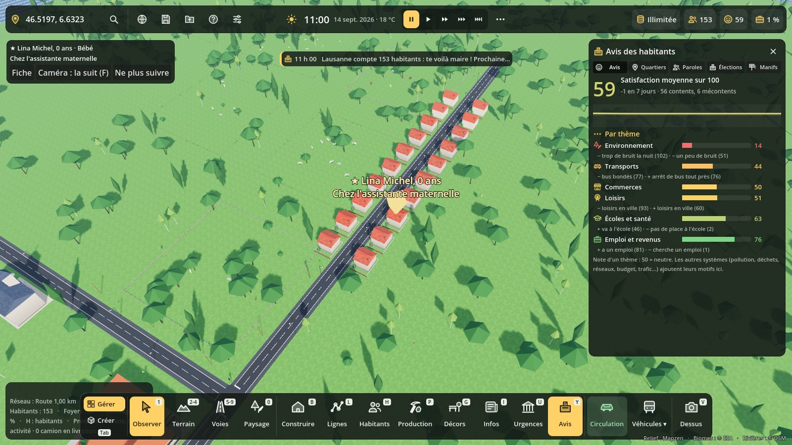
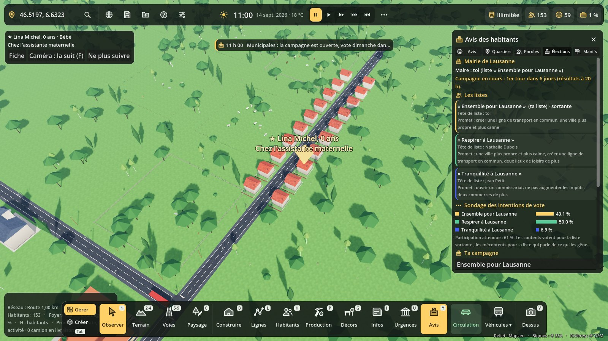
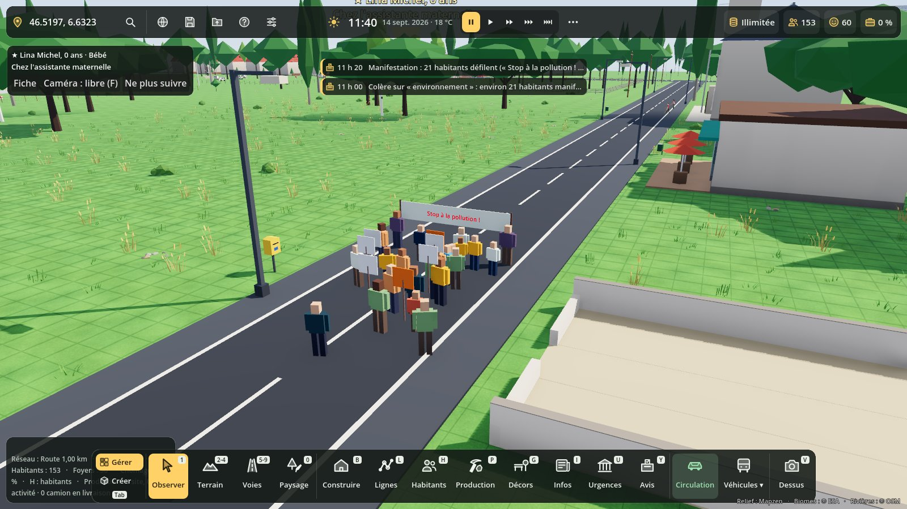

# Avis des habitants, élections et manifestations

Code : `scripts/avis/` (`avis.gd`, `elections.gd`, `manifestations.gd`, `avis_panel.gd`, `avis_carte.gd`).
Test : `tests/avis_test.gd`. Captures : `tests/avis_vitrine.gd`.





## Dans le jeu

- **Touche Y** (ou clic sur le chiffre de satisfaction en haut, ou bouton « Avis » de la barre du bas) : panneau Avis.
  - **Avis** : satisfaction moyenne, sa courbe jour après jour, note de chaque thème (0 à 100, 50 = neutre) et les motifs qui pèsent le plus, effets en cours (promesses, manifestations).
  - **Quartiers** : satisfaction par quartier (Centre-ville, Quartier Nord…), bouton « Aller voir », carte de couleur au-dessus des logements.
  - **Paroles** : ce que disent quelques habitants, les plus mécontents d'abord (clic : leur fiche).
  - **Élections** : maire, date du vote, promesses et objectifs du mandat, campagne, sondage, résultats.
  - **Manifs** : manifestations en cours ou annoncées, réponses, historique.
- **Admin (F10) → Événements** : élections (aucune, défaite sans effet, objectifs imposés, fin de partie) et manifestations oui / non.

## Thèmes

| Thème | Exemples de motifs |
|---|---|
| emploi | a un emploi, cherche un emploi, foyer endetté |
| logement | confort du logement, loyer (fil pollution / valeur foncière) |
| services | école, études, hôpital (fil services publics) |
| securite | police, délits (fil services publics) |
| environnement | pollution, bruit (fil pollution), déchets (fil déchets) |
| transports | long trajet, bouchons, bus, parkings (fil trafic) |
| impots | impôts, dette, routes abîmées (fil budget) |
| reseaux | eau, électricité, égouts (fil réseaux), internet, téléphone (fil internet) |
| loisirs | loisirs possibles en ville |
| commerces | commerces, rayons vides (production) |
| politique | promesses tenues ou non, manifestations dispersées, nouveau mandat |

La note d'un thème vaut `50 + 3 × delta moyen` (bornée de 0 à 100).

## Brancher un système (pour les autres fils)

Sans dépendre de l'ordre de chargement : le nœud rejoint le groupe `avis_sources` et répond à `avis_facteurs()`.

```gdscript
func _ready() -> void:
	add_to_group("avis_sources")

func avis_facteurs() -> Array:
	return [
		{"id": "dechets", "theme": "environnement", "f": _avis_dechets},          # par habitant
		{"id": "impots", "theme": "impots", "f": _avis_impots, "ville": true},    # le même pour tous
	]

func _avis_dechets(p: Dictionary) -> Array:   # p : Population.persons[pid]
	return [-8.0, ["− les poubelles débordent"]]

func _avis_impots() -> Array:
	return [-5.0, ["− impôts trop lourds"]]
```

Ou directement : `if Avis.instance: Avis.instance.facteur("id", "theme", f, ville)`.

- Delta conseillé : −15 à +10 par facteur. Raisons : « + … » ou « − … ».
- `Population.satisfaction(p)` garde ses motifs et ajoute ceux d'Avis ; elle rend aussi `themes` ({thème: delta}).
- Lire l'avis : `Avis.instance.note("transports")`, `moyenne()`, `sondage()` (thèmes, quartiers, satisfaction par logement).
- Effet passager : `Avis.instance.ajouter_effet(theme, delta, jours, raison)`.
- Ne pas utiliser `Population.extra_satisfaction` (un seul Callable, pris par la production).

## Élections municipales

- Le joueur devient maire à 30 habitants. Un mandat dure 6 ans de vie des habitants (au moins 28 jours de jeu) : 6 mois de jeu à la vitesse de vie normale.
- La campagne s'ouvre 7 jours avant (moins si le mandat est court). 2 listes adverses (3 dès 300 habitants), choisies selon les pires thèmes : écologie, sécurité, contribuables, solidarité. Leur tête de liste est un habitant (noté dans son CV).
- Le joueur nomme sa liste et choisit jusqu'à 3 promesses (école, hôpital, commissariat, ligne de transport, logements, chômage, loisirs, commerces, impôts, dette, environnement, réseaux).
- Vote le dimanche, résultats à 20 h. Chaque habitant majeur vote : la liste sortante attire les contents, les autres listes ceux que leurs thèmes gênent, les promesses touchent ceux que le thème gêne, et chacun a ses affinités. Participation plus forte chez les très contents, les très mécontents et les plus de 60 ans.
- Pas de majorité au 1er tour : 2e tour le dimanche suivant entre les listes à 10 % ou plus.
- Bilan : à la campagne suivante, chaque promesse tenue rapporte, chaque promesse rompue coûte cher.
- Défaite : sans effet, objectifs imposés (les promesses de la liste gagnante deviennent tes objectifs, à tenir pour reprendre la mairie), ou fin de partie (on peut continuer).
- « Élections anticipées » (onglet Élections) : vote le dimanche suivant, pour tester.

## Manifestations

- Chaque matin, si un thème est sous 35 / 100 (assez d'habitants concernés, 5 jours depuis la dernière sur ce thème), une manifestation est annoncée l'après-midi (14 h – 17 h) devant la mairie, sinon la place du marché.
- Un cortège avec banderole et pancartes remonte la rue la plus proche pendant une heure, la rue est fermée à la circulation, et des manifestants quittent leur journée pour y aller (passants visibles).
- Réponses : **Négocier** (300 € par manifestant, le thème remonte un mois), **Ignorer** (le thème baisse ; la 2e fois sur le même thème, grève d'un jour des agents de la ville : écoles, mairie et services fermés, sauf hôpitaux, pompiers et police), **Police** (s'il y a un commissariat : une patrouille est envoyée, le cortège est dispersé, la vie politique baisse et les manifestants s'en souviennent un mois). Sans réponse, elle compte comme ignorée.
- « Provoquer une manifestation » (onglet Manifs) : un cortège tout de suite, pour tester.

## Sauvegarde

Section `avis` : effets en cours, historique des sondages, élections (mandat, listes, promesses, objectifs, résultats), manifestations, grèves.
