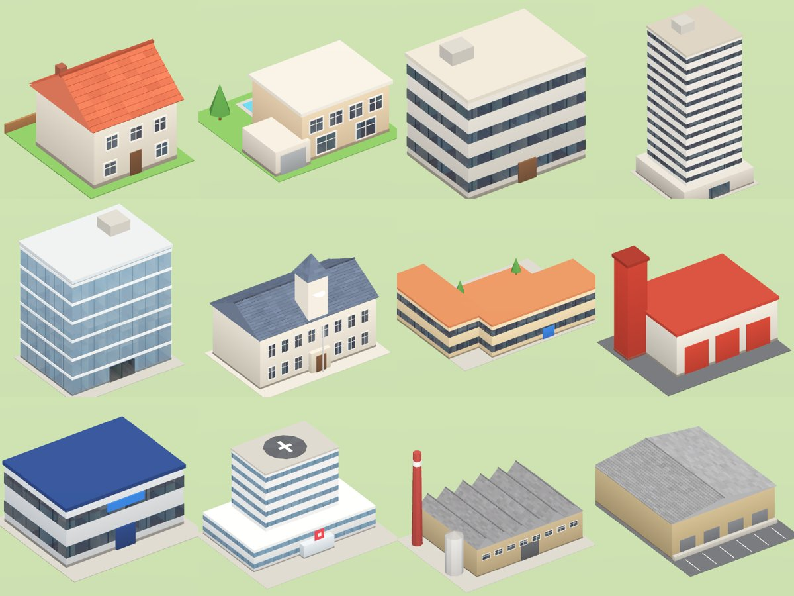
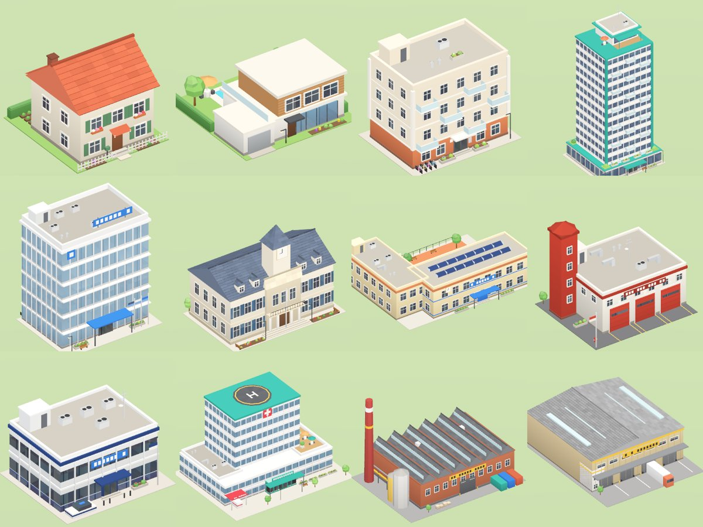
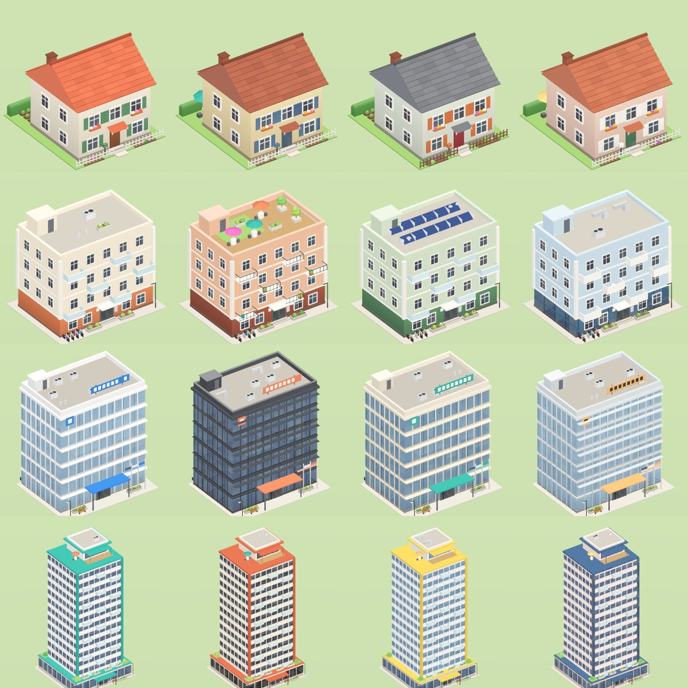
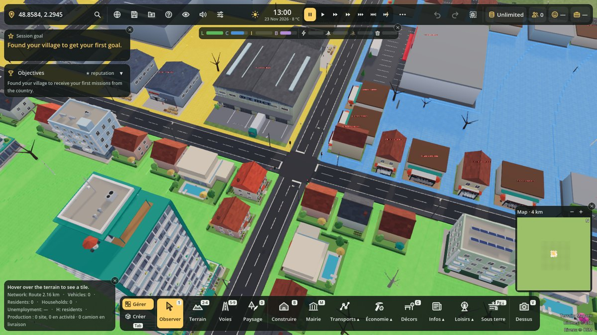

# Bâtiments de la ville plus détaillés

Les bâtiments de tous les jours (logements, bureaux, tours, services publics,
industrie) sont redessinés pour un rendu plus joli et plus « cosy » : couleurs
franches et harmonieuses, toits équipés, balcons, marquises, enseignes et
abords plantés. Les petits commerces ont leur propre habillage (Devantures).

| Avant | Après |
|---|---|
|  |  |
| **Quatre variantes par type** | **Dans un quartier** |
|  |  |

## Tester (Godot 4.7 et plus)

1. Ouvrir le projet, puis lancer avec F5 et commencer une partie (départ en 2000).
2. Peindre des zones résidentielles, commerciales et industrielles (B, Zonage) le
   long d'une route : les maisons, immeubles, tours, bureaux, ateliers, entrepôts
   et usines qui poussent ont les nouveaux modèles. Deux bâtiments voisins du même
   type n'ont pas la même variante (couleurs, toit-terrasse, balcons).
3. Poser une mairie, une école, une caserne de pompiers, un commissariat, un
   hôpital ou un château d'eau (B, Construire, Services publics).
4. Zoomer (molette) ou passer en vue au sol (V) : jardinières, vélos, bancs,
   parasols sur les terrasses, climatiseurs sur les toits. En dézoomant au-delà
   d'environ 320 m, ces détails disparaissent (version légère).
5. Les bâtiments modernes des styles du monde (tours, bureaux, hôpitaux, écoles,
   usines… de la bible) reçoivent aussi toits équipés, entrées et abords.

Planche de comparaison sans lancer le jeu :

```
godot --path . --script res://tests/batiments_detail_vitrine.gd -- --screenshot planche.png --ids immeuble,mairie --variantes
```

`--loin` montre la version vue de loin, `--tuile 800` agrandit les vignettes.

## Ce qui a été fait

- `scripts/batiments/habillage_ville.gd` (`HabillageVille`) : boîte à outils
  d'habillage. Toit-terrasse (dalle gravillonnée, acrotère et couvertine,
  édicule, climatiseurs, extracteurs, gaines, panneaux solaires, terrasse
  plantée avec parasols, réservoir, antenne), façades à trame (bandeaux vitrés,
  nez de dalle, montants), fenêtres sur quatre façades, balcons (verre,
  barreaux ou pleins, avec pots de fleurs ou chaise), marquises, marches, portes
  vitrées, enseignes en applique ou sur le toit, pastilles (croix de l'hôpital),
  horloges, arbres ronds, jardinières, massifs, haies, bancs, lampadaires,
  vélos, mâts et drapeaux, parkings.
- `scripts/batiments/batiments_classiques.gd` (`BatimentsClassiques`) : les 15
  modèles classiques (maison, villa, immeuble, tour d'habitation, bureaux,
  atelier, entrepôt, usine, maison de commune, mairie, école, pompiers,
  commissariat, hôpital, château d'eau) redessinés avec quatre palettes chacun.
  Ils ont maintenant des variantes (`BuildingCatalog.variants_of`).
- `StyleBuilder._generic` appelle `HabillageVille.habiller_bible` de près pour
  les archétypes modernes de la bible (immeuble, tour, gratte-ciel, bureaux,
  hôpital, école, grand magasin, usine, entrepôt, atelier, gare, théâtre). Les
  styles antiques et traditionnels gardent leurs ornements (StyleKit).
- Les mâts des drapeaux de la mairie et de la maison de commune restent à leur
  place (Communes.MATS).
- Fumée : la cheminée de la maison et celle de l'usine ont leur point de fumée.

## Performances

- Les détails ne sont dessinés que de près (`BlocMesh._fine()`). La version
  lointaine garde les volumes et les couleurs : 70 à 900 triangles.
- De près : 1 000 à 9 000 triangles par modèle. Un modèle est construit une
  fois par type et par variante puis partagé (2 à 25 ms la première fois).
- `BuildingCatalog.approx_height` est mis en cache : le repère de l'habitant
  suivi reconstruisait le maillage complet du bâtiment à chaque image.
- Banc `tests/perf_ville.gd` (headless, CPU) : 1 000 habitants, image moyenne
  6,7 ms (main : 9,4 à 10 ms) ; 5 000 habitants, 17,3 ms (main : 18,3 ms). Le
  rendu GPU reste à mesurer sur un vrai PC (sans `--headless`).
