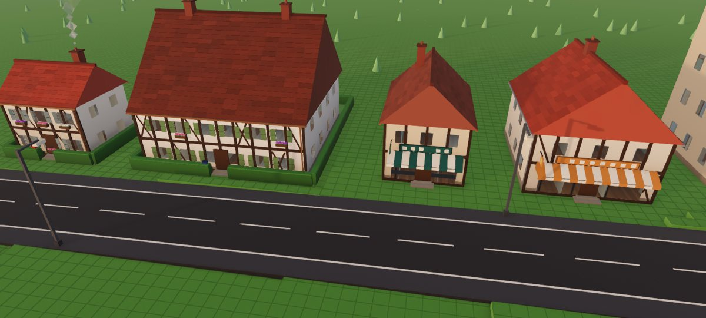
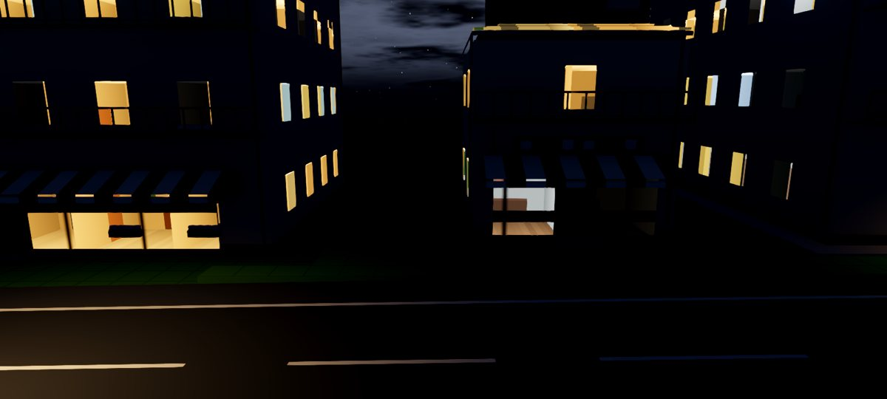
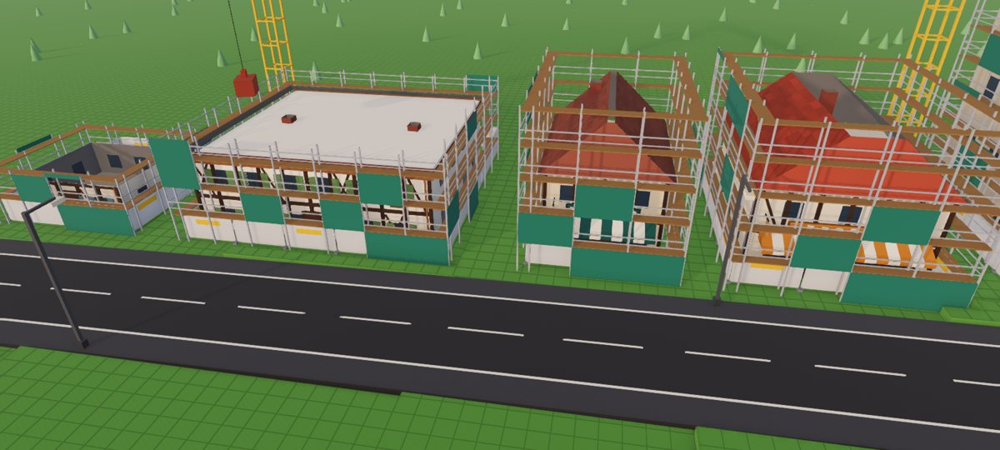
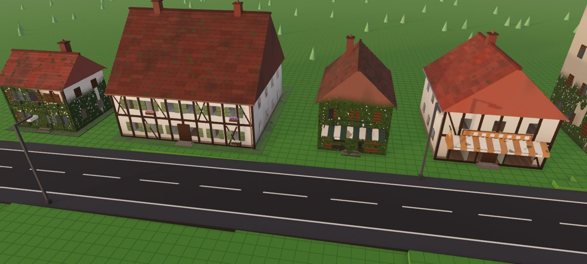

# Bâtiments plus riches et vivants

Ce document couvre cinq ajouts sur les bâtiments de la bible.

1. Des détails modelés selon le style.
2. Des variantes, pour que deux bâtiments du même type ne soient jamais identiques.
3. Des bâtiments qui vivent et vieillissent.
4. Des chantiers visibles.
5. Des pièces visibles derrière les fenêtres.

| Jour | Soir |
|---|---|
|  |  |
| **Chantiers** | **Usure et abandon** |
|  |  |

## Tester (Godot 4.3 et plus)

1. Ouvrir le projet, puis lancer avec F5.
2. Poser une maison ou un immeuble (B, Construire). Il démarre en chantier : palissade, échafaudages, puis les étages qui montent un par un et enfin le toit. Les bâtiments de plus de 12 m ont une grue.
   - Un chantier dure 1 h de jeu, plus 45 min par étage de 3 m.
   - Pour aller plus vite, Maj+T accélère le temps.
   - Personne ne s'installe avant la fin du chantier.
3. Une fois une maison habitée, ses abords apparaissent : clôture ou haie, boîte aux lettres, pots de fleurs, potager, arbre fruitier et linge. La cheminée fume.
4. Regarder les vitres de près (molette, ou V pour la vue au sol). On voit les pièces derrière. Le soir, une partie d'entre elles s'allument.
5. Pour l'usure, le plus simple est de régler la vitesse de la vie des habitants (H) sur ×365 :
   - les façades se délavent et la mousse gagne les toits ;
   - un bâtiment vide depuis longtemps se couvre de lierre, et ses fenêtres restent éteintes ou sont condamnées.

## Ce qui a été fait

### 1. Détails par style (`scripts/catalogue/style_kit.gd`)

`StyleKit.flags()` décide de ce que porte chaque style. Une clé `kit_<nom>` dans `Styles.STYLES` peut forcer un réglage.

- **Volets** ouverts autour des fenêtres. Leurs couleurs dépendent de la région.
- **Jardinières fleuries** en Europe traditionnelle.
- **Colombages en croix de Saint-André** pour les styles à colombages et Tudor.
- **Cheminées** en brique ou dans la couleur du mur. Leur sommet est gardé comme point de fumée : métadonnée `ancres` du maillage.
- **Gouttières** et descentes, en zinc ou en cuivre.
- **Enseignes** avec lettres stylisées et potence pour les commerces anciens.
- **Auvents rayés** en pente avec lambrequin festonné.
- **Garde-corps à barreaux** sur les balcons.
- **Lanternes rouges** pour la Chine, le Japon et la Corée.
- **Moucharabiehs** pour le Maghreb, la Perse, l'Inde, le monde ottoman et la côte swahilie.
- **Équipements de toit et de façade** : climatiseurs, antennes, panneaux solaires, réservoir d'eau de New York (Art déco), balcons modernes.
- **Perron** devant les portes.

Ces détails ne sont dessinés que de près. La version vue de loin (au-delà de 320 m) s'en passe.

### 2. Variantes (`BuildingCatalog.VARIANTES`, 4 par type de la bible)

- La variante 0 garde le modèle de base.
- Les autres changent la teinte des murs et du toit, ajoutent ou retirent une fenêtre par façade et modifient la pente du toit.
- Les couleurs des volets et des enseignes changent aussi.
- La variante d'un bâtiment dépend de son emplacement (`BuildingSystem.variant_for`) et elle est sauvegardée (clé `v`).

### 3. Bâtiments vivants (`scripts/batiments/batiments_vie.gd`)

Ce code se trouve dans le nœud `VieBatiments` créé par `terre_main`.

- **Usure.** Elle augmente avec l'âge du bâtiment, qui suit la vitesse de la vie des habitants. Elle monte lentement quand le bâtiment est occupé et vite quand il est vide.
- **Abandon.** Il commence après 6 mois de vie sans personne, logements et emplois compris.
- **Matériaux par paliers.** Ces deux valeurs passent par des variantes du matériau des bâtiments (`NightWindows.variant_material`, 30 au plus). Le renderer Compatibilité n'accepte pas les uniformes d'instance.
- **Abords.** Ils sont décrits dans `scripts/batiments/abords.gd` : un maillage par type, posé seulement quand un foyer habite la maison. La clôture change selon la région : piquets, haie, muret ou bambou.
- **Fumée.** Le shader `scripts/batiments/fumee.gdshader` anime des bouffées à facettes qui montent, grossissent et dérivent. Il n'y a aucune particule.

### 4. Chantiers

- Les clés `ne` (date de construction) et `fin` (fin du chantier) sont sauvegardées.
- Les parties sans ces clés chargent des bâtiments déjà construits, donc sans chantier.
- Pendant le chantier, le bâtiment utilise une copie du matériau qui dessine aussi les faces arrière. Sa uniforme `chantier_h` coupe tout ce qui dépasse la hauteur construite.
- Les échafaudages (planchers, lisses, filets), la palissade et la grue sont générés à partir de la taille réelle du bâtiment.
- `BatimentsVie.chantiers = false` fait apparaître les bâtiments d'un coup. Les tests des habitants, de la production et de l'interface utilisent ce réglage.

### 5. Intérieurs vus par les fenêtres (`scripts/ambiance/batiment.gdshader`)

Le shader utilise l'« interior mapping ». Derrière chaque vitre, il calcule une pièce de 3,4 m × 3 m × 4 m :

- sol en parquet ou en carrelage, plafond, murs de couleur ;
- un meuble bas, un cadre, une plante, une porte sur le côté ;
- un fond plus sombre que l'avant.

Tout est calculé, sans aucune géométrie. Le jour, on devine la pièce derrière les reflets. Le soir, les pièces allumées laissent voir leur décor sous le plafonnier.

- `interieurs = false` revient aux vitres simples.
- `day_interior` règle la visibilité des pièces en plein jour.

## Coût

| Ajout | Effet sur le rendu |
|---|---|
| Détails par style | Ils ajoutent des triangles de près seulement (même maillage partagé par type et par variante). |
| Variantes | Elles multiplient au plus par 4 le nombre de maillages en mémoire, et seulement pour les types posés. |
| Intérieurs, usure et coupe | Ils ne coûtent que dans le shader, sur les pixels concernés. |
| Abords et fumée | Ils disparaissent au-delà de 260 m et de 380 m. |

## Captures

Les captures se font avec `tests/batiments_vitrine.gd` :

- `--habite` : abords et fumée ;
- `--chantiers --avancement 0.45` : chantiers à divers stades ;
- `--usure 0.85 --abandon 1` : bâtiments vieillis ;
- `--heure 19.5` : lumière du soir.
