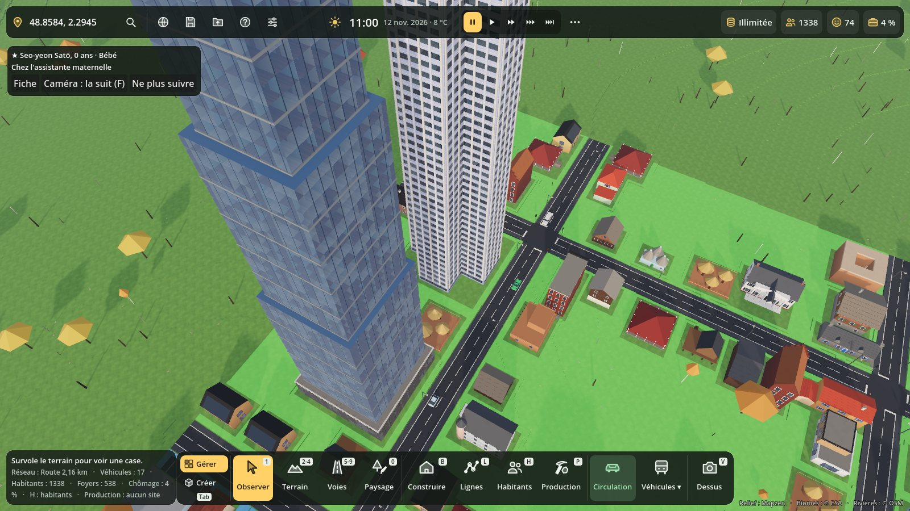
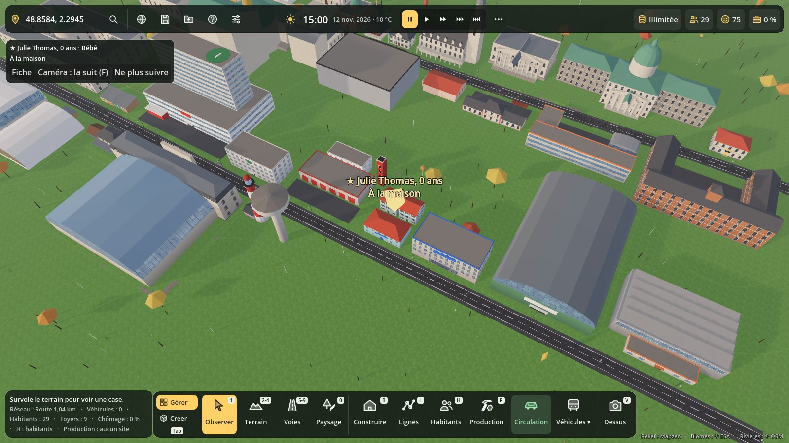
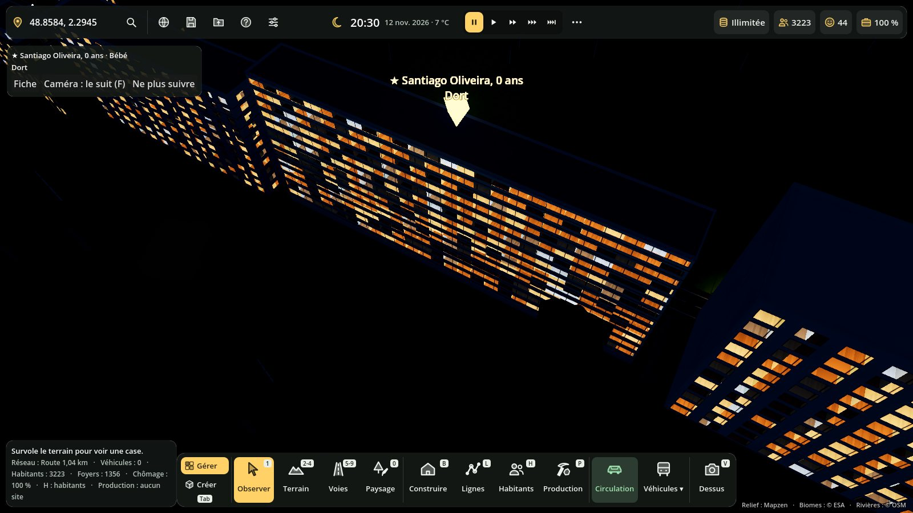
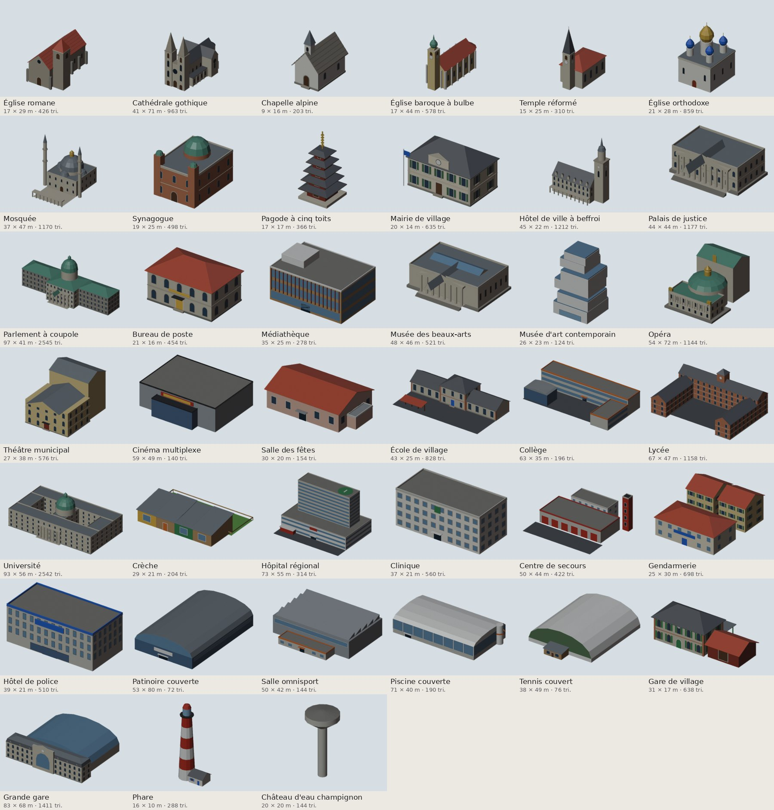
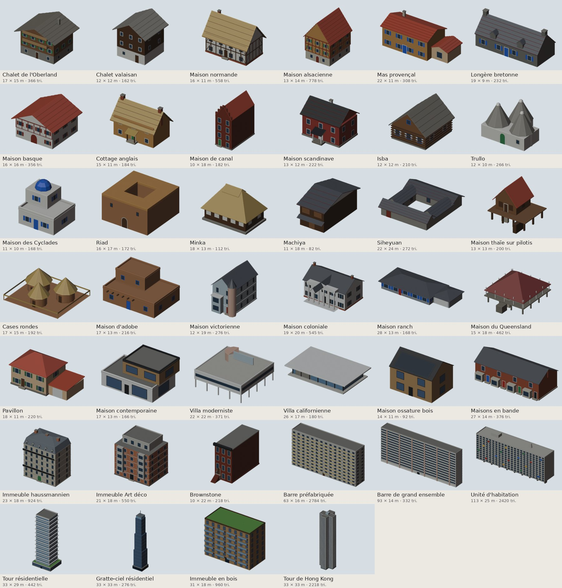

# Bible de bâtiments Blender

Des centaines de bâtiments **modélisés dans Blender par script**, d'après des bâtiments réels ou des types
courants du monde entier, et branchés dans le catalogue de construction du jeu (touche **B**, puis la
catégorie). Chaque bâtiment a son prix, ses emplois et leurs métiers, ses logements ou ses visiteurs, sa
région et son époque (les filtres du panneau), et plusieurs variantes de couleur.

79 bâtiments à ce jour : 39 bâtiments publics, 40 résidences.







## Comment ça marche

1. **Blender, sans interface** : `tools/blender/bible/generer.py` construit chaque bâtiment avec le kit
   `tools/blender/bible/kit_bible.py` (corps de bâtiment et fenêtres sur chaque façade, toits à deux pans,
   à croupes, mansardés, en voûte, en sheds, clochers, coupoles, bulbes, silos, colombages, pignons à
   redents…). Le kit s'appuie sur le générateur commun `tools/blender/batiment_lowpoly.py` (palette, export).
2. Chaque bâtiment donne un `.glb` dans `assets/modeles/bible/` avec sa **texture palette 64 × 64** et sa carte
   `<id>.palette.json` : on peut le recolorer dans une scène avec `CouleursModele.recolore()`, comme les stades.
3. Chaque famille a sa fiche `assets/modeles/bible/<famille>.json` (nom, catégorie, emprise, prix, emplois,
   métiers, logements, source…). **`BibleGlb`** (`scripts/modeles/bible_glb.gd`) la lit et `BuildingCatalog`
   ajoute les bâtiments au catalogue.
4. Dans le jeu, le `.glb` est « cuit » en maillage à couleurs par sommet, comme les bâtiments faits en code :
   même matériau partagé, donc **fenêtres allumées la nuit**, intérieurs derrière les vitres, usure,
   chantiers, ombre au pied des murs, et **variantes de couleur** (murs, toit, volets) selon le bâtiment.

Règles des modèles : 1 unité = 1 mètre, origine au sol au centre, façade principale vers la voie,
3 000 triangles au plus (la plupart en ont moins de 1 000). Les métiers des emplois viennent de
`Metiers.METIERS` ; le champ `role` relie un bâtiment aux mécaniques existantes (une école accueille des
élèves, une église la vie spirituelle, une caserne les pompiers…).

## Tester dans Godot

1. Ouvre le projet dans Godot 4.3 ou plus récent (les `.glb` s'importent tout seuls, ça prend une minute la
   première fois).
2. Lance le jeu (**F5**), choisis un lieu, puis **B** (Construire) : les nouveaux bâtiments sont dans
   chaque catégorie. Le filtre de région (Europe, Asie de l'Est, Amériques…) et d'époque aide à les trouver.
   Un bâtiment se pose comme les autres (clic, **R** pour tourner) ; il lui faut une route à côté.
3. Passe la nuit (**Maj+T** pour accélérer) : les fenêtres s'allument.
4. Zonage : dans l'onglet Zones du panneau, choisis le style **« Bâtiments Blender (bible) »** ; les maisons,
   immeubles, commerces et ateliers de la bible poussent alors dans les zones peintes.

Vitrine de toute une famille le long de deux routes :

```bash
godot --path . --script res://tests/batiments_vitrine.gd -- --famille publics --screenshot vitrine.png
```

Test automatique :

```bash
godot --headless --path . --import
godot --headless --path . --script res://tests/bible_glb_test.gd
```

Il doit afficher `BIBLE GLB TEST OK` (fiches complètes, métiers connus, maillage léger posé au sol et
contenu dans son emprise, vitres reconnues, variantes de couleur).

Refaire une famille avec Blender (sur le PC de Gaël) :

```bash
"C:\Program Files\Blender Foundation\Blender 5.2\blender.exe" --background --factory-startup --python tools/blender/bible/generer.py -- --famille publics --vignettes vignettes
python tools/blender/bible/planche.py --famille publics --vignettes vignettes --out docs/bible-blender/planche-publics.jpg
python tools/blender/bible/doc.py
```

`--seul id1,id2` ne refait que ces bâtiments. Le dossier `vignettes` (images de chaque bâtiment) n'est pas
gardé dans le dépôt : seules les planches le sont. Pour ajouter un bâtiment : une fonction de plus dans le
module de sa famille, avec le décorateur `@batiment(...)` (voir `tools/blender/bible/registre.py`).

## Bâtiments publics (39)

Culte, administration, culture, éducation, santé, sécurité, sport couvert, gares.



| Bâtiment | Catégorie | Emprise | Prix | Emplois / logements | D'après |
| --- | --- | --- | --- | --- | --- |
| **Église romane** — Église de village en pierre, nef, abside et clocher carré. | Services publics | 17 × 29 m, 19,3 m de haut | 3,2 M€ | 2 emplois | Églises romanes de Bourgogne et du Brionnais (XIe-XIIe s.) |
| **Cathédrale gothique** — Nef haute, bas-côtés, transept, deux tours à flèche et rosace. | Services publics | 41 × 71 m, 62 m de haut | 60 M€ | 12 emplois | D'après la cathédrale Notre-Dame de Chartres et celle de Reims, très simplifiées |
| **Chapelle alpine** — Petite chapelle blanche à clocheton, toit de bardeaux. | Services publics | 9 × 16 m, 13,5 m de haut | 650 k€ | 1 emplois | Chapelles du Valais et des Grisons |
| **Église baroque à bulbe** — Église claire à pilastres et clocher à bulbe de cuivre. | Services publics | 17 × 44 m, 36,1 m de haut | 7,5 M€ | 3 emplois | Églises baroques de Bavière et du Tyrol (Wieskirche, Saint-Oswald de Seefeld) |
| **Temple réformé** — Temple sobre en molasse, grandes fenêtres et clocher à flèche. | Services publics | 15 × 25 m, 31,4 m de haut | 2,4 M€ | 1 emplois | Temples vaudois et neuchâtelois (XVIIIe-XIXe s.) |
| **Église orthodoxe** — Église blanche à cinq bulbes dorés et bleus. | Services publics | 21 × 28 m, 29,8 m de haut | 9 M€ | 3 emplois | D'après les églises russes à cinq coupoles (cathédrale de la Dormition de Vladimir) |
| **Mosquée** — Salle de prière à grande coupole, demi-coupoles et deux minarets. | Services publics | 37 × 47 m, 43 m de haut | 14 M€ | 4 emplois | D'après les mosquées ottomanes de Sinan (Süleymaniye, Istanbul), simplifiée |
| **Synagogue** — Façade néo-mauresque à arcs, deux tourelles à petites coupoles. | Services publics | 19 × 25 m, 17,8 m de haut | 6 M€ | 2 emplois | D'après la synagogue Beth Yaacov de Genève et les synagogues néo-mauresques du XIXe s. |
| **Pagode à cinq toits** — Pagode de bois à cinq étages de toits débordants. | Services publics | 17 × 17 m, 30,2 m de haut | 5,5 M€ | 2 emplois | D'après la pagode du Hōryū-ji (Nara, Japon) |
| **Mairie de village** — Mairie-école à fronton, horloge et drapeau. | Services publics | 20 × 14 m, 10,9 m de haut | 1,8 M€ | 6 emplois | Mairies-écoles françaises de la IIIe République |
| **Hôtel de ville à beffroi** — Grand hôtel de ville à arcades et beffroi de 55 m. | Services publics | 45 × 22 m, 53,8 m de haut | 18 M€ | 60 emplois | D'après l'hôtel de ville et le beffroi d'Arras (Pas-de-Calais) |
| **Palais de justice** — Palais néo-classique à colonnade, fronton et grand perron. | Services publics | 44 × 44 m, 18,1 m de haut | 22 M€ | 80 emplois | D'après le palais de justice de Lyon (« les 24 colonnes ») et celui de Paris |
| **Parlement à coupole** — Grand palais de grès vert avec coupole centrale et deux ailes. | Services publics | 97 × 41 m, 43,3 m de haut | 90 M€ | 300 emplois | D'après le Palais fédéral de Berne (1902) |
| **Bureau de poste** — Bureau de poste en pierre, guichets au rez-de-chaussée. | Services publics | 21 × 16 m, 11,1 m de haut | 1,5 M€ | 10 emplois | Bureaux de poste suisses et français des années 1920-1930 |
| **Médiathèque** — Médiathèque contemporaine, grand volume de verre et lames de bois. | Services publics | 35 × 25 m, 16,8 m de haut | 12 M€ | 20 emplois | D'après les médiathèques françaises des années 2000 (Bordeaux, Lyon) |
| **Musée des beaux-arts** — Musée néo-classique à portique ionique et salles éclairées par le toit. | Loisirs | 48 × 46 m, 16,4 m de haut | 30 M€ | 40 emplois | D'après le British Museum (Londres) et le musée des Beaux-Arts de Lille |
| **Musée d'art contemporain** — Boîtes blanches empilées et décalées, bandeaux de verre. | Loisirs | 26 × 23 m, 38,1 m de haut | 40 M€ | 35 emplois | D'après le New Museum de New York (SANAA, 2007) |
| **Opéra** — Façade à loggia et colonnes, coupole et grande cage de scène. | Loisirs | 54 × 72 m, 43 m de haut | 120 M€ | 150 emplois | D'après l'Opéra Garnier (Paris, 1875), très simplifié |
| **Théâtre municipal** — Théâtre à l'italienne de ville moyenne, fronton et cage de scène. | Loisirs | 27 × 38 m, 23,1 m de haut | 15 M€ | 25 emplois | Théâtres municipaux du XIXe s. (Lausanne, Besançon) |
| **Cinéma multiplexe** — Douze salles, hall vitré et enseigne lumineuse. | Loisirs | 59 × 49 m, 16,9 m de haut | 18 M€ | 30 emplois | Multiplexes de périphérie (Pathé, UGC, Kinepolis) |
| **Salle des fêtes** — Salle polyvalente de village avec scène et buvette. | Loisirs | 30 × 20 m, 9,1 m de haut | 2,2 M€ | 3 emplois | Salles polyvalentes de communes rurales |
| **École de village** — École Jules Ferry : corps central, deux ailes (filles et garçons) et préau. | Services publics | 43 × 25 m, 10,7 m de haut | 3 M€ | 8 emplois | Écoles de la IIIe République (lois Jules Ferry, 1881-1882) |
| **Collège** — Collège des années 1970 : barres de béton et bandes vitrées. | Services publics | 63 × 35 m, 11 m de haut | 14 M€ | 50 emplois | Collèges « Pailleron » et constructions scolaires industrialisées |
| **Lycée** — Lycée en U autour d'une cour, briques et grandes fenêtres. | Services publics | 67 × 47 m, 26,3 m de haut | 28 M€ | 110 emplois | Lycées urbains de l'entre-deux-guerres (lycée Claude-Bernard, Paris) |
| **Université** — Bâtiment principal néo-Renaissance à coupole et deux cours. | Services publics | 93 × 56 m, 37,5 m de haut | 80 M€ | 400 emplois | D'après le bâtiment principal de l'EPF de Zurich (Semper, 1864) |
| **Crèche** — Crèche et école maternelle colorée, toits à un pan et jardin. | Services publics | 29 × 21 m, 5,6 m de haut | 1,9 M€ | 10 emplois | Crèches contemporaines en bois (Suisse romande, Vorarlberg) |
| **Hôpital régional** — Socle de soins, tour d'hospitalisation de 9 étages et urgences. | Services publics | 73 × 55 m, 44,1 m de haut | 120 M€ | 900 emplois | Hôpitaux régionaux des années 1970-1990 (CHUV Lausanne, CHU de province) |
| **Clinique** — Clinique privée de trois étages, façade claire et loggias. | Services publics | 37 × 21 m, 14,4 m de haut | 18 M€ | 120 emplois | Cliniques de quartier contemporaines |
| **Centre de secours** — Caserne moderne : six portes, bureaux, tour de manœuvre. | Services publics | 50 × 44 m, 20,6 m de haut | 9 M€ | 40 emplois | Centres d'incendie et de secours (SDIS) des années 2000 |
| **Gendarmerie** — Brigade de gendarmerie : bureaux et logements de fonction. | Services publics | 25 × 30 m, 11,4 m de haut | 6,5 M€ | 25 emplois, 8 logements | Casernes de gendarmerie françaises |
| **Hôtel de police** — Commissariat central : quatre étages, accueil vitré, garage. | Services publics | 39 × 21 m, 14,9 m de haut | 16 M€ | 120 emplois | Hôtels de police contemporains |
| **Patinoire couverte** — Halle voûtée avec piste de 60 × 30 m et gradins. | Sport | 53 × 80 m, 18 m de haut | 24 M€ | 15 emplois | D'après la patinoire de Malley (Lausanne) et les patinoires municipales |
| **Salle omnisport** — Gymnase triple : terrain de handball, gradins, toit à sheds. | Sport | 50 × 42 m, 12,7 m de haut | 7 M€ | 6 emplois | Salles omnisports municipales |
| **Piscine couverte** — Halle vitrée avec bassin olympique de 50 m et toboggan. | Sport | 71 × 40 m, 14 m de haut | 22 M€ | 20 emplois | Centres aquatiques et piscines olympiques couvertes |
| **Tennis couvert** — Halle gonflable sur arceaux, deux courts en résine. | Sport | 38 × 49 m, 11 m de haut | 3,5 M€ | 3 emplois | Halles de tennis de clubs |
| **Gare de village** — Bâtiment voyageurs à deux niveaux, marquise et halle à marchandises. | Services publics | 31 × 17 m, 10,1 m de haut | 2 M€ | 6 emplois | Gares des compagnies PLM et des CFF (fin XIXe s.) |
| **Grande gare** — Bâtiment voyageurs à horloge et grande halle voûtée sur les quais. | Services publics | 83 × 68 m, 25 m de haut | 95 M€ | 150 emplois | D'après la gare de l'Est (Paris) et la gare de Lausanne |
| **Phare** — Tour à bandes rouges et blanches, lanterne et maison du gardien. | Services publics | 16 × 10 m, 35,5 m de haut | 4 M€ | 2 emplois, 1 logement | D'après les phares de Bretagne (phare du Créac'h, Ouessant) |
| **Château d'eau champignon** — Réservoir de béton en forme de champignon sur un fût de 30 m. | Services publics | 20 × 20 m, 37,6 m de haut | 2,5 M€ | 1 emplois | Châteaux d'eau en béton des années 1960-1970 (France, Suède) |

## Résidences (40)

Maisons traditionnelles du monde, maisons et villas modernes, immeubles et tours.



| Bâtiment | Catégorie | Emprise | Prix | Emplois / logements | D'après |
| --- | --- | --- | --- | --- | --- |
| **Chalet de l'Oberland** — Grand chalet de bois sur socle de pierre, toit à faible pente et balcons. | Logement | 17 × 15 m, 11,4 m de haut | 780 k€ | 2 logements | Chalets de l'Oberland bernois (Gstaad, Grindelwald) |
| **Chalet valaisan** — Chalet de mélèze bruni sur rez de pierre blanchie, toit de lauzes. | Logement | 12 × 12 m, 10,1 m de haut | 520 k€ | 1 logement | Maisons d'Evolène et du val d'Hérens (Valais) |
| **Maison normande** — Maison à colombages, torchis blanc et toit de chaume à forte pente. | Logement | 16 × 11 m, 9,9 m de haut | 420 k€ | 1 logement | Chaumières du pays d'Auge (Normandie) |
| **Maison alsacienne** — Maison à colombages ocre, pignon sur rue et toit pentu à tuiles plates. | Logement | 13 × 14 m, 14,1 m de haut | 560 k€ | 1 logement | Maisons de Riquewihr et de Colmar (Alsace) |
| **Mas provençal** — Mas en pierre enduite ocre, tuiles canal, volets bleu lavande. | Logement | 22 × 11 m, 8,6 m de haut | 690 k€ | 1 logement | Mas du Luberon et des Alpilles (Provence) |
| **Longère bretonne** — Longue maison de granit, ardoises et cheminées aux pignons. | Logement | 19 × 9 m, 7,3 m de haut | 380 k€ | 1 logement | Longères du Finistère (Bretagne) |
| **Maison basque** — Etxe blanche aux colombages rouges, toit dissymétrique. | Logement | 16 × 16 m, 9,1 m de haut | 640 k€ | 2 logements | Fermes labourdines (Ainhoa, Espelette) |
| **Cottage anglais** — Cottage de pierre dorée, toit de chaume épais et souches de cheminée. | Logement | 15 × 11 m, 8,9 m de haut | 610 k€ | 1 logement | Cottages des Cotswolds (Angleterre) |
| **Maison de canal** — Haute maison de brique étroite à pignon à redents et poulie de levage. | Logement | 10 × 18 m, 17 m de haut | 1,4 M€ | 3 logements | Grachtenhuizen d'Amsterdam (XVIIe s.) |
| **Maison scandinave** — Maison de bois peinte au rouge de Falun, encadrements blancs. | Logement | 13 × 12 m, 8,8 m de haut | 450 k€ | 1 logement | Maisons rurales suédoises (Dalécarlie) |
| **Isba** — Maison de rondins, fenêtres à encadrements sculptés peints. | Logement | 12 × 12 m, 7,1 m de haut | 300 k€ | 1 logement | Isbas du nord de la Russie (Kiji, Souzdal) |
| **Trullo** — Maisonnettes blanchies à la chaux coiffées de cônes de pierre sèche. | Logement | 12 × 10 m, 6,2 m de haut | 350 k€ | 1 logement | Trulli d'Alberobello (Pouilles, UNESCO) |
| **Maison des Cyclades** — Cubes blanchis à la chaux, terrasse, petite coupole et volets bleus. | Logement | 11 × 10 m, 8 m de haut | 520 k€ | 1 logement | Maisons d'Oia (Santorin) et de Mykonos |
| **Riad** — Maison à patio aux murs ocre, terrasses et petites ouvertures. | Logement | 16 × 17 m, 7,6 m de haut | 900 k€ | 1 logement | Riads de la médina de Marrakech |
| **Minka** — Ferme japonaise à grand toit de chaume en croupe et galerie de bois. | Logement | 18 × 13 m, 10,9 m de haut | 650 k€ | 1 logement | Minka de Shirakawa-gō et des maisons rurales japonaises |
| **Machiya** — Maison de ville de Kyoto : façade de lattes de bois, auvent et tuiles grises. | Logement | 11 × 18 m, 7,9 m de haut | 820 k€ | 1 logement | Kyō-machiya du quartier de Gion (Kyoto) |
| **Siheyuan** — Maison à cour carrée de Pékin : quatre ailes de briques grises et toits courbes. | Logement | 22 × 24 m, 5,1 m de haut | 1,6 M€ | 2 logements | Siheyuan des hutong de Pékin |
| **Maison thaïe sur pilotis** — Maison de teck sur pilotis, toits pentus aux pignons recourbés. | Logement | 13 × 13 m, 9,3 m de haut | 280 k€ | 1 logement | Maisons traditionnelles du centre de la Thaïlande |
| **Cases rondes** — Trois cases de terre aux toits de paille coniques autour d'une cour. | Logement | 17 × 15 m, 5,3 m de haut | 120 k€ | 1 logement | Cases traditionnelles d'Afrique de l'Ouest (pays dogon, Sénégal) |
| **Maison d'adobe** — Volumes d'adobe arrondis en gradins, poutres saillantes (vigas). | Logement | 17 × 13 m, 7,1 m de haut | 480 k€ | 2 logements | Taos Pueblo et maisons de Santa Fe (Nouveau-Mexique) |
| **Maison victorienne** — « Painted lady » à bow-window, tourelle et façade pastel. | Logement | 12 × 19 m, 14 m de haut | 1,9 M€ | 2 logements | Painted Ladies d'Alamo Square (San Francisco) |
| **Maison coloniale** — Maison à étage symétrique, colonnes blanches et grand porche. | Logement | 19 × 20 m, 10,6 m de haut | 1,2 M€ | 1 logement | Maisons néo-coloniales de Nouvelle-Angleterre et du Sud des États-Unis |
| **Maison ranch** — Maison de plain-pied tout en longueur, toit bas et garage attenant. | Logement | 28 × 13 m, 4,5 m de haut | 520 k€ | 1 logement | Ranch houses américaines des années 1950 |
| **Maison du Queensland** — Maison de bois sur pilotis, véranda tout autour et toit de tôle. | Logement | 15 × 18 m, 8,8 m de haut | 640 k€ | 1 logement | Queenslanders de Brisbane (Australie) |
| **Pavillon** — Pavillon de lotissement : crépi clair, tuiles, garage accolé. | Logement | 18 × 11 m, 8,1 m de haut | 310 k€ | 1 logement | Maisons de lotissement françaises des années 1980-2000 |
| **Maison contemporaine** — Deux cubes décalés, toit plat, grandes baies et bardage de bois. | Logement | 17 × 13 m, 7,3 m de haut | 820 k€ | 1 logement | Maisons d'architecte des années 2010 |
| **Villa moderniste** — Boîte blanche sur pilotis, fenêtres en bandeau et solarium sur le toit. | Logement | 22 × 22 m, 9,6 m de haut | 2,4 M€ | 1 logement | D'après la villa Savoye (Le Corbusier, Poissy, 1931) |
| **Villa californienne** — Pavillon de verre et d'acier à toit plat très débordant. | Logement | 26 × 17 m, 3,7 m de haut | 2,9 M€ | 1 logement | Case Study Houses (Los Angeles, années 1950) |
| **Maison ossature bois** — Maison passive en bois clair, toit à deux pans et panneaux solaires. | Logement | 14 × 11 m, 8,5 m de haut | 450 k€ | 1 logement | Maisons passives du Vorarlberg et de Scandinavie |
| **Maisons en bande** — Quatre maisons de brique mitoyennes avec bow-windows. | Logement | 27 × 14 m, 8,9 m de haut | 1,3 M€ | 4 logements | Terraced houses de l'époque victorienne (Londres, Manchester) |
| **Immeuble haussmannien** — Pierre de taille, balcons filants aux 2e et 5e étages, toit mansardé en zinc. | Logement | 23 × 18 m, 25,1 m de haut | 9 M€ | 18 logements | Immeubles du baron Haussmann (Paris, 1853-1870) |
| **Immeuble Art déco** — Immeuble de briques et béton, bow-windows d'angle et attique en retrait. | Logement | 21 × 18 m, 18,7 m de haut | 6,5 M€ | 14 logements | Immeubles des années 1930 (Boulogne-Billancourt, Genève, Tel-Aviv) |
| **Brownstone** — Maison de ville new-yorkaise en grès brun, perron et corniche saillante. | Logement | 10 × 22 m, 13,7 m de haut | 3,6 M€ | 4 logements | Brownstones de Brooklyn et Harlem (New York) |
| **Barre préfabriquée** — Bloc de panneaux de béton préfabriqués, onze étages, loggias. | Logement | 63 × 16 m, 31,7 m de haut | 16 M€ | 88 logements | Plattenbau WBS 70 (Berlin-Marzahn, Halle-Neustadt) |
| **Barre de grand ensemble** — Longue barre HLM de quatorze étages, façades rythmées et halls traversants. | Logement | 93 × 14 m, 38,6 m de haut | 22 M€ | 120 logements | Grands ensembles des années 1960 (Sarcelles, La Courneuve) |
| **Unité d'habitation** — Grand paquebot de béton brut sur pilotis, loggias colorées, toit-terrasse. | Logement | 113 × 25 m, 52 m de haut | 40 M€ | 160 logements | D'après la Cité radieuse (Le Corbusier, Marseille, 1952) |
| **Tour résidentielle** — Tour de vingt-quatre étages, balcons filants vitrés et socle commercial. | Logement | 33 × 29 m, 79,1 m de haut | 45 M€ | 150 logements | Tours de logements contemporaines (Paris rive gauche, Lyon Confluence) |
| **Gratte-ciel résidentiel** — Tour de verre de 45 étages, couronnement lumineux. | Logement | 33 × 33 m, 173 m de haut | 160 M€ | 320 logements | Tours résidentielles new-yorkaises et de Dubaï (années 2010) |
| **Immeuble en bois** — Immeuble de sept étages en bois, loggias et toiture végétalisée. | Logement | 31 × 18 m, 21,7 m de haut | 12 M€ | 42 logements | Immeubles bois-béton contemporains (Mjøstårnet, Bordeaux Hypérion) |
| **Tour de Hong Kong** — Tour fine de quarante étages en croix, fenêtres serrées et climatiseurs. | Logement | 33 × 33 m, 116,6 m de haut | 70 M€ | 400 logements | Tours de logements publics de Hong Kong (Harmony, Concord) |
