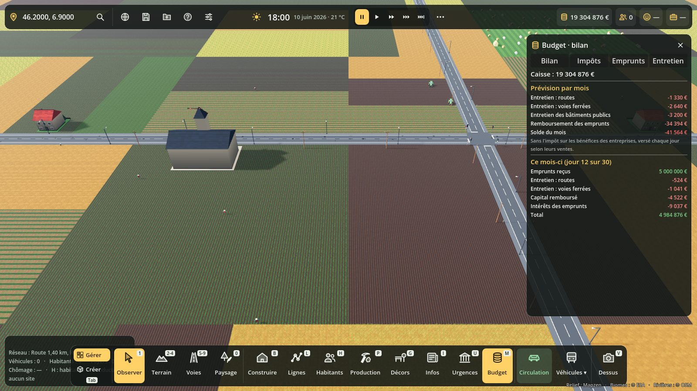
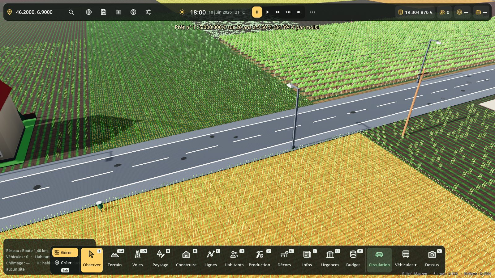
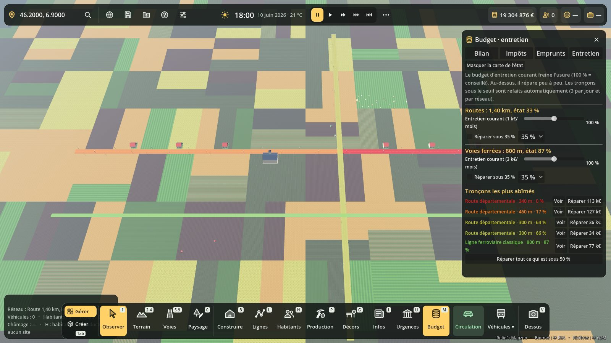

# Budget de la commune : impôts, emprunts, entretien et usure

Touche **M** (comme Mairie), ou l'icône **Budget** de la barre du bas. En solo, la caisse
de la commune est celle du joueur : le joueur est le maire.

Le panneau a quatre onglets :

- **Bilan** : caisse, prévision du mois (recettes en vert, dépenses en rouge), comptes du
  mois en cours et du mois dernier, alerte « dans le rouge » et tutelle.
- **Impôts** : taux votés par le conseil municipal.
- **Emprunts** : nouvel emprunt, emprunts en cours, remboursement anticipé.
- **Entretien** : budget d'entretien par réseau, réparation automatique, carte de l'état
  des voies, tronçons les plus abîmés (« Voir », « Réparer »).

## Impôts

| Impôt | Base | Taux |
|---|---|---|
| Taxe foncière | 95 € par foyer et par mois × valeur foncière | 0 à 200 % |
| Impôt des entreprises (CFE) | 60 € par emploi privé occupé | 0 à 200 % |
| Impôt sur les bénéfices | 25 % des bénéfices du jour des entreprises | 0 à 200 % |

Le réglage **Impôts** de l'Admin (F10) reste un multiplicateur général, appliqué en plus.
La **pression fiscale** ressentie (moyenne : foncier 50 %, entreprises 25 %, bénéfices 25 %)
fait râler les habitants au-dessus de 100 % (jusqu'à −15 de satisfaction) et les rend un peu
plus contents en dessous (jusqu'à +6). Le système d'avis des habitants la lit par le groupe
`avis_sources`.

## Emprunts

- Montants : 100 k€, 500 k€, 1 M€, 5 M€, 10 M€, 20 M€ ; durées : 5, 10, 20 ou 30 ans de jeu.
- Taux : 2 % + jusqu'à 5 % selon la dette (par rapport au plafond), +1 % si la caisse est dans
  le rouge, +0,5 % par palier de durée.
- Mensualité fixe (prêt amortissable), payée chaque jour au 1/30e : intérêts d'abord, puis capital.
- Plafond de dette : 8 ans de recettes, au moins 10 M€ (pour qu'une ville neuve puisse s'équiper).
- Remboursement anticipé : capital restant + 1 % de pénalité.

## Tutelle du préfet

Caisse dans le rouge **90 jours** de suite : la ville passe sous tutelle. Chaque impôt est
relevé à au moins 150 %, plus d'emprunts, plus de nouveaux bâtiments publics (catégorie
Services). Elle en sort après **30 jours** sans dette en caisse. Sans effet en argent illimité.

## Usure des voies

Chaque tronçon de route, de rail, de chemin ou de voie d'eau a un **état** de 100 % (neuf)
à 0 % (hors d'usage), gardé dans le réseau (`edges[id].u`, sauvegardé avec les transports,
conservé quand un tronçon est coupé en deux).

- **Âge** : sans entretien ni trafic, une route est hors d'usage en 1 100 jours de jeu
  (rail 1 800, chemin 1 500, voie d'eau 3 000).
- **Trafic** : chaque heure de jeu, les véhicules présents usent leur tronçon selon leur
  poids (voiture 1, deux-roues 0,3, utilitaire 4, camion de livraison 10, bus et tram 8,
  attelage 6, train 3, bateau 0,5) et la longueur du tronçon.
- **Sous 50 %** : nids-de-poule et rustines visibles sur la chaussée, véhicules ralentis
  (jusqu'à 60 % de leur vitesse), habitants mécontents si l'état moyen des routes passe
  sous 70 %.
- **À 0 %** : la voie est fermée (`closed_edges[id] = "usure"`), les itinéraires l'évitent.
- Vitesse d'usure dans l'Admin (F10) : Aucune, Lente, Normale, Rapide.

## Entretien

- **Entretien courant** (curseur 0 à 200 %) : à 100 %, l'usure est divisée par 5 ; au-dessus,
  les voies se refont peu à peu. Coût conseillé par km et par mois : route 700 €, rail
  2 200 €, chemin 120 €, voie d'eau 250 € (selon la largeur, × coût des constructions).
- **Réparation automatique** : chaque jour, jusqu'à 3 tronçons par réseau sous le seuil
  (20, 35, 50 ou 70 %) sont refaits, si la caisse le permet.
- **Réfection** d'un tronçon : 35 €/m² de route (rail 120, chemin 15, voie d'eau 20) × usure.
  C'est un **chantier visible** (voie fermée, engins, scripts/chantiers) qui dure environ
  6 h de jeu par 100 m et paie au fil des travaux ; en construction instantanée (Admin), tout
  de suite.
- **Carte de l'état** : bouton de l'onglet Entretien, vert = neuf, orange = abîmé,
  rouge = hors d'usage.

## Brancher un autre système

Le nœud `Budget` (classe `BudgetCommunal`, `BudgetCommunal.instance`, groupe
`budget_communal`) est créé par `terre_main`.

- Coûts mensuels : ajouter son nœud au groupe `budget_entretien` avec
  `func budget_entretien() -> Dictionary` (`{"Entretien réseau d'eau": euros_par_mois}`).
- Recettes mensuelles : groupe `budget_recettes` avec `func budget_recettes() -> Dictionary`.
- Ces montants sont versés chaque jour (1/30e) et affichés dans le bilan. Ne pas toucher
  `buildings.money` en plus pour ces flux.
- Flux ponctuels : `recette(poste, montant)`, `depense(poste, montant)` ; somme déjà versée
  ailleurs : `BudgetCommunal.noter(poste, montant)`.
- Usure d'un réseau à soi (eau, électricité, fibre…) : `register(reseau, id, longueur_m)`,
  `etat_ext(reseau, id)`, `user(reseau, id, quantite)`, `reparer_ext(reseau, id)`.
- Lecture : `taux`, `pression_fiscale()`, `dette()`, `mensualites()`, `tutelle`,
  `etat_moyen_routes()`, `vitesse_facteur(eid)` (si le trafic expose `speed_factors`, le
  budget s'y branche tout seul).
- `Population.city_pay` : le versement quotidien de la ville passe par `BudgetCommunal.pay_day`.

Sauvegarde : section `budget` (taux, emprunts, entretien, autres réseaux, tutelle, comptes
des 24 derniers mois).

## Code et tests

- `scripts/budget/budget_communal.gd` : impôts, emprunts, tutelle, usure, entretien.
- `scripts/budget/usure_vue.gd` : nids-de-poule (MultiMesh) et carte de l'état.
- `scripts/budget/budget_panel.gd` : panneau (M).
- `tests/budget_test.gd` : `BUDGET TEST OK`.
- `tests/budget_vitrine.gd` : captures (avec affichage).
