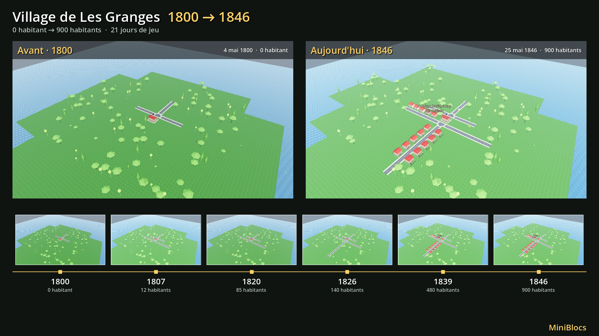
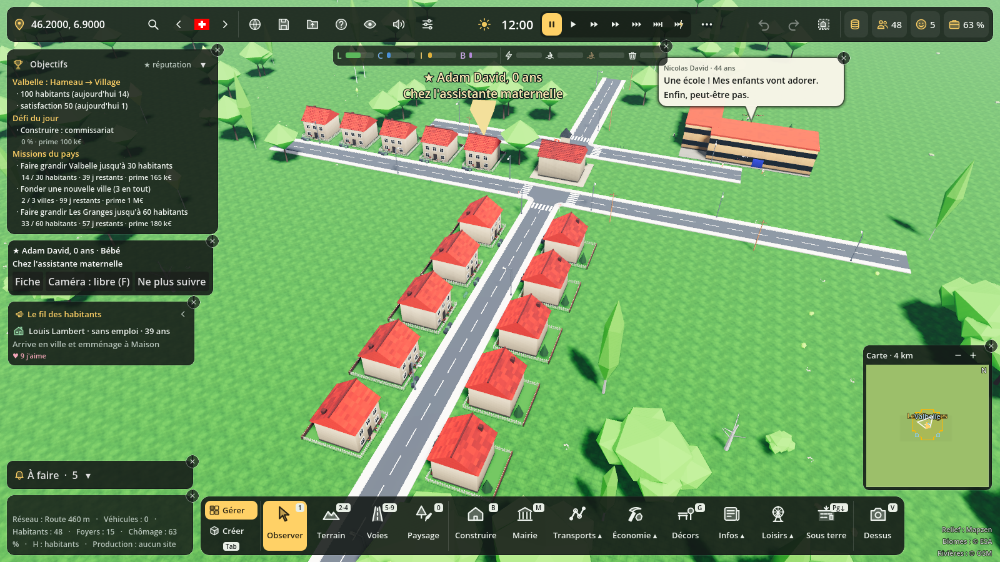

# Bulles des habitants et frise avant / après

## Bulles des habitants

Quand le joueur fait un choix, un habitant du coin réagit en une phrase, dans une
bulle au-dessus de l'endroit. Ton réaliste avec une touche d'humour.

- **Ce qui fait parler** : un bâtiment posé (logement, commerce, usine, ferme,
  école, santé, police, pompiers, lieu de culte, gare, mairie, réseaux, déchets,
  cimetière, loisirs, sport, parc, zoo, tourisme, place, monument), une
  démolition (et « où dorment-ils ce soir ? » pour un logement), une route, une
  voie ferrée, un chemin, une voie d'eau, des zones, des décors, des conduites,
  les impôts relevés ou baissés, Ctrl+Z (« Ah, finalement non ? »), la fondation
  d'un village, et 4 bâtiments identiques en une minute (« C'est une ville ou un
  jeu de dominos ? »). 96 phrases en tout.
- **Époque et âge** : une phrase peut être réservée à avant ou après une année
  (« Mon cheval va enfin garder ses fers » avant 1910, « toujours pas de place
  pour se garer » après 1955) ou à un âge (enfant, adulte, retraité).
- **Qui parle** : un habitant qui vit près de l'endroit (sinon n'importe qui de
  plus de 5 ans). Nom et âge en haut de la bulle ; clic : sa fiche (H).
- **Lisible** : une seule bulle à la fois, 12 s au moins entre deux bulles, le
  même genre de choix ne refait parler qu'après 75 s, et les gestes très
  fréquents (routes, zones, décors, maisons) ne font parler qu'une fois sur deux
  environ. La bulle reste ~6 s (plus si la souris est dessus).
- **Couper** : croix de la bulle, ou œil en haut → menu Affichage → « Bulles des
  habitants » (gardé pour les parties suivantes).
- Purement pour le plaisir : les bulles ne changent ni l'avis (Y) ni l'argent.

Code : `scripts/habitants/reactions_habitants.gd` (`ReactionsHabitants`, phrases
dans `PHRASES`). Les gestes du joueur arrivent par l'historique d'annulation :
`HistoriqueVille.geste_note(ops, noms)` et `HistoriqueVille.annule`. Les impôts
sont suivis sur `BudgetCommunal.taux`, la fondation sur `Communes.fonde`.

## Frise avant / après

Dans l'écran du time-lapse (Maj+F8), bouton **« Frise avant / après (image) »**
(section Partager) : une image PNG 1920 × 1080 à partager.

- En haut : le nom du village et les années (« 1800 → 1846 »), les habitants
  au début et aujourd'hui, le nombre de jours de jeu.
- Au milieu : la toute première image (« Avant · 1800 ») et la dernière
  (« Aujourd'hui · 1846 ») côte à côte, avec la date et les habitants.
- En bas : une frise de 6 images régulièrement espacées, avec l'année et les
  habitants sous chacune.
- Enregistrée dans `Images/MiniBlocs/Photos`, aperçu à l'écran (Échap ou
  « Fermer l'aperçu »), bouton « Ouvrir le dossier ».

Chaque image du time-lapse garde désormais l'**année de la partie** (`an`,
`Epoques.annee()`) : dans une partie commencée en 1800, la frise et l'écran du
time-lapse affichent « 4 mai 1846 » et non l'année de l'horloge.

Code : `scripts/photo/frise_ville.gd` (`FriseVille`), bouton dans
`scripts/photo/timelapse_panel.gd`.

## Tests

- `tests/reactions_frise_test.gd` (headless) : règles, époques, âges, écart et
  recharge, historique, Ctrl+Z, impôts, menu Affichage, clic, traductions
  en/de/it/es, frise (choix des images, mise en page, PNG, aperçu).
- `tests/reactions_frise_vitrine.gd` : captures réelles (xvfb + opengl3).

