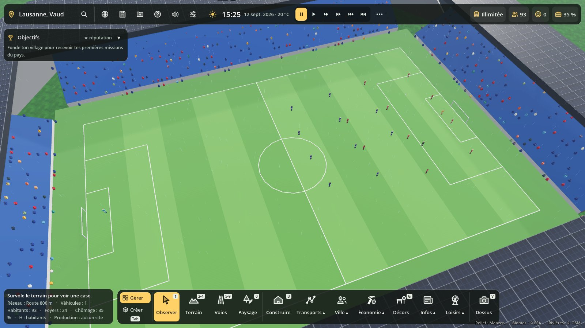
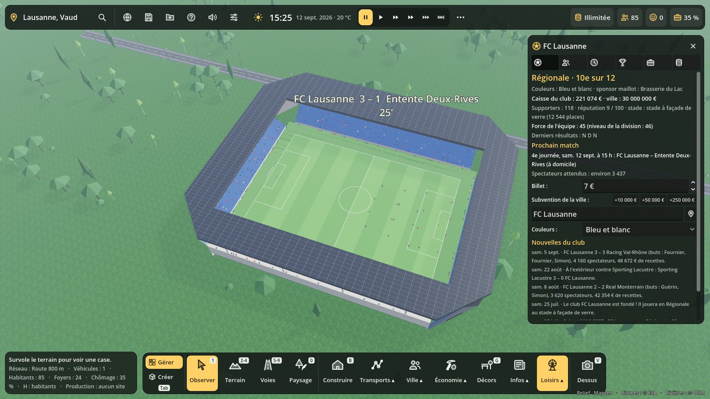

# Club de sport (football)

Première version du troisième univers de MiniBlocs : un club de football dont
le joueur est le président. Menu **Loisirs → Club de sport**, ou **Maj+B**.

## Fonder le club

- Il faut un stade terminé dans la ville : un des 11 stades modélisés dans
  Blender (Construire → Sport) ou le terrain de foot du catalogue.
- On choisit un nom (proposé : « FC » + le lieu de la partie), des couleurs et
  le stade. La ville verse une subvention de départ de 150 000 €.
- Le club a **sa propre caisse**, séparée de celle de la ville. La ville peut
  le subventionner (onglet Club) et touche la location du stade à chaque
  match à domicile (12 % de la billetterie, au moins 300 €).
- L'équipe de départ compte 20 joueurs. En Régionale, la moitié sont des
  habitants de la ville qui aiment le football : ils jouent bénévolement.

## Championnat

| Division | Niveau des équipes | Billet de référence | Droits télé / saison | Sponsors / saison |
|---|---|---|---|---|
| Régionale | 46 | 7 € | — | 30 000 € |
| Nationale | 56 | 12 € | 350 000 € | 400 000 € |
| Deuxième Ligue | 65 | 18 € | 6 M€ | 2,5 M€ |
| Première Ligue | 74 | 30 € | 25 M€ | 10 M€ |

- 12 clubs (le tien et 11 clubs inventés), matchs aller et retour : 22 journées.
- Le samedi, de mi-août à fin mai, sans la trêve de Noël (18 décembre – 20 janvier).
  Si le club est fondé en cours de saison, les journées se resserrent
  (mercredis en plus, ou matchs aller seulement) ; trop tard, il attend la
  saison suivante.
- Les deux premiers montent, les deux derniers descendent. Prime de classement
  en fin de saison. Historique et palmarès dans l'onglet Finances.

## Équipe

- Chaque joueur : poste (gardien, défenseur, milieu, attaquant), âge, note,
  potentiel, forme, fatigue, blessures, salaire, fin de contrat.
- Le onze est choisi tout seul selon la **formation** (4-4-2, 4-3-3, 3-5-2,
  5-3-2, 4-5-1) ; un joueur peut être mis au repos. Il manque un poste : un
  autre joueur le remplace, moins bien.
- **Tactique** : défensive, équilibrée, offensive (plus de buts des deux côtés).
- **Entraînement** : léger, normal, intense. Les jeunes progressent vers leur
  potentiel (plus vite à l'entraînement intense), les plus de 30 ans baissent.
  Intense : plus de fatigue et de blessures.
- Fin de saison : les contrats finis partent (les bénévoles restent presque
  tous), les plus de 36 ans prennent leur retraite. Moins de 16 joueurs : des
  jeunes du centre de formation complètent.

## Matchs

- Le résultat dépend de la force du onze (notes, forme, fatigue) contre celle
  de l'adversaire, de l'avantage à domicile et de la tactique.
- À domicile, le match se voit au stade (système des événements) : joueurs
  aux couleurs du club, tribunes remplies selon l'affluence, tableau
  d'affichage, buts dans le fil d'actualité. Les habitants fans de foot y vont.
- Affluence : fans de la ville + supporters du club (ils augmentent avec les
  victoires et les montées), selon la forme du moment, l'adversaire et le
  **prix du billet**.

## Argent du club

- Recettes : billetterie, buvette (3,50 € par spectateur), boutique,
  sponsor maillot, droits télé, prime de classement, ventes de joueurs,
  subventions de la ville.
- Dépenses : salaires (le 1er du mois), staff, transferts, primes à la
  signature (deux mois de salaire), indemnités de départ, location du stade.
- Le marché des transferts change chaque lundi. Les meilleurs joueurs refusent
  un club trop modeste (selon la division et la réputation).

## Code

- `scripts/club/club_sport.gd` (`ClubSport.instance`) : club, joueurs,
  championnat, argent, sauvegarde (section `club`).
- `scripts/club/club_donnees.gd` : divisions, formations, tactiques, clubs
  inventés, salaires, valeurs, calendrier aller-retour.
- `scripts/club/club_panel.gd` : le menu (6 onglets).
- `scripts/evenements/matchs.gd` : les matchs du club au stade (`data.club`),
  sans match inventé en plus dans ce stade.
- Tests : `tests/club_test.gd` ; captures : `tests/club_vitrine.gd`.

## Pistes pour la suite

Coupe, équipe féminine et équipes de jeunes, centre d'entraînement à bâtir,
agrandir le stade, abonnements, matchs à l'extérieur suivis à la radio,
autres sports (basket, hockey, rugby).
