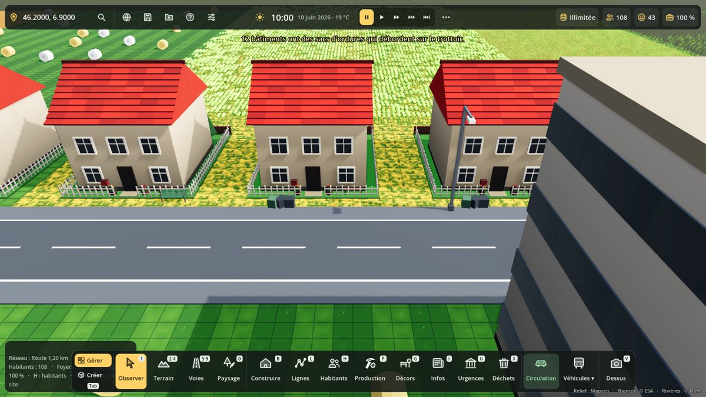
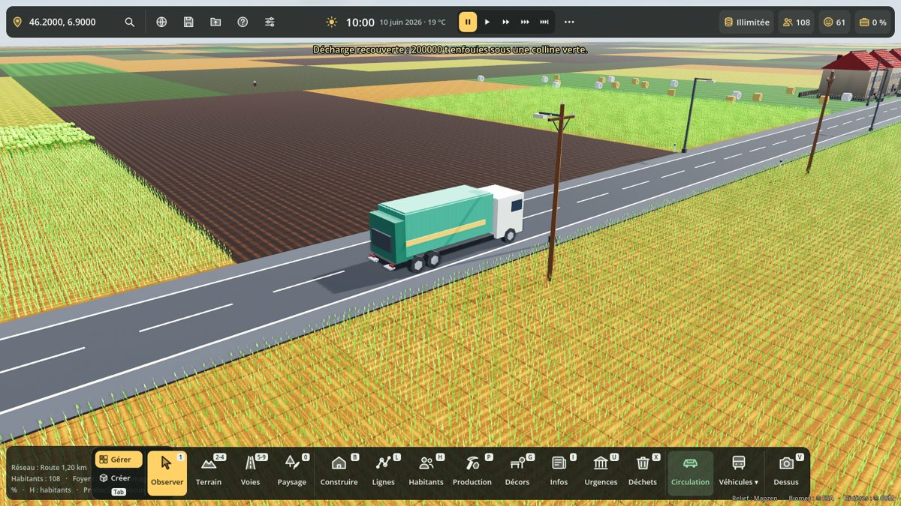
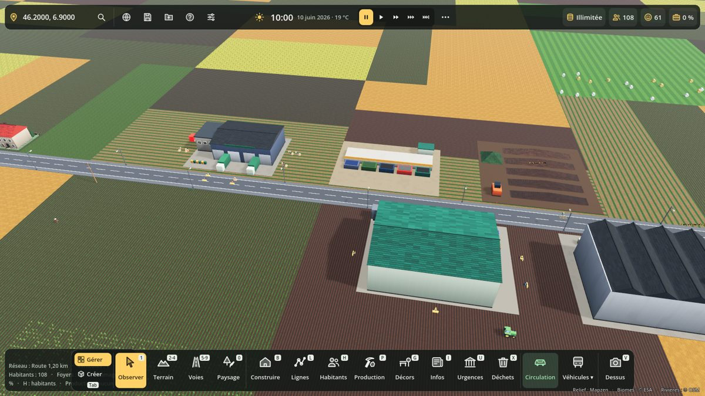
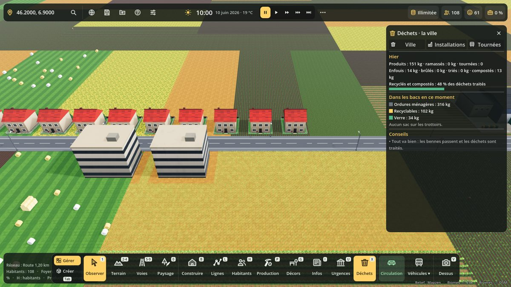

# Déchets et recyclage

Touche **X** : panneau Déchets. Construire → onglet **Déchets** : les bâtiments.

## Ce qui se passe

1. **Les bacs se remplissent.** Chaque logement, commerce et entreprise produit des déchets selon ses habitants et ses employés : 1,4 kg par habitant et par jour (0,8 kg d'ordures, 0,45 kg de recyclables, 0,15 kg de verre), 0,5 kg par emploi (×2,5 pour les commerces, cafés et loisirs). Les bacs tiennent 5 jours.
2. **Ils débordent.** Un bac plein déborde : des sacs noirs s'entassent sur le trottoir devant la porte. Les habitants sont mécontents (« Les poubelles débordent devant chez moi »), la rue est sale et sent mauvais (nuisances).
3. **Les éboueurs passent.** Les bennes à ordures partent du **dépôt de collecte** de 5 h à 12 h, du lundi au samedi, avec 3 éboueurs de service par benne (des habitants qui travaillent au dépôt). Une tournée vide les bacs les plus pleins autour du dépôt (8 km), porte à porte, jusqu'à 8 t, puis décharge à l'usine qui reçoit ce flux et rentre. Le camion roule vraiment sur les routes et s'arrête devant chaque porte.
4. **Les déchets sont traités.**
   - **Décharge** (centre d'enfouissement) : 120 000 t. Bon marché, mais elle pollue l'eau et sent mauvais. Pleine, elle refuse les bennes : bouton **Recouvrir** (1,5 M€) dans le panneau, elle devient une colline verte avec ses puits de biogaz.
   - **Usine d'incinération** : 300 t par jour, 0,6 MWh d'électricité par tonne (environ 7 MW à plein régime, déclarés au réseau électrique). Pollue l'air. L'usine d'incinération de la bible Blender (catégorie Industrie) brûle aussi les ordures (400 t par jour).
   - **Centre de tri** : sans lui, personne ne trie (tout part en ordures). Avec lui, 55 % des recyclables et du verre vont dans le bon bac, 70 % près d'une **déchèterie** (4 km). Il fait des **balles de tri** (85 % des recyclables, le reste part en ordures) et du **verre** (calcin), qui entrent dans l'économie (touche P) : livrés par camion aux usines qui en ont besoin, ou exportés.
   - **Usine de recyclage** : balles de tri → papier et carton, plastique, acier (une usine de l'économie, comme les autres).
   - **Déchèterie** : les habitants à moins de 4 km y apportent encombrants et déchets verts ; ses bennes partent au compost et à la décharge (ou à l'incinérateur).
   - **Plateforme de compostage** : déchets verts → compost, vendu.

## Argent

- Dépenses mensuelles : 2 500 € par benne (gazole, entretien) et l'entretien des bâtiments (0,1 % de leur prix par mois).
- Recettes : taxe d'ordures ménagères (12 € par foyer et par mois, × le réglage Impôts) dès qu'il y a un dépôt, vente du compost.
- Ces sommes vont au panneau **Budget** (groupes `budget_entretien` et `budget_recettes`) ; sans Budget dans la partie, la caisse les paie directement (1/30e par jour).
- Le centre de tri et l'usine de recyclage sont des entreprises de l'économie : elles vendent leurs balles et leurs matières et paient leurs salaires.

## Réglages (Admin, F10)

- **Déchets à ramasser** : oui / non (non : la ville reste propre toute seule).
- **Quantité de déchets par habitant** : ×0,5 à ×3.

## Liens avec les autres systèmes (sans dépendance)

Le nœud `Dechets` (scripts/dechets/dechets.gd) est dans ces groupes :

| Groupe | Fonction | Contenu |
|---|---|---|
| `pollution_sources` | `pollution_sources()` | décharges (eau, odeur), incinérateurs (air), dépôts (bruit), sacs non ramassés (saleté, odeur) |
| `electricite_sources` | `electricite_sources()` | `{bid, mw, nom}` des incinérateurs |
| `avis_sources` | `avis_facteurs()` | thème « environnement » : poubelles qui débordent (−4 à −12), ramassage et tri (+1) |
| `budget_entretien` | `budget_entretien()` | collecte et traitement (€/mois) |
| `budget_recettes` | `budget_recettes()` | taxe d'ordures ménagères, compost (€/mois) |

## Code

- `scripts/dechets/dechets_types.gd` : les 8 bâtiments (modèles low-poly), rôle de chaque type.
- `scripts/dechets/dechets.gd` : simulation (pas de 15 min, traitement chaque heure, bilan chaque jour), sacs visibles, sauvegarde (section `dechets`).
- `scripts/dechets/dechets_panel.gd` : panneau X (Ville, Installations, Tournées).
- Benne à ordures : `benne_om` dans VehicleCatalog (hors circulation d'ambiance).
- Métiers : éboueur·euse, agent·e de tri, gardien·ne de déchèterie.
- Test : `tests/dechets_test.gd` ; captures : `tests/dechets_vitrine.gd`.

## Aperçus

