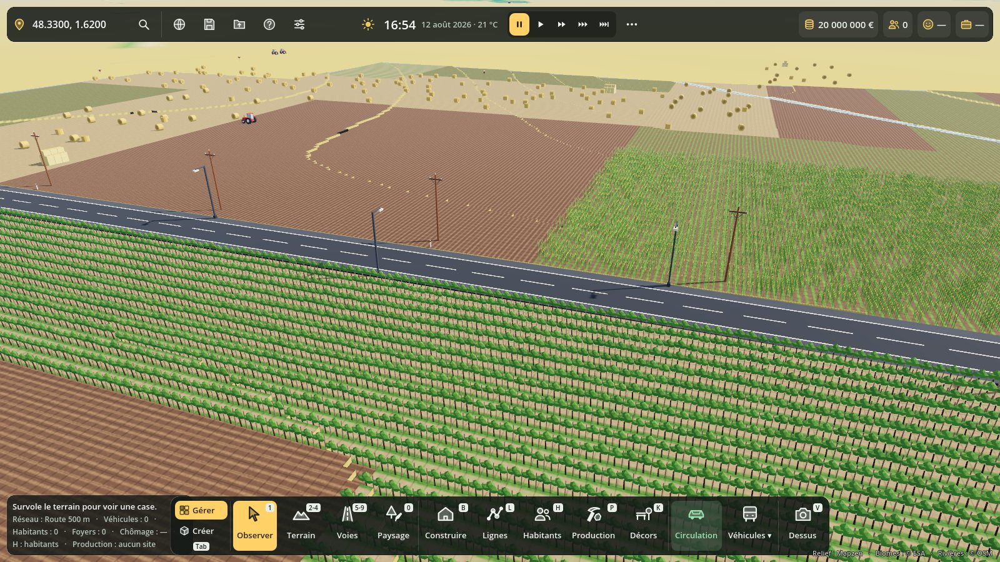
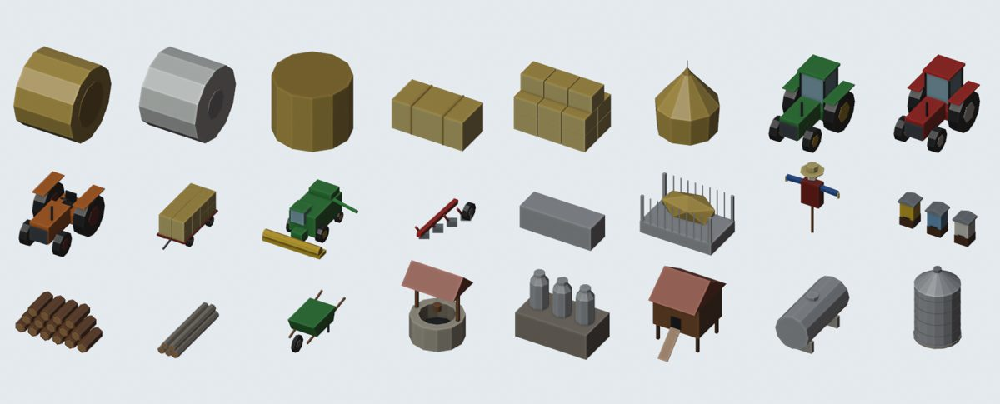
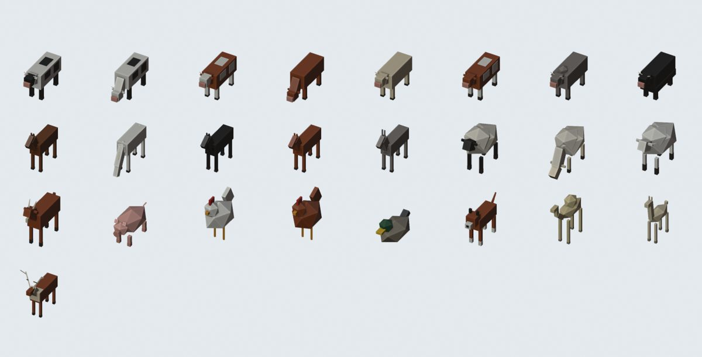
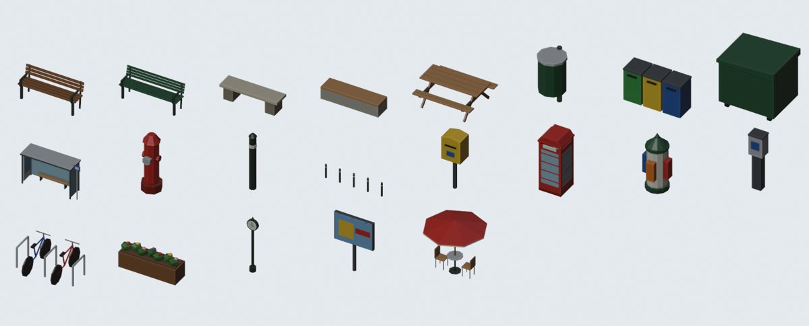
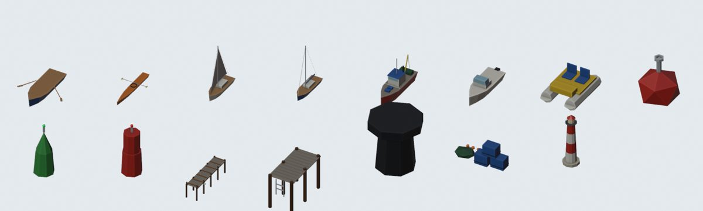
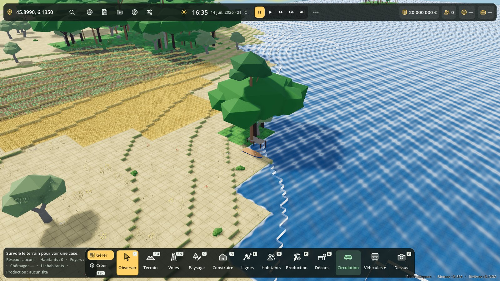
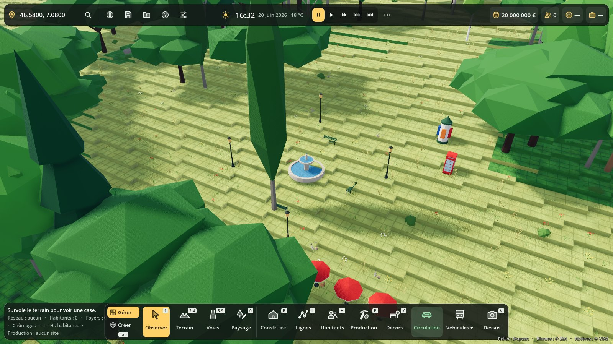

# Décors : rendre la Terre vivante

160 petits modèles low-poly (29,314 triangles en tout, 1 600 au plus chacun) faits avec Blender en Python, à la taille réelle : mobilier urbain, éclairage, fontaines et statues, clôtures et murets, panneaux, marché, jeux et sport, plage, ferme, cultures, animaux, bateaux et pontons, rochers.



## Tester dans Godot 4.7

1. Ouvrir le projet, laisser Godot importer les nouveaux `.glb` (une fois).
2. **Vitrine** : ouvrir `scenes/vitrine_decors.tscn` et appuyer sur **F6**.
   - Touches **1 à 5** : place du village, ferme, port et plage, jeux et montagne, catalogue complet avec les noms.
   - **N** : nuit (réverbères et lanternes allumés), **Espace** : rotation de la caméra. Les animaux bougent.
3. **En jeu** (F5) :
   - Partir de la Beauce (48.33, 1.62) en août : bottes de foin dans les champs moissonnés, tracteurs, épouvantails. En janvier, les champs sont vides.
   - Poser une route en campagne : poteaux électriques, balises, bornes kilométriques, cédez-le-passage aux carrefours. En ville (près des bâtiments) : bancs, poubelles, bornes à incendie.
   - Un pré (Gruyère 46.58, 7.08 ou Normandie) : troupeaux qui se promènent avec abreuvoir et clôture.
   - Un bord de lac (Annecy 45.899, 6.135) : pontons, barques amarrées, canards.
   - Touche **G** (ou l'icône Décors) : le panneau.

## Le panneau Décors (touche G)

| Outil | Geste |
|---|---|
| Poser | Clic : un décor. Glisser : une rangée, ou une clôture continue. **R** / **Maj+R** : tourner. |
| Pinceau | Glisser : sème le décor choisi au hasard (troupeau, rochers, bottes…). Réglages rayon et densité. |
| Gomme | Glisser : efface les décors posés **et** les décors automatiques (ils ne reviennent pas). |

La case **Décors automatiques** coupe tout ce qui vient seul (utile pour un terrain nu). Échap lâche l'outil. Les décors posés et gommés sont sauvegardés dans la section `decors`.

## Comment ça marche

- `tools/blender/decors_lowpoly.py` : la liste des décors (id, catégorie, options) ; les modèles sont des fonctions dans `tools/blender/decors/*.py` (le nom affiché vient de leur docstring). Primitives communes dans `base.py` (boîte, cylindre, poutre, profil, rocher, roue…).
- Couleurs : une palette de 64 teintes (`palette_decors.png`) et une palette de lumières pour la nuit ; les `.glb` sont exportés sans matériau et le jeu applique un seul matériau partagé.
- `scripts/decors/decors.gd` : le catalogue (`decors.json`), tailles, distances de vue, maillages.
- `scripts/decors/decor_system.gd` : décors automatiques calculés par tuiles de 64 m autour de la caméra (budget 3,5 ms par image), dessinés en MultiMesh par modèle. Ils suivent le biome, le climat et la saison (cultures de `Sols`), le réseau de transport et les bâtiments. Les animaux sont animés jusqu'à 220 m.
- `scripts/decors/decor_panel.gd` : le panneau G.

### Refaire les modèles

```
pip install bpy        # Blender en module Python
xvfb-run -a python tools/blender/decors_lowpoly.py -- --dossier assets/modeles/decors --planches /tmp/planches
godot --headless --path . --import
```

Ajouter un décor : écrire une fonction dans le bon fichier de `tools/blender/decors/`, l'ajouter au dictionnaire `DECORS`, relancer. Il apparaît tout seul dans le panneau.

### Tests

```
godot --headless --path . --script res://tests/decors_test.gd
godot --path . --script res://tests/decors_vitrine.gd -- --dossier /tmp/captures   # captures sur de vrais lieux
```

## Catalogue

| Catégorie | Nb | Décors |
|---|---|---|
| Mobilier urbain | 21 | Banc public : lattes de bois sur pieds de fonte, Banc de parc à lattes peintes en vert, Banc de pierre massif, Banc contemporain : bloc de béton et assise en bois, Table de pique-nique en bois et ses deux bancs, Corbeille de rue sur son poteau, Trois bacs de tri, Conteneur à ordures sur roues, Abribus vitré : banc, toit et plan du réseau, Poteau d'incendie rouge, Potelet de trottoir, Rangée de cinq potelets, Boîte aux lettres jaune sur pied, Cabine téléphonique rouge à petits carreaux, Colonne d'affichage verte et ses affiches, Horodateur de stationnement, Arceaux à vélos et deux vélos garés, Bac à fleurs en bois, Horloge de rue à double cadran, Panneau publicitaire 4 × 3 sur pied, Table de café, deux chaises et un parasol |
| Éclairage | 5 | Lampadaire routier : mât de 8 m, crosse, lanterne vers -Y, Lampadaire à deux crosses, Réverbère ancien en fonte et sa lanterne, Lampadaire de parc à boule, Tōrō : lanterne de pierre de jardin japonais |
| Fontaines et statues | 8 | Fontaine ronde : bassin de pierre, colonne et vasque, Fontaine à boire en fonte verte, Borne-fontaine pour boire, Statue en bronze sur son piédestal, Cavalier en bronze sur un grand piédestal, Buste sur une colonne, Monument aux morts : stèle, obélisque et grille, Petit obélisque de granit |
| Clôtures et murets | 11 | Palissade de jardin blanche, Clôture de pâture : poteaux et trois lisses en bois gris, Piquets et fils, Grillage vert sur poteaux, Muret de pierres sèches, Mur de briques et son chaperon, Haie taillée de buis ou de troène, Barrière de ville en métal, Glissière de sécurité routière, Palissade de bambous, Barrière de ferme en bois à cinq lisses |
| Panneaux et réseaux | 12 | Stop, Cédez le passage, Limitation à 50, Danger, Parking, Panneau de direction à deux flèches, Panneau d'entrée d'agglomération, Borne kilométrique de route, Balise de bord de route, Feu tricolore sur son mât, Poteau électrique en bois avec traverse et isolateurs, Pylône à haute tension |
| Marché | 7 | Étal de fruits et légumes sous un auvent rayé, Tente blanche de marché, Grand parasol de marché ou de terrasse, Pile de cagettes, Trois tonneaux de bois cerclés, Charrette à bras en bois, Triporteur à glaces |
| Jeux et sport | 9 | Portique à deux balançoires, Toboggan à plate-forme et échelle, Tourniquet d'aire de jeux, Jeu à ressort en forme de cheval, Bac à sable bordé de rondins, Cabane perchée avec filet d'escalade, But de football à 7, Panier de basket sur poteau, Table de ping-pong en béton |
| Plage | 4 | Parasol de plage rayé, planté dans le sable, Chaise longue en toile, Cabine de plage rayée, Chaise haute de surveillant de baignade |
| Ferme | 24 | Botte ronde de foin, Botte ronde enrubannée de film blanc, Botte ronde posée debout, Petite botte de paille rectangulaire, Pile de grosses bottes carrées, Meule de foin traditionnelle, Tracteur moderne vert à cabine, Tracteur rouge, Vieux tracteur sans cabine, Plateau chargé de bottes de paille, Moissonneuse-batteuse et sa barre de coupe, Charrue à socs, Abreuvoir galvanisé, Râtelier à foin, Épouvantail au chapeau de paille, Trois ruches en bois, Tas de bûches, Grumes, Brouette, Puits en pierre avec son toit, Bidons de lait sur un quai en bois, Petit poulailler sur pilotis, Cuve à eau ou à fioul sur berceau, Silo à grain en tôle ondulée |
| Cultures | 6 | Carré de citrouilles, Rang de choux, Rang de tomates sur tuteurs, Serre tunnel en plastique, Pommier de verger, chargé de pommes, Fin de rang de vigne : piquet de tête et fils |
| Animaux | 25 | Vache prim'holstein, pie noire, Vache pie noire qui broute, tête dans l'herbe, Vache montbéliarde, pie rouge à tête blanche, Vache rousse qui broute, Vache charolaise, toute crème, Veau, Zébu à bosse, Yack à longs poils, Cheval bai à crinière noire, Cheval gris clair qui broute, Cheval noir, Poney alezan, Âne gris aux grandes oreilles, Brebis blanche à tête noire, Mouton qui broute, Agneau, Chèvre à barbiche et cornes recourbées, Cochon rose, Poule blanche, Poule rousse, Canard colvert, Chien de ferme, Dromadaire à une bosse, Lama des Andes, Renne de Laponie et ses bois |
| Bateaux et pontons | 15 | Barque à rames, Kayak de mer, Petit voilier de plaisance, Voilier au mouillage, voiles roulées, Chalutier côtier, Vedette à moteur, Pédalo à deux places, Bouée de mouillage rouge, Balise de chenal verte, Balise de chenal rouge, Ponton de bois sur pilotis, Petit embarcadère, Bitte d'amarrage de quai, Casiers et filets de pêcheur sur le quai, Petit phare de jetée blanc et rouge |
| Rochers et bois | 13 | Dalle rocheuse affleurante, Rocher couvert de mousse sur le dessus, Gros bloc de granit erratique, Éboulis : pierres de toutes tailles, Rochers de bord de mer, noircis en bas, Rocher de grès rouge, Pan de roche dressé, Menhir, Dolmen : table de pierre sur trois montants, Cairn de randonneurs, Galets ronds de rivière, Souche d'arbre coupé et ses racines, Tronc couché, gagné par la mousse |








Les planches des autres catégories sont dans `docs/apercu-catalogue-decors-*.jpg`.
