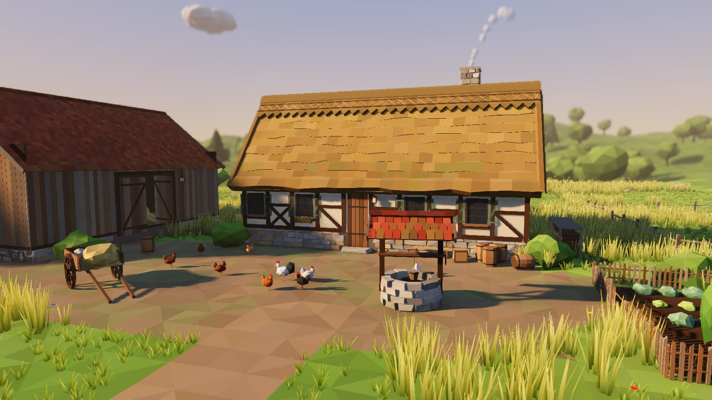
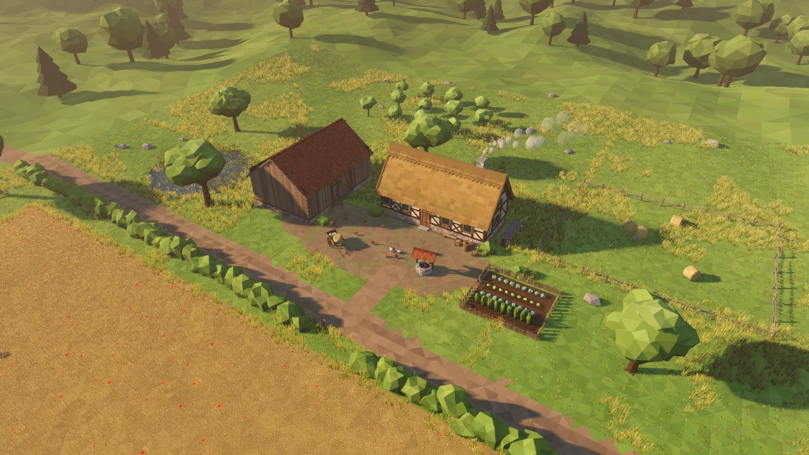
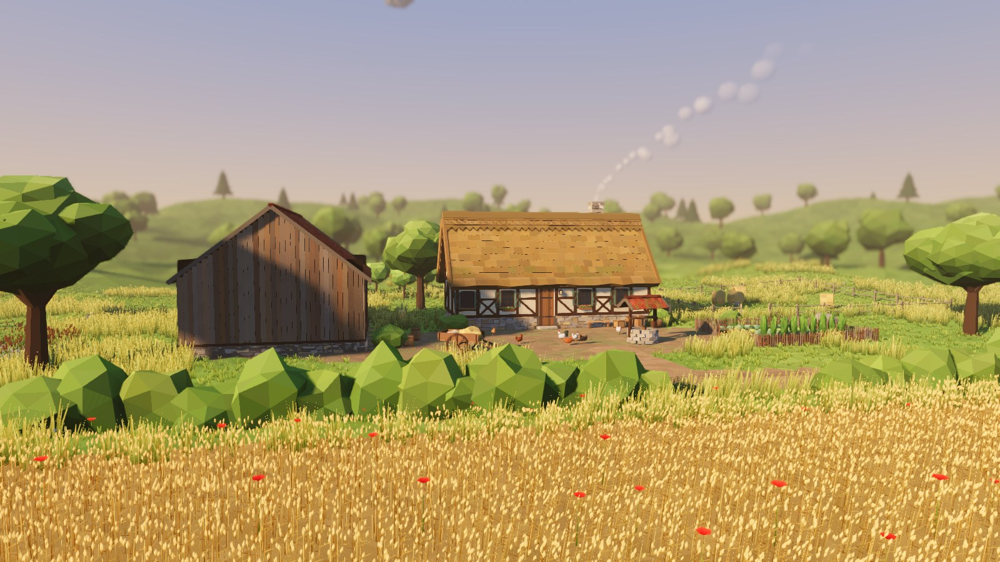
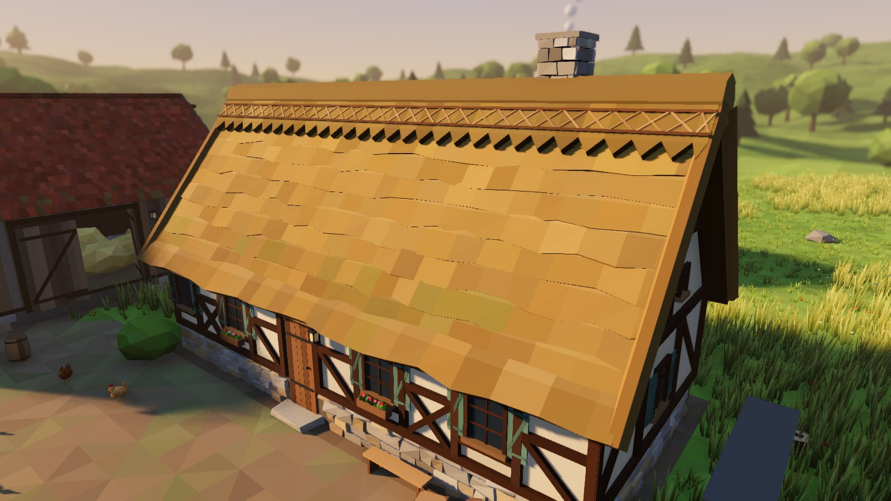
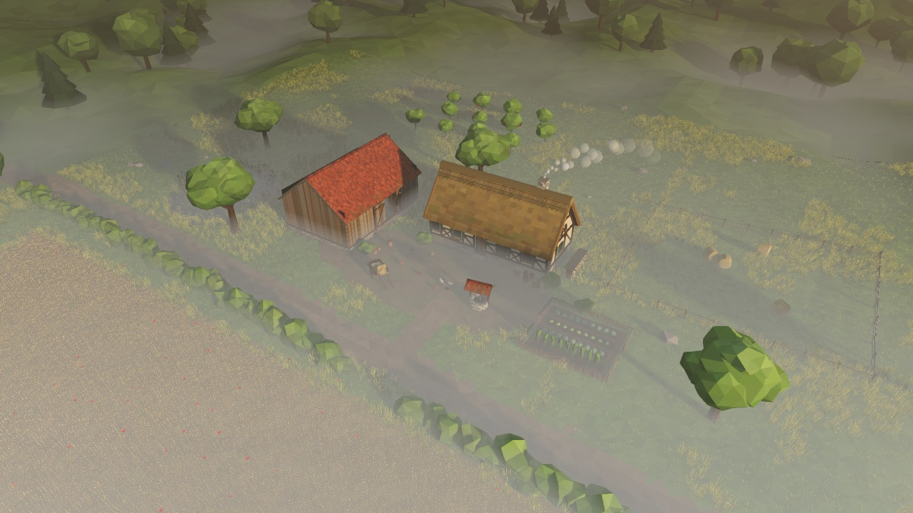
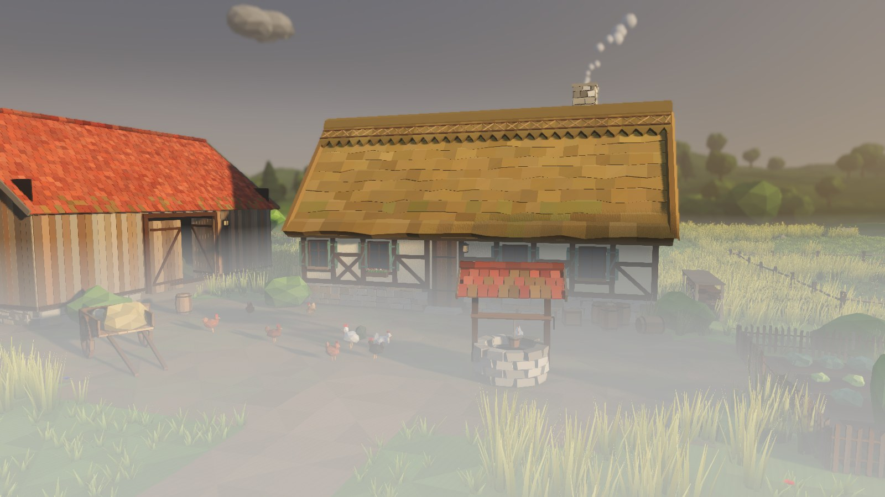
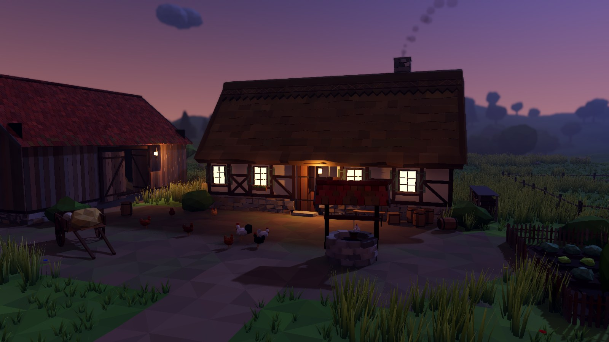

# Démo : jusqu'où pousser le low-poly

Une ferme complète, entièrement générée en code (aucun modèle 3D, aucune texture), pour voir ce que le style de MiniBlocs peut donner quand on le pousse : longère à colombages et toit de chaume, grange en planches, puits, charrette, tonneaux, potager, poules, champ de blé au vent, mare, haies, verger et forêt, avec quatre ambiances de lumière.

## Ouvrir la démo

1. Ouvre le projet dans **Godot 4.3 ou plus** (rendu **Forward+**, celui du projet).
2. Dans le panneau **Système de fichiers**, double-clique sur `scenes/demo_ferme.tscn`.
3. Appuie sur **F6** (lancer la scène courante).

| Action | Touches |
| --- | --- |
| Changer la lumière | **1** fin d'après-midi · **2** matin brumeux · **3** plein midi · **4** soir, lanternes allumées |
| Point de vue suivant | **C** (ensemble, cour, champ de blé, détail du toit) |
| Tourner / zoomer | clic droit glissé / molette |
| Se déplacer | ZQSD ou flèches |
| Masquer l'aide | **H** |

Captures en ligne de commande : `godot --path . --script res://tests/ferme_vitrine.gd -- --toutes ferme` (voir l'en-tête du script).

## Les captures

| | |
| --- | --- |
|  |  |
| Vue d'ensemble, à hauteur de caméra de gestion | Depuis le champ : blé au vent, coquelicots, flou au loin |
|  |  |
| Toit de chaume : rangs de bottes, faîtage festonné, brochettes croisées | Matin brumeux : brouillard au ras du sol, toits et arbres qui en sortent |
|  |  |
| La cour dans la brume | Heure bleue : fenêtres et lanternes allumées, ombres portées par les lanternes |

## Ce qui fait la différence (et ce qu'on peut généraliser)

Tout passe par un petit kit, `scripts/demo/lp_kit.gd` (classe `LpKit`), réutilisable pour n'importe quel bâtiment :

| Technique | Effet | Coût | À généraliser ? |
| --- | --- | --- | --- |
| **Faces plates** (une normale par triangle) | Le relief se lit par facettes, c'est la signature du style | Aucun | Oui, partout |
| **Une teinte par face** (`LpKit.vary`) | Planches, pierres, tuiles et bottes de paille jamais identiques, sans texture | Aucun | Oui, partout |
| **Formes irrégulières** : pierres aux coins décalés, bords de chaume ondulés, sphères bosselées | Aspect « fait main » | Quelques triangles de plus | Oui, dans les générateurs de bâtiments |
| **Ombre peinte dans les couleurs** (bas des feuillages et des herbes plus sombre) | Volume et profondeur gratuits | Aucun | Oui |
| **Un seul maillage par objet**, une couche par matériau (base, verre, flamme) | Une maison = 3 appels de dessin, pas des centaines de boîtes | Gain | Oui : c'est ce qui permet des milliers de bâtiments |
| **Détails vraiment modelés** (colombages en relief, volets, jardinières, faîtage) | Ce qui donne envie de zoomer | 5 000 à 30 000 triangles par bâtiment | Oui pour les bâtiments proches, avec une version simplifiée au loin (niveaux de détail) |
| **Herbe et blé en MultiMesh** avec un shader de vent (`lp_vent.gdshader`) | Champs vivants, rafales qui traversent le blé, lumière à contre-jour | 50 000 touffes : correct sur une carte graphique moyenne | Oui, autour de la caméra seulement (comme les arbres du mode Terre) |
| **Lumière** : soleil bas, ombres douces, occlusion ambiante (SSAO), brume au sol et brume volumétrique, tons ACES, léger flou de distance | L'essentiel de « l'ambiance » | Réglages d'environnement, coût fixe | Oui : à brancher sur le cycle jour/nuit et la météo existants |
| Fenêtres et lanternes qui s'allument le soir | Vie la nuit | Quasi nul | Déjà fait en ville (#14), même principe |

**Ce qui reste hors de portée** (et pourquoi la démo ne le tente pas) : les textures peintes à la main ou photo, les matériaux réalistes (paille fibre par fibre, pierre mouillée), l'éclairage global calculé et les milliers de plantes uniques. Ça demande des artistes et des assets par objet, impossible à tenir pour la Terre entière en solo.

**Ce que la démo montre en chiffres** : environ 210 000 triangles de décor, 27 000 touffes d'herbe et 27 000 gerbes de blé, construits en un peu plus d'une seconde.

## Fichiers

- `scripts/demo/lp_kit.gd` : le kit de modelage (triangles, boîtes, pierres, poutres, tubes, objets de révolution, sphères bosselées).
- `scripts/demo/ferme_modeles.gd` : la longère, la grange, le toit de chaume, le toit de tuiles, le puits, la charrette, les tonneaux, les arbres, les poules…
- `scripts/demo/lp_vent.gdshader` : herbes, blé, fleurs et roseaux au vent.
- `scripts/demo/ferme_demo.gd` : la scène (relief, zones, végétation, lumières, caméra).
- `tests/demo_ferme_test.gd` : le test automatique (`DEMO TEST OK` si tout va bien) ; `tests/ferme_vitrine.gd` : les captures.
