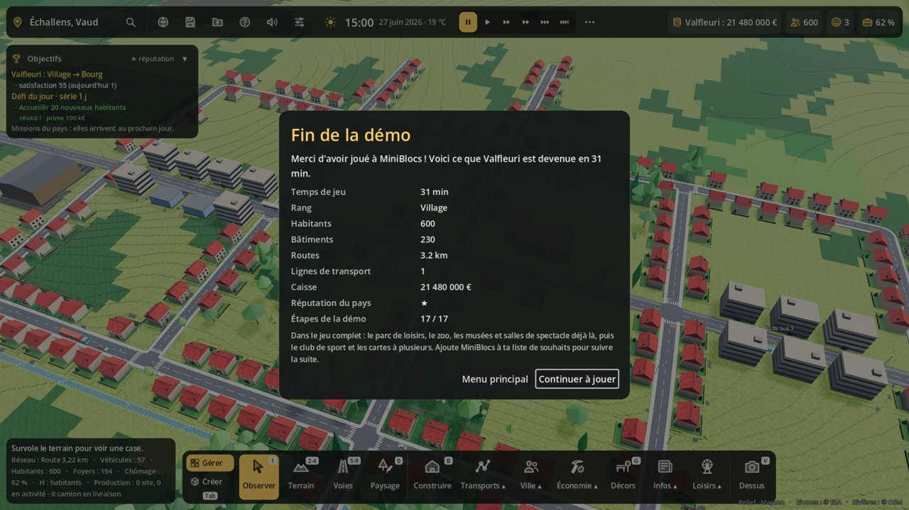

# Démo guidée (environ 30 minutes)

Code : `scripts/tutoriel/demo.gd` (`Demo` : lieu, réglages, lancement),
`scripts/tutoriel/demo_bilan.gd` (`DemoBilan` : bilan de fin), les étapes dans
`Tutoriel.ETAPES_DEMO` (`scripts/tutoriel/tutoriel.gd`).
Tests : `tests/demo_test.gd` (headless), `tests/demo_vitrine.gd` (captures et vidéo
pour la page Steam).


## Lancer la démo

Menu principal → **Démo guidée**. C'est une nouvelle partie, toujours au même
endroit : **Échallens (Vaud)**, un plateau agricole presque plat avec des bois
(`Demo.LIEU`), avec les réglages **Normal** (30 M€, 100 fondateurs, réseaux
obligatoires). Pas de globe à traverser.

La carte en haut à gauche affiche « Démo guidée · étape N / 17 · 12 min ». Le
chrono compte le temps réel joué (pas le temps en pause).

## Le parcours

1. Les 11 premières étapes du **tutoriel** (caméra, Maison de commune, fondateurs,
   route, logements, courant et eau, temps, emplois, école, budget, objectifs),
   sans l'étape « Tu es maire ! ».
2. Les chapitres de la démo :

| # | Chapitre | Il se valide quand… | Bouton |
|---|---|---|---|
| 12 | Descendre dans la rue | la vue au sol est active (V) | passe en vue au sol |
| 13 | Un coin pour souffler | un espace public, un loisir ou un terrain de sport est posé | Construire → Espaces publics |
| 14 | Une fête au village | un marché ou une fête est organisé (I → Organiser) | ouvre Infos → Organiser |
| 15 | Prendre le bus | une ligne de transport existe (L) | ouvre les lignes |
| 16 | Cent habitants | la ville a 100 habitants (ou le rang de Village) | ouvre Maj+J |
| 17 | Fin de la démo | bouton « Voir mon bilan » | ouvre le bilan |



**Bilan** : temps de jeu (et jours passés en ville), rang, habitants, bâtiments,
kilomètres de routes, lignes, caisse, réputation, étapes faites. Deux boutons :
**Continuer à jouer** (la partie continue, sans tutoriel) et **Menu principal**
(la partie est d'abord sauvegardée, on peut la reprendre avec Continuer).

Comme le tutoriel : « Passer » saute un chapitre, la croix arrête la démo, une
partie sauvegardée en pleine démo la reprend au même chapitre avec son chrono
(section `tutoriel` : `parcours`, `temps_demo`, `jour0`, `demo_finie`).

## Rythme

Mesuré avec `tests/partie_test.gd -- --jours 40` (joueur automatique, Normal,
1 jour de jeu = 1 minute) : premières maisons habitées vers le jour 15, 100
habitants logés vers le jour 25, 240 au jour 30. Les 11 étapes du tutoriel et les
chapitres 12 à 15 se font pendant que les chantiers avancent ; la démo tient donc
en 25 à 35 minutes. Le rang de Village demande aussi 50 % de satisfaction, ce qui
peut prendre plus longtemps : c'est pour ça que le dernier chapitre accepte
100 habitants.

## Captures et vidéo pour la page Steam

`tests/demo_vitrine.gd` bâtit un village au lieu de la démo (vrai relief,
téléchargé), puis prend 8 captures en 1920 × 1080 : vue du ciel, campagne à
l'horizon, centre, démo guidée pendant un marché, vue au sol, soir, foot, bilan.

```
godot --path . --rendering-driver opengl3 --resolution 1920x1080 --script res://tests/demo_vitrine.gd -- --dossier captures/demo
```

Vidéo (environ 40 s, 5 plans) avec le Movie Maker de Godot, puis ffmpeg :

```
godot --path . --rendering-driver opengl3 --resolution 1920x1080 --write-movie film.avi --fixed-fps 30 --script res://tests/demo_vitrine.gd -- --film
ffmpeg -ss <début> -i film.avi -c:v libx264 -crf 18 -pix_fmt yuv420p -c:a aac demo.mp4
```

Le script imprime « FILM DÉBUT image N » : la vidéo utile commence à N / 30 s.

## Changer le lieu ou les chapitres

- Lieu : `Demo.LIEU` (nom, latitude, longitude, code du pays pour le drapeau).
- Chapitres : ajouter une entrée à `Tutoriel.ETAPES_DEMO` (avec `"demo": true`),
  un cas dans `Tutoriel.est_faite()` et, pour son bouton, dans
  `terre_main._on_tuto_action()`.

## Test de bout en bout

`tests/demo_parcours_test.gd` joue la démo comme un joueur : bouton « Démo
guidée » du menu → écran de chargement → partie à Échallens (Normal, 100
fondateurs + 40 ouvriers du kit, vrais chantiers) → chaque étape avec le bouton
de la carte puis le geste demandé, sans jamais « Passer » → le temps tourne à
la vitesse du jeu (accéléré par `Engine.time_scale`, le chrono de la démo compte
donc les minutes du joueur) → bilan → « Menu principal » → « Continuer ».

```
godot --headless --path . --script res://tests/demo_parcours_test.gd [-- --echelle 20 --rapport parcours.csv]
```

Options : `--proxy hôte:port --ca fichier.crt` (vrai relief téléchargé),
`--soigneux` (maire prévoyant : déchets, dépôt de marchandises, négocie avec
les manifestants), `--aleas` (incendies, tempêtes et crues au hasard, coupés
sinon pour que le test reste reproductible). À la fin : ce que disent les
habitants (thèmes, motifs), les réseaux, les bâtiments.

Mesures (novembre 2026, gestes instantanés) : 100 habitants vers le jour 38-45,
soit 10 à 11 minutes de jeu à vitesse maximale ; un vrai joueur, qui lit les
cartes et pose ses routes à la souris, met plutôt 25 à 35 minutes.

Corrigé grâce à ce test :
- un incendie, une tempête ou une crue rasait le campement des fondateurs : les
  140 fondateurs quittaient la ville d'un coup et plus aucun chantier
  n'avançait. Le campement est maintenant replanté sur place ;
- le chapitre « Un coin pour souffler » se validait tout seul dès qu'un café
  poussait dans la zone commerciale ;
- le bilan affichait 16 / 17 étapes même démo finie ;
- les fondateurs sous la tente manifestaient dès le premier jour (seuil de 50
  habitants compté avec eux) ;
- un motif de l'avis était compté autant de fois qu'il apparaissait (« 690
  habitants » sur 138) ;
- un village sans livraisons possibles (ni chauffeur-livreur, ni dépôt, gare,
  port ou route qui sort de la carte) mourait de faim devant une boulangerie
  vide : les foyers font maintenant leurs courses dans une ville voisine
  (« rayons vides : fait ses courses dans une ville voisine », −5) ;
- l'étape du tutoriel « Courant, eau et égouts » demande aussi un traitement
  des égouts (le kit de l'État le paie) : sans lui, tous les logements
  avaient « les égouts débordent ».

Équilibrage choisi par Gaël (2026-11-15) : sous 500 habitants
(`Communes.ATTENTES_REDUITES_MAX`), personne ne se plaint de l'absence
d'hôpital, de police, d'internet ou de réseau mobile (on va à la ville
voisine), et l'outil Route pose une rue de village par défaut (plus une
départementale). Satisfaction à la fin de la démo : de 10-25 % à 42-46 % ; il
reste surtout les poubelles (dépôt de collecte du kit) et les commerces.
