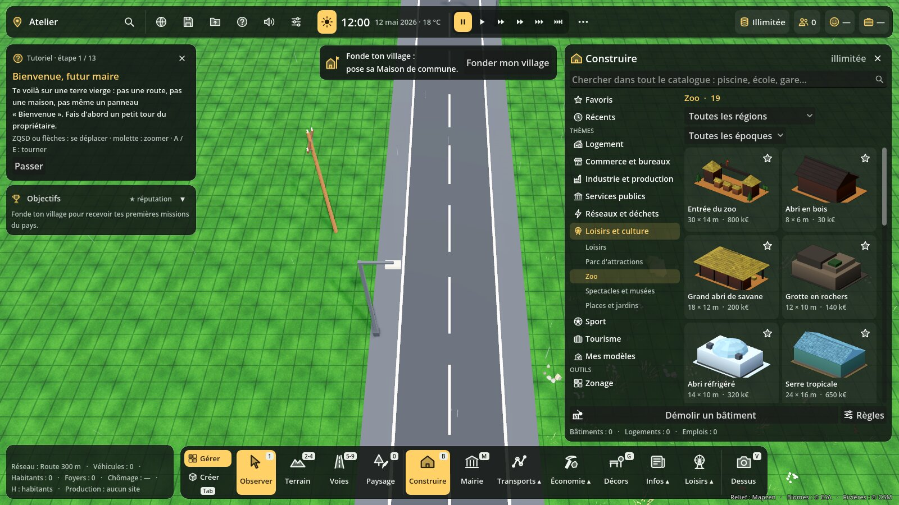
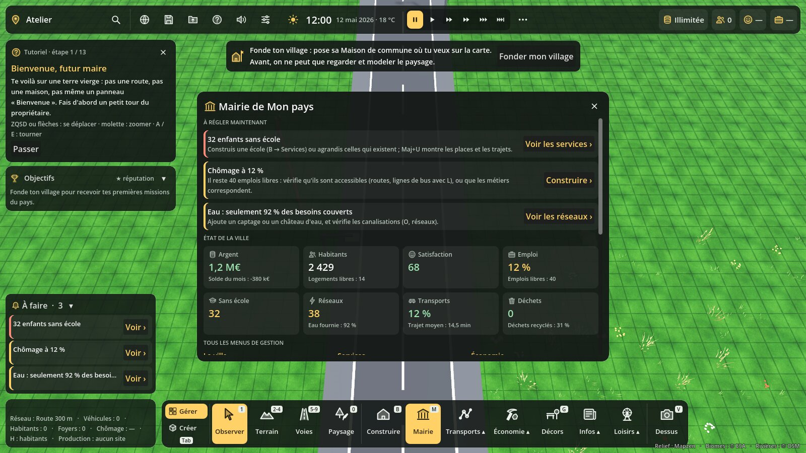
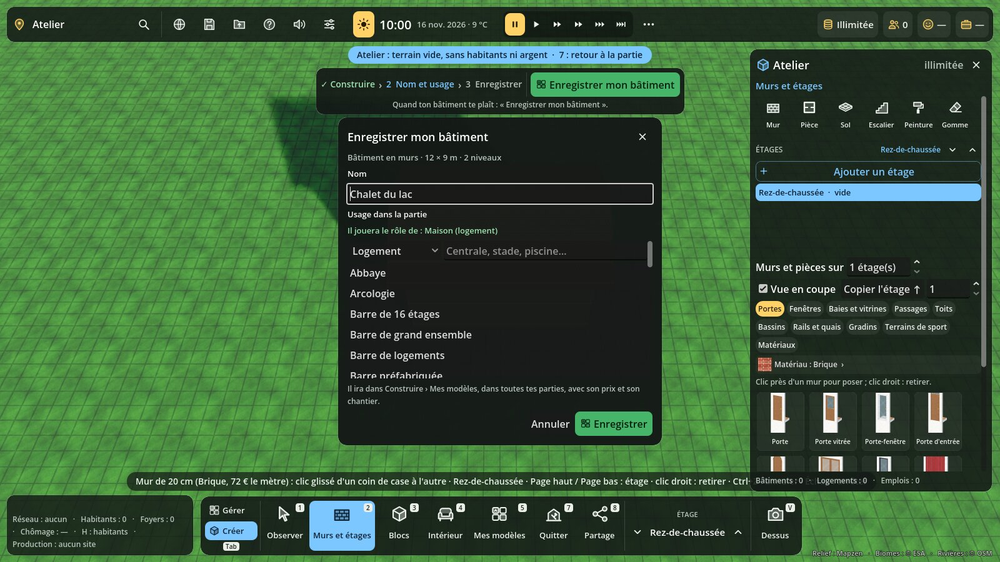
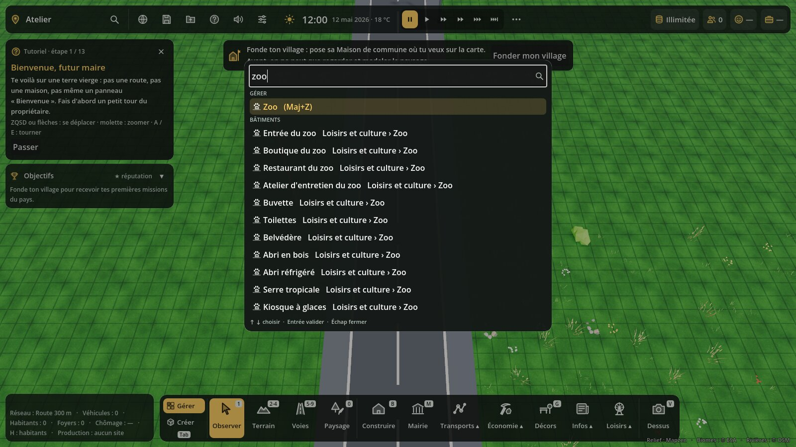

# Ergonomie : trouver, construire, gérer

Refonte du 16 novembre 2026, d'après les maquettes choisies par Gaël
(Construire A + C, Atelier A + C, Gestion A + B).

Captures refaites avec `tests/ergonomie_vitrine.gd` (voir son en-tête).

## Construire (B)

- **Thèmes nommés** à gauche du panneau, au lieu de 21 icônes sans nom :
  Favoris, Récents, puis Logement, Commerce et bureaux, Industrie et
  production, Services publics, Réseaux et déchets, Loisirs et culture,
  Sport, Tourisme, Mes modèles, et l'outil Zonage. Un thème qui regroupe
  plusieurs catégories montre ses sous-thèmes (Loisirs : parc
  d'attractions, zoo, spectacles et musées, places et jardins).
  Code : `BuildingPanel.THEMES`, `SUB_NAMES`, `_fill_themes()`.
- **Recherche dans tout le catalogue** en haut du panneau : « piscine »
  trouve les piscines même si l'onglet Logement est ouvert. Elle ignore les
  accents (« ecole » trouve « École »).
- **Favoris et Récents** : l'étoile en haut à droite d'une vignette garde le
  bâtiment dans les Favoris ; chaque bâtiment choisi s'ajoute aux Récents.
  Communs à toutes les parties (`user://construire_favoris.json`,
  classe `FavorisConstruire`).
- **Mes modèles** commence par « Créer un nouveau bâtiment dans l'Atelier ».

## Recherche dans tout le jeu (Espace)

Espace (ou « Chercher… » dans la barre du haut) ouvre une recherche au centre :
bâtiments, outils (Route, Rail, Aplanir…) et panneaux de gestion (Budget, Zoo,
Avis…). ↑ ↓ pour choisir, Entrée pour valider, Échap pour fermer. Elle ne
s'ouvre pas en vue au sol (Espace y fait sauter). Code :
`scripts/interface/recherche_universelle.gd`.

## Atelier et mode Créer

- **Terrain vide** : dans l'Atelier, ni arbres, ni herbes hautes, ni fleurs, ni
  décors automatiques (`TerrainWorld.sans_vegetation`,
  `DecorSystem._auto_on()`).
- **Trois étapes** en haut de l'écran (mode Créer et Atelier) : 1 Construire,
  2 Nom et usage, 3 Enregistrer, avec une ligne d'aide.
- **Un seul bouton « Enregistrer mon bâtiment »** : il prend la construction
  visée (le bâtiment en murs avec son toit et ses blocs, sinon le groupe de
  blocs le plus proche du centre de l'écran), sans rectangle à tracer. La fiche
  demande le nom et l'usage dans la partie (maison, école, stade… ou simple
  décor pour les blocs). Code : `scripts/atelier/parcours_atelier.gd`.
- **Un seul nom : Mes modèles.** La tuile 5 du mode Créer montre les modèles en
  murs et les créations en blocs ensemble (l'ancienne tuile « Mes créations »
  est cachée, la touche 6 mène au même endroit).
- **« Le poser dans ma partie »** après l'enregistrement : depuis l'Atelier, on
  revient à la partie avec le bâtiment en main (`GameStart.modele_a_poser`) ;
  dans une partie, on repasse en mode Gérer, bâtiment en main.

## Gestion : la Mairie (M) et le fil « À faire »

- **M ou la tuile Mairie** ouvre le tableau de bord : ce qu'il faut régler
  maintenant (avis du Conseiller, chacun avec un bouton qui ouvre le bon
  panneau), 8 tuiles d'état (Argent, Habitants, Satisfaction, Emploi, Écoles,
  Réseaux, Transports, Déchets) et tous les menus de gestion rangés par thème.
  Code : `scripts/interface/mairie_panel.gd`.
- La tuile Mairie remplace le menu « Ville ▴ » de la barre du bas (ses
  panneaux sont tous dans la Mairie, et gardent leurs touches).
- Le **Budget** ne s'ouvre plus avec M : Mairie → Argent, Ville dans la
  recherche, ou les boutons des alertes.
- **Fil « À faire »** en bas à gauche : les alertes urgentes et à surveiller,
  repliable, caché en mode Créer et dans l'Atelier.
  Code : `scripts/interface/fil_alertes.gd`.

## Tests et captures

- `tests/ergonomie_test.gd` (sans affichage).
- `tests/ergonomie_vitrine.gd -- --dossier <dossier>` (avec affichage) :
  atelier vide, chalet, fiche, enregistré, Construire en thèmes, recherche,
  recherche Espace, fil d'alertes, Mairie.

## Pas encore fait

- Le menu « Loisirs ▴ » garde ses panneaux (parc, zoo, musée…) en plus des
  thèmes de Construire : on pose dans Construire, on gère dans ces panneaux ou
  depuis la Mairie.
- Les alertes ouvrent le bon panneau mais ne déplacent pas encore la caméra sur
  le lieu du problème (le Conseiller ne donne pas de position).
