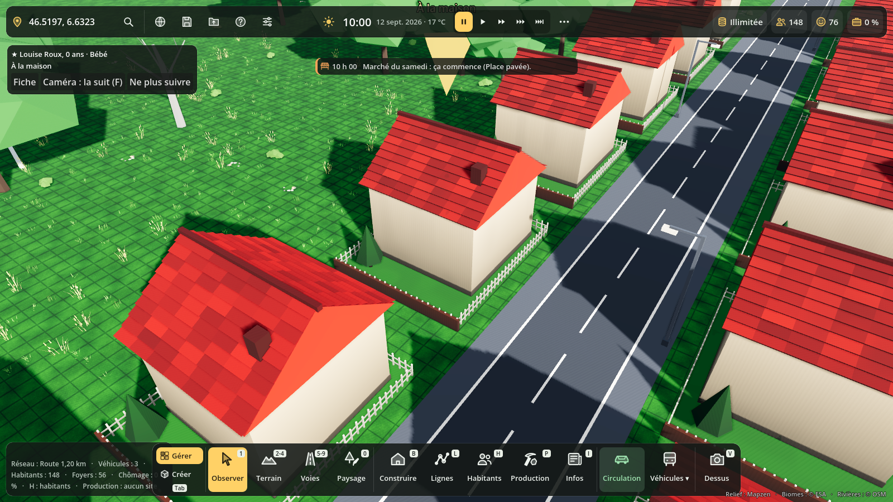
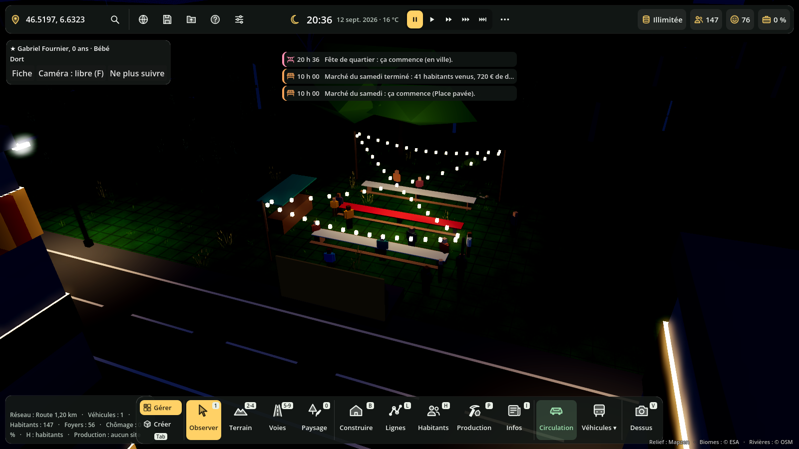
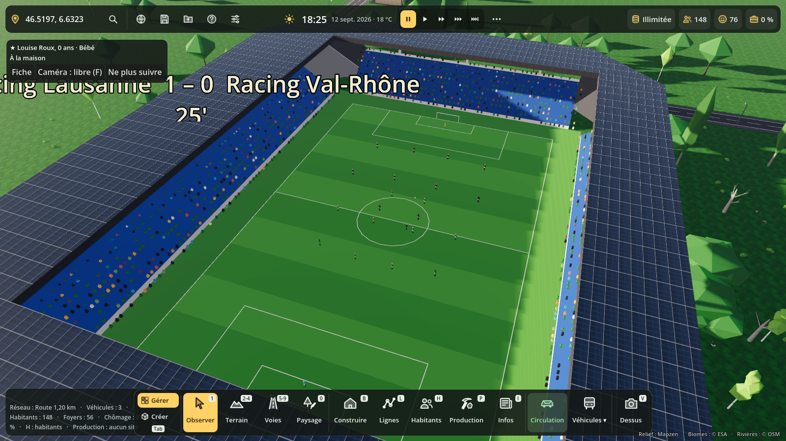
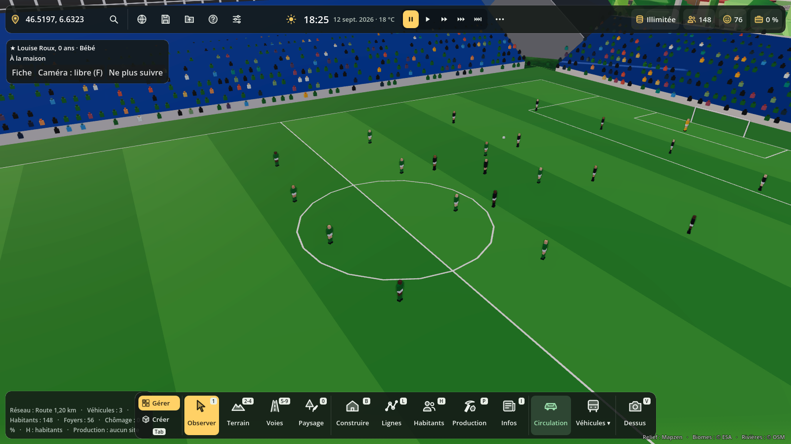
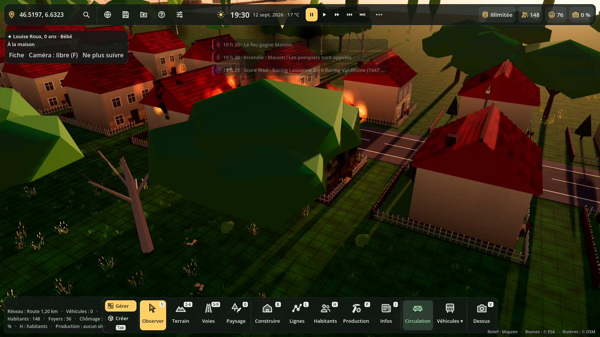
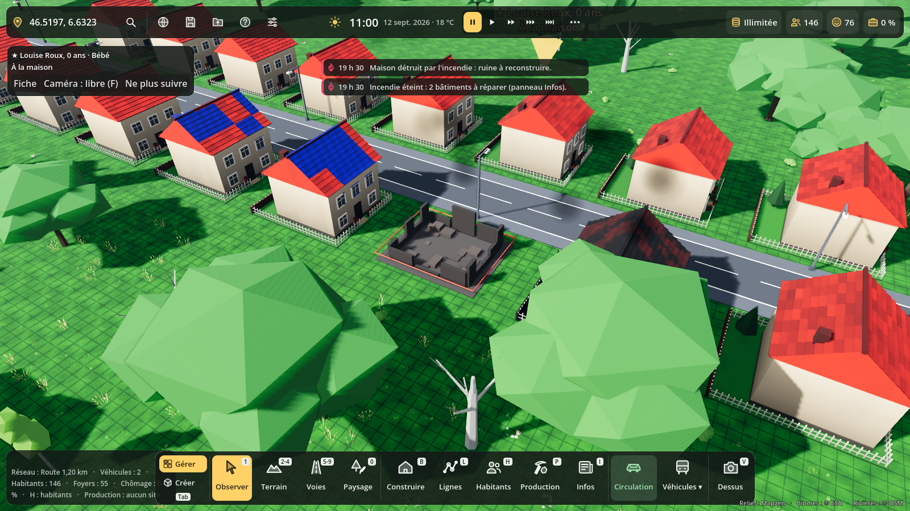
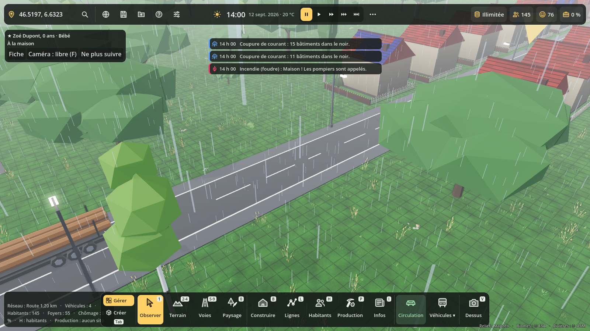
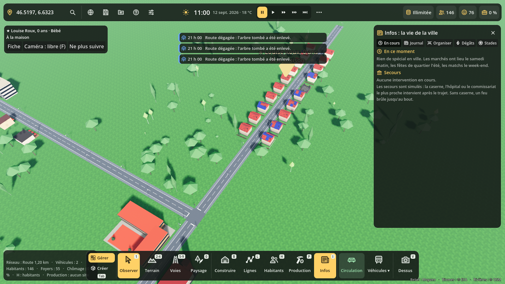

# Événements en ville

Touche **I** (ou le bouton **Infos** de la barre du bas) : le panneau des événements.
En haut de l'écran, un fil d'actualité annonce ce qui se passe ; un clic sur une
nouvelle emmène la caméra sur place.

## Fêtes et marchés

- **Marché du samedi**, de 7 h à 13 h, sur la plus grande place (sinon devant la mairie
  ou un commerce), dès 30 habitants. Les droits de place rapportent 60 € par étal.
- **Fête de quartier** le 2e samedi de mai à septembre, de 15 h à 23 h, et **Fête de la
  musique** le 21 juin.
- À la main : panneau Infos, onglet **Organiser**, puis clic sur la carte
  (fête 8 000 €, marché 2 000 €). Les habitants du coin y vont vraiment : leur journée change.

## Matchs au stade

Les 11 stades sont dans le catalogue (catégorie Sport). Chaque stade a un club au nom
inventé d'après la ville (« FC Lausanne », « Racing … ») dans un championnat de 10 clubs.
Saison de mi-juillet à mi-décembre puis de février à mai : un match à domicile toutes les
deux semaines (samedi 18 h ou dimanche 16 h 30), et un match amateur le dimanche matin sur
les terrains de foot. On voit les 22 joueurs, l'arbitre, le ballon, les tribunes qui se
remplissent (fans de foot surtout) et le score. Recette : 3 € par spectateur. Onglet
**Stades** : prochains matchs et classement.

## Incendies

- Au hasard (plus souvent dans l'industrie et l'hiver dans les logements, ou par la foudre
  pendant une tempête), ou à la main (Organiser, puis clic sur un bâtiment).
- Le feu grandit tant que les pompiers ne sont pas là, abîme le bâtiment et gagne les
  voisins à moins de 6 m quand il est fort.
- Une fois éteint : façade noircie à **réparer** (onglet **Dégâts**, prix selon les dégâts),
  ou **ruine** à reconstruire (chantier) ou à déblayer.

## Tempêtes

Pendant l'orage : arbres tombés qui coupent une route (les véhicules font le tour jusqu'à
ce qu'on l'enlève), toits arrachés (bâchés en attendant la réparation), coupures de courant
(fenêtres et lampadaires éteints dans le quartier), foudre, et crue des rivières qui inonde
les bâtiments et les routes proches puis redescend en quelques heures.

## Épidémies

Grippe, gastro, virus, rougeole (enfants). Les malades restent chez eux (moins de
travailleurs et d'élèves), la maladie passe par le foyer, le travail et l'école. Les cas
graves appellent une ambulance et vont à l'hôpital ; quelques-uns peuvent mourir. Tout est
noté dans le CV des habitants.

## Réglages (Admin, F10)

Section **Événements** : événements automatiques (marchés, fêtes, matchs) oui ou non,
catastrophes au hasard oui ou non, et leur fréquence (Rares, Normales, Fréquentes).
Décochées, les catastrophes se déclenchent seulement à la main.

## Secours

Chaque urgence devient un **incident** (`Evenements.declarer`) que les services d'urgence
prennent en charge. Tant qu'aucun service ne s'est branché, les secours sont simulés : la
caserne, l'hôpital ou le commissariat le plus proche arrive après le trajet. Sans caserne,
un feu brûle jusqu'au bout.

## Code

- `scripts/evenements/evenements.gd` (`Evenements`, nœud `/root/Evenements`) : événements,
  incidents, dégâts, ruines, actualités, sauvegarde (section « evenements »).
- `fetes_marches.gd`, `matchs.gd`, `stades.gd`, `incendies.gd`, `tempetes.gd`,
  `epidemies.gd` : un module par type. `ev_visuels.gd` : étals, foule, feu, ruines…
- `evenements_panel.gd` (touche I) et `actualites.gd` (fil d'actualité).
- Tests : `tests/evenements_test.gd` ; captures : `tests/evenements_vitrine.gd`.
