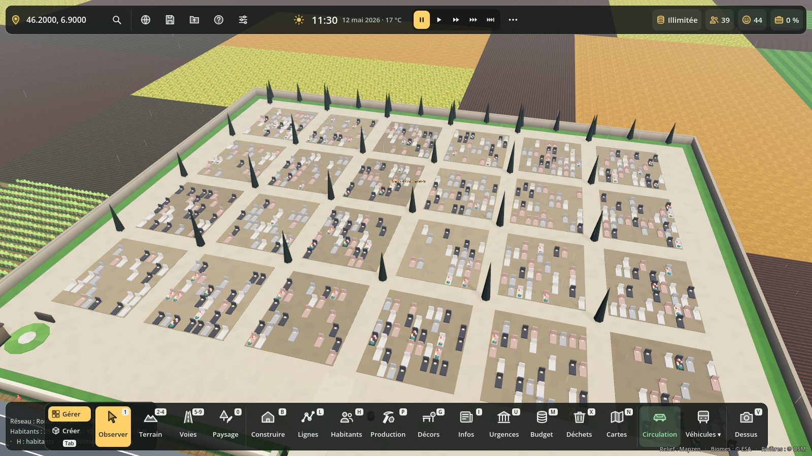
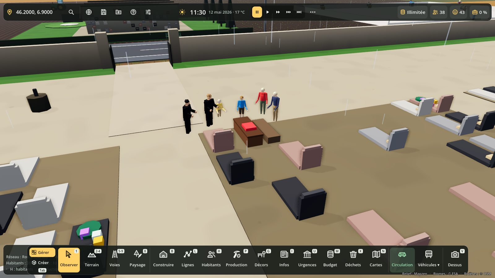
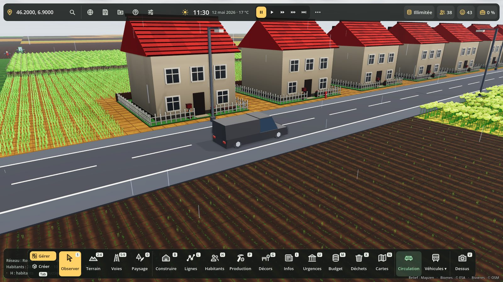
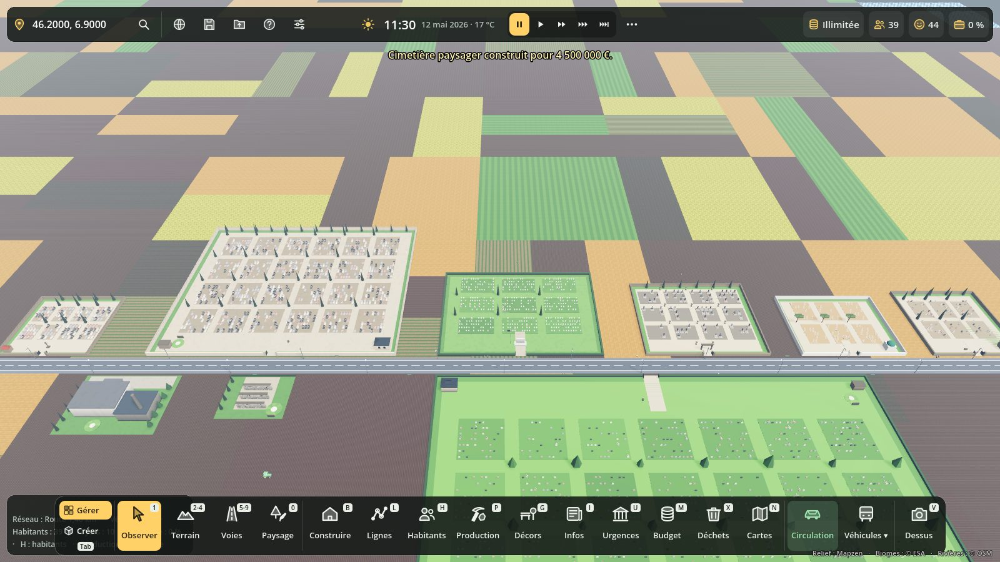
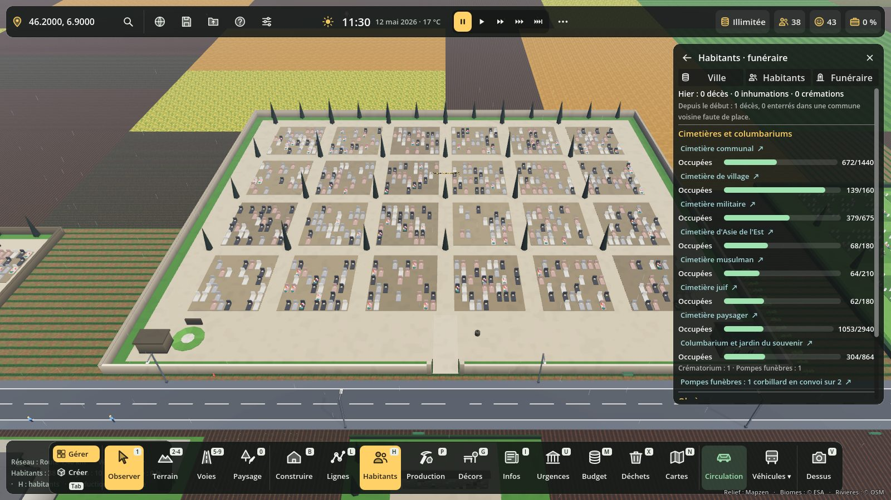

# Obsèques et cimetières

Panneau **Habitants (H) → onglet Funéraire**. Construire → onglet **Funéraire** : les bâtiments.

## Ce qui se passe à chaque décès

1. **On organise les obsèques.** Inhumation ou crémation selon la région d'origine du défunt (Europe ≈ 42 % de crémations, Asie de l'Est ≈ 92 %, Moyen-Orient et Maghreb 0 %…), ou selon le réglage Admin. Cérémonie religieuse ou non, selon la région aussi, s'il y a un lieu de culte à moins de 8 km.
2. **On cherche une place.** Le caveau familial d'abord (conjoint, parents ou enfants déjà enterrés, 3 places par caveau), sinon la tombe libre du cimetière le plus proche (le cimetière d'Asie de l'Est attire les familles venues d'Asie de l'Est, le cimetière musulman celles du Moyen-Orient et du Maghreb).
3. **Les obsèques ont lieu 1 à 3 jours après**, du lundi au samedi, entre 9 h 30 et 16 h.
   - Le **corbillard** part des pompes funèbres (2 porteurs de service au moins), prend le défunt chez lui ou à l'hôpital (levée du corps, 20 min), passe au lieu de culte (45 min), puis va au cimetière ou au crématorium. Il roule vraiment sur les routes.
   - Les **voitures de la famille** le suivent depuis la levée du corps (1 à 4 voitures).
   - Au cimetière, **les proches se rassemblent autour de la fosse** (cercueil, mains jointes, 30 min), puis la **pierre tombale apparaît**, fleurie pendant 20 jours.
4. **Crémation** : cérémonie d'adieu au crématorium, puis l'urne, le lendemain : au columbarium (45 %), dispersée au jardin du souvenir (35 %) ou gardée par la famille (20 %).
5. **La fiche du défunt** (panneau H) dit où il repose, avec un lien « Aller sur sa tombe ». Clic sur une tombe : la fiche du défunt et son CV. Les obsèques sont notées dans le CV du défunt et de ses proches.

## Quand ça manque

- **Plus de place au cimetière** : le défunt attend à la chambre funéraire ; au bout de 2 jours sa famille est mécontente (« attend ses obsèques depuis 3 jours »), au bout de 6 jours il est enterré dans une commune voisine (1 500 € de plus, −8 de satisfaction pour ses proches pendant 60 jours).
- **Pas de pompes funèbres** : les convois viennent d'une commune voisine (900 € de plus, pas de corbillard visible).
- **Pas de crématorium** : crémation dans une commune voisine (600 € de plus).
- **Tous les corbillards sont pris** : les obsèques sont décalées de 2 heures.
- **Pas de cimetière du tout** (ville de plus de 150 habitants) : les plus de 65 ans sont mécontents.

## Concessions

Concessions de 30 ans (années de vie des habitants). À l'échéance, un proche qui vit en ville (conjoint, enfant, petit-enfant) la renouvelle (450 € pour la commune, noté dans son CV) ; sinon la place est reprise et les restes partent à l'ossuaire.

## Argent

- La famille paie les obsèques : 3 800 € (inhumation) ou 3 300 € (crémation), plus la concession (450 €) ou la case (400 €). Le conjoint paie, sinon un enfant qui vit en ville, sinon l'épargne du défunt. Si l'argent manque, la commune paie le reste (« Obsèques prises en charge par la commune »).
- La commune encaisse les concessions, les cases et la redevance du crématorium (650 €) : poste « Concessions et crématorium » du Budget (M).
- Elle paie l'entretien des cimetières et du crématorium (0,1 % de leur prix par mois) et les salaires des fossoyeurs, gardiens, jardiniers et opérateurs (agents publics).

## Bâtiments

| Bâtiment | Places | Rôle |
|---|---|---|
| Pompes funèbres | chambre funéraire de 6 | 2 corbillards, 4 porteurs, 2 conseillers, 1 thanatopracteur |
| Cimetière de village | ≈ 160 tombes | mur de pierre, croix, ifs et cyprès |
| Cimetière communal | ≈ 1 440 tombes | conciergerie, ossuaire, fontaine, jardin du souvenir |
| Cimetière paysager | ≈ 2 900 tombes | parc, étang, haies basses, jardin du souvenir |
| Columbarium et jardin du souvenir | 864 cases | murs de cases, pelouse de dispersion |
| Crématorium | 2 fours (≈ 8 par jour) | salle de cérémonie, cheminée, jardin du souvenir |
| Cimetière militaire | ≈ 675 tombes | stèles blanches alignées, mât |
| Cimetière d'Asie de l'Est | ≈ 180 tombes | hautes stèles sombres, lanternes |
| Cimetière musulman | ≈ 210 tombes | tombes tournées vers La Mecque |
| Cimetière juif | ≈ 180 tombes | stèles et petits cailloux, maison de purification |

Le nombre de places vient de la disposition des carrés (FuneraireTypes.slots) : chaque tombe a sa place réelle dans l'enceinte.

## Réglages (Admin, F10)

- **Obsèques, cimetières…** : oui / non (non : les défunts quittent la ville sans obsèques, comme avant).
- **Part des crémations** : selon la région de chacun, ou 10 %, 25 %, 50 %, 75 %, 95 %.

## Liens avec les autres systèmes (sans dépendance)

| Groupe | Fonction | Contenu |
|---|---|---|
| `avis_sources` | `avis_facteurs()` | thème « services » : belles obsèques (+3), attente (−6), commune voisine (−8), pas de cimetière (−3), à côté du crématorium (−2) |
| `budget_entretien` | `budget_entretien()` | « Cimetières et crématorium » (€/mois) |
| `pollution_sources` | `pollution_sources()` | crématorium (air, un peu) |
| `fiche_batiment` | `fiche_lignes(bid)` | lignes de la fiche d'un bâtiment dans le panneau H (tombes, défunts, corbillards) |

`Population.person_died(pid, home)` est émis par `CycleVie.die()` juste avant que l'habitant ne quitte `persons` : tout système peut s'y brancher.

## Code

- `scripts/funeraire/funeraire_types.gd` : les 10 bâtiments (modèles low-poly), disposition des tombes, pierres tombales par style.
- `scripts/funeraire/funeraire.gd` : obsèques (pas de 15 min), convois, cérémonies, tombes visibles (MultiMesh), concessions, argent, avis, sauvegarde (section `funeraire`).
- `scripts/funeraire/funeraire_vue.gd` : onglet Funéraire du panneau Habitants.
- Corbillard : `corbillard` dans VehicleCatalog (hors circulation d'ambiance).
- Métiers : conseiller·ère funéraire, porteur·euse, thanatopracteur·rice, fossoyeur·euse, gardien·ne de cimetière, opérateur·rice de crématorium, jardinier·ère. Geste « se recueille ».
- Test : `tests/funeraire_test.gd` ; captures : `tests/funeraire_vitrine.gd`.

## Aperçus

