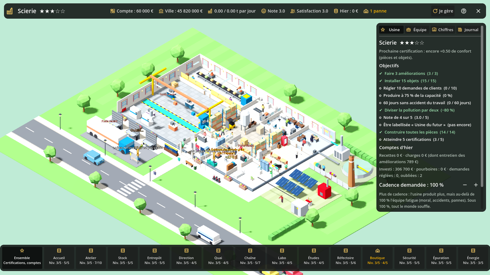
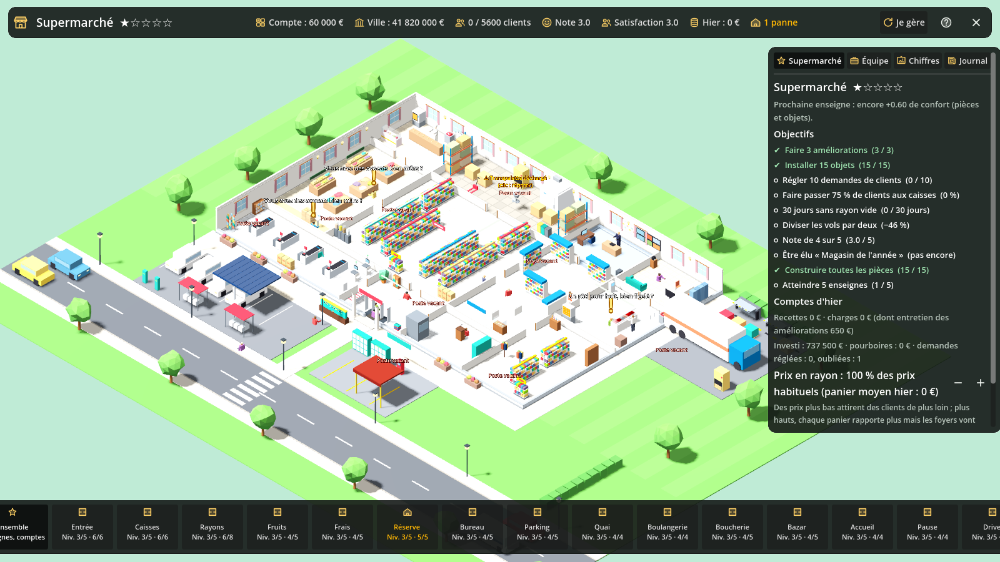
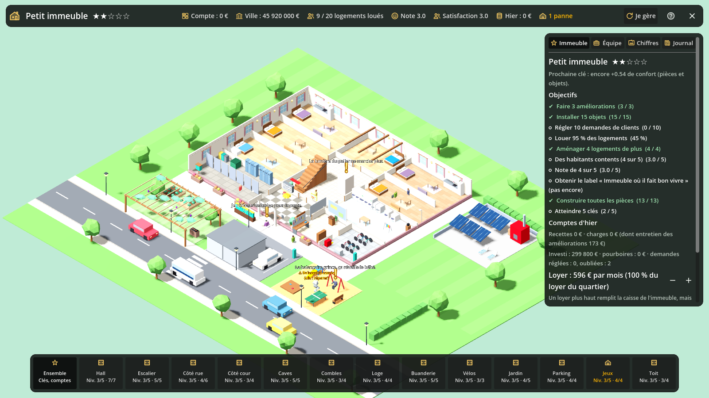

# Mode gestion « tycoon » : un jeu de gestion dans chaque bâtiment

Clique sur un hôtel, puis sur la tuile **Gérer l'hôtel** de sa fiche (ou sur **Gérer** dans le menu Tourisme, Maj+D → Hébergements) : on entre dans l'hôtel, vu en 3D isométrique, comme dans un petit jeu de gestion à part. Le temps de la ville continue (T : pause, Maj + T : vitesse) ; **Échap** ramène à la ville.

**Si tu ne t'en occupes pas, l'hôtel se gère tout seul** (bouton **Gestion auto** en haut, actif par défaut) : il répare ses pannes, ajuste le prix de la nuit chaque semaine selon le remplissage et investit ses bénéfices dans l'amélioration ou l'objet le plus rentable, en gardant 15 jours de charges en réserve. Il ne touche jamais à la caisse de la ville. Clique sur le bouton pour passer en **Je gère** et tout décider toi-même ; tu peux aussi acheter ce que tu veux en mode automatique.

## Ce qu'on voit

- **La maquette** : le rez-de-chaussée coupé comme une maison de poupée. Murs du fond hauts avec fenêtres, rideaux et appliques ; cloisons basses ; façade rasée. Sols à motifs (damier du hall, parquet du bar et du restaurant, moquette des chambres, carrelage du spa et de la lingerie, dalles de la salle de sport). Dehors : parvis avec jardinières, vélos, mâts et drapeaux, l'enseigne avec le nom de l'hôtel et ses étoiles, le parking, la rue avec ses voitures qui passent.
- **13 pièces** : hall et réception, chambres (6 chambres le long d'un couloir, avec lit, chevets, salle de bains), lingerie, bureau de la direction, bar et salon, restaurant (cuisine ouverte), spa, boutique, salle de sport, salle de conférences ; dehors la piscine, le jardin et club enfants, le parking et voiturier. Une pièce pas encore construite est un emplacement de chantier (gravier, piquets, ruban, « + nom de la pièce »).
- **Les objets achetés** (environ 75, de 4 à 9 par pièce), chacun dessiné à sa place : télé, minibar, clim, coffre, baignoire balnéo dans chaque chambre ; fontaine, lustre, borne d'enregistrement dans le hall ; piano, billard, juke-box, cheminée au bar ; buffet, four à pizza, aquarium au restaurant ; sauna, jacuzzi, hammam au spa ; plongeoir, toboggan, palmiers, bar de la piscine ; balançoire, kiosque au jardin ; bornes de recharge, guérite, navette au parking… Beaucoup donnent des places en plus aux clients (canapés, bancs, transats, vélos d'appartement).
- **Le personnel** : les vrais employés de l'hôtel (les habitants embauchés), chacun à son poste selon son métier. Un poste sans personne affiche **Poste vacant**. Les pièces ajoutées dont l'hôtel n'embauche pas le métier (vendeur de la boutique, coach, animateur du club enfants…) ont des **extras**, payés dans l'entretien de la pièce.
- **Les clients** : un personnage pour environ 5 clients réels (au plus 22 à l'écran). Ils arrivent par le trottoir, font la queue à la réception, vont dans une chambre, au restaurant, au bar, au spa, à la piscine, à la boutique, à la salle de sport, au jardin ou en conférence, et repartent. Le prix de la nuit, des repas ou des soins s'affiche au-dessus d'eux.
- **Les demandes** : de temps en temps un client lève un **!** (« Des serviettes propres ! », « Le projecteur ne s'allume pas ! », « Mon fils est coincé en haut du toboggan ! »…). Un clic dessus la règle : pourboire et clients plus contents. Une demande oubliée les déçoit un peu.
- **Les pannes** : un appareil tombe en panne de temps en temps (douche bouchée, four en panne, filtre de la piscine encrassé…). Un **⚠** et de la fumée apparaissent au-dessus de la pièce ; tant que ce n'est pas réparé, la satisfaction baisse chaque jour. Un clic sur le ⚠ répare. Un personnel formé et une direction au niveau 3 cassent moins.

## Ce qu'on fait

- **Améliorer les pièces** (clic sur une pièce ou sur sa tuile en bas) : 5 niveaux par pièce. La carte de droite dit ce que le niveau suivant apporte, son prix et qui le paie. Chaque niveau ajoute de l'**entretien** par jour.
- **Équiper les pièces** : sous les niveaux, la liste des objets de la pièce avec leurs effets et leur prix ; certains demandent un niveau de pièce (le lustre attend un hall au niveau 4).
- **Onglet Hôtel** : étoiles, objectifs, comptes d'hier, prix de la nuit (− et +), remboursement de la ville.
- **Onglet Équipe** : postes pourvus par pièce, **salaires** (80 % à 150 % : mieux payée, l'équipe sourit et les clients le sentent), **formation** (5 niveaux : service plus rapide, clients plus contents, moins de pannes), **pannes** à réparer.
- **Onglet Chiffres** : recettes et charges des 30 derniers jours en barres, remplissage en courbe, note, satisfaction, séminaires, clients célèbres.
- **Onglet Journal** : tout ce qui s'est passé (travaux, achats, pannes, visites).
- **Gagner des étoiles** : tous les 0,6 point de confort gagné, une étoile de plus (jusqu'à 5).

## Ce qui arrive tout seul

- **L'inspecteur du guide** passe incognito à peu près une fois par mois. Si la note est assez bonne pour les étoiles de l'hôtel, il le **recommande** pendant 60 jours (+6 % de clients).
- **Séminaires** : la salle de conférences se loue à des entreprises (plus souvent et plus cher quand elle est équipée).
- **Clients célèbres** : une chanteuse, un footballeur, une ministre… laissent un gros pourboire (plus souvent dans les beaux hôtels).
- **Autocars** : un groupe de touristes arrive sans prévenir quand il reste de la place (plus souvent avec un grand parking).

Objectifs : 3 améliorations, 15 objets, 10 demandes réglées, hôtel rempli à 75 %, note de 4, recommandation du guide, toutes les pièces, 5 étoiles.

## L'argent

L'hôtel est une entreprise privée : ses bénéfices s'accumulent sur son **compte**. Ce qu'on achète se paie d'abord avec ce compte ; s'il ne suffit pas, **la caisse de la ville avance le reste** (inscrit au budget : « Gestion : avance à … »), que l'hôtel rembourse plus tard (bouton **Rembourser la ville**). La gestion automatique, elle, n'utilise que le compte de l'hôtel. Avec l'argent illimité (F10), tout est gratuit.

La boutique, le bar, le spa, le minibar, la cave à vins… font **dépenser** les clients sur place : ces ventes entrent dans les recettes de l'hôtel. Ce que la ville y gagne : plus de lits et de clients, donc plus de nuitées, de taxe de séjour, d'impôts sur les bénéfices, de repas et de courses en ville.

## Le restaurant

Les 55 cafés et restaurants du jeu (café-restaurant, brasserie, auberge, taverne, pub, maquis, salon de thé…) se gèrent aussi : tuile **Gérer le restaurant** sur leur fiche. 14 pièces : accueil et vestiaire, grande salle, cuisine, plonge, réserve et chambre froide, bureau du patron, bar, toilettes, salon privé, cave à vins, salon de thé et pâtisserie, et dehors la terrasse, le potager avec son poulailler et le quai de livraison. Environ 70 objets dessinés (friteuse, four mixte, piano du chef en cuivre, rôtissoire, tireuse à bière, baby-foot, aquarium à homards, pergola et vigne, guirlandes, ruches, scooters de livraison, camionnette…).

- Le compte du restaurant est la caisse de l'entreprise (économie, touche P) : les améliorations se paient d'abord avec elle, la ville avance le reste.
- **Couverts** : la salle, la terrasse, le salon privé et le bar ajoutent des tables : le restaurant peut servir plus de repas par jour (habitants et touristes).
- **Affluence** : la note, l'attrait et le **prix du menu** (− / + dans l'onglet Restaurant) décident combien de clients viennent. Plus cher, chaque repas rapporte plus mais il vient moins de monde et ils sont moins contents.
- **Toques** (1 à 5) : comme les étoiles de l'hôtel, gagnées par le confort ; chaque toque rend le repas plus cher. Le vin, les desserts et les cafés (« ventes ») s'ajoutent à l'addition.
- Chaque jour : salaires, entretien des améliorations, bilan (recettes, charges, couverts servis), satisfaction (prix, pannes, produits qui manquent) et note.
- Événements : critique gastronomique incognito (« Coup de cœur » du guide), inspection d'hygiène (amende si la cuisine, la plonge, la réserve ou les toilettes sont en panne), banquets dans le salon privé (mariages, repas d'entreprise), clients célèbres, soirs de match au bar.
- Gestion automatique comme l'hôtel (sans jamais toucher à la caisse de la ville).

## La caserne de pompiers

Les casernes (et leurs versions d'époque) se gèrent : tuile **Gérer la caserne** sur leur fiche. C'est un **service public** : pas de clients qui paient, mais un **budget versé chaque jour par la caisse de la ville** (1 000 € par jour pour une caserne standard, − / + dans l'onglet Caserne, de 0 à 8 fois plus). La caserne paie son entretien avec ce budget et investit le reste (tout seule en gestion automatique). Une caserne jamais ouverte en mode gestion ne coûte rien de plus.

14 pièces : accueil et couloir, salle d'alerte, remise des engins, chambres de garde, vestiaires et douches, cuisine et réfectoire, salle de formation, bureau du chef de centre, magasin et pharmacie, salle de sport, atelier mécanique, et dehors la cour d'honneur, la tour de manœuvre et l'aire de lavage et de carburant. 74 objets dessinés (râtelier de tuyaux, compresseur d'air, désincarcération, tour de séchage, mât de descente, lits superposés, tenues de feu, mur d'écrans, mannequins de secourisme, simulateur de feu, pont élévateur, pompe à bras de 1890, camion des années 1950, conteneur d'entraînement au feu…).

Ce que ça change **vraiment** dans les urgences (touche U) :
- **Remise** : chaque niveau ajoute un engin à la flotte (VSAV, fourgon pompe-tonne, VSAV, grande échelle) et l'engin de réserve un de plus. Dans la maquette, les engins sont garés dans la remise ; quand un appel arrive, l'alerte sonne et l'engin sort, gyrophares allumés, et part par la rue. Il revient à sa place quand il rentre.
- **Chambres de garde** : un pompier de garde de plus par niveau (lits superposés : un de plus). Chaque engin a besoin de son équipage pour partir : plus de garde, plus d'engins en même temps. Les **volontaires** (recrutés grâce au prestige et à la salle de formation) comptent aussi.
- **Rapidité** : alerte, vestiaires, sport, tour de manœuvre, matériel et formation du personnel font travailler l'équipe plus vite sur place (jusqu'à 2,5 fois).
- **Note** : elle suit le **délai moyen d'arrivée** des secours de cette caserne (5 sur 5 sous 3 minutes), le moral et les pannes. **Galons** (1 à 5) : gagnés par l'expérience (pièces et objets).
- Événements : inspection (« citée en exemple » : un pompier de garde en plus pendant 60 jours), bal des pompiers en juillet, tournée des calendriers en fin d'année, volontaires, manœuvres, visites d'écoles. Les visiteurs (stages de secourisme, enfants, futurs volontaires) posent leurs questions : y répondre rapporte un petit don.

## Le commissariat de police

Les commissariats se gèrent aussi : tuile **Gérer le commissariat** sur leur fiche. Comme la caserne, c'est un **service public** payé par la ville (budget de 900 € par jour pour un commissariat standard, − / + dans l'onglet Commissariat). Un commissariat jamais ouvert en mode gestion ne coûte rien de plus.

14 pièces : accueil et salle d'attente, salle de commandement (le 17), garage des voitures, vestiaires et salle de repos, bureau des plaintes, salle de pause, bureau du commissaire, armurerie et scellés, bureau des enquêteurs, cellules de garde à vue, stand de tir et sport, et dehors le parvis avec sa piste d'éducation routière, le chenil de la brigade cynophile et la fourrière. 75 objets (tableau des clés, motos, radar, gilets pare-balles, scellés, tableau de l'enquête avec ses fils rouges, kit d'empreintes, petit labo de police scientifique, toise, salle d'audition, cibles mobiles, niches, Rex le chien, dépanneuse, sabots de Denver, estafette des années 1960…).

Ce que ça change **vraiment** dans la ville :
- **Garage** : chaque niveau ajoute une voiture de patrouille (ou un fourgon) à la vraie flotte de police ; la voiture banalisée de réserve en ajoute une. Dans la maquette, on voit la voiture sortir, gyrophares allumés, quand un appel arrive.
- **Vestiaires et repos** : un policier en service de plus par niveau. Les **réservistes** (recrutés grâce à la confiance des habitants et au bureau des plaintes) comptent aussi.
- **Enquêtes** (nouveau) : quand la patrouille arrive trop tard sur un cambriolage, les enquêteurs ont une chance de retrouver les voleurs (bureau des enquêteurs, cellules, chenil, empreintes, fichier, labo : jusqu'à 85 %). Le foyer ne perd alors rien, et c'est compté dans les statistiques des urgences.
- **Fourrière** : les voitures mal garées rapportent des frais au budget du commissariat.
- **Note** : délai moyen d'arrivée, moral et pannes. **Insignes** (1 à 5) : gagnés par l'expérience.
- Événements : contrôle de la préfecture (« félicité » : un policier en plus pendant 60 jours), permis vélo des écoles au printemps, démonstrations de la brigade cynophile, défilé du 14 juillet, objets trouvés rendus, réservistes.

## L'hôpital

Les hôpitaux se gèrent aussi : tuile **Gérer l'hôpital** sur leur fiche. Service public payé par la ville (environ 3 100 € par jour pour un hôpital standard, − / + dans l'onglet Hôpital). Un hôpital jamais ouvert en mode gestion ne coûte rien de plus.

14 pièces : accueil des urgences, régulation du SAMU (le 15), garage du SAMU, chambres des patients, salle de garde des urgentistes, consultations, direction, pharmacie, bloc opératoire, imagerie (radio, scanner), laboratoire, et dehors le jardin des patients, l'hélistation et le parking des visiteurs. 67 objets (fauteuils roulants, lits médicalisés, pieds à perfusion, table d'examen, échographe, table d'opération, scialytique, moniteurs, respirateur, robot chirurgical, scanner, microscopes, frigo à poches de sang, hélicoptère sanitaire…).

Ce que ça change **vraiment** dans la ville :
- **Garage du SAMU** : chaque niveau ajoute une ambulance ou un SMUR à la vraie flotte (Urgences). Elles sortent du garage gyrophares allumés dans la maquette.
- **Salle de garde** : un urgentiste de garde de plus par niveau. Les **internes** (attirés par la réputation et les consultations) comptent aussi.
- **Chambres** (nouveau) : 12 lits de plus par niveau (et 4 avec les lits médicalisés) dans la capacité de l'hôpital, utilisée par les services publics et la santé publique.
- **Soins** (nouveau) : bloc, imagerie, labo, pharmacie, hélistation. Quand l'ambulance arrive trop tard sur un malaise, une partie des patients qui seraient morts sont sauvés (jusqu'à 80 %).
- **Parking** : les tickets des visiteurs rapportent un peu chaque jour.
- **Note** : délai moyen d'arrivée des ambulances, moral, pannes. **Caducées** (1 à 5) : gagnés par l'expérience.
- Événements : certification (« sans réserve » : un urgentiste en plus pendant 60 jours), naissances, collecte de sang en hiver, clowns hospitaliers, hélicoptère, internes.

## Les autres bâtiments de secours

Cinq bâtiments de secours de la bible utilisent le tycoon d'un autre bâtiment :

| Bâtiment | Se gère comme | Titre de la tuile |
|---|---|---|
| Centre de secours (`caserne_pompiers`) | la caserne | Gérer le centre de secours |
| Gendarmerie (`gendarmerie`, et la brigade d'époque) | le commissariat | Gérer la gendarmerie |
| Hôtel de police (`commissariat`) | le commissariat | Gérer l'hôtel de police |
| Hôpital régional (`hopital_regional`) | l'hôpital | Gérer l'hôpital régional |
| Clinique (`clinique`) | l'hôpital | Gérer la clinique |

Avant ce changement, ces cinq bâtiments n'envoyaient aucun véhicule. Ils envoient maintenant leurs 3 véhicules comme les modèles de base. Le rôle est lu par `Urgences.service_type` : le type lui-même, sa base, ou le `role` de la bible. Le mode gestion leur ajoute des véhicules en plus, du personnel de garde et des effets, et ils changent avec l'époque et le pays comme les autres.

Pour tester dans Godot 4.7, pose une gendarmerie ou une clinique au bord d'une route. Clique dessus : la tuile s'appelle « Gérer la gendarmerie » ou « Gérer la clinique ». Tu peux aussi lancer le test automatique : `godot --path . --script res://tests/gestion_urgences_bible_test.gd`.

## Le parc de loisirs

Le parc de loisirs se gère comme une maquette : bouton **Gérer le parc (maquette)** dans le panneau du parc (Maj+G), ou tuile sur la fiche de l'**Entrée du parc**. Le parc appartient à la ville : les billets et les stands vont toujours dans la caisse de la ville. Une fois le parc ouvert en gestion, **25 % du bénéfice du jour** sont mis de côté dans la **caisse des travaux** du parc, qui paie les aménagements (la ville avance le reste). Un parc jamais ouvert en gestion ne change pas.

13 zones : billetterie, direction, infirmerie, manèges familiaux, grands frissons, rivière et toboggans, royaume des petits, place gourmande, boutique de souvenirs, scène des spectacles, toilettes, atelier technique et parking des visiteurs. 68 objets (bornes à billets, mascotte, coupe-file, écrans d'attente, brumisateurs, photo souvenir, petit train, friterie, barbe à papa, food truck, gradins, projecteurs, machine à fumée, nacelle élévatrice, balayeuse, ombrière solaire, autocar…).

**Les vraies attractions** du parc apparaissent **en miniature** dans leur zone, et elles tournent : montagnes russes et bateau pirate dans les grands frissons, attractions sur l'eau dans la rivière, petits manèges chez les petits, le reste dans les manèges familiaux (et là aussi tant que leur zone n'est pas construite).

Ce que ça change **vraiment** dans le parc :
- **Visiteurs attirés** (billetterie, parking, spectacles, mascotte…) : plus de visiteurs attendus chaque jour, jusqu'à +80 %.
- **Confort** (décors, files ombragées, bancs…) : jusqu'à +1 étoile sur la note du parc.
- **Vitesse** : manèges et stands qui servent plus vite (jusqu'à +50 %).
- **Fiabilité des manèges** (atelier, techniciens) : jusqu'à 70 % d'usure en moins et des révisions plus efficaces.
- **Propreté** (toilettes, atelier, balayeuse) : les agents de propreté nettoient plus vite.
- **Ventes** : photos, consigne, poussettes… chaque visiteur dépense un peu plus.
- **Humeur** : les visiteurs arrivent de meilleure humeur, surtout quand on règle leurs demandes (« J'ai perdu mon fils ! », « Mon ballon s'est envolé ! »).
- Le **billet** se règle depuis la maquette (− / +) ; en gestion automatique, il suit ce que vaut le parc et les refus à l'entrée.
- **Fanions** (1 à 5) : gagnés par l'expérience. Événements : inspection de sécurité (label Sécurité 60 jours), trophée du parc de l'année en décembre, autocars et sorties scolaires, anniversaires, influenceurs, canicule.

## L'usine

Toutes les usines qui transforment une matière (scierie, aciérie, cimenterie, usine de biens, agroalimentaire…) se gèrent aussi : tuile **Gérer l'usine** sur leur fiche. Comme le restaurant, c'est une entreprise : le compte est la caisse de l'usine (Production), qui reçoit les ventes et paie les améliorations. Une usine jamais ouverte en gestion produit exactement comme avant.

14 pièces : accueil et pointeuse, atelier de fabrication, chaîne de montage, stock matières, entrepôt des produits finis, laboratoire qualité, bureau d'études, réfectoire, direction, boutique d'usine (showroom), infirmerie et sécurité, et dehors le quai de chargement, la station d'épuration et la centrale d'énergie. 78 objets (pont roulant, presse, machine-outil, four industriel, bras robotisé, convoyeurs, AGV, chariot élévateur, racks à palettes, filmeuse, banc d'essai, spectromètre, imprimante 3D, filtre à manches, bassin de décantation, panneaux solaires, chaudière, éolienne, semi-remorque…).

Ce que ça change **vraiment** dans la ville :
- **Production** (atelier, chaîne, robots) : l'usine transforme plus de matière par heure, commande plus de matière première et stocke plus.
- **Économie de matière** (labo, découpe optimisée) : plus de produits finis pour la même matière, jusqu'à +40 %.
- **Qualité** (labo, études, showroom, réputation) : les produits se vendent plus cher, à l'export comme aux autres entreprises (jusqu'à ×1,8).
- **Pollution en moins** (filtre à manches, épuration, décantation) : moins de pollution de l'air et de l'eau autour de l'usine, et moins de CO₂ industriel dans le bilan climat (jusqu'à −80 %).
- **Énergie économisée** (panneaux solaires, chaudière, éolienne) : moins de charges chaque jour.
- **Cadence demandée** (− / + de 70 % à 130 %) : au-dessus de 100 %, heures sup : plus de production, mais l'équipe fatigue, les pannes et les **accidents du travail** augmentent. Sans infirmerie, un accident peut valoir une amende de l'inspection du travail. Moral au plus bas et salaires bas : **grève**, les machines s'arrêtent.
- **Certifications** (1 à 5) : gagnées par l'expérience. Événements : audit « Usine du futur » (label 60 jours), grosses commandes, ventes de la boutique d'usine, visites d'usine, salon de l'industrie au printemps.

## Le supermarché

Les supermarchés et les supérettes se gèrent aussi : tuile **Gérer le magasin** sur leur fiche. C'est une entreprise : le compte est la caisse du magasin, qui reçoit les ventes aux habitants et paie les améliorations (les prix suivent ceux du catalogue : une supérette coûte bien moins cher à aménager qu'un supermarché). Un magasin jamais ouvert en gestion vend exactement comme avant.

15 pièces : entrée et sas, ligne de caisses, rayons épicerie et boissons, fruits et légumes, produits frais et surgelés, boucherie et poissonnerie, boulangerie, réserve, bureau du directeur, salle de pause, bazar et électroménager, accueil et point relais, et dehors le parking, le drive et le quai de livraison. 75 objets (chariots, portiques antivol, caisses à tapis, caisses automatiques, gondoles, têtes de gondole, rayon vrac, cave à vins, étals en cagettes, meubles froids, bacs à surgelés, comptoir de boucherie, vivier à homards, four à pain, presse à cartons, casiers du drive, ombrières solaires, camion frigorifique…).

Ce que ça change **vraiment** dans la ville :
- **Rayons mieux remplis** (réserve, rayons, frais, quai) : le magasin garde jusqu'à 2,5 fois plus de stock, donc moins de rayons vides et moins de foyers qui manquent de tout.
- **Clients attirés** (parking, fruits, boulangerie, drive, promotions, « Magasin de l'année ») : les foyers du quartier choisissent ce magasin avant les autres commerces, et viennent de plus loin.
- **Prix en rayon** (− / + de 80 % à 140 %) : plus bas, il attire de plus loin ; plus haut, chaque panier rapporte plus mais des foyers repartent chez le concurrent.
- **Panier moyen** (boucherie, bazar, cave, drive) : chaque client dépense plus.
- **Caisses** : plus de clients servis par jour ; quand la file déborde, la satisfaction baisse, puis la note et l'attrait.
- **Vols à l'étalage** : un peu de la recette disparaît chaque jour ; portiques, caméras, coffre et vigile les divisent.
- **Énergie** : portes vitrées sur le froid, presse à cartons, ombrières solaires : moins de factures.
- **Enseignes** (1 à 5) : gagnées par l'expérience. Événements : client mystère (« Magasin de l'année » 60 jours), semaines de promotion, rush de la rentrée et de Noël, foire aux vins, contrôle sanitaire de la chaîne du froid.

## L'immeuble

Les immeubles, les tours et les résidences de logements se gèrent aussi : tuile **Gérer l'immeuble** sur leur fiche (pas les maisons ni les maisons en rangée, ni les logements précaires). On joue le gérant : le compte encaisse les loyers des foyers qui habitent l'immeuble et paie les travaux (les prix suivent ceux du catalogue). Un immeuble jamais ouvert en gestion reste exactement comme avant.

13 pièces : hall d'entrée, escalier et ascenseur, appartements côté rue et côté cour, caves et local poubelles, loge du gardien, local vélos, combles aménagés, buanderie commune, et dehors le jardin partagé, le parking et les garages, l'aire de jeux et le toit-terrasse. 60 objets (boîtes aux lettres, digicode, lustre, caméras, ascenseur, cuisines équipées, salles de bains, balcons fleuris, studios redécoupés, mezzanine, portes de caves blindées, boîte à livres, étagère à colis, arceaux et prises pour vélos, lave-linge collectifs, carrés potagers, barbecue, toboggan, ping-pong, boxes fermés, bornes de recharge, panneaux solaires, chaudière à condensation, jacuzzi sur le toit…). Plus on monte de niveau, plus les appartements de la maquette sont nombreux et meublés.

Ce que ça change **vraiment** dans la ville :
- **Logements en plus** (appartements rénovés, combles, studios redécoupés, mezzanine) : l'immeuble compte de vrais logements de plus, et de nouveaux foyers viennent s'y installer.
- **Habitants contents** (ascenseur, jardin, aire de jeux, buanderie, gardien…) : la satisfaction des habitants de l'immeuble monte dans la ville (ligne « immeuble bien tenu (gérant) »).
- **Loyer** (− / + de 70 % à 150 % du loyer du quartier) : c'est le vrai loyer que paient les foyers ; trop haut, ceux qui ne peuvent plus payer déménagent. Le **standing** (lustre, parquet, poutres, toit-terrasse) permet de demander plus sans faire fuir.
- **Cambriolages** : digicode, caméras, portail, gardien et portes blindées les divisent.
- **Charges** : isolation, volets, chaudière, panneaux solaires, éclairage à détecteur : moins de factures.
- **Clés** (1 à 5) : gagnées par l'expérience. Événements : label « Il fait bon vivre » (60 jours), dégât des eaux (moitié moins cher avec un gardien), cambriolage, loyer impayé, fête des voisins.

## Faire grandir l'établissement (tous les genres)

Deux onglets en plus dans la carte de droite, pour l'hôtel, le restaurant, la caserne, le commissariat, l'hôpital, le parc et l'usine :

- **Essor**
  - **Recherche** : un projet à la fois, avancé par des points gagnés chaque jour (équipe, formation, pièces construites). 8 projets : méthodes de travail (+15 % de vitesse), démarche qualité, maintenance préventive (−30 % de pannes), achats groupés (−10 % de charges), design et ambiance (confort), fidélisation (clients, ou une personne de garde en plus pour un service public), atelier d'idées (recherche plus rapide), excellence. Certains attendent un autre projet.
  - **Publicité** (entreprises) : affiches, journal (dès 1830), radio (1925), télé (1955), site et avis en ligne (1998), influenceurs (2010), journée découverte. **Campagnes** (services publics) : portes ouvertes, recrutement, prévention dans les écoles, affiches, reportage. Payées chaque jour tant qu'elles durent ; la même refaite moins de 30 jours après n'a que la moitié d'effet.
  - **Défi** : tous les 12 jours environ, un défi est proposé (« Régler 5 demandes en 7 jours », « Aucune panne pendant 10 jours », « Monter la note à 4,2 en 15 jours », « Encaisser 25 000 € en 7 jours », « Faire 8 interventions en 10 jours »…). Accepté : une prime et des clients ravis pendant 30 jours s'il est réussi à temps.
  - **Paliers** : une pièce au niveau maximum, 10, 25 ou 50 objets, 3 ou 10 défis réussis, toute la recherche : chacun donne un petit bonus permanent, annoncé au journal.
- **Avis** : les avis écrits par les clients (ou les habitants pour un service public), avec leurs étoiles, la moyenne, ce qui plaît et ce qui fâche (pannes, prix, équipe, pièces, publicité…), et le **classement** des établissements du même genre dans la partie (note, étoiles, part des clients).

Et aussi :

- **Équipe en personnes** (onglet Équipe, en bas) : chaque employé a un trait (rapide, aimable, soigneux, endurant, créatif, ambitieux, maladroit, râleur), un moral et une fatigue. Le moral suit le salaire, les augmentations, la formation, la fatigue et les pannes ; resté très bas une semaine, la personne démissionne et une recrue la remplace. Pauses courtes, normales ou longues (plus de repos, service un peu plus lent ; la salle de repos, les vestiaires ou les chambres de garde aident aussi). Demandes d'augmentation (+10 %, à accorder ou refuser) et employé du mois (une prime par mois, moral en hausse pour toute l'équipe).
- **Prix des services** (onglet Essor) : spa, bar, boutique, cave… chacun de 60 % à 160 % du prix habituel, en plus du prix principal.
- **Types de clients** (onglet Avis, « Qui vient ») : familles, gens d'affaires, touristes, jeunes, seniors (écoles, actifs, personnes âgées pour un service public). Leur part change avec la saison ; chacun aime certaines pièces et regarde plus ou moins le prix. Plus ils sont contents, plus la satisfaction et l'affluence montent.
- **Banque** (entreprises) : trois prêts possibles, versés tout de suite sur le compte, remboursés chaque jour pendant 120 jours avec le taux de l'époque (5 % au XIXe siècle, 9 % dans les années 1980, 3,5 % aujourd'hui). Remboursement anticipé possible.
- **Agrandissement** : deux extensions, chacune donne un niveau de plus à toutes les pièces (jusqu'au niveau 7) et un peu de confort.
- **Trophées** : 10 à gagner (défis, recherche, publicité, avis à 4,5, première place de la ville, équipe soudée, agrandissement). Chacun donne un petit bonus et s'expose sur un socle devant l'entrée de la maquette.

En gestion automatique, l'établissement choisit sa recherche, accepte les défis et lance une publicité quand il manque de clients (seulement avec son propre compte).

Code : `scripts/gestion/gestion_plus.gd` (`GestionPlus` : équipe, services, types de clients, prêt, trophées, agrandissement), `scripts/gestion/gestion_essor.gd` (`GestionEssor`, état dans `st.essor`, bonus lus par `Gestion.effet`, charges par `Gestion.entretien_jour`, pannes, journée) et `gestion_essor_vue.gd` (les deux onglets). Test : `tests/gestion_essor_test.gd`. Captures : `tests/gestion_vitrine.gd -- --onglet essor|avis`.

## Tous les autres bâtiments : les tycoons « en kit » (37 genres)

Plus de 350 types du catalogue (et leurs variantes de style) se gèrent maintenant comme un tycoon, avec le même écran (carte à onglets Essor, Avis, Équipe, Stats, Journal). Ils ont leur propre caisse (compte « lieu ») : visiteurs, recettes du jour, salaires et entretien. Pour un service public (école, mairie, gare, centre sportif, centrale, usine d'eau, déchets, poste, centre technique, office de tourisme), la ville verse en plus un budget chaque jour, réglable par − / +.

| Priorité | Genres |
|---|---|
| Haute | zoo, école (et crèche, collège, lycée), université, gare, musée, mairie (et hôtel de ville), stade (tous les `stade_*`, plus salles omnisports, palais des sports, patinoire de hockey, centre de tennis), ferme (céréales, maraîchage, vergers, oliveraies, ruchers, serres… 30 types), ferme laitière et élevages, domaine viticole (et caves) |
| Moyenne | grand magasin, boulangerie et boucherie, boutique de quartier, marché couvert, pharmacie, station-service, concession et garage, immeuble de bureaux et banque, cinéma, studios de cinéma, salle de spectacle (opéra, théâtre, jazz, cirque…), centre sportif (gymnase, piscine, patinoire), parc aquatique, casino, carrière et mine, entreprise du bâtiment, centrale électrique, centre de traitement des déchets, grands monuments |
| Basse | bowling et discothèque, usine d'eau et station d'épuration, pompes funèbres et crématorium, poste et télécoms, centre technique municipal, office de tourisme, golf, châteaux et sites historiques |

Chaque genre a au moins 8 pièces (dedans et dehors), 30 objets, ses demandes, pannes, événements et objectifs.

**Les époques.** Une pièce ou un objet peut avoir une année d'apparition (`annee`) ou de disparition (`jusqu`) : en 1850, pas de rayon électronique au grand magasin ni de bornes de recharge à la station ; la pompe à bras disparaît après 1960. Les noms changent aussi (`noms_epoque`) : ménagerie avant 1900, magasin de nouveautés, cinématographe avant le parlant, syndicat d'initiative, dancing, relais de poste… Les prix suivent l'époque (×0,08 avant 1900, ×0,25 avant 1950, ×0,6 avant 1990).

**Les pays.** `noms_pays` adapte des noms : en Suisse, maison de commune, maison de jeu au lieu de casino, fromagerie de gruyère, carnotzet, SUVA… (et les noms CH/BE des tycoons faits à la main).

**Les stades.** Tous les stades (catalogue, styles du monde, modèles de l'Atelier) se gèrent avec la même fiche : la capacité vient des places du bâtiment, les jours de match (un sur sept) remplissent les tribunes, chaque stade garde son nom et sa caisse. Des centaines de stades différents fonctionnent donc sans fiche à écrire.

**Liens avec le jeu.** Zoo et musée : les vrais visiteurs du zoo (Maj+Z) et du musée comptent, et l'attrait de la gestion augmente leur affluence. École : chaque niveau de salle de classe ajoute des places d'élèves dans les services publics (Maj+U). Fermes, carrières et mines : l'effet « rendement » augmente la vraie production (P), jusqu'à +60 %.

### Tester dans Godot 4.7

1. Ouvrir `project.godot`, lancer une partie (F5), Admin (F10) : argent illimité si besoin.
2. Poser au bord d'une route un des bâtiments du tableau (par exemple une boulangerie, un cinéma, un stade, une ferme, un château), cliquer dessus : la tuile « Gérer … » ouvre la maquette.
3. Acheter un niveau de pièce, un objet, régler le prix, passer en vitesse rapide (Maj+T) : visiteurs, recettes et avis arrivent. Pour un service public, régler le budget avec − / +.
4. Pour voir l'adaptation à l'époque : nouvelle partie au 1er janvier 1800 ou 1900, les noms et les objets changent.

Test automatique : `xvfb-run -a godot --path . --rendering-driver opengl3 --script res://tests/gestion_kit_test.gd` (tous les genres, ou `-- --genre cinema` pour un seul). Il vérifie plan, portes, chemins, modèles 3D, métiers, époques et pays, puis pose chaque bâtiment dans une ville et joue plusieurs jours, avec sauvegarde et rechargement.

Code : `scripts/gestion/genres/genres_auto.gd` (`GenresAuto` : monte une fiche courte en vrai genre, plan et poses calculés tout seuls, cache par pays et époque), `genres_haute.gd`, `genres_moyenne.gd`, `genres_basse.gd` (les fiches), `scripts/gestion/gestion_lieu.gd` (`GestionLieu` : visiteurs, recettes, budget), `gestion_epoques.gd` (`GestionEpoques`), `decors_auto.gd` (`DecorsAuto` : ~30 décors de pièces qui s'adaptent à la taille et à l'époque, et les modèles de la touche G avec `deco:`). Ajouter un genre : une entrée dans le `SPECS` d'un de ces fichiers.

## Rythme

Le mode suit le temps du jeu : rien ne se gagne pendant que le jeu est fermé, rien ne bouge en pause, tout va plus vite en vitesse rapide. La gestion automatique, les pannes et les événements tournent chaque jour de jeu pour tous les hôtels, même ceux qu'on n'ouvre jamais. Un hôtel jamais ouvert garde ses effets à zéro tant qu'il n'a rien acheté.

## Pour aller plus loin (code)

- `scripts/gestion/genres/genre_restaurant.gd` (`GenreRestaurant`) : le restaurant (pièces, objets, demandes, pannes). `source` dit qui fait vivre le bâtiment : `tourisme` (hôtel) ou `production` (restaurant : `Gestion.affluence_de`, `prix_repas_de`, `couverts_de`, `compter_de`, `entretien_site`, `cloture_de` sont appelés par `Production`).
- `scripts/gestion/decors_restaurant.gd` et `modeles_restaurant.gd` : décors de base des pièces et ~50 modèles du restaurant.
- `scripts/gestion/genres/genre_caserne.gd` (`GenreCaserne`), `decors_caserne.gd`, `modeles_caserne.gd` : la caserne. Source `ville` : le compte est `etat.caisse`, alimenté par `dotation()` dans `_journee_ville()`. Liens avec `Urgences` : `Gestion.flotte_de` (engins en plus, `Urgences.maj_flotte`), `equipage_de` (ajouté à `staff_of`), effet `vitesse` (temps sur place), `intervention_de` et `depart_de` (délai, note, journal). Les engins de la maquette : `GestionDiorama.placer_engins`.
- `scripts/gestion/genres/genre_commissariat.gd` (`GenreCommissariat`), `decors_commissariat.gd`, `modeles_commissariat.gd` : le commissariat, même source `ville`. Les mots propres au service (voiture/engin, garage/remise, policier/pompier, « en service »/« de garde », conseil) sont des clés du genre (`vehicule`, `vehicules`, `garage`, `agent`, `agents`, `de_garde`, `conseil`, `label_effet`, `seul`). Effet `enquete` : `Gestion.chance_enquete_de` et `enquete_de`, appelés par `Urgences._effects_on_done` pour un cambriolage arrivé trop tard.
- `scripts/gestion/genres/genre_hopital.gd` (`GenreHopital`), `decors_hopital.gd`, `modeles_hopital.gd` : l'hôpital. Effet `lits_sup` (un nombre de lits, `Gestion.lits_sup_de`, ajouté dans `ServicesPublics.capacite`) et effet `soins` (`Gestion.chance_soins_de`, `patient_de`, appelés par `Urgences._effects_on_done` pour un malaise en retard).
- `scripts/gestion/genres/genre_parc.gd` (`GenreParc`), `decors_parc.gd`, `modeles_parc.gd` : le parc de loisirs. Source `parc` : chiffres de `ParcLoisirs` (`Gestion._journee_parc`, `visiteurs_parc`, `batiments_parc`). Les effets sont lus par `ParcLoisirs.effet_gestion` (plafonnés par `GESTION_MAX`). Miniatures : `GestionVue.zone_attraction` et `GestionDiorama._poser_miniatures` (clé `miniatures` du genre), clôture et allées : clés `cloture` et `allees`.
- `scripts/gestion/genres/genre_usine.gd` (`GenreUsine`), `decors_usine.gd`, `modeles_usine.gd` : l'usine (tout bâtiment `kind == "transformation"`). Source `production`, chiffres en tonnes (`hier.clients` / `hier.cap`). Branchements : `Production._step_hours` (`Gestion.cadence_de` : 0 = grève, `matiere_de` multiplie la sortie, `produire_de` compte la journée), `cap_of` et `_needs_calc` (stocks et commandes ×cadence), `_unload` (`prix_vente_de` sur l'export et les ventes entre entreprises), `_pay` (`recette_de`), `Nuisances._sources_batiment` et `Climat` (`depollution_de`). Cadence = `etat.prix` (0,7 à 1,3). Chaîne des modèles et décors : hôpital → usine → parc.
- `scripts/gestion/genres/genre_supermarche.gd` (`GenreSupermarche`), `decors_supermarche.gd`, `modeles_supermarche.gd` : le supermarché (profil de commerce `superette` ou `supermarche`). Source `production`, clients = personnes des foyers servis. Branchements dans `Production` : `cap_of` (commerce ×`Gestion.rayons_de`), `_shops_for` (classement distance / `attraction_de`, portée jusqu'à ×1,6, listes refaites quand `Gestion.version_magasins` change), `_shopping` (vente ×`panier_de`, `vente_de` compte clients et recette). Prix = `etat.prix` (0,8 à 1,4). Chaîne des modèles et décors : hôpital → usine → supermarché → parc.
- `scripts/gestion/gestion_types.gd` (`GestionTypes`) : les genres gérables. Un genre = ses pièces (plan, niveaux, prix, effets, métiers et postes, portes et chemins), ses objets (modèle, poses, prix, niveau requis, effets), ses demandes, ses pannes, les activités des clients. Pour ajouter la prison, l'hôpital, l'usine… : une entrée dans `GENRES`, une ligne dans `genre_de()`, et les décors de base de ses pièces dans le diorama (`_decor_<nom>`).
- `scripts/gestion/gestion.gd` (`Gestion`) : niveaux, objets, prix, paiement, effets (`Gestion.effet_de(bid, clé)`), étoiles, personnel (salaires, formation), pannes, événements, historique, journal, gestion automatique (`gerer_auto`, `candidats`), objectifs, sauvegarde (section `gestion`). `nouveau_jour()` est appelé par le tourisme à chaque fin de journée.
- `scripts/gestion/gestion_modeles.gd` (`GestionModeles`) : la bibliothèque des objets low-poly (72 modèles) et les places qu'ils offrent aux clients.
- `scripts/gestion/gestion_diorama.gd` (`GestionDiorama`) : la maquette (sols, murs, fenêtres, façade, rue), les figurines, les trajets, les pannes.
- `scripts/gestion/gestion_vue.gd` (`GestionVue`) et `graphe_gestion.gd` : l'écran (caméra isométrique, barre du haut, carte à onglets, tuiles du bas, bulles, graphique).
- Effets lus par le tourisme : `Tourisme.spec`, `lits`, `note`, `attrait_heb`, repas sur place, dépenses sur place (`ventes`), satisfaction, entretien.

- `scripts/gestion/genres/genre_immeuble.gd` (`GenreImmeuble`), `decors_immeuble.gd`, `modeles_immeuble.gd` : l'immeuble (`GestionTypes.genre_de` : catégorie logement, 6 logements ou plus, pas en rangée ni précaire). Source `logement` : le compte est `etat.caisse`, alimenté par les loyers des foyers (`_journee_logement`). Branchements : `Population._info_of` (`log` + `Gestion.logements_de`, mis à jour par `_maj_logements`), `Population.extra_satisfaction` (chaîné par `Gestion.brancher_population`), `Immobilier.mult_loyer` (× `Gestion.loyer_de`, 0,7 à 1,5). Chaîne des modèles et décors : hôpital → usine → supermarché → immeuble → parc.

Tests : `xvfb-run -a godot --path . --rendering-driver opengl3 --script res://tests/gestion_test.gd` (hôtel) , `res://tests/gestion_restaurant_test.gd` (restaurant) `res://tests/gestion_caserne_test.gd` (caserne) `res://tests/gestion_commissariat_test.gd` (commissariat) `res://tests/gestion_hopital_test.gd` (hôpital) `res://tests/gestion_usine_test.gd` (usine) `res://tests/gestion_supermarche_test.gd` (supermarché) et `res://tests/gestion_immeuble_test.gd` (immeuble). Captures : `tests/gestion_vitrine.gd -- --out DOSSIER [--type haussmann__restaurant|pompiers|police|hopital|scierie|supermarche|immeuble] [--depart] --niveau 1|3|5 [--piece spa] [--zoom 30] [--onglet personnel|stats|journal] [--x 20 --z 14]`.
