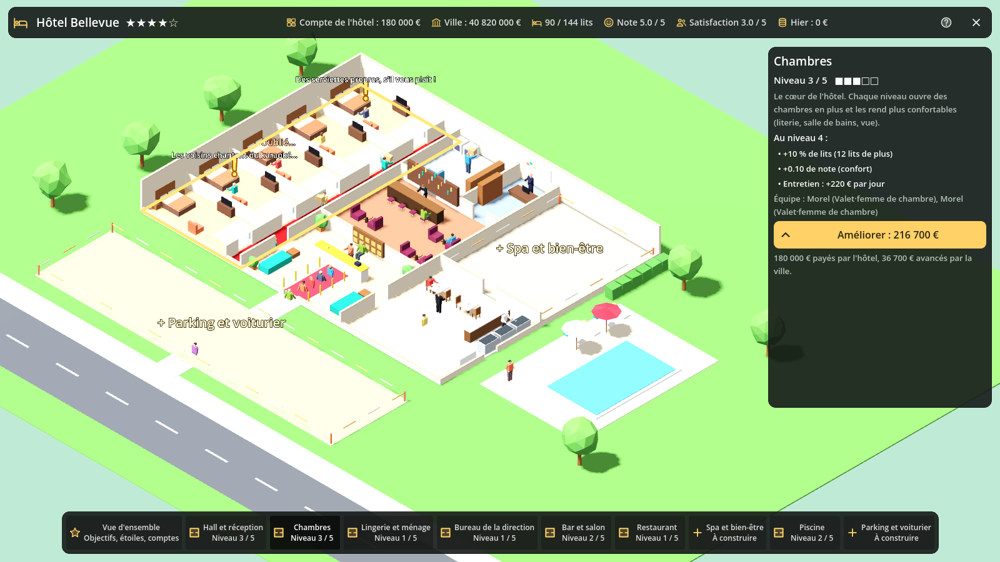

# Mode gestion « tycoon » : un jeu de gestion dans chaque bâtiment

Clique sur un hôtel, puis sur la tuile **Gérer l'hôtel** de sa fiche (ou sur **Gérer** dans le menu Tourisme, Maj+D → Hébergements) : on entre dans l'hôtel, vu en 3D isométrique, comme dans un petit jeu de gestion à part. Le temps de la ville continue (T : pause, Maj + T : vitesse) ; **Échap** ramène à la ville.

## Ce qu'on voit

- **La maquette** : le rez-de-chaussée coupé comme une maison de poupée (murs du fond hauts, murs de devant rasés). Réception, chambres, lingerie, bureau de la direction, bar, restaurant, spa ; dehors la piscine et le parking. Une pièce pas encore construite est un emplacement de chantier (piquets, ruban, « + nom de la pièce »).
- **Le personnel** : les vrais employés de l'hôtel (les habitants embauchés), chacun à son poste selon son métier (réceptionniste au comptoir, agents d'étage dans le couloir, cuisinier au fourneau, serveur entre les tables, maître-nageur près du bassin…). Un poste sans personne affiche **Poste vacant**.
- **Les clients** : un personnage pour environ 5 clients réels de l'hôtel (au plus 22 à l'écran). Ils arrivent de la rue, font la queue à la réception (servis plus vite quand la réception est améliorée, plus lentement sans réceptionniste), puis vont dans une chambre, au restaurant, au bar, au spa ou au bord de la piscine, et repartent. Le prix de la nuit, des repas ou des soins s'affiche au-dessus d'eux.
- **Les demandes** : de temps en temps un client lève un **!** avec sa demande (« Des serviettes propres ! », « Mon plat est froid ! », « Plus un seul transat de libre ! »…). Un clic sur le « ! » la règle : pourboire sur le compte de l'hôtel et clients plus contents. Une demande oubliée (au bout d'une vingtaine de secondes) les déçoit un peu.

## Ce qu'on fait

- **Améliorer les pièces** (clic sur une pièce de la maquette ou sur sa tuile en bas) : 5 niveaux par pièce. La carte de droite dit ce que le niveau suivant apporte, son prix et qui le paie.
  - Chambres : +10 % de lits et du confort par niveau (on voit les chambres en travaux s'ouvrir, la literie, la baignoire, la télé…).
  - Réception, direction, parking : plus de clients attirés.
  - Lingerie et ménage, direction : clients plus satisfaits chaque jour.
  - Restaurant : plus de repas pris sur place (l'hôtel encaisse au lieu des restaurants de la ville).
  - Bar, spa, piscine : du confort (et un peu d'attrait).
  - Chaque niveau ajoute de l'**entretien** par jour, compté dans les charges de l'hôtel.
- **Gagner des étoiles** : tous les 0,6 point de confort gagné, l'hôtel prend une étoile (jusqu'à 5). Plus d'étoiles : une clientèle qui accepte des prix plus hauts, une taxe de séjour plus élevée pour la ville.
- **Le prix de la nuit** : boutons − et + de la vue d'ensemble (5 % à chaque clic).
- **Objectifs** : 3 améliorations, 10 demandes réglées, hôtel rempli à 75 %, note de 4 sur 5, 5 étoiles.

## L'argent

L'hôtel est une entreprise privée : ses bénéfices s'accumulent sur son **compte**. Une amélioration se paie d'abord avec ce compte ; s'il ne suffit pas, **la caisse de la ville avance le reste** (inscrit au budget : « Gestion : avance à … »). Quand l'hôtel a de nouveau de l'argent, le bouton **Rembourser la ville** lui rend ce qu'elle a avancé. Avec l'argent illimité (F10), les travaux sont gratuits.

Ce que la ville y gagne : plus de lits et de clients, donc plus de nuitées, de taxe de séjour, d'impôts sur les bénéfices de l'hôtel, de repas et de courses en ville, de visites des attractions.

## Rythme

Le mode suit le temps du jeu : rien ne se gagne pendant que le jeu est fermé, rien ne bouge en pause, tout va plus vite en vitesse rapide (jusqu'à ×3 pour les personnages). Un hôtel qu'on n'ouvre jamais en mode gestion fonctionne exactement comme avant.

## Pour aller plus loin (code)

- `scripts/gestion/gestion_types.gd` (`GestionTypes`) : les genres de bâtiments gérables. Un genre = ses pièces (plan, niveaux, prix, effets, métiers et postes, portes), ses demandes de clients et leurs activités. Pour ajouter la prison, l'hôpital, l'usine… : une entrée dans `GENRES`, une ligne dans `genre_de()`, et les décors de ses pièces dans le diorama (`_decor_<nom>`).
- `scripts/gestion/gestion.gd` (`Gestion`) : niveaux, prix, paiement (compte puis avance de la ville), effets (`Gestion.effet_de(bid, clé)`), étoiles, demandes, objectifs, sauvegarde (section `gestion`).
- `scripts/gestion/gestion_diorama.gd` (`GestionDiorama`) : la maquette en LpKit, les figurines du personnel et des clients, leurs trajets.
- `scripts/gestion/gestion_vue.gd` (`GestionVue`) : l'écran (caméra orthographique isométrique, barre du haut, carte de droite, tuiles du bas, bulles).
- Effets lus par le tourisme : `Tourisme.spec` (pièces construites, étoiles, prix conseillé), `lits`, `note`, `attrait_heb`, repas sur place, satisfaction, entretien.

Tests : `godot --headless --path . --script res://tests/gestion_test.gd` (il faut un écran virtuel pour la partie écran : `xvfb-run -a godot --path . --rendering-driver opengl3 --script res://tests/gestion_test.gd`). Captures : `tests/gestion_vitrine.gd -- --out DOSSIER --niveau 1|3|5 [--piece spa] [--zoom 30]`.
