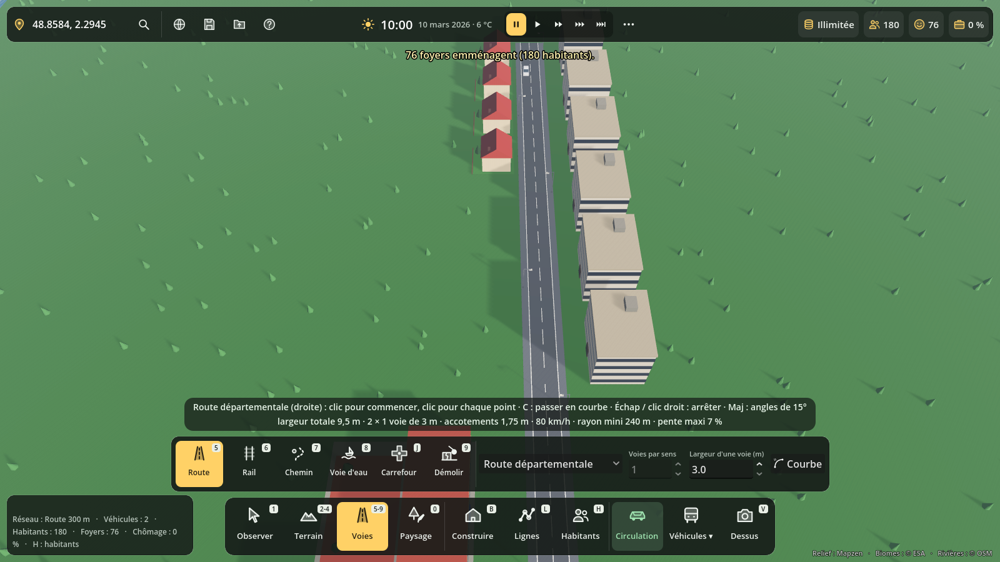
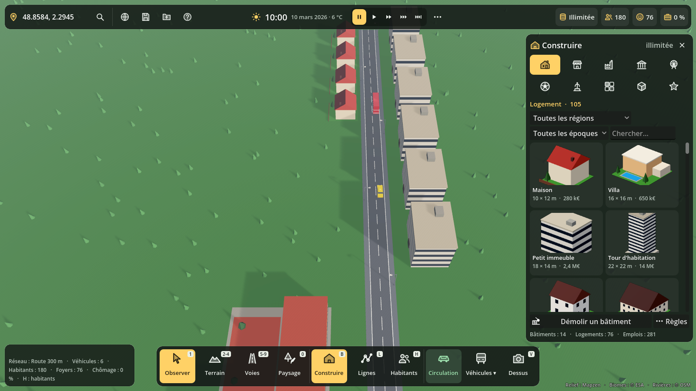
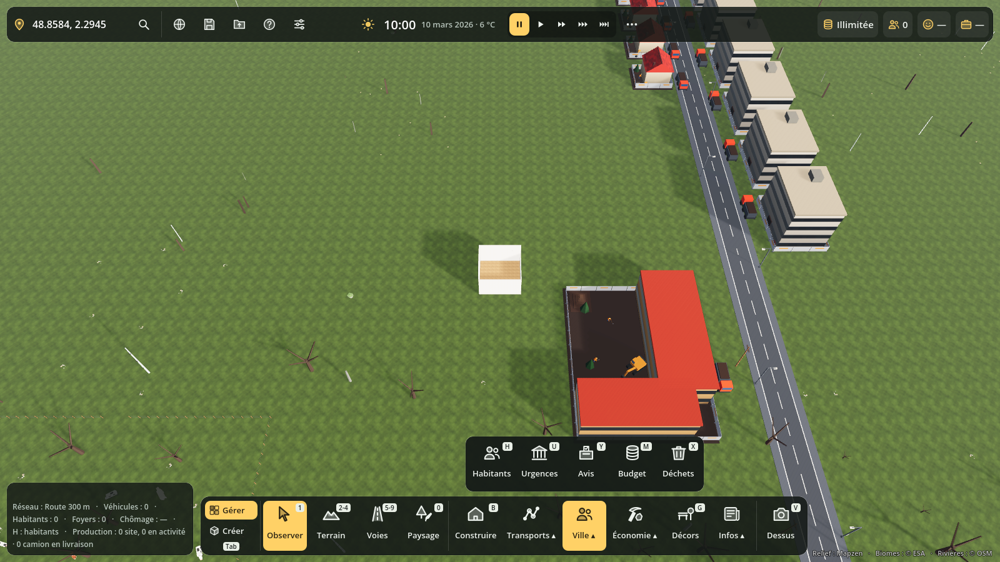
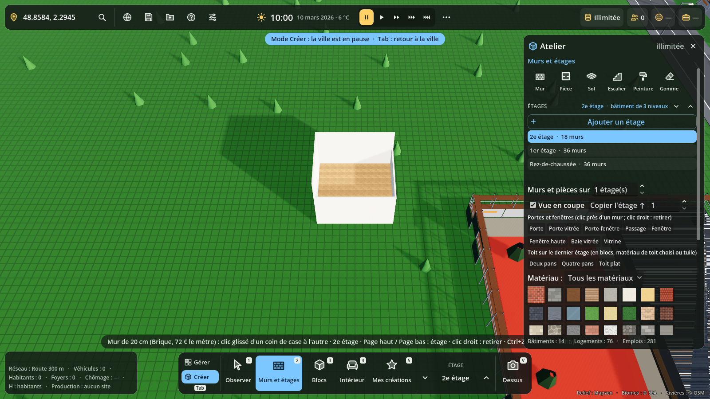
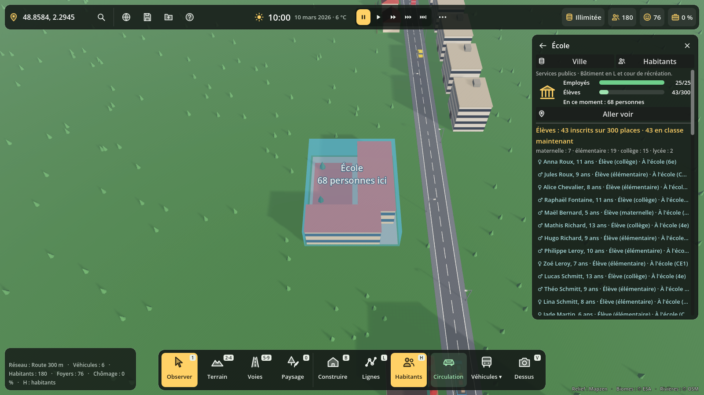
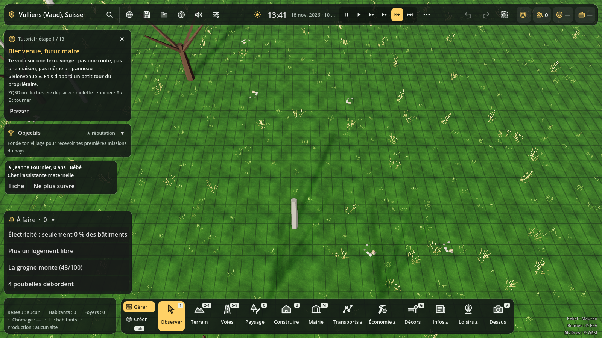

# Interface : menus et icônes

Direction « A » choisie par Gaël le 12 novembre 2026 parmi trois maquettes : une barre de catégories en bas, une seule barre en haut, et deux idées de la direction B (la fiche d'un bâtiment et les vignettes de Construire).

## L'écran

- **Barre du haut** (`TerreHud._build_top_bar`) : lieu, loupe (coordonnées, lieux connus, infos techniques), Globe, Sauver (F5), Charger (F9), Aide (F1). Au centre, l'horloge (`ClockHud`) : heure, date, température, cinq vitesses du temps et un bouton « … » pour le Soleil, la Lune, le curseur de l'heure, les mois et la météo. À droite, les chiffres de la ville (caisse, habitants, satisfaction, chômage) : un clic ouvre Habitants.
- **Barre de catégories** (en bas au centre) : Observer, Terrain, Voies, Paysage, puis Construire, Lignes, Habitants, puis Circulation, Véhicules et Vue. Les touches restent les mêmes : **1-9**, **0**, **J**, **B**, **L**, **H**, **V**.
- **Plateau d'outils** (juste au-dessus) : les outils de la catégorie choisie et, pour les voies, la classe, le nombre de voies, la largeur et la courbe. Un clic sur une catégorie revient au dernier outil choisi dedans ; un second clic revient à Observer.
- **Aide de l'outil** (au-dessus du plateau) : ce que fait le clic, les touches utiles. Elle remplace les trois lignes d'aide fixes.
- **Carte de la case** (en bas à gauche) : case survolée, biome, hauteur, coordonnées, résumé du réseau et des habitants.
- **Panneaux de droite** : Construire, Lignes et Habitants ont la même place et un seul est ouvert à la fois (`terre_main._exclusive_panels`). Leur bouton s'allume dans la barre.

## Une barre qui tient dans l'écran

En mode Gérer, les panneaux sont rangés dans quatre menus ▴ : **Transports** (Lignes, Trafic, Circulation, Véhicules), **Ville** (Habitants, Urgences, Avis, Budget, Déchets), **Économie** (Production, Agriculture) et **Infos** (Infos, Cartes). Un clic ouvre la rangée juste au-dessus du bouton ; un clic ailleurs la referme. Le bouton du menu reste allumé tant qu'un de ses panneaux est ouvert, et les touches (L, H, P, M…) ne changent pas.

La barre se place à droite de la carte de la case. Si l'écran est trop étroit, elle passe en icônes seules (`TerreHud.set_compact`, `_fit_dock`). Un nouveau panneau se range dans un menu avec `"group"` dans `TerreHud.CATEGORIES`.

## Gérer et Créer (touche Tab)

La barre du bas a deux modes, choisis avec l'interrupteur à gauche ou la touche Tab :

- **Gérer** (ambre) : la ville. Observer, Terrain, Voies, Paysage, Construire (catalogue et zonage), Lignes, Habitants, Production, Circulation, Véhicules, Vue.
- **Créer** (bleu) : construire soi-même. Observer (1), Murs et étages (2), Blocs (3), Intérieur (4), Mes créations (5), l'étage actif avec ▼ ▲ (Page bas / Page haut) et Vue. La ville se met en pause ; une pastille bleue le rappelle en haut.

En mode Créer, le panneau de droite devient l'« Atelier » : outils de plan en icônes (mur, pièce, sol, escalier, peinture, gomme) et **échelle des étages** (« Ajouter un étage », puis chaque niveau du toit au sous-sol avec son nombre de murs ; un clic pour y aller).

Code : `TerreHud.set_create_mode()`, signaux `mode_changed`, `create_requested`, `level_step_requested` ; `terre_main.set_create_mode()` et `_on_create_requested()` ; `BuildingPanel.set_workshop()` et `set_ladder()` ; `PlanEditor.set_level()` et `level_counts()`. Un écran Atelier séparé (sans simulation) viendra en plus, ouvert depuis le mode Créer.

## Construire en vignettes

Les onglets sont des icônes (le nom est dans l'infobulle et au-dessus de la liste). Chaque bâtiment est une carte : vignette, nom, taille, prix. Les vignettes sont rendues une par image dans un petit `SubViewport` (`scripts/interface/vignettes.gd`), en vue de trois quarts, puis gardées en mémoire. Sans affichage (tests `--headless`), l'icône de la catégorie reste à la place.

## Fiche d'un bâtiment

Clic sur un bâtiment avec l'outil Observer : le panneau Habitants s'ouvre sur sa **fiche courte** (demande de Gaël du 20 novembre 2026 : « trop d'infos en même temps ») :

- en tête : l'icône de sa catégorie, les jauges (logements, employés, élèves), le nombre de personnes présentes et **une pastille par réseau** (électricité, eau, égouts, chauffage, internet) dans la couleur de son état, le détail en infobulle ; bouton **« Sur les routes »** qui montre (ou cache) le flux des réseaux jusqu'au bâtiment ;
- « Aller voir » et les tuiles « Modifier la façade » / « Aménager l'intérieur » ;
- puis le détail en **rubriques repliables** (Réseaux, Agrandissement ou Entretien, Habitants, Élèves, Employés, Visiteurs) : une ligne-titre avec son résumé (« 3 dans 1 logement sur 1 », « 2 soucis »…), clic pour déplier. Toutes repliées au départ ; le choix est gardé pour les autres bâtiments (`user://interface.cfg`, section `[fiche]`).

Les onglets Ville / Habitants / Funéraire sont cachés sur la fiche (flèche Retour pour revenir) et le panneau s'arrête sous la dernière rubrique. Code : `HabitantsPanel._view_building`, `_repli()`, `_pastilles_reseaux()` ; `Raccordements.remplir_pastilles()`. Captures : `tests/fiche_courte_vitrine.gd`.

Le panneau des coordonnées (clic sur le nom du lieu, en haut à gauche) prend la tête de la colonne de gauche (`PileGauche`) : le fil des habitants et la carte de l'habitant suivi passent dessous au lieu de le recouvrir. Clic ailleurs ou Échap : il se referme.

## Icônes

`scripts/interface/icones.gd` contient 61 icônes SVG de 24 × 24, dessinées au trait avec des facettes remplies à 30 % (esprit low-poly). `Icones.get_icon("route", 28, couleur)` les rend nettes à toute taille avec `Image.load_svg_from_string()`, sans fichier à importer, et garde chaque taille en mémoire. Pour en ajouter une : une entrée de plus dans `Icones.SVG` (écrire `currentColor` pour la couleur).

`scripts/interface/ui_style.gd` réunit le style commun : panneaux sombres arrondis, accent ambre `#ffd166`, boutons à icône (`tile_button`, `icon_button`), pastilles de touche, étiquettes de chiffres.

## Fenêtres trop hautes : défilement

Une fenêtre au centre de l'écran (Réglages de la partie / Admin F10, Aide F1, Son F2)
met son contenu dans `UiStyle.scroll_fit(contenu, fenetre)` : la zone suit la taille
du contenu, puis s'arrête à la hauteur de l'écran (titre et pied restent visibles).
On fait défiler à la molette, en glissant la barre, au clavier ou à la croix (le
focus est suivi) et au stick droit de la manette (`UiStyle.scroll_under`). Test :
`tests/defilement_test.gd`. Toute nouvelle fenêtre longue doit faire pareil.

## Rien ne se chevauche

- **Barre du haut** : l'horloge (`ClockHud`, calque à part) se pose dans la place
  `PlaceHorloge` de la barre (groupe `zone_horloge`) et lui donne sa largeur : les
  boutons Annuler, Rétablir, mode plan et les chiffres de la ville ne passent jamais
  dessous. La caisse d'une ville au long nom est coupée à `TerreHud.CAISSE_MAX` (nom
  complet en infobulle). Si la barre manque encore de place, la date se cache (elle
  reste dans l'infobulle de l'heure et dans les détails « … »).
- **Colonne de gauche** (`PileGauche`) : en haut, la carte du tutoriel et des objectifs
  puis la carte de l'habitant suivi ; en bas, la carte de la case puis le fil « À
  faire ». Les cartes s'empilent ; si la place manque, « À faire » se replie sur son
  titre, puis se cache (les alertes restent dans la Mairie, M). Une nouvelle carte
  flottante à gauche s'ajoute à `pile_gauche.haut` ou `pile_gauche.bas` (terre_main).
- **Bas à droite** : la mention des sources passe sur trois lignes si la barre des
  catégories l'atteint.
- **Panneaux de droite** : ils s'arrêtent au-dessus de la barre des catégories ; un
  contenu long défile (`UiStyle.scroll_fit(corps, panneau, UiStyle.SIDE_BAS)`, voir
  Cartes).
- Test : `tests/chevauchements_test.gd` (fenêtres 1280×720, 1600×900, 1920×1080,
  2560×1080 et 1600×1200, modes Gérer et Créer, tous les menus de la Mairie, colonne
  de gauche avec une carte de la case très longue). Capture :
  `tests/chevauchements_vitrine.gd`.

## Mini-carte (en bas à droite, Ctrl+M)

`scripts/interface/mini_carte.gd` (classe `MiniCarte`, créée par `terre_main._setup_mini_carte`, enfant du HUD, mode Gérer et vue de dessus seulement).

- **Fond** : relief ombré (lumière du nord-ouest) et occupation du sol ESA WorldCover (forêts, prés, champs, bâti, eau, neige), rivières. Calculé 3 lignes par image (128 × 128 px, ≈ 2,5 ms par image pendant 43 images), seulement quand la caméra sort de la zone déjà prête ; reprend tout seul les morceaux pas encore téléchargés.
- **Routes, rails, chemins, canaux, bâtiments, territoires des villages** : dessinés une fois en coordonnées du monde (couche `Couche`), puis seulement déplacés et mis à l'échelle ; redessinés au plus une fois par seconde quand le réseau, les bâtiments ou les villages changent.
- **Couleurs** : reprend la ressource montrée dans Production (P) ou la carte en couleur choisie dans Cartes (N) — toutes celles faites avec `CalqueCouleur` (groupe `calque_couleur`) ; légende « Couleurs : … » sous la carte.
- **Alertes** (relevées une fois par seconde) : appels d'urgence et incendies (rouge, clignotent, restent au bord s'ils sont hors champ), catastrophes en cours (orange), bâtiments non raccordés (rouge foncé), chantiers (jaune). Clic sur un point : la caméra y va et la fiche du bâtiment s'ouvre.
- **Caméra** : champ de vision en trapèze et flèche du regard ; clic ou glisser = déplacer la caméra ; molette ou − / + = 1, 2, 4, 8, 16 ou 40 km. Zoom gardé dans `user://mini_carte.cfg` ; la croix, Ctrl+M et le menu Affichage (œil de la barre du haut, `AffichagePanneaux`, id `mini_carte`) la masquent et la réaffichent.
- **Carte entre amis** : les villes du joueur en ambre, les villes voisines dans leur couleur ; l'infobulle dit « ta ville » ou « ville voisine ».
- Les panneaux de droite passent devant elle ; elle ne touche ni la barre des catégories, ni la carte de la case, ni les sources (vérifié par `tests/chevauchements_test.gd`).
- Tests : `tests/mini_carte_test.gd` (affiche `MINI-CARTE TEST OK`) ; captures : `tests/mini_carte_vitrine.gd` (relief réel de Vulliens, réseau nécessaire).

## Tests et captures

- `tests/interface_test.gd` : icônes, catégories et plateau, panneaux un à la fois, cartes de Construire, chiffres du haut, bouton Vue, fiche. Affiche `INTERFACE TEST OK`.
- `tests/interface_vitrine.gd` : refait les trois captures ci-dessus (avec affichage).

## Pistes

- La roue des menus de la direction C (touche Tab) pour la vue au sol.
- Une couleur par catégorie si les icônes blanches ne suffisent pas.
