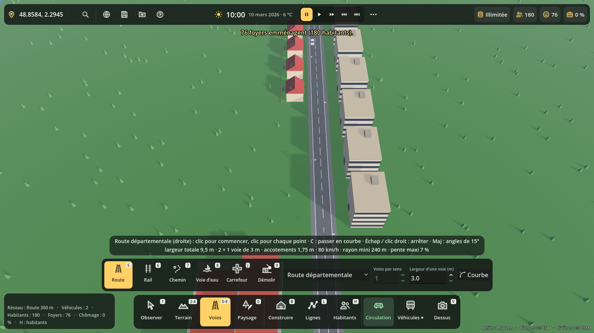
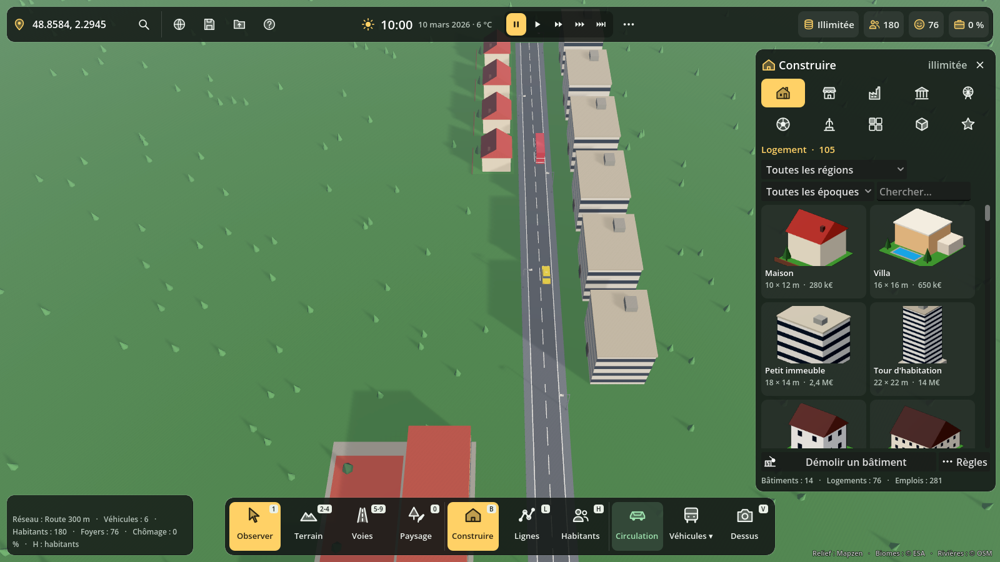
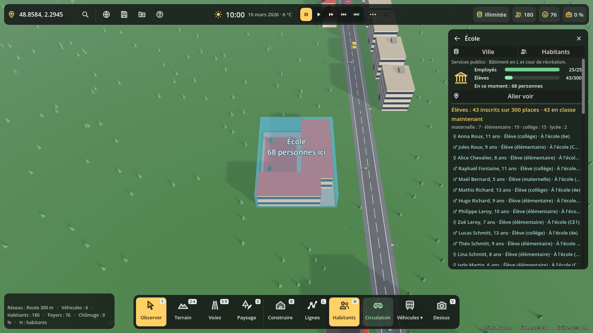

# Interface : menus et icônes

Direction « A » choisie par Gaël le 12 novembre 2026 parmi trois maquettes : une barre de catégories en bas, une seule barre en haut, et deux idées de la direction B (la fiche d'un bâtiment et les vignettes de Construire).

## L'écran

- **Barre du haut** (`TerreHud._build_top_bar`) : lieu, loupe (coordonnées, lieux connus, infos techniques), Globe, Sauver (F5), Charger (F9), Aide (F1). Au centre, l'horloge (`ClockHud`) : heure, date, température, cinq vitesses du temps et un bouton « … » pour le Soleil, la Lune, le curseur de l'heure, les mois et la météo. À droite, les chiffres de la ville (caisse, habitants, satisfaction, chômage) : un clic ouvre Habitants.
- **Barre de catégories** (en bas au centre) : Observer, Terrain, Voies, Paysage, puis Construire, Lignes, Habitants, puis Circulation, Véhicules et Vue. Les touches restent les mêmes : **1-9**, **0**, **J**, **B**, **L**, **H**, **V**.
- **Plateau d'outils** (juste au-dessus) : les outils de la catégorie choisie et, pour les voies, la classe, le nombre de voies, la largeur et la courbe. Un clic sur une catégorie revient au dernier outil choisi dedans ; un second clic revient à Observer.
- **Aide de l'outil** (au-dessus du plateau) : ce que fait le clic, les touches utiles. Elle remplace les trois lignes d'aide fixes.
- **Carte de la case** (en bas à gauche) : case survolée, biome, hauteur, coordonnées, résumé du réseau et des habitants.
- **Panneaux de droite** : Construire, Lignes et Habitants ont la même place et un seul est ouvert à la fois (`terre_main._exclusive_panels`). Leur bouton s'allume dans la barre.

## Construire en vignettes

Les onglets sont des icônes (le nom est dans l'infobulle et au-dessus de la liste). Chaque bâtiment est une carte : vignette, nom, taille, prix. Les vignettes sont rendues une par image dans un petit `SubViewport` (`scripts/interface/vignettes.gd`), en vue de trois quarts, puis gardées en mémoire. Sans affichage (tests `--headless`), l'icône de la catégorie reste à la place.

## Fiche d'un bâtiment

Clic sur un bâtiment avec l'outil Observer : le panneau Habitants s'ouvre sur sa fiche, avec l'icône de sa catégorie et des jauges (logements, employés, élèves), le nombre de personnes présentes, puis la liste des habitants, élèves et employés.

## Icônes

`scripts/interface/icones.gd` contient 61 icônes SVG de 24 × 24, dessinées au trait avec des facettes remplies à 30 % (esprit low-poly). `Icones.get_icon("route", 28, couleur)` les rend nettes à toute taille avec `Image.load_svg_from_string()`, sans fichier à importer, et garde chaque taille en mémoire. Pour en ajouter une : une entrée de plus dans `Icones.SVG` (écrire `currentColor` pour la couleur).

`scripts/interface/ui_style.gd` réunit le style commun : panneaux sombres arrondis, accent ambre `#ffd166`, boutons à icône (`tile_button`, `icon_button`), pastilles de touche, étiquettes de chiffres.

## Tests et captures

- `tests/interface_test.gd` : icônes, catégories et plateau, panneaux un à la fois, cartes de Construire, chiffres du haut, bouton Vue, fiche. Affiche `INTERFACE TEST OK`.
- `tests/interface_vitrine.gd` : refait les trois captures ci-dessus (avec affichage).

## Pistes

- La roue des menus de la direction C (touche Tab) pour la vue au sol.
- Une couleur par catégorie si les icônes blanches ne suffisent pas.
- Une mini-carte en bas à droite.
