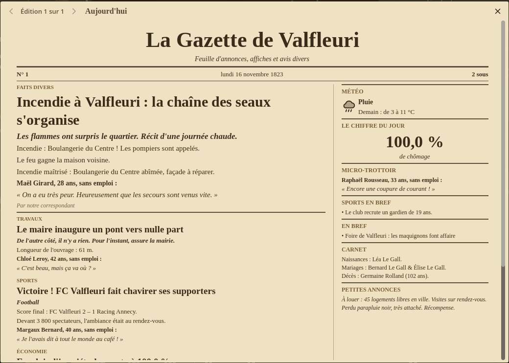
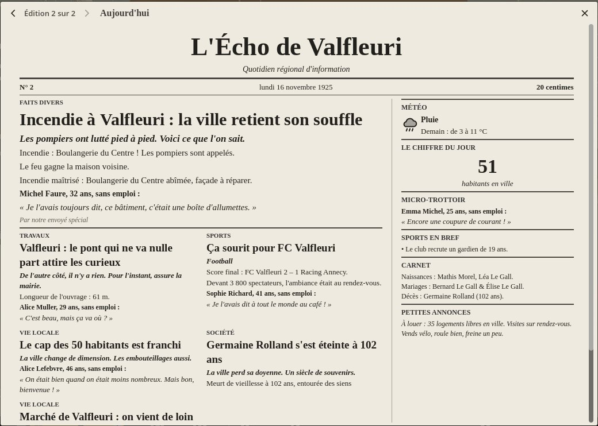
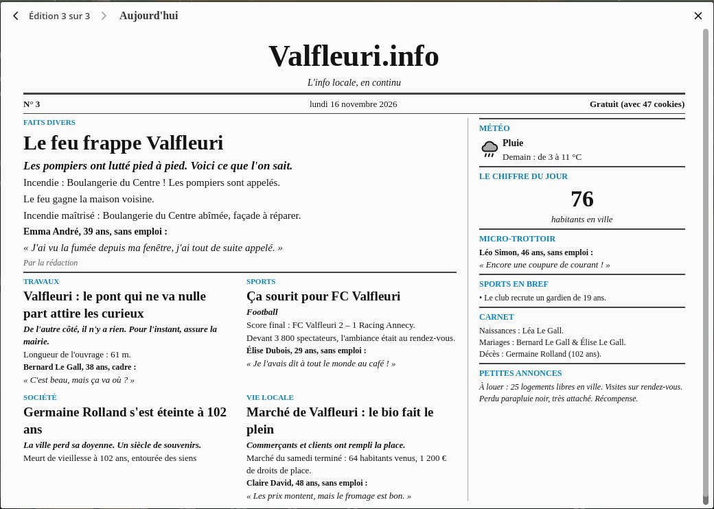
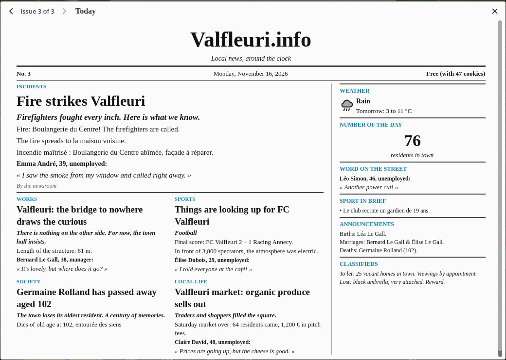

# Gazette de la ville

Touche **F4** (ou menu **Infos** de la barre du bas → **Gazette de la ville**) : le journal du
matin. Chaque jour de jeu, à minuit, une nouvelle édition raconte la veille, avec un ton
réaliste et une touche d'humour, et les vrais habitants de la ville comme personnages.

## La page

- **À la une** : le fait le plus marquant de la veille, avec son titre, son chapeau, le récit
  (les nouvelles du jour, du début à la fin de l'histoire) et un **témoin** : un habitant
  réel, avec son nom, son âge et sa situation, qui donne son avis.
- **Quatre ou cinq articles** sous la une, rangés par rubrique (Faits divers, Météo et nature,
  Société, Vie locale, Politique, Sports, Économie, Travaux).
- **Colonne de droite** : météo de demain, chiffre du jour, micro-trottoir (un habitant dit ce
  qu'il pense de la ville, tiré des avis réels), sports en bref, brèves, carnet (naissances,
  mariages, décès, médailles) et petites annonces (logements libres, postes à pourvoir, et
  une annonce farfelue).
- Un **titre souligné au survol** emmène la caméra sur place ; un **nom d'habitant** ouvre sa fiche.
- Flèches en haut : les **60 dernières éditions**. « Aujourd'hui » revient à la dernière.
- Les jours sans nouvelle, la rédaction s'ennuie et le dit (« Un pigeon élu personnalité du jour »).
- Quand la une est importante, son titre s'affiche aussi en haut de l'écran.

## Ce qui fait l'actualité

| Source | Articles |
|---|---|
| Événements (`Evenements.actualite`) | incendies, tempêtes, crues, épidémies, fêtes, marchés, manifestations, élections et vie politique, neige, sécheresse, canicule, gel |
| Clubs de sport (`ClubSport.resultat`) | victoire, nul ou défaite, score, affluence ; les autres nouvelles du club en « Sports en bref » |
| Habitants (`Population.etape_vie`) | carnet : naissances, mariages, décès, médailles ; un article pour un doyen centenaire |
| Villages (`Communes.fonde`) | naissance d'une commune |
| Bâtiments (passage quotidien) | ouverture d'un service public, d'un lieu de sport, de loisirs, de spectacle, d'un hôtel, d'un parc ou d'un zoo, d'une grande tour ; démolition |
| Voies (passage quotidien) | nouveaux ponts, **pont vers nulle part** (un bout qui ne mène à rien), kilomètres de routes nouvelles |
| Statistiques (dernier relevé) | paliers d'habitants (50, 100, 250… 1 million), chômage qui grimpe, caisse dans le rouge puis dans le vert, habitants mécontents ou ravis, bouchons, poubelles qui débordent, pollution |

Les chiffres ne font un article qu'au passage d'un seuil (avec une marge pour ne pas répéter
l'article chaque jour). Ce qui existait déjà au début de la partie, ou dans une ancienne
sauvegarde, ne fait pas d'article.

## Époques

Le nom, la devise, le prix, la signature et une partie des titres suivent l'année de la
partie (`JournalEpoques`) :

| Depuis | Journal | Prix |
|---|---|---|
| 1800 | La Gazette de … | 2 sous |
| 1830 | Le Courrier de … | 10 centimes |
| 1870 | Le Petit Journal de … | 5 centimes |
| 1914 | L'Écho de … | 20 centimes |
| 1945 | …-Matin | 0,50 F |
| 1980 | … Infos | 5 F |
| 2002 | … Actu | 1,20 € |
| 2015 | ….info | Gratuit (avec 47 cookies) |

Un modèle de titre peut être réservé à une période : en 1823 un incendie mobilise « la chaîne
des seaux », en 2026 « les vidéos inondent les réseaux sociaux » ; on vend un cheval docile en
1900, une trottinette électrique en 2020. Pas de wifi ni de télévision avant leur temps.

## Langues

Les articles sont gardés en **modèles + arguments** (« Incendie à %s : … », « Valfleuri ») et
se traduisent à l'affichage : une édition parue en français se relit en anglais si l'on change
de langue. Les noms propres (villes, habitants, clubs) restent tels quels. Tous les modèles du
journal ont leur traduction dans `assets/langues/en.json` (le test le vérifie).

## Code

- `scripts/journal/journal.gd` (`Journal`, nœud sous la scène, `Journal.instance`) : écoute,
  passage quotidien (`scanner()`), rédaction (`rediger()`), parution (`publier()`), sauvegarde
  (section « journal »). `Journal.texte(T)` traduit un texte gardé en modèle.
- `scripts/journal/journal_redaction.gd` (`JournalRedaction`) : tous les modèles de titres,
  chapeaux, témoignages et annonces. Pour ajouter un texte : l'ajouter à la bonne liste
  (avec `{"t": …, "de": année, "a": année}` s'il est réservé à une époque), puis sa
  traduction dans `en.json`.
- `scripts/journal/journal_epoques.gd` (`JournalEpoques`) : époques, couleurs du papier et de l'encre.
- `scripts/journal/journal_panel.gd` (`JournalPanel`) : la page (F4).
- Un nouveau système qui veut faire parler de lui passe par `Evenements.news(texte, pos, genre, ev)` :
  ses nouvelles vont au fil d'actualité et au journal (les nouvelles d'un même événement
  forment un seul article ; un genre inconnu du journal part en brève).

## Tests

- `godot --headless --path . --script res://tests/journal_test.gd` : faits notés, une, articles,
  brèves, carnet, jour calme, époques et anachronismes, traduction anglaise de tous les textes,
  sauvegarde, panneau, parution automatique au changement de jour.
- `godot --path . --rendering-driver opengl3 --script res://tests/journal_vitrine.gd -- --dossier <dossier>` :
  captures de la page en 1823, 1925, 2026 et en anglais.
