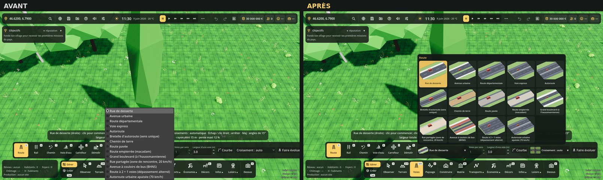
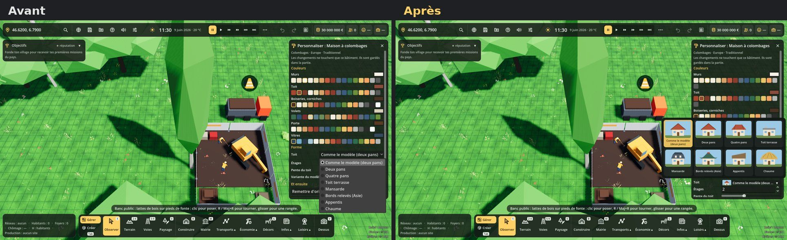

# Menus en images

Les listes de texte des menus à choix sont remplacées par des **grilles de vignettes** :
le joueur voit tout de suite ce qu'il va choisir. Le nom reste écrit sous chaque image,
et l'infobulle donne les détails (vitesse, voies, largeur…).

## Ce qui est en images

| Menu | Où | Images |
|---|---|---|
| Classe de voie : Route, Rail, Chemin, Voie d'eau | Voies (5 à 8) → bouton de gauche de la barre de réglages | Vignettes 3D rendues avec le vrai maillage du jeu (tronçon droit + véhicule de la classe) |
| Croisement : auto, pont, tunnel | Voies → « Croisement : auto ▾ » (N) | Dessins |
| Carrefour : régime, rond-point, échangeur | Voies → Carrefour (J) | Dessins sur les boutons |
| Faire évoluer : classe et bords | Route → « Faire évoluer » | Vignettes 3D (classe), coupes (trottoirs, accotements, simple bordure) |
| Météo | Horloge → « … » → Météo | 8 dessins (automatique, soleil, nuages, couvert, pluie, orage, neige, brouillard) |
| Biome à peindre | Paysage (0) → Biome | 10 dessins de paysages |
| Filtre du mode photo | F8 → Filtre | Aperçu de chaque filtre sur une petite scène (mêmes formules que le shader) |
| Cadrage du mode photo, format d'une caméra time-lapse | F8 → Cadrage, Maj+F8 → Caméras | Cadre au bon rapport largeur / hauteur |
| Époque de départ | Nouvelle partie → Réglages | Véhicule 3D de chaque époque (diligence, locomotive Crampton, tramway 1900, voiture 1950, voiture électrique) |
| **Phase 2 : tous les autres menus** | | |
| Toit d'un bâtiment | Atelier → Personnaliser → Forme → Toit | 7 dessins de maisons (deux pans, quatre pans, terrasse, mansarde, bords relevés, appentis, chaume) |
| Usage d'un bâtiment, fonction et filtre des pièces | Construire (B) → Intérieur | Bâtiment 3D de l'usage (maison, école, cinéma…), meuble 3D typique de la pièce (canapé, cuisinière, lit…), dessins des salles de spectacle |
| Styles de meubles | Construire → Intérieur → Style | Un meuble 3D du style |
| Continents du zoo | Zoo (Maj+Z) → Animaux | Un animal 3D par continent (lion, tigre, ours, lama, kangourou, ours polaire, chèvre) |
| Régions et époques du catalogue, style du zonage | Construire → filtres ; Zonage → Style | Une maison 3D de la région, de l'époque ou du style |
| Catégories et liste des décors | Décors (G) | Un décor 3D par catégorie, vignette 3D de chaque décor dans la liste |
| Véhicules qui circulent (époque, région) | Barre du bas → Véhicules | Un véhicule 3D de l'époque ou de la région |
| Culture des champs | Agriculture → ferme | Champ aux couleurs de la culture |
| Modèle de véhicule d'une ligne | Lignes (L) → ligne | Le véhicule 3D |
| Pièces creusées sous terre | Sous terre → Creuser | 5 coupes (cave, parking, entrepôt, local technique, bunker) |
| Timbre d'une carte postale | Visites (F12) → carte postale | 6 timbres dessinés |
| Couleurs du club | Club (Maj+B) | Maillot aux deux couleurs |
| Catégorie de l'Atelier, familles du catalogue, sortes partagées | Atelier, Catalogue, Partage | Icône du thème sur une tuile de couleur, ou bâtiment 3D de la catégorie |
| Réglages Admin, montants, durées, vitesses, cadences, définitions… | F10, Mairie, Lignes, Photo… | Jauge qui monte avec le choix (Rares → Fréquentes, ×1 → ×10) |
| Listes de villes, parties, fermes, enclos, musées… | partout | Icône du thème sur une couleur propre à chaque choix |

## Comment ça marche (code)

- `scripts/interface/choix_visuel.gd` (**ChoixVisuel**) : remplace une `OptionButton`. Même
  interface (`add_item`, `select`, `selected`, `get_selected_id`, `set_item_tooltip`, `clear`,
  signal `item_selected`). Le bouton montre l'image et le nom du choix actuel ; un clic ouvre la
  grille au-dessus (ou en dessous s'il n'y a pas la place). Options : `titre`, `prefixe`
  (« Météo : » sur le bouton seulement), `tile_size`, `image_height`, `max_columns`, `infobulle`.
- Les façons de donner l'image d'un choix, dans l'ordre où elles sont essayées :
  - `set_item_icon(i, texture)` : texture prête (dessin, drapeau, maillot…) ;
  - `add_item(texte, id, "icone")` : une icône du jeu (`Icones`) ;
  - `set_item_modele(i, sorte, id)`, ou `modele_meta = "sorte"` (l'id est alors la métadonnée de
    chaque choix) : un vrai modèle du jeu, voir **Illustrations** ci-dessous ;
  - `illustrer = func(i, cible: TextureRect)` : image calculée seulement à l'affichage
    (vignette 3D rendue par `Vignettes`, aperçu de filtre…) ;
  - sinon, une **vignette d'office** (`Pictos.auto`) : l'icône du thème (`icone`, ou devinée
    d'après le nom : « 2 semaines » → horloge, « 500 k€ » → billet…) sur une couleur propre au
    choix ; pour une liste graduée (`gradue = 1`, ou d'office si la plupart des choix sont des
    nombres), une jauge qui monte avec le rang. Aucun choix n'est donc jamais sans image.
- Plus de 24 choix : un champ « Chercher… » filtre la grille.
- `scripts/interface/illustrations.gd` (**Illustrations**) : `poser(sorte, id, cible)` pose
  l'image d'un modèle, rendue par un nœud `Vignettes` partagé. Sortes : `batiment`, `vehicule`,
  `meuble`, `piece` (meuble typique), `decor`, `decor_cat`, `animal`, `continent` (animal
  typique), `style`, `style_meuble`, `region`, `epoque`, `categorie`, `usage`,
  `vehicule_epoque`, `vehicule_region`, `toit`, `timbre`, `culture`, `drapeau`, `picto`, `icone`,
  `icone_sorte`, `famille`, `salle`. `poser_dans_liste(sorte, id, liste, i)` fait de même pour
  une ligne d'`ItemList` ou de `PopupMenu` (liste des décors, menu Véhicules).
- `scripts/interface/vignettes_voies.gd` (**VignettesVoies**) : maquette 3D d'une classe de voie
  (`TransportView.build_mesh` + sol + `VehicleCatalog`), rendue par `Vignettes.request_mesh`
  (direction de caméra et taille d'image réglables).
- `scripts/interface/pictos.gd` (**Pictos**) : dessins SVG en couleur 96 × 64 (`get_picto`),
  cadrages (`cadrage(r)`), aperçus de filtres photo (`filtre_photo(f)`). Ils se rendent aussi
  sans affichage (tests en `--headless`).

Pour un nouveau menu : `ChoixVisuel.new()` (jamais `OptionButton`, le test le vérifie), puis
`icone` / `gradue` pour la vignette d'office, ou un modèle avec `modele_meta` ou
`set_item_modele`, et les nouveaux textes aux 4 fichiers `assets/langues/*.json`.

## Restés en texte

Plus aucune liste à choix (phase 2, 2026-11-20). Restent en texte les menus d'actions
(clic droit des habitants, des expéditions) et la liste des parties sauvegardées (avec sa
capture d'écran à côté).

## Tests

- `tests/menus_images_test.gd` (headless) : ChoixVisuel, chaque dessin, chaque maquette de voie,
  branchement dans les panneaux, traductions.
- `tests/menus_images_vitrine.gd` (captures, `xvfb-run` + `--rendering-driver opengl3`,
  `LANG=fr_FR.UTF-8` pour le français) ; marche aussi sur une version sans menus en images
  (captures « avant »). Captures : `/mnt/project-files/captures/menus-images/`.
- `tests/menus_images2_vitrine.gd` : même chose pour la phase 2 (Admin, zoo, décors, régions,
  intérieurs, toits).
