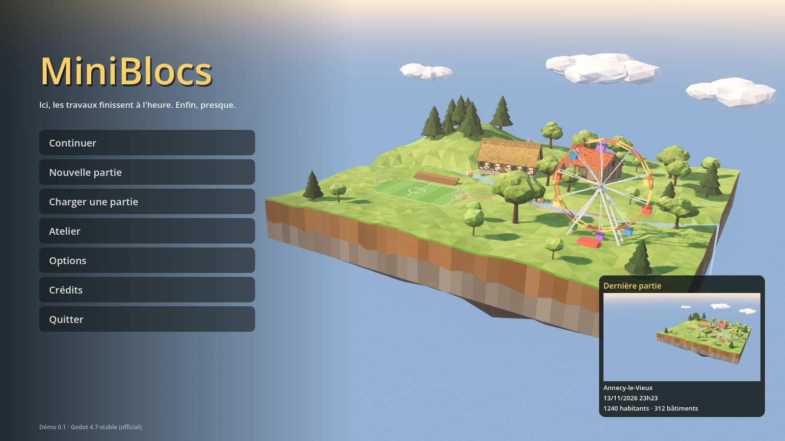

# Menu principal, options, chargement et pause

Code : `scripts/menu/` · scène de départ : `scenes/menu_principal.tscn` ·
tests : `tests/menu_test.gd` (headless), `tests/menu_vitrine.gd` (captures).



## Écran titre (`MenuPrincipal`, `TitreDiorama`)

Le jeu démarre sur une île de terre flottante en low-poly, fabriquée en code avec
`LpKit` et `FermeModeles` : une longère, une grange, un puits, une rivière qui
tombe en cascade des deux côtés, un terrain de foot avec sa tribune et une grande
roue qui tourne (clin d'œil au sport et au parc de loisirs à venir). La caméra
tourne lentement autour (Options > Jeu > « Écran titre immobile » pour la figer).
Une devise tirée au hasard s'affiche sous le titre.

| Bouton | Effet |
| --- | --- |
| Continuer | reprend la partie la plus récente (sauvegarde auto comprise) ; sa carte avec l'aperçu est en bas à droite |
| Nouvelle partie | ouvre le globe pour choisir le lieu (Échap ou « Menu principal » pour revenir) |
| Charger une partie | liste des parties, avec aperçu, fiche, renommer, supprimer |
| Atelier | terrain plat pour créer des bâtiments, sans habitants ni argent |
| Options | voir plus bas |
| Crédits | données utilisées (relief, biomes, villes, drapeaux) |
| Quitter | ferme le jeu |

## Sauvegardes : nom et aperçu

- Chaque sauvegarde porte un nom (« Sauvegarder sous ce nom » dans la fenêtre
  Parties, ou le nom du lieu par défaut). **Renommer** change seulement le nom
  affiché (le dossier et les empreintes ne bougent pas).
- **Aperçu** : à chaque sauvegarde, la vue de la caméra est rendue une fois, sans
  l'interface, dans une petite fenêtre à part (`terre_main.capture_preview`), puis
  enregistrée en `apercu.jpg` (384 × 216) dans le dossier de la partie. Ce n'est
  pas une section : le format de sauvegarde reste le format 2, les anciennes
  parties s'ouvrent sans aperçu.
- **Sauvegarde automatique** : toutes les 5 minutes par défaut (Options > Jeu :
  jamais, 2, 5, 10 ou 15 min), seulement s'il y a eu des changements, dans la
  partie à part « sauvegarde-auto » (marquée ⟳ dans la liste). Ta partie à toi
  n'est jamais écrasée par elle.

## Options (`OptionsJeu`, `OptionsPanel`)

Préférences du joueur, valables pour toutes les parties, dans `user://options.cfg`.
Les réglages d'une partie (argent, coûts, règles) restent dans l'Admin (F10).

- **Graphismes** : fenêtre / plein écran / plein écran exclusif, synchro verticale,
  images par seconde max, résolution 3D (50 à 100 %, agrandie en FSR : l'interface
  reste nette), ombres, anticrénelage, rendu poussé. Deux préréglages :
  « ordinateur modeste » et « par défaut ».
- **Son** : volumes Général, Musique, Effets, Ambiances, Interface. Ils sont lus et
  écrits dans `user://son.cfg`, le fichier du système de son : le panneau Son (F2)
  et cet onglet montrent toujours les mêmes valeurs.
- **Jeu** : sauvegarde automatique, langue (français ; les autres viendront après
  la démo), écran titre immobile, ouvrir le dossier des sauvegardes.
- **Touches** : les principales touches. Les changer viendra plus tard.

## Écran de chargement (`EcranChargement`)

`EcranChargement.aller("res://scenes/terre.tscn", "Annecy")` pose un écran au-dessus
de tout (il survit au changement de scène), charge la scène en arrière-plan, la
lance, puis attend que le relief autour de la caméra soit prêt (tuiles téléchargées,
blocs de 64 m calculés ; 25 s au plus) avant de s'effacer en fondu. Des conseils
défilent toutes les 6 secondes. Utilisé pour : Continuer, Charger, Commencer la
partie (globe), Atelier, retour au menu.

## Menu pause (`MenuPause`, touche Échap)

Échap ferme d'abord ce qui est ouvert : une fenêtre, un tracé, un outil (avec un
outil de terrain ou de voie, Échap revient à Observer). Quand rien n'est en cours,
Échap ouvre le menu pause et **tout le jeu s'arrête** (`get_tree().paused`) :

Reprendre (Échap) · Sauvegarder (F5) · Charger / sauvegarder sous… · Options ·
Aide (F1) · Menu principal · Quitter le jeu.

S'il y a des changements non sauvegardés, « Menu principal » et « Quitter »
demandent d'abord : sauvegarder et partir, partir sans sauvegarder, ou annuler.

## Tester

```
godot --headless --path . --script res://tests/menu_test.gd
xvfb-run godot --path . --script res://tests/menu_vitrine.gd -- --dossier captures/menu
```
