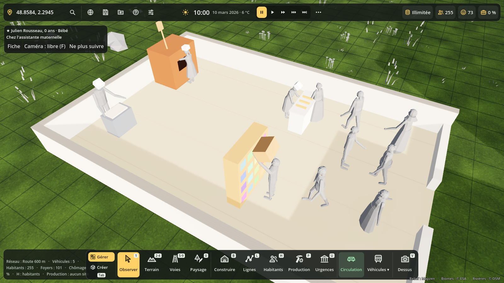
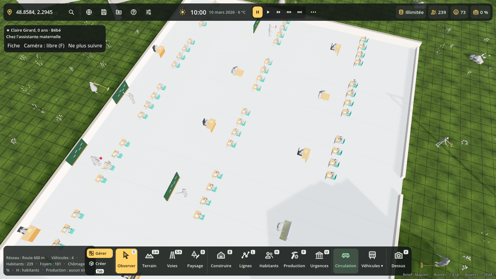
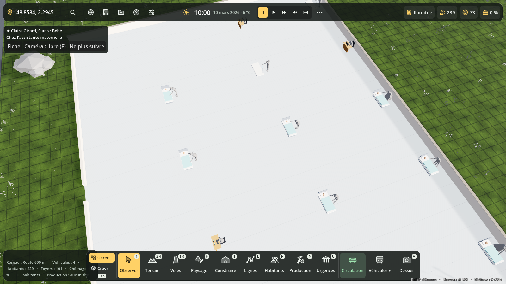

# Les habitants au travail (métiers visibles)

On voit les habitants travailler : le boulanger pétrit, l'enseignant écrit au tableau, le médecin ausculte, la caissière scanne, l'agriculteur bêche. Les bâtiments vivent selon leur personnel : sans employés, ils ferment, et cela a de vraies conséquences sur la ville.



## Dans le jeu

- **Vue en coupe** : zoome près d'un commerce, d'une école, d'un hôpital, de bureaux ou d'une usine où quelqu'un travaille. Le toit et la façade s'effacent : on voit le sol, des murets, les postes de travail et les employés qui font leurs gestes. Les élèves sont assis à leur pupitre, dans la salle de leur enseignant, et les clients se promènent près de l'entrée. En dézoomant, le bâtiment se referme.
- **Dehors** : les métiers d'extérieur se voient sans vue en coupe. Les agriculteurs sont aux champs, les bûcherons, carriers et pêcheurs à leur poste, les marchands au marché, les policiers montent la garde, les pompiers vérifient leur camion et les agents municipaux balaient.
- **Ouvert / Fermé** : une enseigne verte ou rouge est posée sur la façade des commerces, services et loisirs. Un rideau de fer descend quand un commerce est fermé.
- **Pancartes** : au-dessus des bâtiments, une pancarte orange indique « Manque de personnel (2/6) », une rouge « Fermé : pas d'enseignant·e ».
- **Clic sur un employé** : sa fiche s'ouvre. Elle dit ce qu'il fait en ce moment (« À son poste, Léa pétrit la pâte. ») et donne le personnel du bâtiment.
- **Fiche d'un bâtiment** (outil 1) : état (ouvert, fermé et pourquoi), employés au travail, embauchés et postes prévus, et les conséquences en clair.

| Touche | Effet |
| --- | --- |
| **K** | Vue métiers : la couper ou la remettre |
| **Maj + K** | Ouvrir les bâtiments en coupe quand on zoome, ou non |



## Gestes

56 gestes, avec chacun une animation, un outil en main et un poste de travail. Chaque métier a 1 à 3 gestes et passe de l'un à l'autre toutes les 10 minutes de jeu. Par exemple, le boulanger pétrit, façonne les baguettes puis enfourne.

Les tenues suivent le métier : toque du boulanger et du cuisinier, blouse du médecin, tenue bleue de l'infirmier, casque et gilet orange de l'ouvrier, uniforme du policier, casque du pompier.

**Ajouter un métier** (chaînes de production, nouvelles entreprises) : il suffit de l'ajouter dans `Metiers.METIERS` et `Metiers.PAR_BATIMENT`. Il reçoit tout seul des gestes devinés d'après son nom (« pâtissier » façonne et enfourne, « livreur » charge et conduit) ou, à défaut, d'après la catégorie de son bâtiment. Pour choisir soi-même, on ajoute à son entrée :

```gdscript
"patissier": {"name": "Pâtissier·ère", ..., "geste": ["faconner", "enfourner"], "tenue": "boulanger"},
```

La liste des gestes est dans `scripts/metiers/gestes.gd` (`GESTES`). Les outils et les postes sont dans `scripts/metiers/accessoires.gd`.

## Personnel et conséquences

`Effectif` (`scripts/metiers/effectif.gd`) calcule, pour chaque bâtiment qui a des emplois :

- **fermé** : personne n'est embauché, ou il manque le métier indispensable. L'école ferme sans enseignant, l'hôpital sans médecin ni infirmier, la boulangerie sans boulanger, le café sans serveur ni cuisinier, la caserne sans pompier, et ainsi de suite (`REQUIS`) ;
- **manque de personnel** : moins de la moitié des postes sont pourvus ;
- **ouvert maintenant** : un employé indispensable est à son poste, selon ses horaires. L'enseigne et le rideau de fer en dépendent.

Les conséquences :

| Bâtiment | Fermé | En sous-effectif |
| --- | --- | --- |
| École | Les élèves restent à la maison (leur journée l'indique) ; satisfaction −15 | Classes surchargées au-delà de 25 élèves par enseignant (fiche) |
| Commerce | Les clients vont au commerce ouvert le plus proche, sinon pas de courses ; satisfaction −8 si tout est fermé | Longues files : satisfaction −5 |
| Hôpital | Personne n'y est soigné : la santé des habitants baisse | Soins ralentis : il compte comme s'il était deux fois plus loin |
| Loisirs | Les habitants font leur loisir à la maison | — |
| Production | Production arrêtée | Production selon les postes pourvus (existait déjà) |
| Pompiers, police | Aucun véhicule ne peut partir (`Effectif.peut_intervenir`) | — |

Dès que de nouveaux habitants sont embauchés, tout rouvre.



## Code

| Fichier | Rôle |
| --- | --- |
| `scripts/metiers/gestes.gd` | Gestes, gestes par métier, devinette pour les nouveaux métiers |
| `scripts/metiers/figurine.gd` | Habitant articulé : personnage arrondi de Blender (`Silhouettes`) ou figurine en blocs ; tenues ; animations |
| `scripts/metiers/accessoires.gd` | Outils et postes de travail low-poly |
| `scripts/metiers/effectif.gd` | Personnel et conséquences (branché dans `Population` et `CycleVie`) |
| `scripts/metiers/metiers_vivants.gd` | Nœud `MetiersVivants` créé par `terre_main` : coupe, dehors, enseignes, pancartes, clic |

Dans les bâtiments en murs fins, les employés (`Occupants`) sont aussi des figurines animées à leur poste.

Tests : `tests/metiers_test.gd`. Captures : `tests/metiers_vitrine.gd`.

Note sur les captures : elles sont prises avec le moteur de rendu « Compatibilité » (sans carte graphique), qui n'affiche pas les couleurs des personnages arrondis. Dans le jeu (rendu Forward+), les habitants ont leurs couleurs et leurs tenues.
