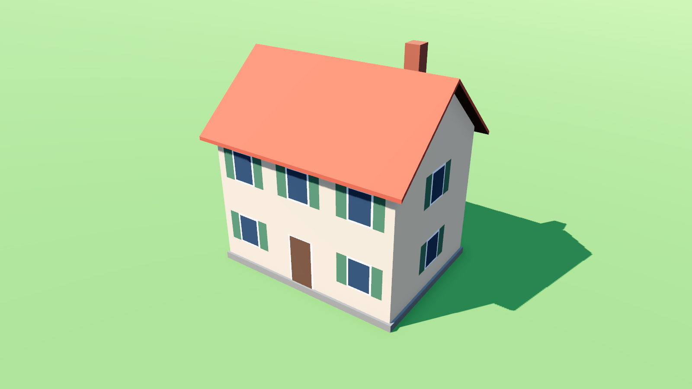
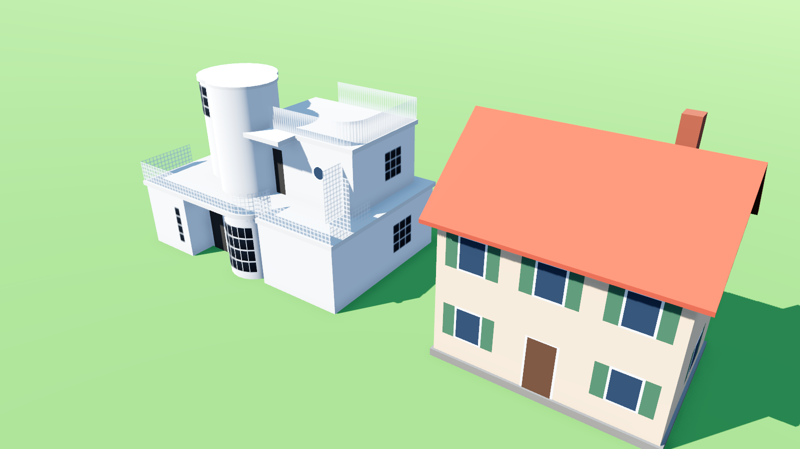
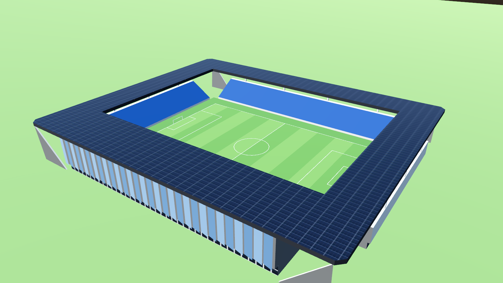

# Bâtiments modélisés dans Blender (.glb)

À côté des bâtiments générés en code, MiniBlocs peut maintenant accueillir des bâtiments **modélisés dans Blender par script** puis exportés en `.glb`. Le but : partir d'une photo ou d'un dessin d'un bâtiment réel et en faire une version low-poly légère, dans le style du jeu.



## La chaîne

1. **Description** : un petit fichier JSON décrit le bâtiment (largeur, profondeur, étages, toit, fenêtres, couleurs). Exemple : `tools/blender/exemples/maison_test.json`.
2. **Blender, sans interface** : `tools/blender/batiment_lowpoly.py` construit le modèle, l'exporte en `.glb` dans `assets/modeles/batiments/` et peut faire une image d'aperçu.
3. **Godot** importe le `.glb` tout seul à l'ouverture du projet.

```bash
"C:\Program Files\Blender Foundation\Blender 5.2\blender.exe" --background --factory-startup --python tools/blender/batiment_lowpoly.py -- --desc tools/blender/exemples/maison_test.json --out assets/modeles/batiments/maison_test.glb --apercu apercu.png
```

Option `--blend fichier.blend` : garde aussi le fichier Blender pour le retoucher à la main.

### Règles des modèles

- **1 unité = 1 mètre** = une case du jeu. Origine au sol, au centre de l'emprise.
- **Façade principale** vers -Y dans Blender, donc +Z dans Godot.
- **Une texture palette** de 64 × 64 px (8 × 8 couleurs franches) : chaque face prend la couleur d'une case. En plus, trois motifs de 32 × 32 px répétés seulement si le bâtiment en a besoin : vitrage à petits carreaux, grille ajourée, panneaux solaires.
- **Budget** : quelques centaines de triangles pour une maison (la maison test en a 176), 3 000 au maximum pour un grand monument. Le test le vérifie.

## Tester dans Godot 4.7

1. Ouvre le projet dans Godot (le `.glb` s'importe tout seul).
2. Double-clique sur `scenes/vitrine_modeles.tscn`, puis **F6**.
3. La caméra tourne autour des modèles. Molette : zoom. Clic gauche glissé : tourner. Espace : arrêter la rotation.

Test automatique (en ligne de commande) :

```bash
godot --headless --path . --import
```

```bash
godot --headless --path . --script res://tests/modeles_glb_test.gd
```

Il doit afficher `MODELES GLB TEST OK` (chaque `.glb` s'importe, moins de 3 000 triangles, texture de 256 px au plus, posé au sol, taille réaliste).

## Bâtiments recréés d'après une image

Un bâtiment particulier a son propre script dans `tools/blender/batiments/`, qui réutilise les briques du générateur : boîtes, cylindres et portions de cylindre, dalles, vitrages à petits carreaux (texture répétée), garde-corps en grille ou à barreaux fins (texture semi-transparente), hublots.

| Script | Bâtiment | Triangles |
| --- | --- | --- |
| `maison_frank.py` | Villa moderniste d'après une maison de Josef Frank (années 1930) : bow-window, tours cylindriques, terrasses | 558 |
| `stade_tuiliere.py` | Stade de la Tuilière, Lausanne (2020) : 12 544 places, terrain 105 × 68 m, tribune principale à façade de verre à facettes, trois tribunes ouvertes, toit en porte-à-faux couvert de panneaux solaires, voiles de béton aux angles. Sources en tête du script. | 470 |





Un seul modèle dans la vitrine : `godot --path . res://scenes/vitrine_modeles.tscn -- --modele stade_tuiliere` (avec `--screenshot fichier.png` pour une capture).

```bash
"C:\Program Files\Blender Foundation\Blender 5.2\blender.exe" --background --factory-startup --python tools/blender/batiments/maison_frank.py -- --out assets/modeles/batiments/maison_frank.glb --apercu apercu.png --azimuts -8,40
```

## Outils et ressources gratuits

Seulement des licences compatibles avec un jeu vendu sur Steam.

| Outil ou source | Usage | Licence | Pour un jeu vendu |
| --- | --- | --- | --- |
| [Blender](https://www.blender.org) | modélisation par script, export .glb | GPL (le logiciel) | Oui : ce qu'on crée avec nous appartient |
| [Krita](https://krita.org) | peindre ou retoucher la palette et les textures | GPL (le logiciel) | Oui, même règle |
| [Material Maker](https://www.materialmaker.org) | générer des petites textures (tuiles, briques, pierre) | MIT | Oui |
| [Poly Haven](https://polyhaven.com) | textures, ciels HDRI, modèles de référence | CC0 | Oui, sans mention obligatoire |
| [ambientCG](https://ambientcg.com) | textures de matériaux | CC0 | Oui |
| [Kenney](https://kenney.nl/assets) | kits low-poly (ville, nature, véhicules) | CC0 | Oui |
| [Quaternius](https://quaternius.com) | packs low-poly (bâtiments, nature, personnages) | CC0 | Oui |

À éviter : les modèles Sketchfab « CC BY-NC » (pas d'usage commercial), les licences « éditoriales » ou « usage personnel » de TurboSquid ou CGTrader, et bien sûr tout asset extrait d'un jeu existant (Les Sims, Anno, Cities: Skylines…). On peut s'inspirer de leur **style** (proportions, palettes, lisibilité vue de dessus), pas copier leurs modèles ni leurs textures.

## Prochaines étapes

- Recréer un premier vrai bâtiment à partir d'une image (vue de face et de côté).
- Ajouter des formes au générateur selon les besoins : toit à quatre pans, croupe, lucarnes, balcons, arcades, ailes en L.
- Relier les `.glb` au catalogue (`building_catalog.gd`, styles de la bible) pour les poser en jeu.
