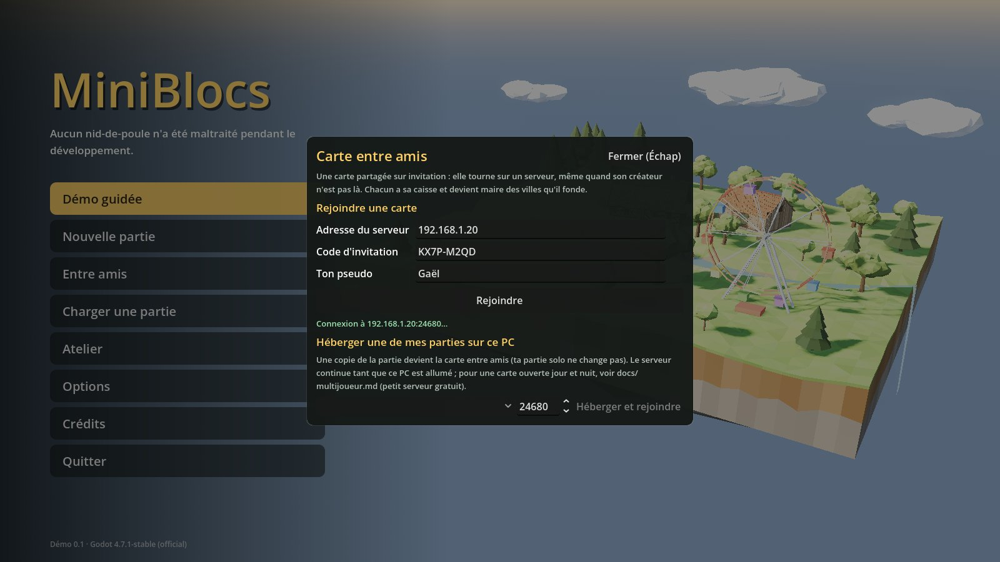
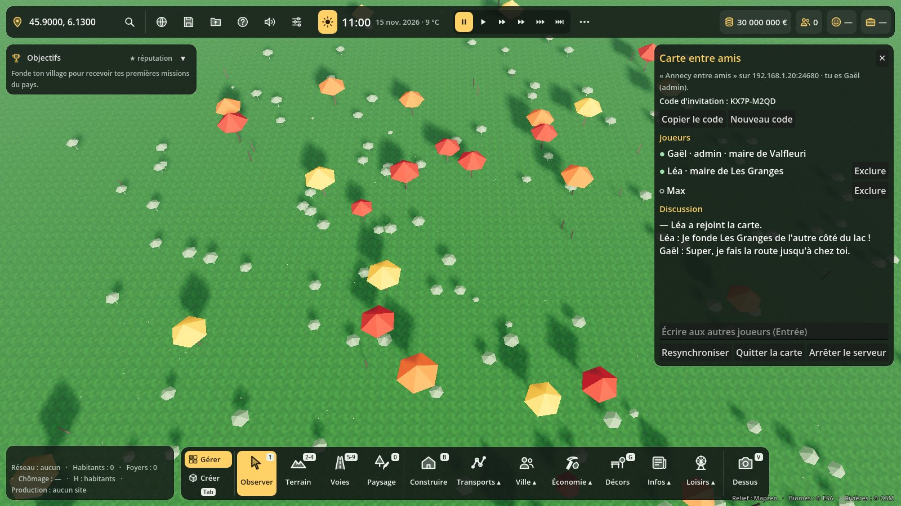

# Carte entre amis (multijoueur, première base)

Une carte partagée sur invitation. Elle tourne sur un **serveur** : le jeu MiniBlocs
lancé sans écran (`--headless`). La carte reste accessible même quand son créateur
n'est pas là, tant que le serveur tourne. Budget zéro : le serveur est le jeu
lui-même, sur un PC de la maison ou un petit serveur gratuit.

## Jouer

**Menu principal → Entre amis.**



- **Rejoindre une carte** : adresse du serveur (`192.168.1.20`, `monserveur.fr:24680`…),
  code d'invitation (`ABCD-EFGH`, demandé seulement la première fois), ton pseudo.
  La carte est téléchargée puis s'ouvre ; elle est aussi gardée dans tes parties
  (« … (en ligne) »), mais ce qui compte est la version du serveur.
- **Héberger une de mes parties sur ce PC** : une copie de la partie devient la carte
  entre amis (ta partie solo ne change pas), un serveur démarre en arrière-plan et
  tu y entres. Il continue après la fermeture du jeu, tant que le PC est allumé
  (pour l'arrêter : F3 → Arrêter le serveur).

En jeu, **F3** : joueurs (● en ligne), villes de chacun, code d'invitation (admin),
discussion, **Resynchroniser** (redemande la carte entière), **Quitter la carte**.



## Règles

| | |
|---|---|
| Entrer | la première fois avec le code ; ensuite tu es membre, plus besoin du code. L'admin peut changer le code (les membres restent) ou exclure quelqu'un. |
| Admin | le créateur de la carte (ou, sur une carte neuve sans créateur désigné, le premier qui entre avec le code) : réglages F10, vitesse du temps (T, Maj+T), code, exclure, arrêter le serveur. |
| Ta caisse | en arrivant : une caisse personnelle avec l'argent de départ des réglages. Quand tu fondes un village, tu en deviens le maire et ta caisse personnelle passe dans la caisse de ta ville. |
| Construire | partout, comme en solo. Dans tes villes, c'est la caisse de la ville qui paie ; hors de tes villes (chez un ami, en pleine nature), c'est ta caisse principale qui paie, y compris le chantier au fil des travaux et le remboursement à la démolition. |
| Mairie | seul le maire d'une ville règle son budget (M : impôts, emprunts, entretien) et son pilote automatique. Les autres peuvent construire chez lui, avec leur propre caisse. |
| Temps | une seule heure pour tous, celle du serveur. Le menu pause ne met en pause que ton écran. |

## Ce qui est synchronisé

- Bâtiments : pose, démolition, personnalisation par le joueur (catalogue B),
  et tout ce que le serveur fait pousser (zones, pilote automatique, fondateurs).
  Les **créations** de l'éditeur libre, de l'Atelier et de l'éditeur du parc partent
  avec le bâtiment : tes amis les voient même s'ils ne les ont pas dans leur bibliothèque.
- Villages : fondation avec la Maison de commune (même nom chez tous), maire.
- Voies : tracé, démolition, carrefours, giratoires, échangeurs.
- Terrain : outils Aplanir / Monter / Creuser et pinceaux du Paysage (colline,
  lisser, lac et canal, biomes, arbres), et le terrassement sous les bâtiments et les voies.
- **Zonage**, **éditeur libre** (blocs, murs et étages, meubles et pièces), **décors**,
  **allées et files d'attente du parc**, **réseaux** (électricité, eau, égouts, gaz,
  fibre et cuivre) : ce que tu poses apparaît chez les autres une fraction de seconde
  plus tard, et le prix est payé sur le serveur (ta ville, ou ta caisse hors de tes villes).
- **Lignes de transport** : arrêts, gares et stations, création et suppression de
  lignes, véhicules et fret (panneau des lignes).
- **Budget de la mairie** (M) : impôts, emprunts, remboursements, entretien et
  réparations des voies, et **pilote automatique** de la ville. **Seul le maire de la
  ville** peut les changer ; les autres voient le budget mais leurs réglages sont refusés.
- Caisses (chaque seconde), heure et vitesse du temps, réglages de l'admin.
- Discussion.

Pas encore synchronisé : les panneaux du club, du parc de loisirs, du zoo et du musée
(réglages, transferts, enclos…). Ils restent sur ton écran et reviennent comme le
serveur à la prochaine resynchronisation.

Les habitants, véhicules et chantiers sont simulés par chaque jeu à partir de la
même carte : ils peuvent un peu différer d'un écran à l'autre. Les chiffres qui
comptent (bâtiments, voies, terrain, zones, réseaux, argent) viennent du serveur.

Si deux joueurs créent au même instant un objet qui reçoit le même numéro (une zone,
un tronçon…), le second est prévenu (« Un autre joueur a construit au même moment »)
et n'a qu'à recommencer.

## Lancer un serveur à la main

Dans le dossier du jeu (celui de `project.godot`), avec Godot 4.3 ou plus :

```
godot --headless --path . -- --serveur --partie <id de la partie> [--port 24680] [--code ABCD-EFGH]
godot --headless --path . -- --serveur --nouvelle --lat 45.899 --lon 6.129 --nom "Annecy" [--createur <id joueur>]
```

- `<id de la partie>` : le nom du dossier dans `parties/` (Charger une partie affiche
  les parties ; sous Windows, les dossiers sont dans
  `%APPDATA%\Godot\app_userdata\MiniBlocs\parties`).
- Le serveur affiche le code d'invitation au démarrage, sauvegarde la carte chaque
  minute et en s'arrêtant. Ctrl+C l'arrête (la dernière minute peut être perdue :
  préfère F3 → Arrêter le serveur).
- `--createur` : l'identifiant du joueur admin (`id` dans `joueur.cfg`, même dossier).
  Sans lui, le premier qui entre avec le code devient l'admin.

## Une carte ouverte jour et nuit, sans payer

- **Un vieux PC ou un Raspberry Pi 4/5** à la maison, allumé en permanence : Godot pour
  Linux (ARM64 pour le Pi), le dossier du jeu, la commande ci-dessus. Ouvrir le port
  **24680 en UDP** sur la box (redirection vers ce PC) et donner aux amis l'adresse IP
  publique de la box.
- **Un serveur gratuit dans le cloud** : par exemple l'offre « Always Free » d'Oracle Cloud
  (machine ARM, 24 Go de mémoire), sous Linux. Copier le jeu et la partie, lancer la
  commande, ouvrir le port 24680/UDP dans le pare-feu du cloud.
- **Sans ouvrir de port** : un réseau privé gratuit comme Tailscale ou ZeroTier ; les amis
  rejoignent le réseau et utilisent l'adresse du serveur dans ce réseau.

## Comment ça marche (pour le code)

- `scripts/multijoueur/protocole.gd` (`Protocole`) : messages (`var_to_bytes` +
  Zstandard), un seul canal fiable et ordonné (ENet, port UDP 24680), instantané
  de la partie en morceaux de 192 Ko, version du protocole.
- `scripts/multijoueur/serveur_amis.gd` (`ServeurAmis`) : le serveur fait foi. Les jeux lui
  envoient des **actions** (`poser`, `demolir`, `voie`, `voie_demolir`, `carrefour`,
  `terrain`, `pinceau`) ; il les applique à sa partie (en attendant que le relief du
  lieu soit chargé) et renvoie le **résultat** : bâtiments ajoutés, retirés ou changés
  (`bat`, quelle que soit leur origine), voies rejouées (`rejouer`) ou section
  `transport` entière (changement venu d'ailleurs), cases du terrain changées
  (`terrain`), et chaque seconde un `tic` (heure, vitesse, caisses, empreintes).
- `scripts/multijoueur/client_amis.gd` (`ClientAmis`) : reçoit l'instantané, l'écrit comme
  une sauvegarde `amis-…` et l'ouvre ; ensuite applique les messages. Les systèmes
  du jeu ont un **verrou réseau** (`BuildingSystem`, `TransportSystem` :
  `verrou_reseau`, `appliquer_reseau`) : rien ne change en local sans le serveur, et
  ce que fait le joueur à la souris part par `relais` (aussi `TerrainWorld.relais`).
  Si les empreintes (nombre de bâtiments, de tronçons, de villages) diffèrent deux
  tics de suite, le jeu redemande la carte entière (au plus une fois par minute).
- `scripts/multijoueur/carte_amis.gd` (`CarteAmis`) : code, membres, rôles, maires,
  caisses personnelles ; section `multijoueur` de la sauvegarde du serveur.
- Caisses : `Pays.payeur_force` (la caisse qui paie pendant l'action d'un joueur),
  caisses personnelles `Pays.JOUEUR_BASE - n` (clés négatives), clé `caisse` d'un
  bâtiment payé hors des villes de son constructeur (`Pays.du_batiment`).
- `scripts/multijoueur/multijoueur.gd` (`Multijoueur`) : rôle (solo, serveur, client),
  options de la ligne de commande, héberger sur ce PC (`OS.create_process`).
- `scripts/multijoueur/sections_partagees.gd` (`SectionsPartagees`) : zones, blocs, plans
  (murs et étages), mobilier, décors, réseaux, télécom, allées du parc. Chaque section
  est mise à plat (une entrée par objet, sans ce qui est simulé : chantier en cours,
  pannes, stocks…). Le jeu du joueur compare sa section à la dernière version du
  serveur après chaque geste (0,3 s après le dernier clic ou la dernière touche) et
  envoie la **différence** (action `sections` : entrées mises, ôtées, et ce que le geste
  a coûté dans ses caisses). Le serveur l'applique, fait payer la bonne caisse et
  envoie à tous ce qui a changé chez lui (`sections`). Toutes les 5 s, le `tic` porte
  les empreintes des sections ; deux écarts de suite → la section entière (`section_partagee`).
  Les numéros pris en même temps par deux joueurs sont refusés au second.
- **Appels** (`Multijoueur.relayer`, `Multijoueur.APPELS`) : les commandes du budget, du commerce (accords, libre-échange, voir docs/commerce.md),
  du pilote automatique et des lignes partent au serveur (action `appel`), qui vérifie
  que le joueur est maire de la ville, les fait, puis les renvoie à tous pour qu'ils
  les rejouent (`appel`, `Multijoueur.rejeu`).
- Créations des joueurs : `SectionsPartagees.definition()` (créations, modèles de
  l'Atelier, attractions) jointe à l'action `poser` et au bâtiment envoyé (`defs`).
- En solo, rien ne change : pas de verrou, pas de relais, `payeur_force` à -1,
  `Multijoueur.relayer` renvoie faux.

Test : `tests/multijoueur_test.gd` lance un vrai serveur dans un autre processus
(terrain plat, sans Internet), fait entrer deux joueurs et vérifie invitation,
caisses, village, route, maisons, démolition, terrain, vitesse, discussion, zonage
payé par la ville, ligne électrique, décor et bloc venus d'un autre joueur, numéro
pris deux fois, création de l'éditeur libre, arrêts et ligne de bus, impôts réservés
au maire, pilote automatique, arrêt et reprise de la carte.

## Prochaines étapes

1. Synchroniser les panneaux du club, du parc, du zoo et du musée (mêmes appels).
2. Envoyer seulement les blocs de terrain changés et des morceaux de sections
   (les grandes villes se chargent plus vite).
3. Préparer la carte mondiale (un serveur par région, comptes de joueurs).
