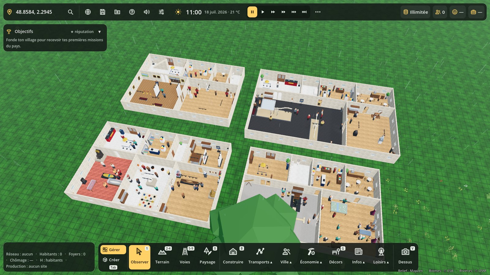
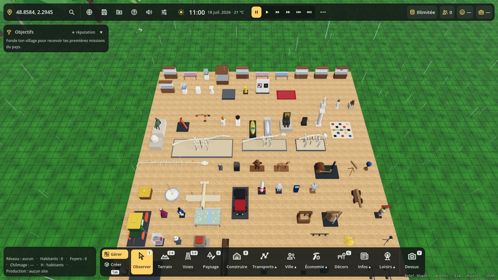

# Musées

Le menu **Musée** (barre du bas, menu **Loisirs**, touche **Maj+C**) réunit tout ce qu'il faut pour bâtir, remplir et faire vivre un musée. Il est inspiré des jeux de gestion de musée, sans en copier aucun.

## Le panneau, onglet par onglet

| Onglet | Ce qu'on y fait |
|---|---|
| **Mon musée** | Note en étoiles et son détail, ouvert ou fermé, visiteurs et recettes d'hier, prix du billet, gratuité du 1er dimanche, nom, « Aller voir », collections, services, personnel, conseils |
| **Bâtir** | 5 musées prêts à poser, « Dessiner mes salles » (mode Créer), « Faire du bâtiment visé un musée », « Aménager tout », matériaux de musée (parquet Versailles, marbre de Carrare, granit poli, béton ciré, grès…) |
| **Salles** | Les 14 fonctions de salle, l'outil « Aménager une salle », la gomme, la liste des salles du musée |
| **Objets** | 106 objets en 12 familles, avec vignettes 3D et recherche ; un clic les met en main |
| **Expositions** | 8 expositions temporaires (pharaons, impressionnistes, dinosaures, vikings, samouraïs, Léonard, art contemporain, jouets anciens) : prix, durée, bonus |
| **Visiteurs** | Ce que disent les visiteurs, d'où ils viennent, combien ils dépensent |

## Les ingrédients

- **Vitrines** (12) : murale, de table, cloche sur socle, à quatre faces, climatisée, de bijoux égyptiens, de monnaies, de fossiles, de minéraux, d'instruments scientifiques, de porcelaines d'Asie, un dodo sous cloche.
- **Socles et cimaises** (6) : socle blanc, colonne-socle en marbre, estrade basse, piédestal doré, cimaise mobile, tapis rouge.
- **Peinture** (10) : tableau de maître, portrait de la Renaissance, nature morte flamande, paysage impressionniste, grande toile d'histoire, triptyque médiéval, toile abstraite, estampe japonaise, fresque, et « La Dame au sourire », un chef-d'œuvre sous verre.
- **Sculpture** (6) : Vénus de marbre, buste en bronze, « Le Songeur », statue équestre, sculpture abstraite en acier, mobile suspendu.
- **Antiquités** (9) : amphore, cratère à figures rouges, sarcophage, momie, pharaon assis, stèle gravée de trois écritures, colonne grecque, mosaïque romaine, tête colossale d'empereur.
- **Histoire naturelle** (9) : grand dinosaure à long cou (8 × 3 m), tyrannosaure, mammouth, baleine suspendue, ammonite géante, météorite, ours, cerf, cadre de papillons.
- **Sciences et techniques** (10) : machine à vapeur, lunette astronomique, globe céleste, planétaire, pendule de Foucault, avion suspendu, automobile de 1900, maquette de fusée, robot, borne interactive.
- **Histoire** (11) : armure de chevalier, panoplie, canon, carrosse, costume d'époque, uniforme de grenadier, plan-relief, carte ancienne, tapisserie, presse à imprimer, cloche de beffroi.
- **Arts du monde** (9) : masques d'Afrique de l'Ouest, mât totémique, bouddha, armure de samouraï, vase bleu et blanc, tête de pierre polynésienne, pirogue, kimono, tapis persan.
- **Éclairage** (6) : rail de spots, lustre, applique, projecteur, colonne lumineuse, puits de lumière.
- **Parcours** (9) : cordon, banquette, cartel, panneau explicatif, flèche, plan du musée, audioguides, écran documentaire, file d'attente.
- **Accueil et services** (9) : billetterie, vestiaire, consignes, caisse et présentoirs de la boutique, livres d'art, cartes postales, comptoir et tables du café. Toilettes, lavabos et plantes viennent de la bible des meubles.

## Comment la note se calcule

- **Collections** : chaque œuvre a un prestige. Il compte plus dans la salle de son thème (×1,2) que hors de sa salle (×0,85). Le hall et la salle d'exposition sont neutres. L'éclairage et la place disponible multiplient aussi le prestige.
- **Confort** : bancs, cartels, panneaux et plans.
- **Services** : billetterie (obligatoire pour ouvrir), vestiaire, toilettes, boutique, café, audioguides.
- **Variété** : trois collections ou plus.
- **Exposition temporaire** en cours (bonus réduit de moitié sans salle d'exposition).
- **Dégâts** : un objet fragile sans vitrine ni cordon finit par être touché, ce qui coûte une restauration et fait baisser la note.

## Visiteurs et argent

- Le musée est ouvert de 10 h à 18 h (19 h en juillet et août) et fermé le lundi.
- Les visiteurs sont des habitants de la ville et des touristes, attirés par le prestige. Ils sont plus nombreux le week-end, le mercredi, l'été et quand il pleut, et moins nombreux quand le billet est cher.
- La capacité dépend de la surface (4 m² par visiteur).
- Recettes : billets (70 % de payants), boutique, café, audioguides et taxe de séjour. Elles entrent dans la caisse de la ville où se trouve le musée.
- Charges chaque jour : salaires (gardiens, agents d'accueil, guides-conférenciers, conservateur) et assurance des œuvres.
- Les visiteurs se promènent d'une œuvre à l'autre, passent les portes et s'assoient sur les banquettes.

## Trois façons d'avoir un musée

1. **Un musée prêt à poser** (onglet Bâtir) : le petit musée d'histoire locale, le musée des beaux-arts (2 niveaux), le muséum d'histoire naturelle, le musée des sciences et techniques, le musée des civilisations.
2. **Tes propres murs** (mode Créer, Murs et étages) : tu choisis l'usage « Musée », tu donnes une fonction à chaque salle, puis tu aménages ou tu poses les objets un à un.
3. **Le musée du catalogue** (Construire → Loisirs) : un bâtiment néoclassique avec une collection déjà installée. Un modèle de l'Atelier posé avec la fonction « Musée » devient aussi un musée.

## Fichiers

| Fichier | Rôle |
|---|---|
| `scripts/musee/musee_objets.gd` | Bible des 106 objets, familles, fonctions de salle, aménagements |
| `scripts/musee/musee_modeles.gd` | Modèles 3D des objets (LpKit) |
| `scripts/musee/musee_gabarits.gd` | Les 5 musées prêts à poser |
| `scripts/musee/musee.gd` | Analyse, note, visiteurs, argent, expositions, sauvegarde |
| `scripts/musee/musee_visuels.gd` | Visiteurs dessinés dans les salles |
| `scripts/musee/musee_panel.gd` | Le panneau Musée (Maj+C) |
| `tests/musee_test.gd` | Test automatique |
| `tests/musee_vitrine.gd` | Captures (`--vue dessus|proche|dinos|bible|panneau`) |
