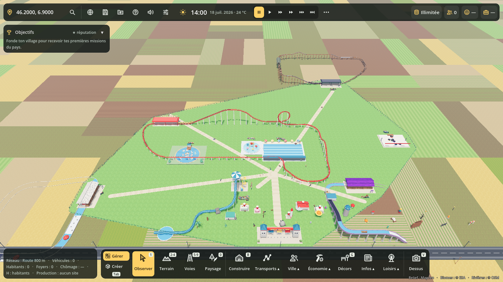
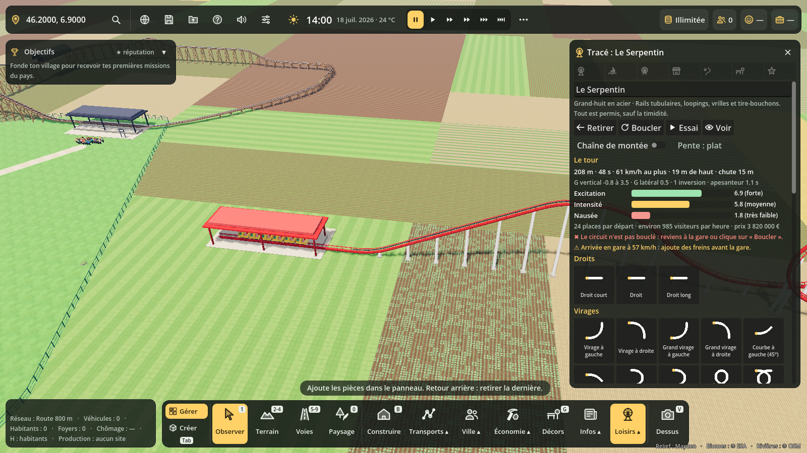
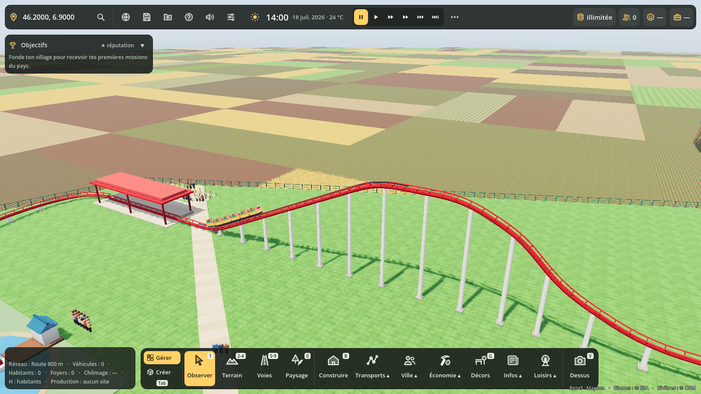
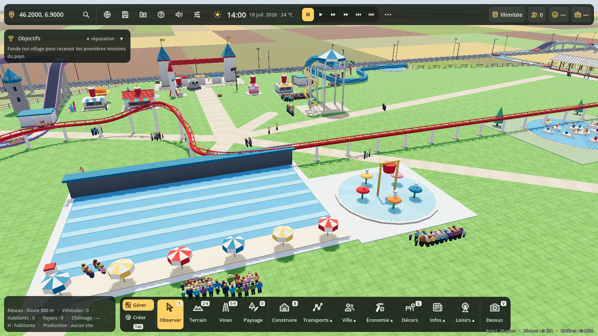
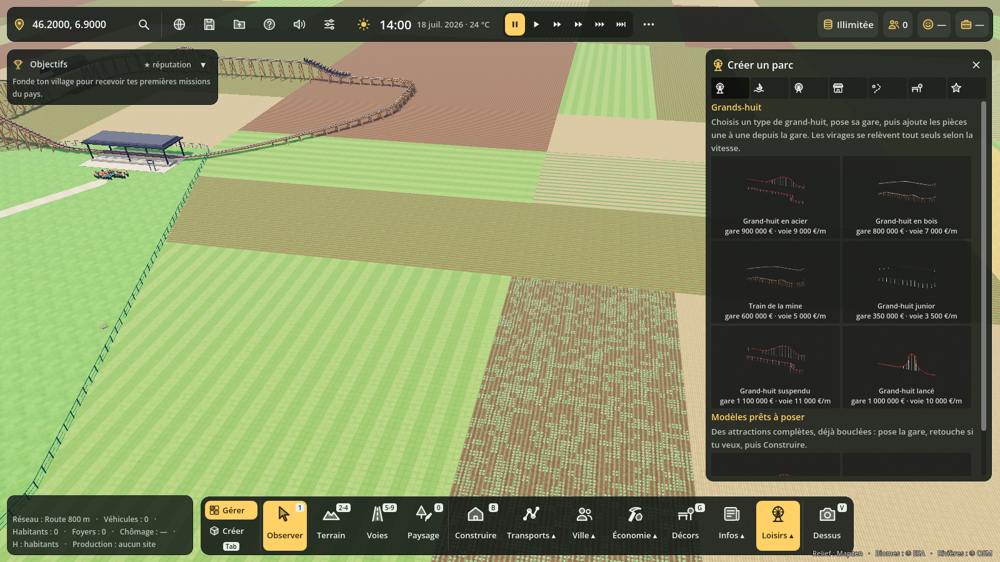

# Créer un parc : grands-huit, aquatiques, allées et décors

Un menu dédié pour construire son parc d'attractions pièce par pièce, dans
l'esprit des grands jeux de parc (tracé libre, notes du tour, files dessinées,
décors à thème), sans en copier ni les noms ni les modèles.

## Ouvrir le menu

- Barre du bas → **Loisirs** → **Créer un parc**, ou **Maj + A**.
- Le groupe Loisirs contient aussi le panneau du parc (Maj + G).
- Il faut une **Entrée du parc** (Construire → Parc de loisirs) : tout se pose à
  moins de 250 m derrière elle.

Onglets : **Grands-huit**, **Aquatiques**, **Manèges**, **Boutiques**,
**Allées**, **Décors**, **Mes attractions**.

## Tracer un grand-huit (ou une attraction aquatique)

1. Choisis un type : acier, bois, train de la mine, junior, suspendu, lancé ;
   ou côté eau : bûches, rivière rapide, splash, toboggan aquatique.
2. Pose la **gare** (R tourne, clic pour poser).
3. Ajoute les **pièces** depuis la gare. 46 pièces en 5 familles :
   - droits (court, normal, long) ;
   - virages (serrés, larges, 45°, en hélice) ;
   - pentes (monter, descendre, adoucir, raidir) ;
   - figures (loopings, vrilles, tire-bouchons, Immelmann, plongeon) ;
   - spéciales (freins, lanceur, tunnel, éclaboussures, rapides, tourbillon).
   Survoler une pièce montre l'aperçu en fantôme sur le terrain.
4. **Chaîne de montée** : à cocher pour les montées (le train est tiré).
5. **Boucler** relie automatiquement la fin à la gare (pneus d'entraînement).
6. **Construire** : le prix (gare + mètres de voie) est payé, le chantier suit.

Raccourcis : **Retour arrière** retire la dernière pièce, **Échap** annule.

### Ce que le panneau calcule

La physique fait rouler un train sur le tracé (pesanteur, frottement, air,
chaîne, lanceur, freins, courant de l'eau) :

- longueur, durée, vitesse max, hauteur, plus grande chute ;
- forces G verticales et latérales, inversions, temps d'apesanteur ;
- **excitation**, **intensité** et **nausée** (0 à 10) ;
- places par départ, débit par heure, prix.

Les virages se relèvent tout seuls selon la vitesse. Les erreurs bloquent la
construction (circuit pas bouclé, train qui s'arrête, voie sous le sol) ;
les avertissements non (arrivée trop rapide en gare, G trop forts).

L'attraction construite devient un vrai manège du parc : file d'attente,
visiteurs qui choisissent selon leurs goûts, pannes et entretien, recettes.
**Modifier** sur une attraction posée rouvre son tracé.

## Aquatiques, manèges, boutiques

- **Aquatiques** : piscine à vagues, pataugeoire, bateaux tamponneurs, pédalos,
  plus les tracés d'eau ci-dessus.
- **Manèges** : les 9 attractions du parc v1.
- **Boutiques et services** : pizzeria, crêperie, barbe à papa, bar à
  smoothies, distributeur, ballons, comptoir photo, poste de secours, kiosque
  d'information, plus les stands, toilettes et aires de repos du parc v1.

## Allées et files d'attente

- Allées **pavées, en bois, en terre ou en asphalte**, larges de 2,5, 4 ou 6 m,
  tracées point par point ; les bouts proches se soudent.
- Une **file d'attente** part de l'entrée d'une attraction (à moins de 10 m) et
  se prolonge depuis sa queue ; les visiteurs y font la queue dans l'ordre.
- Gomme pour effacer. Quand des allées sont dessinées, le jeu ne trace plus les
  allées automatiques du parc ; les visiteurs suivent le réseau d'allées.

## Décors à thème

7 thèmes, 41 décors : parc (lampadaires guirlandes, arches fleuries, mascotte),
pirates, Far West, espace, contes, jungle, épouvante. Pose à l'unité ou au
pinceau, comme les décors (G).

## Mes attractions

**Enregistrer** garde un tracé dans la bibliothèque (fichier
`user://mes_attractions.json`) pour le reposer dans n'importe quelle partie.
Cinq modèles prêts à poser : Le Serpentin, Train de la Mine d'Or, Les Bûches du
Moulin, Rivière Sauvage, Le Toboggan Bleu.

## Pour les développeurs

- `scripts/parc/voie_pieces.gd` : familles, pièces, échantillonnage du tracé,
  raccord automatique ; `voie_physique.gd` : simulation et notes ;
  `voie_mesh.gd` : rails, canaux, supports, gare, voitures.
- `attractions_perso.gd` : designs (entrées `atr_<id>` du catalogue),
  brouillon de tracé, trains animés, bibliothèque.
- `parc_allees.gd`, `parc_extras.gd`, `parc_themes.gd`,
  `parc_editeur_panel.gd`.
- Sauvegarde : sections `parc_editeur` et `parc_allees`.
- Tests : `tests/parc_editeur_test.gd` ; captures :
  `tests/parc_editeur_vitrine.gd`.
