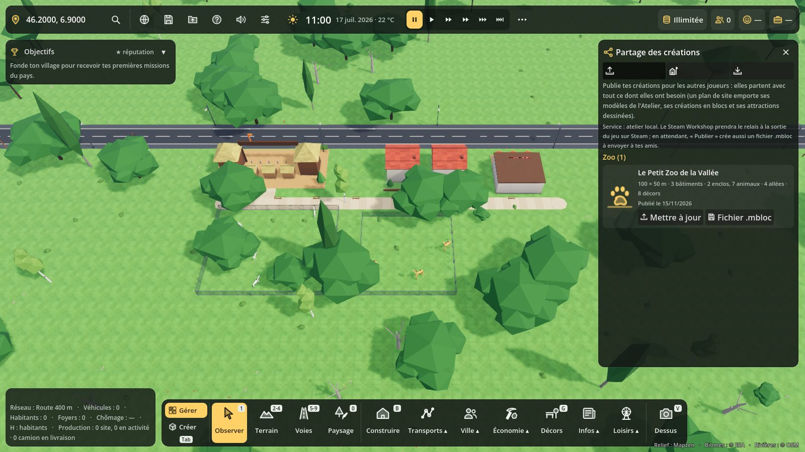
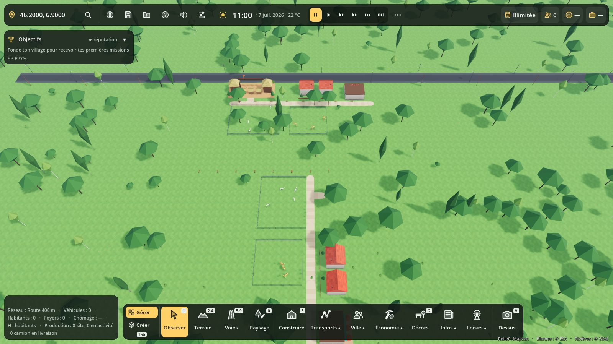

# Partager ses créations

Menu **Partage** : **Maj+W** partout, ou la touche **8** (bouton « Partage ») en mode Créer.
Trois onglets : Partager mes créations, Plans de site, Découvrir les créations des autres.

## Ce qui se partage

| Sorte | D'où ça vient | Où ça arrive une fois installé |
| --- | --- | --- |
| Bâtiment | Banque de l'Atelier (Créer → 6) : façade personnalisée ou murs fins meublés | Banque, et Construire → Mes modèles |
| Musée | Un modèle de la Banque dont l'usage ou la fonction est « Musée » | Banque, et Construire → Mes modèles |
| Création en blocs | Mes créations (Créer → 5) | Mes créations |
| Attraction | Éditeur du parc (Maj+A) : grands-huit, bûches, rivière, splash, toboggans | Créer un parc → Mes attractions |
| Parc, zoo, musée, quartier | Un plan de site (onglet Plans de site) | Onglet Plans de site |

Une création emporte ce dont elle a besoin : un plan de site qui contient un modèle de l'Atelier,
une création en blocs ou une attraction dessinée les met dans le paquet. Chez l'autre joueur, ils
s'installent d'abord, sans écraser ce qu'il a déjà.

## Pas à pas

1. **Publier** : onglet Partager, bouton « Publier » sur la création, puis titre, description et
   étiquettes (séparées par des virgules) et « Publier maintenant ». Une deuxième publication de la
   même création est une mise à jour (« Mettre à jour »).
2. **Envoyer à un ami** (avant Steam) : « Publier » ou « Fichier .mbloc » crée un fichier dans le
   dossier d'échange (onglet Découvrir → « Dossier d'échange »). On l'envoie comme on veut
   (courriel, Discord, clé USB).
3. **Recevoir** : l'ami dépose le fichier .mbloc dans son dossier d'échange, puis onglet Découvrir →
   « Recevoir ». La création apparaît dans la liste : **Installer**. Si une version plus récente
   arrive, le bouton devient **Mettre à jour**. La gomme la retire de la liste (ce qui est installé
   reste dans les bibliothèques).

Le dossier d'échange est `user://partage` (sous Windows :
`%APPDATA%\Godot\app_userdata\MiniBlocs\partage`).

## Plans de site

1. Onglet Plans de site : un nom (facultatif), puis **Choisir une zone sur la carte** : clic sur un
   coin, glisser jusqu'au coin opposé, relâcher (400 m de côté au plus).
2. Le plan garde ce qui est entièrement dans la zone :
   - les bâtiments (rotation, angle, variante, personnalisation), y compris les modèles de l'Atelier,
     les créations en blocs et les attractions dessinées ;
   - les allées du parc et les files d'attente de ses attractions ;
   - les enclos du zoo, leur barrière et leurs animaux (espèce et sexe) ;
   - les décors posés à la main ;
   - les bâtiments en murs fins libres, meublés (un musée construit à la main, par exemple) ;
   - les blocs libres de l'éditeur.
3. **Poser** : le plan suit la souris (cadre bleu et emprise des bâtiments), **R** le tourne d'un
   quart de tour, un clic le pose. Chaque bâtiment se pose comme depuis le catalogue (prix, accès,
   terrassement, chantier) ; les barrières et les animaux se paient ; allées et décors sont offerts.
   Ce qui ne trouve pas sa place est compté à part dans le message.
4. Le plan est classé tout seul : Zoo (s'il a un enclos), Parc de loisirs (attractions ou allées),
   Musée, sinon Quartier. Il se publie comme le reste.

Limites : un plan qui contient des murs fins ou des blocs libres ne tourne pas encore ; les plans de
site ne se posent pas encore dans une carte entre amis (les créations, elles, s'installent).

## Format d'un paquet

Un paquet est un dossier, la forme exacte d'un objet du Steam Workshop :

- `fiche.json` : `format` (« miniblocs-partage »), `version`, `genre` (modele, creation,
  attraction, site), `id`, `cle` (« genre:id »), `titre`, `description`, `auteur`, `etiquettes`,
  `sorte`, `resume`, `cree`, `maj`, `jeu` (version du jeu) ;
- `contenu.json` : `principal` (la création, au format de sa bibliothèque) et `dependances`
  (`modeles`, `creations`, `attractions`) ;
- `apercu.png` : la vignette (facultative).

Un fichier `.mbloc` est ce dossier zippé. La lecture est prudente : uniquement du JSON et une image
PNG, 24 Mo au plus par fichier, format, version et genre vérifiés. Un paquet ne contient jamais de
script. Un paquet d'une version plus récente du jeu est refusé avec un message clair.

## Steam Workshop

`Partage.backend()` choisit où vont les créations :

- `PartageLocal` (aujourd'hui) : l'atelier local, `user://partage/atelier_local/<clé>/`, un dossier
  par création, exactement comme le Workshop les livrerait ;
- `PartageSteam` (à la sortie sur Steam) : si le module [GodotSteam](https://godotsteam.com) est
  installé (singleton `Steam`), que Steam tourne et que `steam/initialization/app_id` est réglé
  dans les paramètres du projet. Publier appelle `createItem` (la première fois), puis
  `startItemUpdate`, `setItemTitle`, `setItemDescription`, `setItemTags`, `setItemMetadata`,
  `setItemContent` (le dossier du paquet), `setItemPreview` et `submitItemUpdate`. L'id de l'objet
  est gardé dans le registre pour les mises à jour. Les abonnements (`getSubscribedItems`,
  `getItemInstallInfo`) s'installent seuls au lancement d'une partie (`Partage.synchroniser`) et
  apparaissent dans Découvrir. La gomme se désabonne (`unsubscribeItem`).

Pour brancher Steam le moment venu : installer GodotSteam (version GDExtension pour Godot 4),
initialiser Steam au démarrage du jeu (`steamInitEx`), régler l'app id. Le menu Partage appelle
`run_callbacks` à chaque image. Les fichiers .mbloc continuent de marcher à côté, pour les amis
hors Steam.

Registre : `user://partage/registre.json` (ce qui est installé, avec la date de la version, et ce
qui a été publié, avec l'id Workshop).

## Code

- `scripts/partage/partage.gd` (Partage) : mes créations, empaqueter, publier, exporter, recevoir,
  disponibles, installer, synchroniser.
- `scripts/partage/paquet_partage.gd` (PaquetPartage) : format, dossier, fichier .mbloc, vérifications.
- `scripts/partage/plans_sites.gd` (PlansSites) : lire une zone, bibliothèque, rotation, poser.
- `scripts/partage/partage_backend.gd`, `partage_local.gd`, `partage_steam.gd` : les services.
- `scripts/partage/partage_panel.gd` (PartagePanel) et `outil_site.gd` (OutilSite) : menu et outil.
- Bibliothèques touchées : `BanqueModeles.plan_data` / `install_data`, `Creations.installer`.
- Test : `tests/partage_test.gd` (paquets, fichiers refusés, installation, plan de site avec
  bâtiments, allée, enclos, zèbres et banc reposé tourné, atelier local, Steam avec une doublure de
  GodotSteam, menu).

## Aperçus

Captures : `godot --path . --script res://tests/partage_vitrine.gd -- --screenshot p.png --vue partager|sites|decouvrir|pose|repose`.
