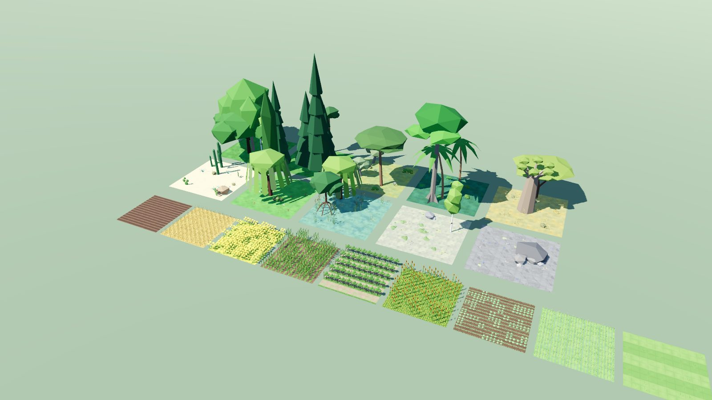
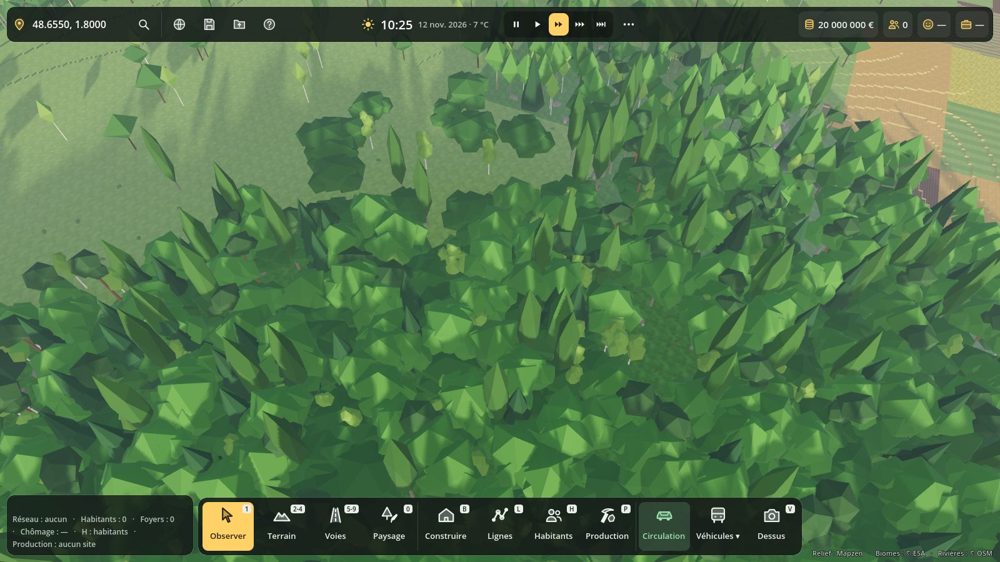
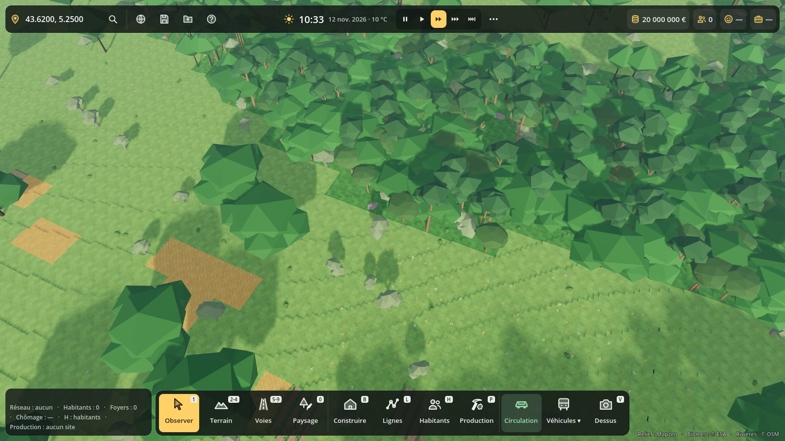
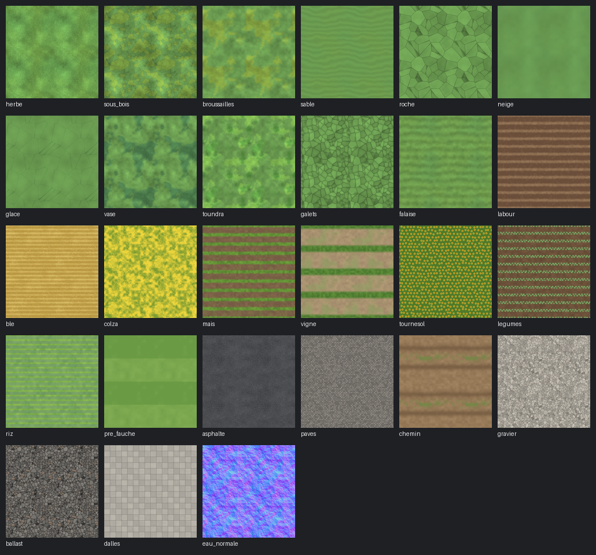
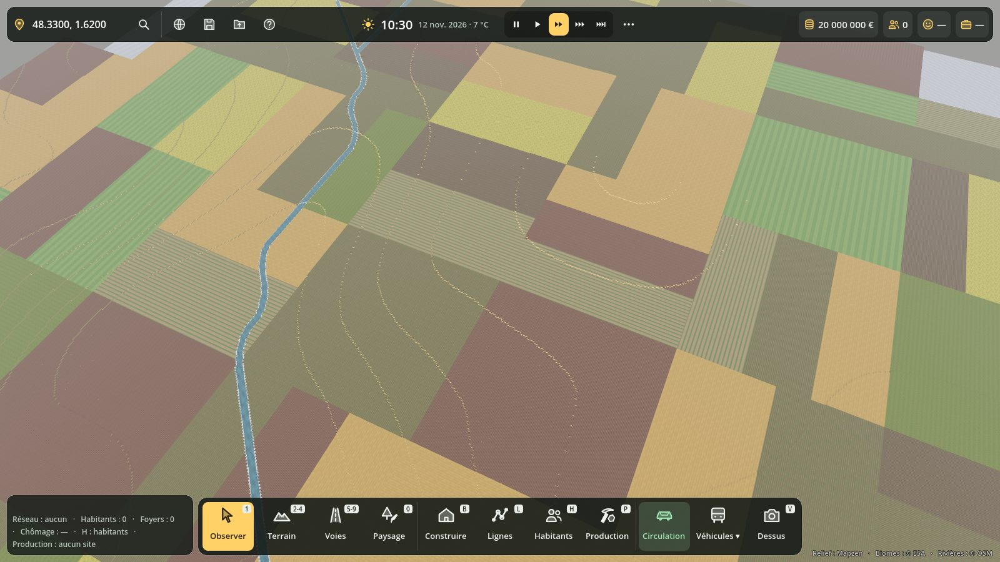
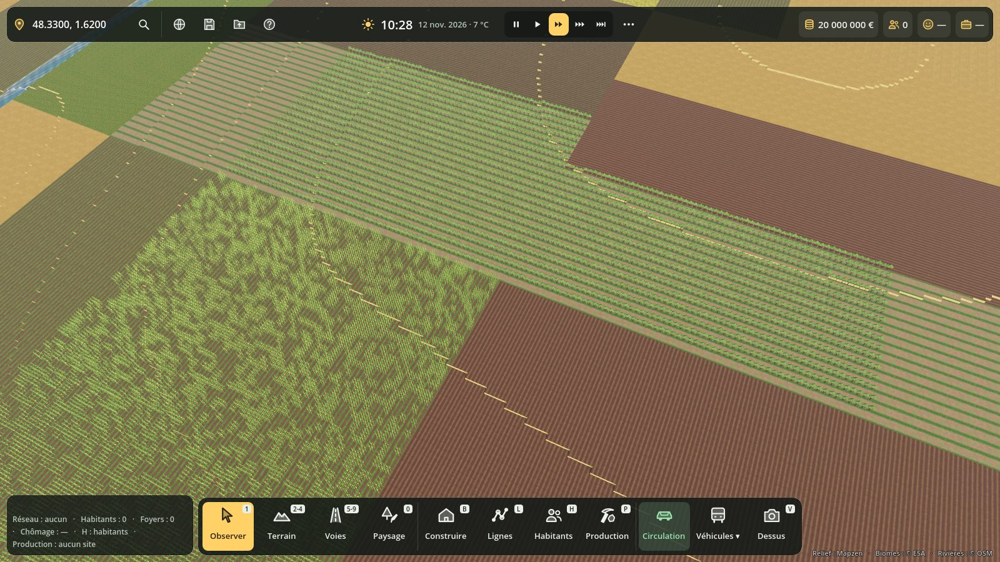

# Plantes et textures du sol

Le terrain a maintenant de vraies plantes low-poly (arbres, arbustes, herbes, fleurs, cultures, rochers) choisies selon le biome, le climat du lieu et l'altitude, et des textures de sol : herbe, sous-bois, sable, roche, neige, vase, galets… et des champs cultivés en patchwork (blé, colza, maïs, vigne, tournesol, légumes, riz, labour, prairie de fauche).

Tout est fait par nos propres scripts (Blender et Python) : aucune image ni aucun modèle extérieur, donc aucune licence à respecter pour un jeu vendu sur Steam.



## Les plantes (Blender)

`tools/blender/plantes_lowpoly.py` construit toutes les plantes et les exporte en `.glb` dans `assets/modeles/plantes/` :

```bash
"C:\Program Files\Blender Foundation\Blender 5.2\blender.exe" --background --factory-startup --python tools/blender/plantes_lowpoly.py -- --dossier assets/modeles/plantes
```

Option `--seul chene --apercu chene.png` : une seule plante, avec une image d'aperçu.

| Famille | Plantes | Triangles |
| --- | --- | --- |
| Arbres de forêt | chêne, hêtre, bouleau, peuplier, sapin, épicéa, mélèze, pin sylvestre | 33 à 148 |
| Méditerranée | pin parasol, olivier, lavande, genêt | 81 à 224 |
| Tropiques et savane | grand arbre tropical, cocotier, acacia, baobab, palétuvier (mangrove) | 103 à 193 |
| Bords de l'eau | saule pleureur, roseaux | 78 à 100 |
| Arbustes | buisson, buisson fleuri, genêt, broussaille sèche, fougère | 47 à 81 |
| Désert | saguaro, figuier de Barbarie, agave, rocher de grès | 33 à 92 |
| Toundra et montagne | saule nain, lichen, gentianes, rochers, cailloux | 40 à 120 |
| Herbes et fleurs | touffe d'herbe, hautes herbes, oyat (dunes), coquelicots, marguerites, fleurs jaunes | 27 à 130 |
| Cultures (1 m²) | blé, maïs, colza, tournesol, vigne palissée, légumes, riz | 36 à 129 |

- **Taille réelle** : un chêne fait 12 m, un sapin 18 m, un épicéa 24 m, le blé 90 cm. Le jeu fait varier chaque plante de ± 30 % et la tourne au hasard.
- **Une seule palette** de 64 couleurs (`palette_plantes.png`, 64 × 64 px) pour toutes les plantes : un seul matériau dans le jeu. On peut la retoucher dans Krita.
- **Versions lointaines** : chaque arbre a un `_loin.glb` de 12 à 18 triangles, affiché au-delà de 170 m. Les herbes disparaissent au-delà de 95 m, les cultures au-delà de 130 m (la texture du champ prend le relais).
- **Vent** : `scripts/terre/plante.gdshader` balance les plantes (25 cm en haut d'un arbre, quelques cm pour l'herbe), chacune avec son rythme.

## Ce qui pousse où (`scripts/terre/plantes.gd`)

Le climat vient de la latitude du lieu (boréal au-delà de 58°, tropical sous 18°, méditerranéen autour de la Méditerranée, subtropical, tempéré). Ensuite, pour chaque biome ESA WorldCover :

| Biome | Ce qui y pousse |
| --- | --- |
| Forêt | arbres du climat (chênes et hêtres en France, sapins et épicéas au Nord, pins parasols et oliviers en Provence, grands arbres et cocotiers sous les tropiques), conifères au-dessus de 1 100 m, buissons, fougères |
| Broussailles | genêts et buissons (maquis : lavande, broussailles sèches), quelques arbres (acacias et baobabs dans la savane) |
| Prairie | herbe, hautes herbes, coquelicots, marguerites, arbres isolés |
| Champs | une culture par parcelle (voir plus bas) |
| Désert | saguaros, figuiers de Barbarie et agaves dans les Amériques ; broussailles sèches, rochers et cailloux ailleurs |
| Marais, mangrove | roseaux, saules ; palétuviers dans les mangroves |
| Toundra | saules nains, lichen, cailloux, quelques bouleaux |
| Alpage, roche | herbe et gentianes, cailloux, rochers |
| Plage | oyat ; cocotiers sous les tropiques |

Toujours au même endroit pour un même lieu. Le pinceau **Planter des arbres** plante les arbres des forêts du climat.





## Les textures du sol (`tools/textures/textures_terrain.py`)

```bash
python3 tools/textures/textures_terrain.py --planche docs/apercu-textures.png
```

Python 3 avec numpy et Pillow (`pip install numpy pillow`). Toutes les textures font 256 × 256 px, se répètent sans raccord et couvrent 4 m × 4 m.



- **Sols naturels** (`assets/textures/sol/`, textures « détail ») : herbe, sous-bois, broussailles, sable, roche, neige, glace, vase, toundra, galets (lits des rivières et fonds marins), falaise (flancs des marches). Elles sont grises : le jeu multiplie la couleur du biome par la texture. La couleur reste donc celle du biome et de l'altitude, la texture ajoute les touffes, les fissures, les rides du sable.
- **Champs** (même dossier, en vraie couleur) : labour, blé, colza, maïs, vigne, tournesol, légumes, riz, prairie de fauche. Les champs sont découpés en carrés de 96 m coupés en 1 à 3 longues bandes ; chaque parcelle a sa culture (selon le climat : du riz sous les tropiques, de la vigne surtout en Méditerranée) et ses rangs suivent sa longueur.
- **Routes** (`assets/textures/routes/`) : asphalte, pavés, chemin de terre, gravier, ballast, dalles de trottoir. Prêtes, mais pas encore posées sur les voies (c'est le chantier des réseaux de transport).
- **Eau** (`assets/textures/eau/eau_normale.png`) : carte de normales de vaguelettes, prête pour l'eau.





Dans le jeu, `TerrainWorld.textures_sol = false` revient à l'ancien sol uni.

## Tester dans Godot 4.7

1. Ouvre le projet dans Godot (les `.glb` et les textures s'importent tout seuls).
2. **Vitrine** : double-clique sur `scenes/vitrine_plantes.tscn`, puis **F6**. Touches **1**, **2**, **3** : ensemble, forêts, champs. Molette : zoom. Clic gauche glissé : tourner. Espace : arrêter la rotation.
3. **En jeu** : lance le jeu (F5), choisis un lieu sur le globe et zoome. Quelques lieux parlants :
   - Beauce (champs) : `48.33, 1.62`
   - forêt de Rambouillet : `48.65, 1.80`
   - Provence : `43.62, 5.25`
   - Laponie (forêt boréale) : `67.5, 26.5`
   - Sahara : `25.0, 10.0` ; Arizona (cactus) : `32.3, -111.0`
   - Amazonie : `-3.0, -60.0` ; savane du Kenya : `-2.5, 37.5`
4. Les plantes bougent doucement avec le vent ; en vue au sol (**V**), on voit les fleurs, l'herbe et les rangs de cultures.

Tests automatiques :

```bash
godot --headless --path . --import
godot --headless --path . --script res://tests/plantes_test.gd
```

Il doit afficher `PLANTES TEST OK` (chaque espèce a son modèle, léger et posé au sol, sa version lointaine, chaque biome de chaque climat a ses plantes, la texture du sol se construit).

## Prochaines étapes possibles

- Haies et murets entre les parcelles (bocage normand, Bretagne).
- Saisons : feuillage d'automne, arbres nus et neige l'hiver, champs moissonnés l'été.
- Poser les textures de routes sur les voies, et la carte de normales sur l'eau.
- D'autres essences selon les régions : cyprès, cèdres, bananiers, bambous, cerisiers.
