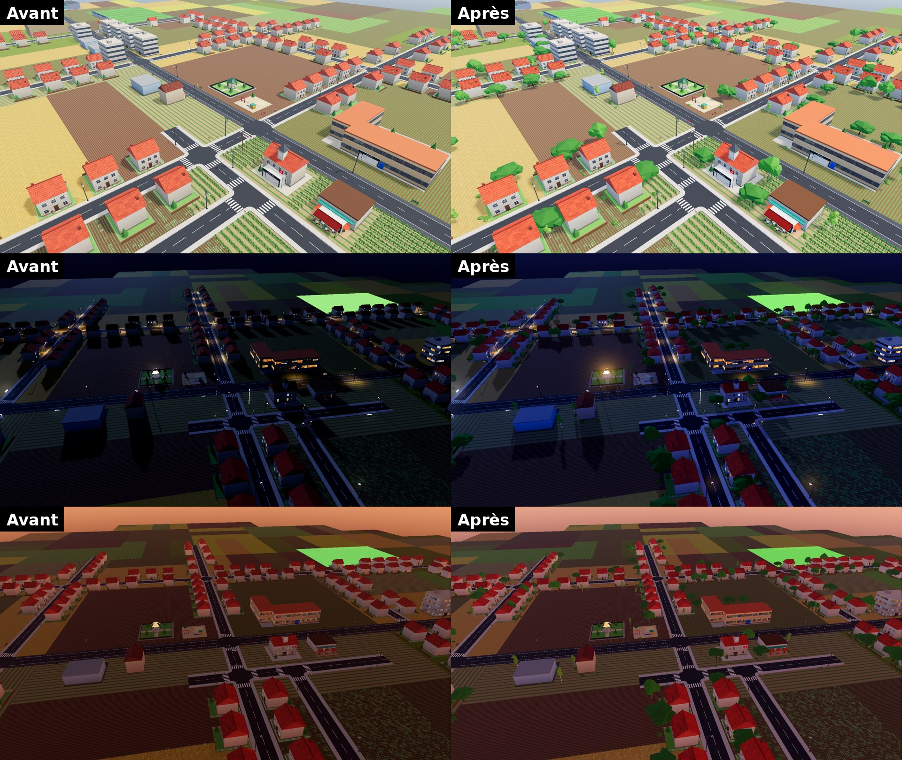

# Rendu cosy

Le rendu cosy rend la ville plus douce et plus chaleureuse, sans toucher aux modèles. Il s'ajoute au rendu poussé (heures dorées, occlusion, brume du matin).

## Ce qui change

| Moment | Effet |
| --- | --- |
| Jour | Soleil crème, ombres claires et bleutées (lumière du ciel), occlusion ambiante qui marque les coins et le pied des murs, ciel pastel, brume de l'air plus légère et bleu lavande |
| Heures dorées, crépuscule | Soleil abricot puis corail, ciel orangé et rose |
| Nuit | Bleu nuit lisible au lieu du noir, fenêtres plus dorées avec un halo, lampadaires plus forts |
| Sol | Champs un peu moins criards, terres sombres remontées vers un brun chaud, herbe plus fraîche, quadrillage plus discret |
| Eau | Plus turquoise et plus claire |
| Jardins | Arbres, buissons et massifs de fleurs plantés tout seuls autour des maisons, immeubles, commerces, services et loisirs, avec les espèces du climat (chênes et hêtres, oliviers et lavande, palmiers…) |

Les saisons, la neige, le vent et les feuilles d'automne s'appliquent aussi aux jardins (mêmes modèles et même matériau que la végétation du terrain). Les arbres se posent sur les côtés et à l'arrière, pas devant la façade, et jamais sur une voie, un bâtiment ou l'eau.

## Réglages

Menu **Options → Graphismes** :

- **Rendu cosy** (allumé par défaut) : tout ce qui est décrit plus haut. Prend effet à la prochaine partie chargée.
- **Effet maquette** (coupé par défaut) : flou au premier plan et au loin, net là où regarde la caméra, comme une photo de maquette (tilt-shift). Vue de dessus seulement ; le mode photo garde son propre flou.
- **Ombres hautes** : ajoutent l'éclairage indirect (lumière qui rebondit sur les façades) et des ombres plus douces.

## Coût

Réglages de l'environnement surtout, coût fixe. Les jardins sont des MultiMesh (un par espèce), refaits seulement quand un bâtiment ou une voie change, et seulement pour les nouveaux bâtiments. L'éclairage indirect n'est actif qu'avec les ombres hautes.

## Fichiers

- `scripts/ambiance/rendu_cosy.gd` (RenduCosy) : couleurs du ciel et du soleil, réglages de l'environnement, effet maquette.
- `scripts/terre/verdure.gd` (Verdure) : jardins autour des bâtiments.
- `scripts/terre/terrain.gdshader`, `scripts/terre/horizon.gdshader` : uniforme `douceur`.
- `tests/rendu_cosy_test.gd` : test automatique ; `tests/cosy_vitrine.gd` : captures (6 moments de la journée, `--avant` pour l'ancien rendu, `--variantes` pour comparer des réglages).
