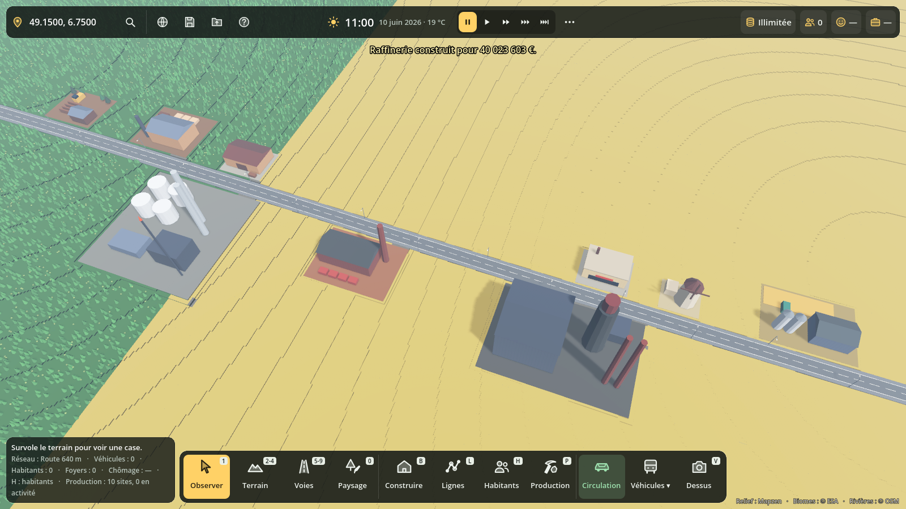
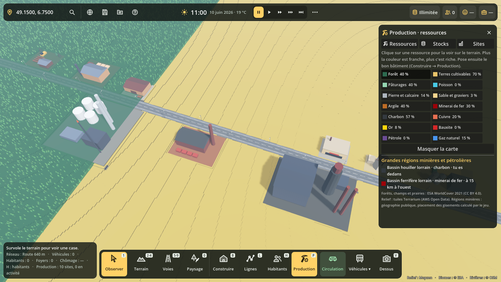
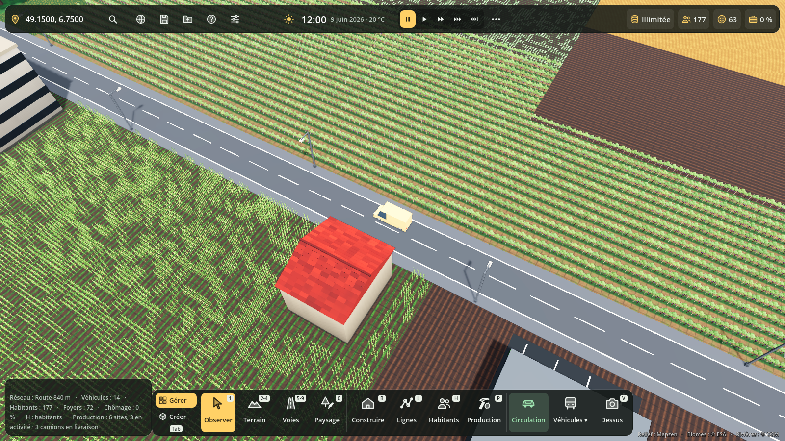
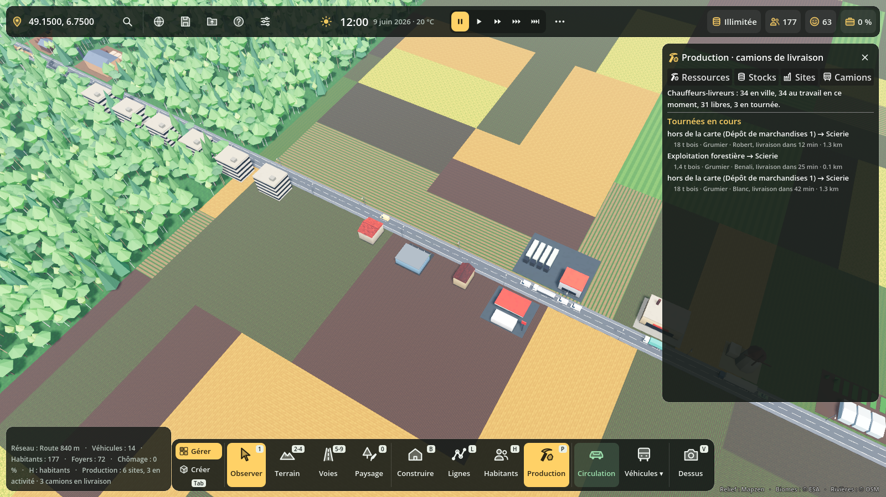
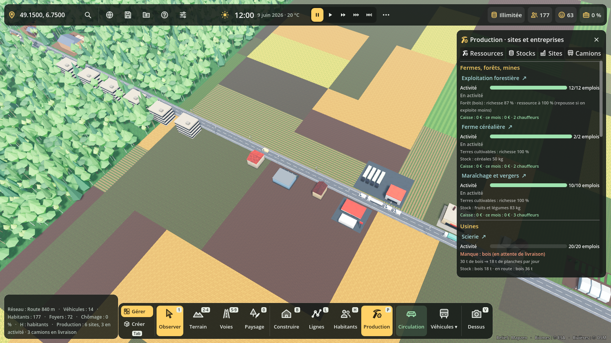

# Ressources naturelles et production

Étape 1, livrée le 2026-11-12. Le code est dans `scripts/economie/`, le test dans `tests/production_test.gd`.

## Ce que fait l'étape 1

- **Carte des ressources** : panneau Production (touche **P**), onglet Ressources. Un clic sur une ressource la dessine sur le relief autour de la caméra, sur environ 1,4 km de côté. Plus la couleur est franche, plus la ressource est riche. Survoler une case affiche ses ressources les plus riches dans la fiche du terrain.
- **14 ressources naturelles** : bois, terres cultivables, pâturages, poisson, pierre, sable, argile, fer, charbon, cuivre, or, bauxite, pétrole et gaz.
- **20 bâtiments de production** dans Construire → Production (catégorie nouvelle) :
  - extraction : exploitation forestière, ferme céréalière, élevage, port de pêche, carrière, sablière, carrière d'argile, mine (elle prend le meilleur minerai sous elle), puits de pétrole ou de gaz ;
  - transformation : scierie, moulin, boulangerie industrielle, abattoir, briqueterie, cimenterie, aciérie, fonderie de cuivre, raffinerie, menuiserie, usine de biens.
- **Règle de pose** : un site d'extraction est refusé là où sa ressource est trop pauvre. L'aide de pose affiche la richesse, les tonnes par jour prévues et la réserve.
- **Emplois** : la production suit la part des emplois pourvus. Il faut des habitants (logements) près des sites. 12 nouveaux métiers : bûcheron, carrier, mineur, foreur, marin pêcheur, sidérurgiste…
- **Stock commun, façon Anno** : tous les bâtiments desservis par une voie partagent le stock de la ville, 2 000 t par marchandise. Chaque entrepôt ajoute 20 000 t.
- **Chaînes** : bois → planches → meubles ; céréales → farine → pain ; bétail → viande ; minerai de fer + charbon → acier ; minerai de cuivre → cuivre ; acier + planches + cuivre → biens ; pétrole → carburant ; argile → briques ; pierre → ciment.
- **Ventes** : chaque jour, les habitants achètent pain, viande, poisson, meubles, biens et carburant (un plein par voiture), s'il y a au moins un commerce en ville.
- **Export** : le surplus part à 80 % du prix de gros, par les dépôts de marchandises, gares et ports (150 t par jour chacun), par les voies qui sortent de la carte, plus les tonnes que transportent tes lignes de fret. La ville garde d'abord 3 jours de besoins.
- **Caisse** : elle encaisse les ventes et l'export, et paie les salaires des employés de la production (charges comprises).
- **Épuisement** : les mines et les puits ont une réserve qui baisse. Le bois et le poisson s'appauvrissent si on les exploite fort, puis repoussent. Les sols, la pierre, le sable et l'argile ne s'épuisent pas.
- **Sauvegarde** : section `production` (stocks, sites, réserves, comptes).

## D'où viennent les ressources (lieu réel)

| Ressource | Source dans l'étape 1 | Licence |
|---|---|---|
| Bois, cultures, pâturages | ESA WorldCover 2021, déjà lu par le jeu | CC BY 4.0 (attribution affichée) |
| Pente, altitude, bathymétrie | tuiles Terrarium (AWS Open Data) | libre, attribution |
| Rivières, lacs, mer | WaterMap du jeu (relief, OSM si disponible) | ODbL pour OSM |
| Sable, argile, pierre | calculés : bords de rivière, plages, plaines basses, roche nue, pente | — |
| Fer, charbon, cuivre, or, bauxite, pétrole, gaz | `GisementsMonde.PROVINCES` : 106 grandes régions réelles (centre, rayon, richesse), plus de petits gisements locaux possibles partout | faits géographiques, aucune base recopiée |

Dans une province, les gisements sont des taches de quelques kilomètres, tirées d'un bruit calculé sur les vraies coordonnées. Tout le monde a donc les mêmes gisements au même endroit, en solo comme en carte mondiale.

## Données gratuites pour aller plus loin

Toutes ces données permettent l'usage commercial, donc la vente sur Steam :

- **USGS MRDS** (Mineral Resources Data System), environ 300 000 sites miniers dans le monde : domaine public.
- **USGS World Petroleum Assessment** (provinces pétrolières) : domaine public.
- **Global Energy Monitor** : Global Coal Mine Tracker et Global Oil and Gas Extraction Tracker, CC BY 4.0.
- **GLiM**, carte lithologique mondiale (calcaire, granite, sédiments) : CC BY.
- **SoilGrids 250 m** (ISRIC), carbone, argile et pH des sols : CC BY 4.0.
- **MapSPAM**, rendement de 42 cultures par maille de 10 km : CC BY 4.0.
- **WorldClim**, pluie et température : CC BY 4.0.
- **Global Wind Atlas** et **Global Solar Atlas** : CC BY 4.0.
- **NASA MODIS**, chlorophylle des océans (productivité de la pêche) : domaine public.
- **GEBCO**, bathymétrie mondiale : libre.

À éviter, car leur licence est non commerciale : FAO GAEZ v4, Global Fishing Watch, Sea Around Us.

Méthode prévue : comme pour `tools/build_biome_map.py`, un script `tools/` précalcule une grille mondiale compacte (par exemple 0,05°) pour chaque ressource, livrée avec le jeu. Le jeu y lit la probabilité d'un gisement, puis place les taches comme aujourd'hui.

## Choix de Gaël (2026-11-12)

1. Transport : stock commun à courte distance, et lignes de fret à longue distance. L'étape 1 fait le stock commun ; l'étape 2 fera circuler les tonnes sur les lignes de fret.
2. Épuisement : oui pour les mines, le pétrole et le gaz. Le bois et le poisson repoussent si on n'exploite pas trop : à plein régime, la ressource baisse et se stabilise vers 60 % ; laissée tranquille, elle revient à 100 % en quelques mois de jeu.
3. Clients : les habitants et l'export. L'export passe par les dépôts, gares et ports, et par les voies qui sortent de la carte : 200 t par jour pour une route, 800 t pour un rail, 1 200 t pour une voie d'eau qui arrive à moins de 300 m du bord.

## Économie locale (2026-11-12)

Les marchandises ne « téléportent » plus : elles roulent en camion sur tes routes.

- **Un stock par site** : chaque ferme, usine, commerce et entrepôt a son propre stock (onglet **Sites** du panneau P). Un site d'extraction garde au plus 5 jours de production ; une usine fait venir 3 jours d'intrants ; un commerce garde 4 jours de ventes en rayon.
- **Livraisons automatiques** : toutes les 15 minutes de jeu, la ville regarde qui manque de quoi (les plus pressés d'abord) et envoie un camion depuis le fournisseur le plus proche **par la route** qui en a en stock. Un camion prend aussi ce que le même client attend du même fournisseur.
- **Chauffeurs-livreurs** : chaque camion est conduit par un habitant au métier de chauffeur-livreur, à son poste (lundi-vendredi, 6 h-15 h). Il travaille chez le fournisseur, chez le client, dans un entrepôt ou dans la nouvelle **entreprise de transport routier** (20 emplois, surtout des chauffeurs). Pas de chauffeur libre : la livraison attend, et les rayons se vident.
- **Camions visibles** : un camion par livraison, choisi selon la marchandise et la charge : fourgon (≈ 4 t), camion porteur (≈ 11 t), semi-remorque (≈ 22 t), citerne (lait, carburant, chimie), benne (sable, pierre, minerais, céréales) ou grumier (bois). Il part de son dépôt, charge, livre, puis rentre. Au plus 60 camions affichés à la fois ; au temps réel, le camion arrive à peu près quand la marchandise est livrée ; en accéléré, la livraison est comptée avant que le camion à l'écran n'ait fini sa route.
- **Entrepôts relais** : le surplus d'un site (au-delà de 60 % de son stock maximal, si personne n'en commande) part vers l'entrepôt le plus proche (20 000 t), où les autres viennent se servir.
- **Import et export** : ce que personne ne produit sur la carte arrive par camion depuis une porte d'import (route qui sort par le bord, dépôt de marchandises, gare ou port), à 125 % du prix de gros. Le surplus sans entrepôt part à l'export (80 % du prix). Limite par jour : 150 t par station, 200 t par route qui sort de la carte (800 t rail, 1 200 t eau), plus le fret de tes lignes.
- **Commerces** : les habitants font leurs courses chaque jour dans les commerces ouverts les plus proches de chez eux (jusqu'à 3, à moins de 6 km). Rayon vide : satisfaction en baisse (« rayons vides près de chez lui », plus fort pour le pain, les laitages, les légumes, l'épicerie, les boissons, l'hygiène, la viande, les médicaments et le carburant). Tout est là : « + commerces bien approvisionnés ». Le boulanger de quartier cuit son pain avec de la farine livrée (et fait venir du pain s'il n'a pas de farine). Les cafés et restaurants se font livrer boissons, pain, viande et légumes pour servir leurs clients.
- **Entreprises** : chaque site a sa caisse et ses comptes du mois : ventes aux habitants ou aux autres entreprises, achats, import, export, salaires, gazole (0,6 €/km), courses payées à un transporteur extérieur (1,8 €/km + 20 €). **Ta caisse (la ville) touche seulement un impôt de 25 % sur les bénéfices** (× réglage Impôts du panneau Admin), en plus de la cotisation foncière par emploi déjà comptée dans le budget de la ville.

### Chaînes de la vie courante

| Besoin | Chaîne | Commerce |
|---|---|---|
| Pain | ferme céréalière → moulin → boulangerie industrielle (ou farine → boulanger) | boulangerie, supérette, supermarché, marché |
| Viande | élevage → abattoir | supérette, supermarché, marché |
| Poisson | port de pêche | supermarché, marché |
| Lait, fromages, yaourts | ferme laitière → laiterie | supérette, supermarché, marché |
| Fruits et légumes | maraîchage et vergers | supérette, supermarché, marché |
| Épicerie | farine + sucre (betteraves → sucrerie) + légumes + laitages → usine agroalimentaire | supérette, supermarché, station-service |
| Boissons | céréales + sucre + verre (sable → verrerie) → brasserie | supérette, supermarché, station-service, cafés |
| Hygiène | produits chimiques (gaz → usine chimique) + papier (bois → papeterie) + plastiques → usine d'hygiène | supérette, supermarché, pharmacie, grand magasin |
| Médicaments | chimie + sucre → laboratoire pharmaceutique | pharmacie |
| Vêtements | lin et coton + plastiques → usine textile | boutique de vêtements, supermarché, grand magasin |
| Meubles | bois → scierie → menuiserie | magasin de meubles, grand magasin |
| Électroménager, outils | acier + planches + cuivre → usine de biens | magasin d'électronique, supermarché |
| Électronique | cuivre + plastiques + verre → usine d'électronique | magasin d'électronique, supermarché |
| Carburant | pétrole → raffinerie (qui fait aussi les plastiques) | station-service, supermarché |
| Voitures | acier + aluminium (bauxite → aluminerie) + plastiques + électronique + verre → usine automobile | concession automobile |

Nouveaux bâtiments : 4 fermes (maraîchage, betteraves, lin et coton, lait), 13 usines, l'entreprise de transport routier, et 6 commerces (station-service, pharmacie, boutique de vêtements, magasin d'électronique et d'électroménager, magasin de meubles, concession automobile). Les prix et rendements sont des ordres de grandeur ; l'équilibre (qui gagne de l'argent, qui en perd) reste à affiner en jouant.

Code : `scripts/economie/production.gd` (sites, livraisons, courses, comptes), `ressources.gd` (marchandises, commerces, consommation), `production_types.gd` et `commerces_types.gd` (bâtiments), `Traffic.add_delivery_vehicle` (camions). Sauvegarde : section `production`, version 2 (les parties d'avant gardent leur stock, rangé dans les entrepôts ou chez les producteurs).

## Étapes suivantes proposées

- Trains et bateaux de fret qui chargent eux-mêmes aux gares et aux ports (aujourd'hui, ils ajoutent de la capacité d'import et d'export).
- Faillite des entreprises qui perdent trop d'argent ; prix qui suivent l'offre et la demande.
- Les bâtiments consomment des matériaux à la construction (briques, ciment, planches, acier).
- Champs visibles autour des fermes, forêt qui recule sous l'exploitation et repousse.
- Énergie : centrales à charbon, au gaz, hydrauliques, éoliennes et solaires (Global Wind Atlas, Global Solar Atlas).
- Grilles mondiales précalculées à partir de USGS MRDS et Global Energy Monitor.

