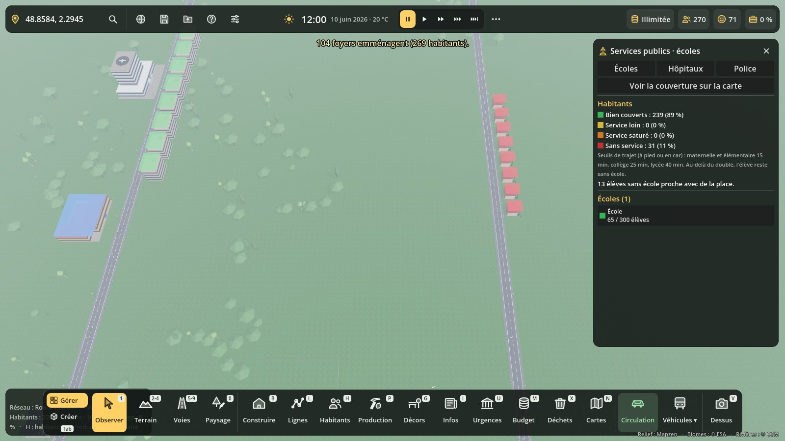
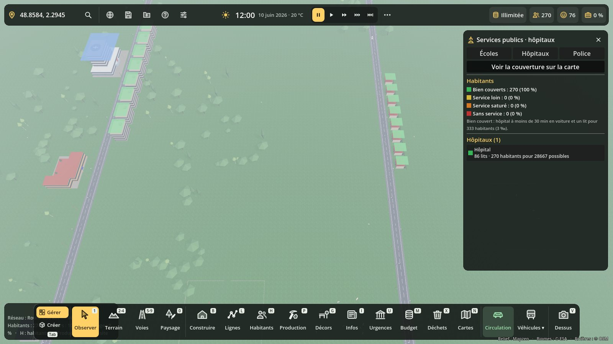

# Services publics : écoles, hôpitaux, police

Code : `scripts/services/services_publics.gd` (`ServicesPublics`, nœud « ServicesPublics » créé par `terre_main`) et `scripts/services/services_panel.gd` (panneau, **Maj+U**). Test : `tests/services_test.gd`. Captures : `tests/services_vitrine.gd`.

## Ce qui compte

Chaque logement est relié au service le plus **rapide à rejoindre par les routes et chemins** (temps de trajet réel sur le réseau, pas à vol d'oiseau). Sans voie à proximité, on prend la distance à vol d'oiseau × 1,3. Deux quartiers que rien ne relie ne se servent pas l'un l'autre.

| Service | Bien couvert | Plus rien | Places |
|---|---|---|---|
| École | maternelle et élémentaire 15 min, collège 25 min, lycée 40 min (à pied ou en car : trajet en voiture + 5 min d'attente) | au double du seuil | pupitres (« visiteurs » du catalogue) |
| Hôpital | 30 min en voiture | 60 min | lits : « lits » du catalogue, sinon 0,75 par emploi prévu, au prorata du personnel embauché ; besoin 3 lits pour 1 000 habitants |
| Police | 10 min d'intervention | 20 min | agents = employés du commissariat ; 1 agent pour 400 habitants |

Un service **saturé** couvre moins bien : la couverture est divisée par la charge (habitants servis / habitants possibles). Un hôpital ou un commissariat sans personnel (Effectif) ne couvre rien.

**Écoles** : un élève n'est inscrit que dans une école à moins du double du seuil de son niveau (`Population.school_ok`). S'il n'y en a pas, il reste « sans école », même s'il reste des places plus loin. Une école devenue trop loin (route coupée, déménagement) est quittée pour une autre.

## Conséquences

- **Santé** : `CycleVie.health` prend la couverture hôpital (risque ×0,82 bien couvert, ×1,15 sans hôpital).
- **Satisfaction** : école loin, enfant du foyer sans école, hôpital loin ou saturé, quartier sans police ou police débordée, quartier sûr. Les facteurs passent par Avis (groupe `avis_sources`, `avis_facteurs()`) ; tant qu'Avis n'existe pas, ils s'ajoutent par `Population.extra_satisfaction` (en chaîne avec les commerces et les nuisances).
- **Petits délits** : des cambriolages tombent dans les quartiers mal couverts par la police (0,02 par heure réelle et par habitant exposé). Ils sont signalés aux Urgences s'il y a un commissariat, sinon comptés « sans intervention ».

## Carte et panneau

- **Maj+U** : onglets Écoles, Hôpitaux, Police : habitants bien couverts, loin, saturés, sans service ; chaque bâtiment avec ses places, lits ou agents (clic : y aller) ; délits du mois.
- « Voir la couverture sur la carte », ou le panneau **Cartes** (N), groupe « Services » : chaque logement en couleur (vert bien couvert, jaune loin, orange saturé, rouge rien), les services en bleu.

## Pour les autres systèmes

- `ServicesPublics.couverture(pos, type)` → 0..1 en un point (type `"ecole"`, `"hopital"`, `"police"` ou `""` pour la moyenne), 0 sans système. Lu par la valeur foncière.
- `ServicesPublics.instance.couverture_bid(bid, type)`, `detail(bid, type)` → `{q, min, via, charge, why}`, `bilan(type)`.
- Réglables : `lits_par_hab`, `hab_par_agent`, `delits_actifs`.
- Sauvegarde : section `services` (bilan des délits) ; la couverture est recalculée au chargement.
