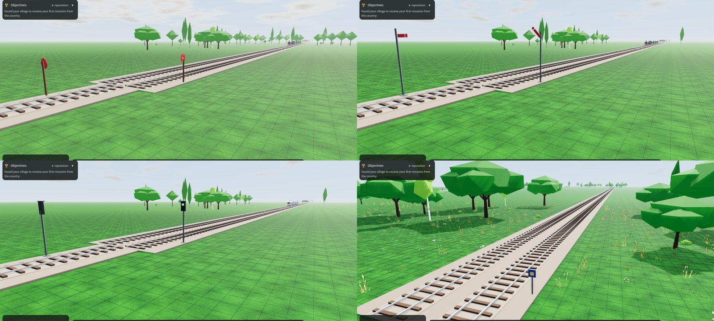
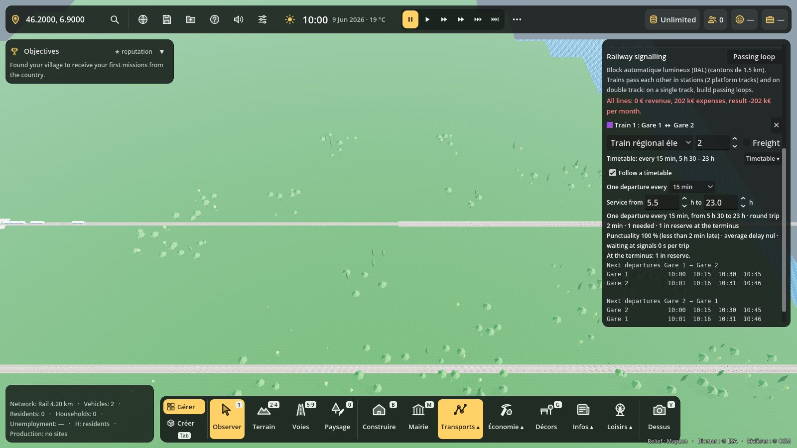

# Signaux et horaires des trains

Demande de Gaël (17 novembre 2026) : des signaux et des horaires pour les trains.

## Signalisation (`scripts/transport/signalisation.gd`)

Un train ne roule que sur la voie qu'il a réservée devant lui (son autorisation
de marche). Il la demande un peu avant d'en avoir besoin (distance de freinage
+ 80 m) et s'arrête 8 m avant le signal tant qu'on la lui refuse.

| Voie | Règle |
|---|---|
| Double voie | chaque sens sur sa voie, découpée en **cantons** : un seul train par canton |
| Voie unique | partagée par les deux sens : un train n'y entre que s'il la réserve **d'un seul coup jusqu'au prochain point de croisement** (gare ou double voie) ; jamais de face-à-face, pas d'interblocage |
| Aiguillage (nœud de 3 voies ou plus) | un seul train à la fois le traverse |
| Gare, station de métro | 2 voies à quai : le 2e train s'arrête sur la voie d'à côté (décalée de 4,5 m) |
| Tramway | marche à vue sur double voie (il suit celui de devant) ; voies uniques et aiguillages comme les trains |

Arrêté à quai, un train libère la ligne derrière lui. Si un train reste bloqué
plus de 150 s (trop de trains pour les voies), il passe en marche à vue jusqu'à
sa prochaine gare ; le panneau Lignes compte ces « interblocages ».

**Évitement** : panneau Lignes (L) > bouton *Évitement*, puis clic sur une voie
unique : elle devient double sur 600 m (`StationSystem.creer_evitement`). Les
trains en sens inverse s'y croisent. Une voie posée en double voie dès le tracé
(réglage *Voies ferrées* = 2) fait la même chose.

### Selon l'époque

| Années | Signaux | Cantons sur double voie |
|---|---|---|
| 1830-1871 | disques tournants et garde-voies (rouge face à la voie = arrêt, de profil = libre) | un seul, de gare à gare |
| 1872-1934 | sémaphores à bras (Lartigue), block manuel | 3 km au plus |
| dès 1935 | block automatique lumineux (BAL), feux rouges et verts | 1,5 km |
| LGV dès 1981 | TVM en cabine : repères bleus et jaunes, sans feu | 1,5 km |

Signaux dessinés par `SignauxVue` (nœud *Transport/Signaux*) : à l'entrée de
chaque canton de double voie, et à chaque bout d'une voie unique (gare,
aiguillage, début d'évitement). Feu vert ou bras levé quand la voie est libre,
ou réservée pour le train qui arrive de ce côté.

## Horaires (`scripts/transport/horaires_lignes.gd`)

Panneau Lignes (L) > *Horaire ▸* sous chaque ligne (toutes sauf l'avion) :

- **Suivre un horaire** (coché : « un départ toutes les 30 min, de 5 h à 24 h » par défaut).
- **Service** : hors des heures choisies, les véhicules restent au terminus
  (remisés pour la nuit) et repartent à la première heure.
- **Cadence** : 2 min à 4 h. Véhicules nécessaires = aller-retour ÷ cadence.
  Ceux en trop restent **en réserve** au terminus ; s'il en manque, le panneau
  dit la cadence réelle (« Il manque 2 trains : un départ toutes les 45 min seulement »).
- Les départs du terminus sont **espacés régulièrement** (plus de trains en paquet).
- **Fiche horaire** : les 4 prochains départs dans chaque sens, et l'heure de
  passage à chaque arrêt, d'après les temps de parcours réels (longueur des
  voies, vitesse du modèle et de la voie, arrêts).
- **Ponctualité** : chaque arrivée est comparée au temps prévu (à l'heure : moins
  de 2 min de retard), avec l'attente moyenne aux signaux par trajet.
- Les habitants attendent en moyenne une demi-cadence (TransitPlanner) ; le
  compte des lignes compte les km de la seule durée de service.

Les heures de la fiche sont des heures réelles : à la vitesse « 1 jour par
minute », un trajet de 10 minutes dure 10 minutes sur la fiche, pas à l'écran
(les trains visibles suivent EchelleTemps).

Sauvegarde : `horaire` et `ponct` dans chaque ligne (section transport > stations).

## Tests

- `tests/signaux_test.gd` : voie unique, évitement, cantons par époque, gare de
  croisement, aiguillage ; puis dans une partie : gares, évitement, horaire,
  nuit et réserve, fiche, panneau, sauvegarde.
- `tests/signaux_vitrine.gd -- --dossier …` : captures des signaux de chaque
  époque et du panneau.

## Aperçus

