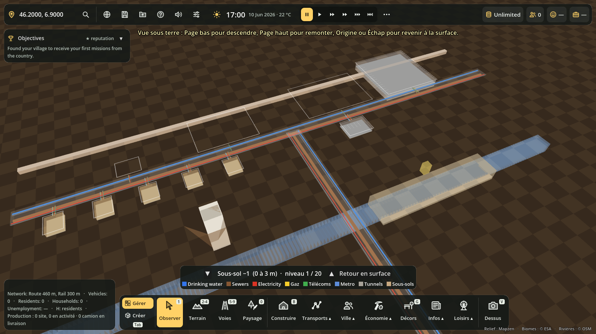

# Vue sous terre

Code : `scripts/souterrain/vue_souterraine.gd` (classe `VueSouterraine`).
Test : `tests/souterrain_test.gd` (avec captures : `-- --dossier /chemin`).

## Ouvrir la vue

- **Page bas** sous le rez-de-chaussée (ou tout de suite s'il n'y a pas de
  bâtiment à étages en murs fins autour de la caméra) : c'est la suite de la
  vue par étage (`VueEtages`).
- Ou le menu **Infos → Vue sous terre**.
- **Page haut** remonte d'un niveau, **Origine** ou **Échap** revient à la surface.
- Niveaux : Sous-sol −1 à −20, 3 m chacun (comme un étage de l'Atelier), donc
  jusqu'à 60 m de fond.

## Ce qu'on voit

La caméra ne montre plus que la couche `VueSouterraine.COUCHE` (couche 19) :
la surface s'efface, sauf les contours des routes et des bâtiments, et une
grille de terre (damier de 10 m) marque le fond du niveau affiché. Comme pour
les étages, un niveau montre ce qui le touche et tout ce qui est plus profond.

| Quoi | Profondeur | Couleur |
|---|---|---|
| Télécoms (cuivre) sous la rue | 0,6 m | vert |
| Basse tension sous la rue | 0,8 m | rouge |
| Gaz sous la rue | 1,0 m | jaune |
| Eau potable sous la rue | 1,2 m | bleu |
| Égout de rue | 2,6 m | marron |
| Conduite d'eau / de gaz posée au panneau O | 1,6 m / 1,3 m | bleu / jaune |
| Collecteur d'égout | 4 m (1,8 m de section) | marron |
| Fibre et cuivre posés au panneau Télécom | 0,8 m | vert |
| Métro | 14 m (voies) | bleu translucide |
| Tunnels de route et de rail | selon le tracé | gris translucide |

Les couleurs sont celles du grillage avertisseur utilisé en France. Un réseau de
rue est **gris** quand le morceau de réseau auquel il appartient n'est alimenté
par aucune source (pas de centrale, de forage, de station…), plus pâle s'il est
rationné. Un tronçon en panne est **rouge vif**, un tronçon en chantier pâle.

- **Branchements** : chaque bâtiment qui consomme un réseau a son petit tuyau
  jusqu'à la rue (l'égout descend en pente). Gris : bâtiment pas raccordé.
- **Stations de métro** : la salle des quais, les deux quais et l'accès vers la
  bouche de métro.
- **Sous-sols du catalogue** (`sous_sols_de`) : une cave sous les maisons et les
  petits commerces, un niveau de parking sous les immeubles, deux sous les tours
  et les grandes surfaces, rien sous les usines, fermes et bâtiments des réseaux.
  Une donnée `"sous_sols"` sur un bâtiment remplace cette règle.
- **Sous-sols de l'Atelier** : les vrais niveaux négatifs des bâtiments en murs
  fins (leurs nœuds passent sur la couche de la vue). L'Atelier descend
  maintenant à **−20** (`PlanEditor.MIN_LEVEL`) : bunkers, parkings profonds.

## Comment les réseaux se raccordent

Les routes portent la desserte locale (voir `docs/reseaux.md`) : un bâtiment à
moins de 30 m d'une route est raccordé aux réseaux de cette route. Le joueur
pose seulement les gros tronçons (panneau O) entre les centrales, usines d'eau,
stations d'épuration et le réseau des rues. La vue sous terre montre ce
principe : les tuyaux suivent les rues, chaque bâtiment s'y branche.

## Limites et suites possibles

- C'est une vue : poser une conduite ou creuser un niveau directement sous terre
  viendra ensuite (les fantômes des outils ne sont pas sur la couche de la vue).
- Les caves du catalogue ne se visitent pas (dessinées en volumes).
- Rayon montré : 450 m autour du point visé (`RAYON`), refait quand la caméra
  s'éloigne de plus d'un quart du rayon ou que les voies, bâtiments ou réseaux
  changent.
