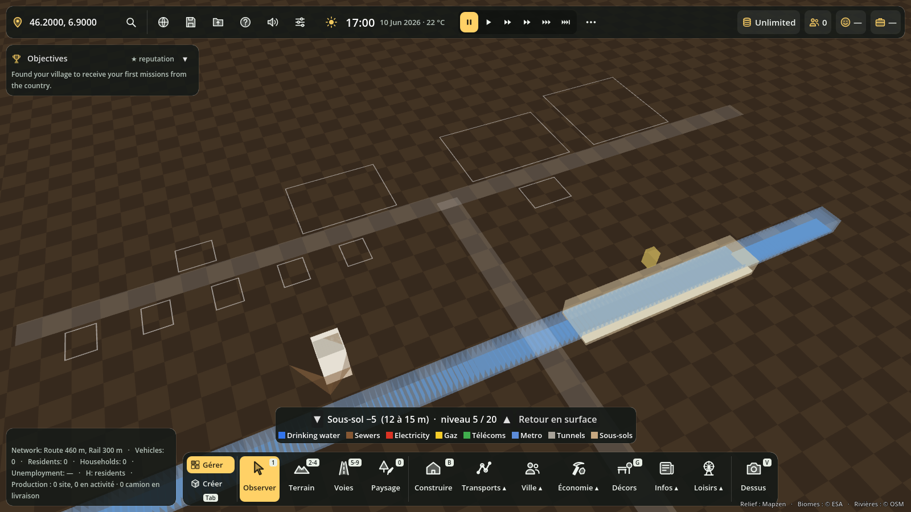
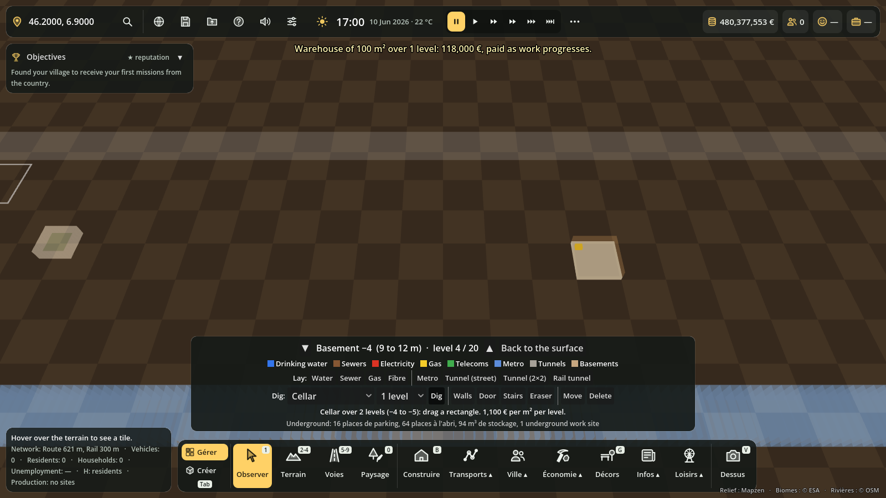

# Vue sous terre

Code : `scripts/souterrain/vue_souterraine.gd` (classe `VueSouterraine`).
Test : `tests/souterrain_test.gd` (avec captures : `-- --dossier /chemin`).

## Ouvrir la vue

- **Page bas** sous le rez-de-chaussée (ou tout de suite s'il n'y a pas de
  bâtiment à étages en murs fins autour de la caméra) : c'est la suite de la
  vue par étage (`VueEtages`).
- Ou le bouton **Sous terre** de la barre du bas (à gauche de « Dessus »),
  allumé tant que la vue est ouverte ; un second clic revient en surface.
- Ou **Construire (B) → Sous terre** : conduites, câbles, tunnels, métro, caves,
  parkings, entrepôts, locaux techniques, bunkers, en images.
- Et **toute seule** dès qu'on prend un outil qui construit sous le sol, d'où
  qu'il vienne (`scripts/souterrain/sous_terre_auto.gd`, classe `SousTerreAuto`,
  test `tests/sous_terre_auto_test.gd`) :

  | Outil pris | Où | Niveau |
  |---|---|---|
  | Conduite d'eau, collecteur, gaz, câble électrique souterrain, aqueduc, séparatif, chaleur, hydrogène | Réseaux (O) | −1 |
  | Fibre sous la rue, ligne téléphonique enterrée, coaxial | Télécoms (Maj+O) | −1 |
  | Métro | Voies → Rail → Métro | −3 |
  | Conduites, tunnels, pièces | Construire → Sous terre | −1 (tunnels : −3) |

  Si la vue est déjà ouverte, l'outil se pose au niveau affiché. Les lignes sur
  poteaux ou pylônes et la fibre aérienne restent en surface. Quand on range
  l'outil (Échap, clic droit, autre outil), la vue revient en surface si c'est
  l'outil qui l'avait ouverte. **Retour en surface** avec une conduite ou le
  métro en main le garde en main, en surface (métro aérien, conduite posée à
  l'ancienne) : il n'est plus repris tant qu'on le garde. En vue au sol (V),
  rien ne bascule.
- **Page haut** remonte d'un niveau, **Origine** ou **Échap** revient à la surface.
- Niveaux : Sous-sol −1 à −20, 3 m chacun (comme un étage de l'Atelier), donc
  jusqu'à 60 m de fond.

## Ce qu'on voit

La caméra ne montre plus que la couche `VueSouterraine.COUCHE` (couche 19) :
la surface s'efface, sauf les contours des routes et des bâtiments, et une
grille de terre (damier de 10 m) marque le fond du niveau affiché. Comme pour
les étages, un niveau montre ce qui le touche et tout ce qui est plus profond.

| Quoi | Profondeur | Couleur |
|---|---|---|
| Télécoms (cuivre) sous la rue | 0,6 m | vert |
| Basse tension sous la rue | 0,8 m | rouge |
| Gaz sous la rue | 1,0 m | jaune |
| Eau potable sous la rue | 1,2 m | bleu |
| Égout de rue | 2,6 m | marron |
| Conduite d'eau / de gaz posée au panneau O | 1,6 m / 1,3 m | bleu / jaune |
| Collecteur d'égout | 4 m (1,8 m de section) | marron |
| Fibre et cuivre posés au panneau Télécom | 0,8 m | vert |
| Métro | 14 m (voies) | bleu translucide |
| Tunnels de route et de rail | selon le tracé | gris translucide |

Les couleurs sont celles du grillage avertisseur utilisé en France. Un réseau de
rue est **gris** quand le morceau de réseau auquel il appartient n'est alimenté
par aucune source (pas de centrale, de forage, de station…), plus pâle s'il est
rationné. Un tronçon en panne est **rouge vif**, un tronçon en chantier pâle.

- **Branchements** : chaque bâtiment qui consomme un réseau a son petit tuyau
  jusqu'à la rue (l'égout descend en pente). Gris : bâtiment pas raccordé.
- **Stations de métro** : la salle des quais, les deux quais et l'accès vers la
  bouche de métro.
- **Sous-sols du catalogue** (`sous_sols_de`) : une cave sous les maisons et les
  petits commerces, un niveau de parking sous les immeubles, deux sous les tours
  et les grandes surfaces, rien sous les usines, fermes et bâtiments des réseaux.
  Une donnée `"sous_sols"` sur un bâtiment remplace cette règle.
- **Sous-sols de l'Atelier** : les vrais niveaux négatifs des bâtiments en murs
  fins (leurs nœuds passent sur la couche de la vue). L'Atelier descend
  maintenant à **−20** (`PlanEditor.MIN_LEVEL`) : bunkers, parkings profonds.

## Comment les réseaux se raccordent

Les routes portent la desserte locale (voir `docs/reseaux.md`) : un bâtiment à
moins de 30 m d'une route est raccordé aux réseaux de cette route. Le joueur
pose seulement les gros tronçons (panneau O) entre les centrales, usines d'eau,
stations d'épuration et le réseau des rues. La vue sous terre montre ce
principe : les tuyaux suivent les rues, chaque bâtiment s'y branche.

## Construire sous terre

Code : `scripts/souterrain/construction_souterraine.gd` (classe
`ConstructionSouterraine`), branché par `terre_main._setup_souterrain()`.
Test : `tests/construction_souterraine_test.gd` (captures : `-- --dossier /chemin`).

La barre sous la légende construit **au niveau affiché** (Page bas / Page haut :
l'outil en main suit le niveau).

### Poser (conduites et tunnels)

Tous les outils sont des vignettes : coupe du sous-sol pour les conduites, les
tunnels et les pièces, icônes pour Murs, Porte, Escalier, Gomme, Déplacer,
Supprimer.

- **Eau, Égout, Gaz, Électricité, Fibre** : le traceur du panneau O (ou du Télécom), mais à la
  profondeur du niveau. Au −1, la conduite garde sa profondeur habituelle ; plus
  bas, elle passe au milieu du niveau (10,5 m au −4). Prix et durée selon la
  profondeur (`facteur_profondeur`) :

  | Profondeur | Méthode | Prix |
  |---|---|---|
  | jusqu'à 2 m | tranchée | × 1 |
  | 2 à 6 m | tranchée blindée | × 1 à × 2 |
  | plus de 6 m | microtunnelier (fonçage) | × 2,5 puis + 8 % par mètre |

  **Électricité** = câble électrique souterrain du panneau O (1 100 €/m, ni
  poteaux ni pannes de tempête) ; comme les conduites, il descend avec le niveau.

- **Métro, Rue, 2 × 2 voies, Train** (tunnels) : l'outil des voies,
  avec les voies à `niveau × 3 − 1` m (14 m au −5). Pas au-dessus du −3. Partant
  d'une voie de surface, le tracé descend en rampe (pente maxi du type). Prix
  du tunnel au mètre, payé au fil des travaux (étapes : sondages, tunnelier,
  radier, équipements, essais) ; les rampes et parties au sol restent gratuites
  comme en surface :

  | Voie | Prix au mètre de tunnel |
  |---|---|
  | Métro double voie | 60 000 € |
  | Tunnel routier urbain | 45 000 € |
  | Tunnel 2 × 2 voies (deux tubes) | 110 000 € |
  | Tunnel ferroviaire | 70 000 € |

  À moins de 10 m (tranchée couverte) : − 40 % ; à plus de 20 m : + 1 % par mètre.
  Repères réels : métro au tunnelier 50 à 80 k€/m hors stations.

### Creuser (pièces)

Cliquer la vignette de l'usage (Cave, Parking, Entrepôt, Local technique,
Bunker), choisir la hauteur (1 à 3 niveaux), puis glisser un rectangle. Le chantier creuse, soutient, coule les dalles et les voiles (on le
voit avancer dans la vue), payé au fil des travaux. À la fin, la pièce devient un
**sous-sol de l'Atelier** (plan « st ») en béton brut : les outils **Murs, Porte,
Escalier, Gomme** de la barre (ceux de l'Atelier, au niveau affiché) l'aménagent.
Une pièce collée à une autre rejoint le même sous-sol.

| Usage | Prix au m² et par niveau | Durée | Capacité |
|---|---|---|---|
| Cave | 1 100 € | 1,2 h/m² | stockage (m³) |
| Parking | 1 300 € | 1 h/m² | 1 place / 25 m² |
| Entrepôt | 1 000 € | 1 h/m² | stockage (m³) |
| Local technique | 1 500 € | 1,4 h/m² | — |
| Bunker (abri) | 2 800 € | 2,5 h/m² | 1 place / m² |

+ 6 % par niveau de profondeur, + 50 % sous un bâtiment (reprise en sous-œuvre).
On ne creuse pas au −1 sous une voie (réseaux de la rue), dans la cave d'un
bâtiment du catalogue, dans un tunnel, ni à travers une conduite (la déplacer
d'abord). Le bilan (places de parking, places à l'abri, stockage) s'affiche
sous la barre.

Les plans souterrains ne creusent pas le relief et ne bloquent rien en surface
(`PlanEditor.cells_st` au lieu de `cells`) : on construit librement au-dessus.

### Déplacer, supprimer

- **Déplacer** : clic sur une conduite enterrée, puis clic à la nouvelle place ;
  elle est reposée au niveau affiché. C'est un dévoiement : la nouvelle est
  construite (et payée) pendant que l'ancienne reste en service, puis
  l'ancienne est retirée à la fin des travaux.
- **Supprimer** : une pièce (comblée, sans remboursement), une conduite (30 %
  rendus, comme au panneau O) ou un tunnel du niveau affiché.

## Limites et suites possibles

- En ligne (carte entre amis), les tunnels ne se creusent pas encore depuis la
  vue sous terre ; les pièces et conduites ne sont pas encore synchronisées.
- Les places à l'abri et les parkings souterrains sont comptés (bilan) mais ne
  servent pas encore aux catastrophes ni au stationnement.
- Les lignes électriques (aériennes) ne se posent pas depuis la vue.
- Les caves du catalogue ne se visitent pas (dessinées en volumes).
- Rayon montré : 450 m autour du point visé (`RAYON`), refait quand la caméra
  s'éloigne de plus d'un quart du rayon ou que les voies, bâtiments ou réseaux
  changent.
