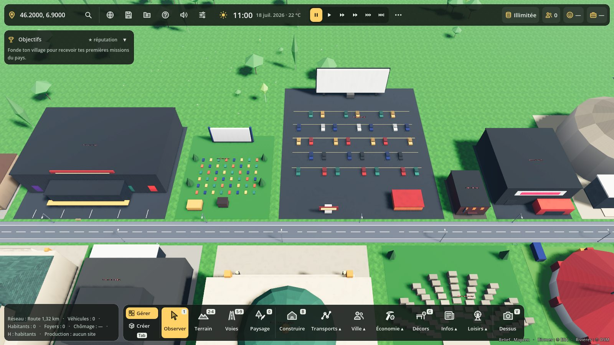
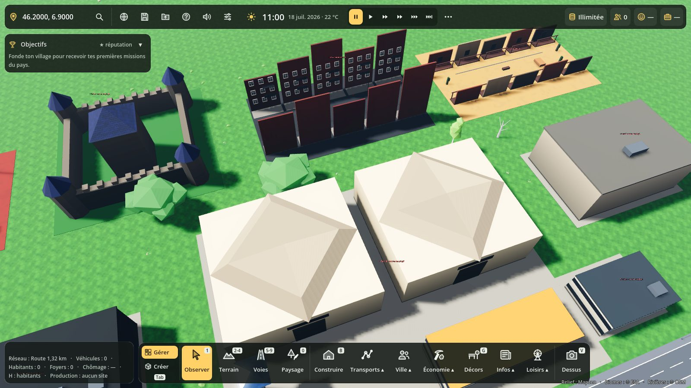

# Spectacles : cinémas, concerts, théâtres et studios de cinéma

Le menu **Spectacles** (barre du bas, menu **Loisirs**, touche **Maj+X**) réunit les salles où l'on vient voir un film, un concert ou une pièce, et les studios où l'on tourne ses propres films. Les bâtiments sont dans **Construire → Spectacles**.

## Le menu, onglet par onglet

| Onglet | Ce qu'on y fait |
|---|---|
| **Mes salles** | Note en étoiles, places, confort et acoustique, public et recettes d'hier, prix du billet, programmation automatique, nom, « Aller voir », prochaines dates (avec annulation), dernières représentations, films à l'affiche d'un cinéma, conseils |
| **Programmer** | Les spectacles en tournée qui peuvent venir dans la salle choisie, avec le public et le bénéfice attendus pour la prochaine date libre ; réserver 1, 3 ou 6 dates. Pour un cinéma : épingler un film |
| **Studios** | Réputation, plateaux libres, décors et annexes ; produire un film ; films en cours (préparation, tournage, montage, en salle) ; filmographie et prix |
| **Bâtir** | Les 25 bâtiments, par famille |
| **À l'affiche** | L'agenda de la ville sur 7 jours et les films du moment |
| **Public** | Ce que disent les spectateurs, depuis l'ouverture |

## Les bâtiments (25)

- **Cinémas** : cinéma d'art et d'essai (2 écrans, 320 places), multiplexe (12 écrans, 2 600 places, attire les villes voisines), cinéma en plein air (500 places, juin–septembre), drive-in (160 voitures, même sous la pluie). Le cinéma du catalogue (B → Loisirs) compte aussi.
- **Studios de cinéma** : les studios (bureaux de production et deux plateaux). Leurs **annexes**, à moins de 300 m : plateau de tournage insonorisé (un film de plus à la fois), décors de western, de rue de grande ville, de château fort, de base spatiale, bassin de tournage, studio d'effets spéciaux (fond vert), post-production, atelier de décors et costumes (films 12 % moins chers).
- **Salles de concert** : club de jazz (150), salle de musiques actuelles (1 100 debout), auditorium philharmonique (2 400), aréna (9 000), scène de festival en plein air (25 000, vendredis et samedis de mai à septembre). Le kiosque à musique (Espaces publics) accueille la fanfare le dimanche, gratuitement.
- **Théâtres** : café-théâtre (90), théâtre à l'italienne (750), scène contemporaine (900), grand opéra à coupole (1 900), théâtre de verdure (700, l'été), chapiteau de cirque (1 400). Les théâtres des styles du monde (opéra haussmannien, cinéma Art déco, amphithéâtre, maison de la culture…) et ceux de la bible Blender (opéra, théâtre municipal, salle de concert, cinéma multiplexe, amphithéâtre romain) sont reconnus.
- Un **modèle de l'Atelier** qui prend une de ces fonctions devient une salle ou un studio (ses places suivent sa surface).

## Programmer une salle

- **60 spectacles en tournée** : orchestres, quatuor, récital, jazz, rock, métal, pop, rap, électro, chanson, musiques du monde, fanfares ; Molière, Corneille, Rostand, Shakespeare ; comédies, boulevard, théâtre contemporain ; comédies musicales ; Carmen, la Flûte enchantée, la Traviata ; le Lac des cygnes, Casse-Noisette, le Boléro ; humour, improvisation, cirque, marionnettes. Les artistes sont inventés, les œuvres du domaine public gardent leur vrai titre.
- Chaque salle accueille certains genres (pas de rap à l'opéra) et une star ne joue pas dans une salle trop petite.
- Jours : concerts du mercredi au samedi à 20 h 30 ; théâtre du mardi au samedi à 20 h 30 et matinée le dimanche à 16 h, relâche le lundi ; cirque et jeune public le mercredi et le week-end à 15 h (cirque aussi à 20 h le vendredi et le samedi).
- **Programmation automatique** (par défaut) : le directeur de la salle réserve, dix jours à l'avance, ce qui rapporte le plus en variant les plaisirs. Les pièces se jouent trois soirs de suite. Il accepte une petite perte plutôt qu'une salle vide.
- Annuler une date moins de 7 jours avant coûte la moitié du cachet.

## Le public

- **Habitants** : selon la notoriété de l'artiste et le goût de la ville pour le genre. Le goût dépend de l'âge des habitants : les enfants aiment le cirque et l'animation, les jeunes le rap et l'électro, les seniors le classique, l'opéra et le boulevard.
- **Région** : les grands noms font venir du monde de loin (beaucoup plus pour une aréna, un multiplexe ou un festival).
- Plus de monde le vendredi et le samedi, moins l'été dans les salles fermées, plus l'été en plein air ; Casse-Noisette remplit la salle en décembre.
- Le **prix du billet** compte : au-delà du prix habituel de l'artiste, le public hésite.
- La **note de la salle** (confort, acoustique, réputation) attire aussi. La réputation suit ce que le public a pensé des dernières soirées.
- Ceux qui ont déjà vu un spectacle ne reviennent pas : une longue série finit par s'essouffler.
- Deux salles qui jouent le même soir se partagent le public.
- En plein air : fermé l'hiver, annulé sous la pluie (la moitié du cachet reste due).
- Le public attend devant la porte avant le spectacle et repart après (petits personnages).

## L'argent

- Recettes : billets, bar (et marchandise des concerts), confiserie au cinéma.
- Charges : cachet de l'artiste, technique, droits d'auteur (9 % des billets), salaires chaque jour.
- **Cinéma** : la moitié du prix du billet va au distributeur… ou à tes studios si c'est ton film.
- Tout passe par la caisse de la ville où se trouve le bâtiment (postes « Spectacles » du budget).

## Produire un film

1. Pose des **studios** au bord d'une route, puis leurs annexes autour.
2. Onglet **Studios** → Produire un film : genre (12), budget (court métrage 80 k€, petit 1,2 M€, moyen 6 M€, gros 25 M€, superproduction 90 M€), réalisateur (8, du débutant à la grande cinéaste), tête d'affiche (7, de « des inconnus » à la star), titre (ou au hasard).
3. Cachets et préparation sont payés tout de suite, le reste pendant le tournage et le montage.
4. **Préparation** (3 jours), **tournage** (de 5 à 45 jours, un plateau par film), **montage et mixage**, puis **8 semaines en salle** dans tout le pays, et enfin les **droits télé et plateformes**.
5. La **qualité** dépend du talent du réalisateur, de la star, du budget, du genre préféré de chacun, du bon décor (sinon on tourne en extérieur : plus cher et moins bien), des effets spéciaux (indispensables pour la science-fiction et l'animation), de la post-production, de la réputation des studios et d'un peu de chance. La presse et le public donnent leurs étoiles.
6. Les entrées suivent le budget, l'avis du public et la star. Ton film passe aussi dans les cinémas de la ville (les habitants reconnaissent la boulangerie).
7. **Festival de la Bobine d'or**, chaque 20 mai : le film de l'année le mieux reçu par la presse peut gagner (prix, réputation, entrées en plus).

## Avis des habitants

Une soirée au spectacle dans le mois rend heureux ; de belles salles en ville aussi, et un film tourné chez nous à l'affiche encore plus. Les salles de concert font du bruit le soir (carte des nuisances).

## Fichiers

| Fichier | Rôle |
|---|---|
| `scripts/spectacles/spectacles_types.gd` | Les 25 bâtiments et leurs modèles 3D, bâtiments d'autres catalogues reconnus |
| `scripts/spectacles/spectacles_programmes.gd` | Genres et goûts par âge, 60 tournées, budgets, réalisateurs, têtes d'affiche, titres de films |
| `scripts/spectacles/spectacles.gd` | Salles, programmation, public, argent, cinémas et films, studios, festival, avis, sauvegarde (section `spectacles`) |
| `scripts/spectacles/spectacles_visuels.gd` | Public devant les salles, équipe de tournage |
| `scripts/spectacles/spectacles_panel.gd` | Le menu Spectacles (Maj+X) |
| `tests/spectacles_test.gd` | Test automatique |
| `tests/spectacles_vitrine.gd` | Captures (`--vue salles|scenes|studios|soiree|panneau|programmer`) |
