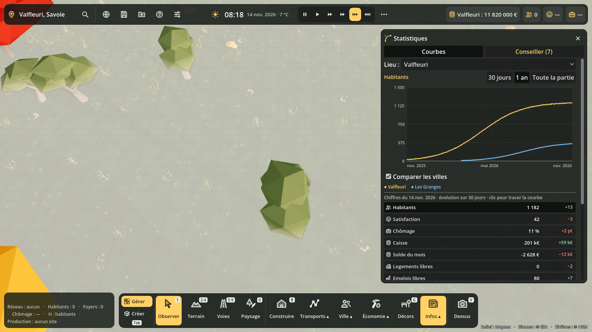

# Statistiques et conseiller

Panneau **Statistiques** : touche **Maj+I**, ou menu **Infos** de la barre du bas. Il a quatre
onglets en images : **Tableau de bord**, **Courbes**, **Âges** et **Conseiller**. En haut, la liste **Lieu** choisit une ville ou tout le
pays. À l'ouverture, c'est la ville que l'on gère (celle de la caisse affichée en haut).



## Tableau de bord

Une vignette par chiffre : son icône, la valeur du jour, l'évolution sur 30 jours (vert si ça
s'améliore, rouge si ça se dégrade) et une mini-courbe des 90 derniers jours. Les chiffres de la
ville d'abord, puis « Pour tout le pays » (réseaux, santé, secours, circulation, climat). Un clic sur
une vignette ouvre sa courbe. Un chiffre jamais relevé (système absent de la partie) n'a pas de vignette.

## Âges

Pyramide des âges du lieu choisi (hommes à gauche, femmes à droite, tranches de 10 ans, effectifs au
survol), avec la part des moins de 20 ans et des 70 ans et plus, l'âge moyen, et une lecture de la
forme (ville jeune, équilibrée ou vieillissante). Calculée à la demande (pas d'historique), avec le
même décompte que les habitants des villes.

## Courbes

- **Période** : 30 jours, 1 an ou toute la partie.
- **Tableau** sous la courbe : le chiffre du jour et son évolution sur 30 jours, en vert quand
  ça s'améliore et en rouge quand ça se dégrade. Un clic sur une ligne trace sa courbe.
- **Survol** de la courbe : la date et la valeur du jour le plus proche.
- **Comparer les villes** : une courbe par ville, une couleur chacune (s'il y a au moins deux villes).

| Chiffre | Par ville | Calcul |
|---|---|---|
| Habitants | oui | habitants logés (les fondateurs encore sous la tente ne comptent pas) |
| Satisfaction | oui | dernier sondage des habitants (Avis, Y), moyenne des logements de la ville |
| Chômage | oui | adultes sans emploi / adultes en âge de travailler (hors étudiants et retraités) |
| Caisse | oui | caisse de la ville, ou du pays |
| Solde du mois | oui | recettes − dépenses du bilan mensuel (budget M) |
| Logements libres | oui | logements − foyers |
| Emplois libres | oui | emplois − actifs |
| Enfants sans école | oui | élèves sans place à l'école |
| Pollution de l'air | oui | air au logement d'un échantillon de 300 habitants, sur 100 |
| Âge moyen, 65 ans et plus | oui | habitants logés |
| Loyer moyen, part du revenu pour le loyer, prix du m² | oui | Immobilier (F11), `Immobilier.bilan(vid)` |
| Adultes diplômés du supérieur | oui | Éducation (Maj+K) : bac+2 et au-delà / adultes |
| Habitants avec eau potable, raccordés aux égouts, malades, hospitalisés | pays | Santé publique (F7), `SantePublique.bilan()` |
| Appels d'urgence du jour, délai moyen des secours | pays | Urgences (U) : écart des cumuls d'un jour à l'autre (min) |
| Électricité, eau fournies | pays | demande servie / demande |
| Bâtiments coupés | pays | bâtiments à moins de 50 % de courant ou d'eau |
| Temps perdu dans les bouchons | pays | temps des trajets en voiture / temps à vide − 1 |
| Trajet moyen | pays | durée moyenne des trajets (min) |
| Poubelles qui débordent, recyclage | pays | bilan de la veille (X) |

## Relevés

Un relevé par **jour de jeu**, au changement de jour. Les 400 derniers jours sont gardés jour
par jour ; les plus vieux sont regroupés par 30 jours (leur moyenne), et au-delà de 600 points
regroupés, deux à deux. Une partie de 50 ans reste donc légère. Les relevés sont dans la
sauvegarde (section `statistiques`). Une ville qui disparaît (fusion) garde ses courbes, avec
« (disparue) » à côté de son nom.

## Conseiller

En tête, le **portrait** du conseiller : serein, soucieux ou alarmé selon l'avis le plus grave
(lunettes, nœud papillon, et une mèche qui se dresse quand ça va mal). Chaque carte porte l'icône
de son thème. Le conseiller relit les chiffres à chaque relevé. Il range ses avis en trois niveaux : **urgent**
(rouge), **à surveiller** (ambre) et **bonne nouvelle** (vert). Chaque avis dit ce qui se passe
(sérieusement, avec une pointe d'humour), quoi faire, et propose d'ouvrir le bon panneau.

| Avis | Quand |
|---|---|
| Caisse dans le rouge | caisse < 0 (urgent), avec les jours avant la tutelle |
| Plus que N mois de réserve | solde négatif et moins de 6 mois de réserve (urgent sous 2 mois) |
| Budget en déficit | solde négatif, de 6 à 24 mois de réserve |
| Chômage | à partir de 10 % (urgent à 20 %) ; s'il reste des emplois libres, il parle d'accès et de métiers |
| Plus un logement libre | 0 logement libre et au moins 10 emplois libres |
| Beaucoup de logements vides | plus de 30 % des habitants (et plus de 20) |
| Grogne / colère | satisfaction sous 50 / sous 35, avec le thème le plus mal noté et sa raison principale |
| Enfants sans école | dès 1 (urgent à 30) |
| Pollution de l'air | à partir de 35/100 (urgent à 60) |
| Électricité, eau | moins de 97 % des besoins couverts (urgent sous 85 %) |
| Bâtiments coupés | production suffisante mais bâtiments mal raccordés |
| Bouchons | à partir de +25 % de temps de trajet (urgent à +60 %) |
| Poubelles qui débordent | dès 1 (urgent à 10) |
| Élections | vote dans moins de 30 jours et satisfaction sous 55 |
| Population qui baisse / grimpe | −5 % ou +15 % en 30 jours |
| Satisfaction qui chute | −10 points en une semaine |
| Loyers qui étranglent | loyer ≥ 33 % du revenu (urgent à 45 %) → Immobilier (F11) |
| Population qui vieillit | 30 % de 65 ans et plus (dès 20 habitants) |
| Épidémie | dès 1 malade (urgent à 20) → Santé (F7) |
| Eau potable, égouts | moins de 60 % des habitants (urgent sous 30 % seulement s'il y a des malades) |
| Secours trop lents | délai moyen ≥ 12 min (urgent à 20) → Urgences (U) |

Quand rien ne va mal, il le dit aussi (et il trouve ça suspect). Un avis **urgent** qui apparaît
s'affiche une fois en haut de l'écran (« Conseiller : La caisse est dans le rouge (Maj+I) »).

## Pour les autres systèmes

```gdscript
var st := Statistiques.instance
st.dernier("pays", "chomage")          # dernière valeur (NAN si jamais relevée)
st.serie(str(vid), "habitants", depuis) # PackedVector2Array (jour, valeur)
st.evolution("pays", "caisse", 30)      # écart sur 30 jours
Conseiller.analyser(st, "pays")         # avis du moment
```

Pour suivre un nouveau chiffre : l'ajouter à `Statistiques.INDICATEURS` et le calculer dans
`_chiffres_ville()` / `_chiffres_pays()` (ou `_nationaux()` s'il ne se calcule que pour le pays).
Pour un nouveau conseil : une fonction dans `Conseiller` appelée par `analyser()`.

Code : `scripts/statistiques/` (`statistiques.gd`, `conseiller.gd`, `courbe.gd`, `mini_courbe.gd`,
`pyramide_ages.gd`, `portrait_conseiller.gd`, `stats_panel.gd`). `st.pyramide(lieu)` rend la pyramide.
Test : `godot --headless --path . --script res://tests/statistiques_test.gd`.
Vitrine (captures) : `godot --path . --rendering-driver opengl3 --script res://tests/statistiques_vitrine.gd -- --dossier /chemin`.
