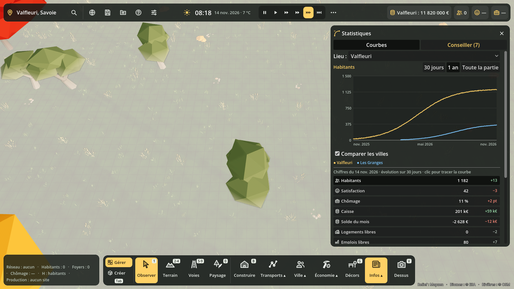

# Statistiques et conseiller

Panneau **Statistiques** : touche **Maj+I**, ou menu **Infos** de la barre du bas. Il a deux
onglets, **Courbes** et **Conseiller**. En haut, la liste **Lieu** choisit une ville ou tout le
pays. À l'ouverture, c'est la ville que l'on gère (celle de la caisse affichée en haut).



## Courbes

- **Période** : 30 jours, 1 an ou toute la partie.
- **Tableau** sous la courbe : le chiffre du jour et son évolution sur 30 jours, en vert quand
  ça s'améliore et en rouge quand ça se dégrade. Un clic sur une ligne trace sa courbe.
- **Survol** de la courbe : la date et la valeur du jour le plus proche.
- **Comparer les villes** : une courbe par ville, une couleur chacune (s'il y a au moins deux villes).

| Chiffre | Par ville | Calcul |
|---|---|---|
| Habitants | oui | habitants logés (les fondateurs encore sous la tente ne comptent pas) |
| Satisfaction | oui | dernier sondage des habitants (Avis, Y), moyenne des logements de la ville |
| Chômage | oui | adultes sans emploi / adultes en âge de travailler (hors étudiants et retraités) |
| Caisse | oui | caisse de la ville, ou du pays |
| Solde du mois | oui | recettes − dépenses du bilan mensuel (budget M) |
| Logements libres | oui | logements − foyers |
| Emplois libres | oui | emplois − actifs |
| Enfants sans école | oui | élèves sans place à l'école |
| Pollution de l'air | oui | air au logement d'un échantillon de 300 habitants, sur 100 |
| Électricité, eau fournies | pays | demande servie / demande |
| Bâtiments coupés | pays | bâtiments à moins de 50 % de courant ou d'eau |
| Temps perdu dans les bouchons | pays | temps des trajets en voiture / temps à vide − 1 |
| Trajet moyen | pays | durée moyenne des trajets (min) |
| Poubelles qui débordent, recyclage | pays | bilan de la veille (X) |

## Relevés

Un relevé par **jour de jeu**, au changement de jour. Les 400 derniers jours sont gardés jour
par jour ; les plus vieux sont regroupés par 30 jours (leur moyenne), et au-delà de 600 points
regroupés, deux à deux. Une partie de 50 ans reste donc légère. Les relevés sont dans la
sauvegarde (section `statistiques`). Une ville qui disparaît (fusion) garde ses courbes, avec
« (disparue) » à côté de son nom.

## Conseiller

Le conseiller relit les chiffres à chaque relevé. Il range ses avis en trois niveaux : **urgent**
(rouge), **à surveiller** (ambre) et **bonne nouvelle** (vert). Chaque avis dit ce qui se passe
(sérieusement, avec une pointe d'humour), quoi faire, et propose d'ouvrir le bon panneau.

| Avis | Quand |
|---|---|
| Caisse dans le rouge | caisse < 0 (urgent), avec les jours avant la tutelle |
| Plus que N mois de réserve | solde négatif et moins de 6 mois de réserve (urgent sous 2 mois) |
| Budget en déficit | solde négatif, de 6 à 24 mois de réserve |
| Chômage | à partir de 10 % (urgent à 20 %) ; s'il reste des emplois libres, il parle d'accès et de métiers |
| Plus un logement libre | 0 logement libre et au moins 10 emplois libres |
| Beaucoup de logements vides | plus de 30 % des habitants (et plus de 20) |
| Grogne / colère | satisfaction sous 50 / sous 35, avec le thème le plus mal noté et sa raison principale |
| Enfants sans école | dès 1 (urgent à 30) |
| Pollution de l'air | à partir de 35/100 (urgent à 60) |
| Électricité, eau | moins de 97 % des besoins couverts (urgent sous 85 %) |
| Bâtiments coupés | production suffisante mais bâtiments mal raccordés |
| Bouchons | à partir de +25 % de temps de trajet (urgent à +60 %) |
| Poubelles qui débordent | dès 1 (urgent à 10) |
| Élections | vote dans moins de 30 jours et satisfaction sous 55 |
| Population qui baisse / grimpe | −5 % ou +15 % en 30 jours |
| Satisfaction qui chute | −10 points en une semaine |

Quand rien ne va mal, il le dit aussi (et il trouve ça suspect). Un avis **urgent** qui apparaît
s'affiche une fois en haut de l'écran (« Conseiller : La caisse est dans le rouge (Maj+I) »).

## Pour les autres systèmes

```gdscript
var st := Statistiques.instance
st.dernier("pays", "chomage")          # dernière valeur (NAN si jamais relevée)
st.serie(str(vid), "habitants", depuis) # PackedVector2Array (jour, valeur)
st.evolution("pays", "caisse", 30)      # écart sur 30 jours
Conseiller.analyser(st, "pays")         # avis du moment
```

Pour suivre un nouveau chiffre : l'ajouter à `Statistiques.INDICATEURS` et le calculer dans
`_chiffres_ville()` / `_chiffres_pays()` (ou `_nationaux()` s'il ne se calcule que pour le pays).
Pour un nouveau conseil : une fonction dans `Conseiller` appelée par `analyser()`.

Code : `scripts/statistiques/` (`statistiques.gd`, `conseiller.gd`, `courbe.gd`, `stats_panel.gd`).
Test : `godot --headless --path . --script res://tests/statistiques_test.gd`.
Vitrine (captures) : `godot --path . --rendering-driver opengl3 --script res://tests/statistiques_vitrine.gd -- --dossier /chemin`.
