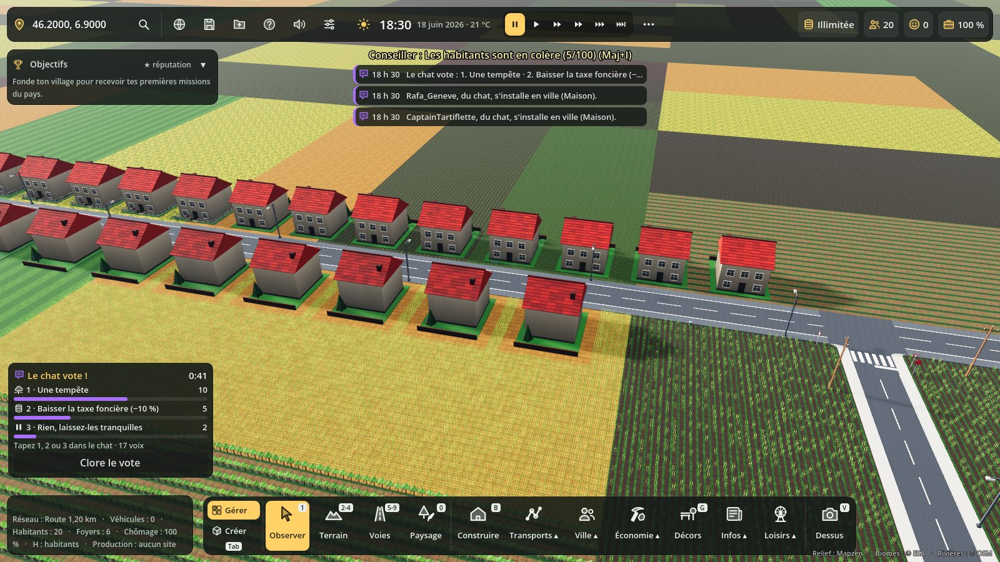

# Mode streamer : le chat Twitch influence la ville

Pendant un live Twitch, les spectateurs votent dans le chat pour ce qui arrive à la
ville (une tempête ? une baisse d'impôts ? de la neige ?) et peuvent devenir
habitants. **Désactivé par défaut.**

## Ouvrir

- **F7**, ou menu **Infos → Mode streamer**.
- Coche **Activer le mode streamer**, tape le nom de ta chaîne (ou colle le lien
  `twitch.tv/…`), puis **Se connecter**. L'état passe à « Connecté ».

Aucun compte, aucune clé, rien à payer : le jeu se connecte au chat comme un
visiteur anonyme (`justinfan…`) en **lecture seule**. Il ne peut rien écrire dans
le chat. Les réglages sont gardés dans ton profil (`user://streamer.cfg`), pas
dans la partie : ils te suivent d'une partie à l'autre.

## Les votes

Toutes les *n* minutes (2, 3, 5, 10 ou 15 ; ou « À la main »), un encart s'affiche
en bas à gauche de l'écran avec **trois propositions**, chacune d'une catégorie
différente ; la troisième est toujours « Rien, laissez-les tranquilles ».
Les spectateurs tapent **1**, **2** ou **3** (ou `!2`, `!vote 2`) dans le chat :

- une voix par spectateur, la dernière compte (on peut changer d'avis) ;
- les robots du chat (Nightbot, StreamElements…) sont ignorés ;
- égalité : tirage au sort entre les ex æquo ; personne n'a voté : rien ne se passe ;
- jamais deux fois de suite la même proposition.

À la fin du vote (30 s à 2 min), le résultat s'affiche avec un **délai de veto**
(0, 5, 10 ou 20 s) : le streamer peut cliquer **Veto** (rien ne se passe, c'est
annoncé au fil d'actualité) ou **Appliquer** tout de suite. **Clore le vote**
termine un vote en avance.

Le streamer et ses modérateurs peuvent lancer un vote en tapant **`!vote`** dans
le chat (désactivable). Bouton **Lancer un vote maintenant** dans le panneau.

| Catégorie | Propositions |
|---|---|
| Catastrophes | un incendie, une tempête, une épidémie, une crue |
| Décisions du maire | taxe foncière +10 % / −10 %, entretien des routes +25 % |
| Météo | grand soleil, pluie, gros orage, neige, brouillard (6 h de jeu, puis météo normale) |
| Fêtes et marchés | une fête de quartier, un marché, là où regarde la caméra (payés par la ville) |

Chaque catégorie se décoche dans le panneau. Les décisions du maire ne sont pas
proposées si le joueur a perdu la mairie. Tout passe par les systèmes du jeu
(`Evenements`, `Saisons`, `BudgetCommunal`, `Meteo`) : les secours, les avis des
habitants et la gazette réagissent comme d'habitude.

Les votes sont réservés aux **parties en solo** : sur une carte entre amis, les
autres joueurs n'ont pas à subir le chat d'un seul streamer.

## Habitants du chat

Un spectateur tape **`!habitant`** : son pseudo entre dans une file d'attente et
devient le prénom du prochain habitant qui naît ou s'installe en ville (« Zoé_Builds
Martin »). Le fil d'actualité l'annonce ; le panneau liste les habitants du chat
(âge, logement, bouton pour aller voir leur maison). Un spectateur n'a qu'un
habitant. La file et les habitants du chat sont dans la sauvegarde.

## Essayer sans Twitch

Bouton **Simuler le chat** : des spectateurs imaginaires votent et demandent à
habiter la ville. Pratique pour régler le rythme avant un live.

## Tester avec une vraie chaîne

1. Lance le jeu (Godot 4.3+ : ouvrir `project.godot`, F5), démarre une partie.
2. F7 → coche **Activer**, tape le nom d'une chaîne Twitch **en direct** avec du
   chat (la tienne, ou n'importe quelle chaîne publique), **Se connecter**.
3. Depuis ton compte Twitch, écris `!habitant`, puis `1` / `2` / `3` pendant un vote
   (sur ta propre chaîne, `!vote` lance un vote tout de suite).

## Code

- `scripts/streamer/twitch_chat.gd` (**TwitchChat**) : WebSocket
  `wss://irc-ws.chat.twitch.tv:443`, `CAP REQ twitch.tv/tags`, `PASS SCHMOOPIIE`,
  `NICK justinfanNNNNN`, `JOIN #chaine` ; PING → PONG ; RECONNECT ; reconnexion
  2 s → 60 s. `TwitchChat.analyser(ligne)` découpe une ligne IRC (étiquettes,
  pseudo, commande, texte). Signal `message_recu(pseudo, nom_affiche, texte, tags)`.
- `scripts/streamer/mode_streamer.gd` (**ModeStreamer**, `ModeStreamer.instance`) :
  réglages, votes (`lancer_vote`, `recevoir`, `decompte`, `clore_maintenant`,
  `annuler`, `appliquer_resultat`, `appliquer(id)`), file des pseudos branchée
  sur `Population.prenom_impose`, chat simulé. Section de sauvegarde `streamer`.
- `scripts/streamer/streamer_panel.gd` (**StreamerPanel**) : panneau F7 et encart du vote.
- Genre d'actualité `streamer` (« Chat Twitch », icône `direct`).
- Test : `tests/streamer_test.gd` (avec un faux serveur Twitch local en WebSocket) ;
  vitrine : `tests/streamer_vitrine.gd`.

## Pistes

- Plus de décisions (nommer une rue, choisir le prochain bâtiment public, le nom
  d'un club).
- Points de chaîne Twitch (EventSub, demande une connexion du streamer).
- Votes sur une carte entre amis, avec l'accord de tous les joueurs.
