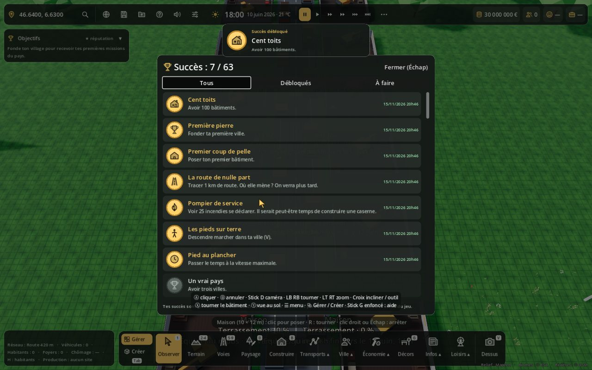
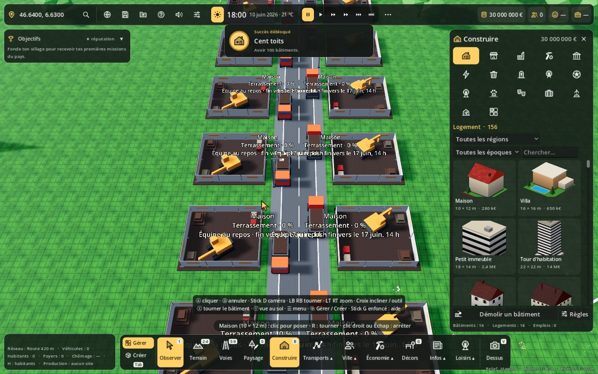
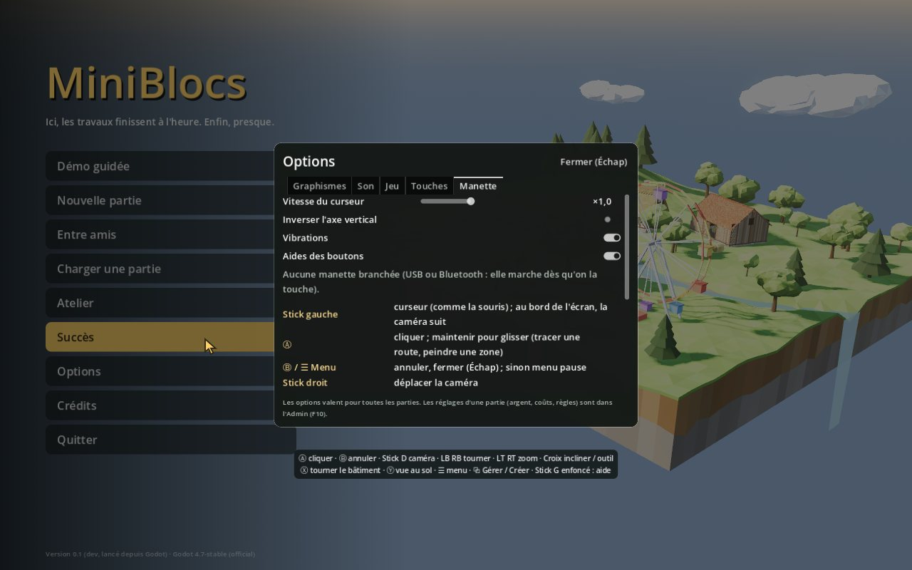

# Succès, manette et Steam Deck

## Succès

**62 succès** (les 21 des Objectifs, plus 41 nouveaux, avec une touche d'humour) valent pour
**toutes les parties**, comme sur Steam. Ils sont gardés dans `user://succes.cfg` avec les
compteurs qui servent à les débloquer (km de routes, incendies vus, bâtiments démolis,
minutes à la manette…).

- **Où les voir** : menu principal → **Succès**, ou en partie **F6** (aussi menu **Infos ▴ → Succès**).
  Les derniers débloqués en premier, une barre d'avancement pour les succès à compteur
  (« 62 / 100 bâtiments »), les succès secrets restent cachés tant qu'on ne les a pas.
- **Quand on en gagne un** : une carte « Succès débloqué » en haut de l'écran, un petit son,
  et une vibration de la manette.
- Les succès des **Objectifs** (Maj+J, par partie) gardent leur nom ; gagnés dans une partie,
  ils passent aussi dans le profil.
- **Argent illimité** (Admin, F10) : aucun succès dans cette partie, et les compteurs n'avancent pas (les succès des Objectifs non plus). La fenêtre des succès le rappelle.
- Pas de succès dans l'Atelier ni sur le serveur d'une carte entre amis (personne ne joue devant).

Quelques-uns : *La route de nulle part* (1 km de route), *Le préfet s'invite* (mise sous
tutelle, secret), *Pause café* (10 minutes de pause, secret), *Maire insomniaque* (jouer
entre 3 h et 5 h du matin pour de vrai, secret), *Le peuple a parlé* (perdre une élection),
*Démolition Express*, *Tour du monde* (villes sur 3 continents), *Pouces verts* (30 minutes
à la manette).

### Steam

`scripts/succes/steam_pont.gd` (`SteamPont`) est prêt pour **GodotSteam** (extension
GDExtension gratuite). Sans elle (aujourd'hui), tout marche en local et rien ne casse.
Le jour de la sortie :

1. Installer GodotSteam (AssetLib « GodotSteam GDExtension ») dans `addons/`.
2. Créer les succès sur Steamworks avec **`docs/steam/succes-steam.csv`** : nom de l'API
   (`MB_…`), noms et descriptions FR / EN, caché ou non, et les icônes 256 × 256
   (couleur et grisée) de `docs/steam/succes-icones/`. Pour les refaire après un changement :
   `godot --headless --path . --script res://tools/steam/exporter_succes.gd`.
3. `steam_appid.txt` (l'App ID) à côté de l'exe pendant les essais.

Au lancement, les succès gagnés hors ligne sont envoyés à Steam, et ceux gagnés sur un autre
ordinateur reviennent. Les succès à compteur montrent leur avancement dans Steam (par paliers
de 10 %). Sur Steam Deck, un champ de texte pris à la manette ouvre le clavier de Steam.

## Manette

Toute manette (Xbox, PlayStation, Switch Pro, Steam Deck) marche dès qu'on la touche ; la
souris ou le clavier reprennent la main dès qu'on s'en sert. Le stick gauche promène un
**curseur** qui fait tout ce que fait la souris (survol, clic, glisser) : tous les panneaux
marchent sans rien changer.

| Bouton | Vue de dessus |
| --- | --- |
| Stick gauche | curseur ; au bord de l'écran, la caméra suit |
| Ⓐ | cliquer ; maintenir pour glisser (tracer une route, peindre une zone, aplanir) |
| Ⓑ | annuler, fermer (Échap) |
| ☰ Menu (Start) | menu pause |
| ⧉ Vue (Select) | mode Gérer / Créer (Tab) |
| Stick droit | déplacer la caméra |
| LB / RB | tourner la caméra |
| LT / RT | dézoomer / zoomer |
| Croix ↑ ↓ | incliner la caméra (dans un menu : passer d'un bouton à l'autre, Ⓐ valide) |
| Croix ← → | outil précédent / suivant |
| Ⓧ | tourner le bâtiment (R) |
| Ⓨ | vue au sol (V) |
| Stick gauche enfoncé / droit enfoncé | aide (F1) / pause du temps (T) |

**Vue au sol** : stick gauche marcher, stick droit regarder, Ⓐ sauter, Ⓧ interagir ou monter
à bord (E), LB courir, RT cliquer, Ⓨ vue suivante, Ⓑ libérer la vue.

Un rappel des boutons s'affiche au-dessus de la barre du bas. **Options → Manette** : vitesse
du curseur, axe vertical inversé, vibrations, rappel des boutons, et la liste des boutons.

## Steam Deck (1280 × 800)

- L'interface (dessinée pour 1600 × 900) s'adapte au 16:10 : rien ne déborde (captures
  ci-dessus et ci-dessous, faites en 1280 × 800).
- Au premier lancement sur le Deck (Steam le dit, ou la variable `SteamDeck=1`), le jeu se
  met en plein écran avec des réglages légers. Ils se remettent quand on veut :
  **Options → Graphismes → Préréglage : Steam Deck** (3D à 80 %, ombres basses, 60 images/s).
- Les pavés tactiles du Deck restent une souris (réglage de Steam par défaut).

## Code et tests

- `scripts/succes/` : `succes.gd` (catalogue et profil), `succes_suivi.gd` (relevé dans la
  partie, toutes les 2 s, et événements), `succes_panel.gd` (fenêtre, médailles),
  `succes_notif.gd` (autoload `SuccesNotif` : carte « Succès débloqué », Steam),
  `steam_pont.gd`.
- `scripts/manette/manette.gd` : autoload `ManetteAuto` (classe `Manette`). La caméra
  (`camera_rig.gd`) et la vue au sol (`vue_sol.gd`) lisent `Manette.pan`, `tourne`, `zoom`,
  `incline`, `marche`, `regard` ; le reste passe par des touches et des clics fabriqués.
- Tests : `tests/succes_test.gd`, `tests/manette_test.gd` ; captures 1280 × 800 :
  `tests/manette_vitrine.gd` (avec affichage).
