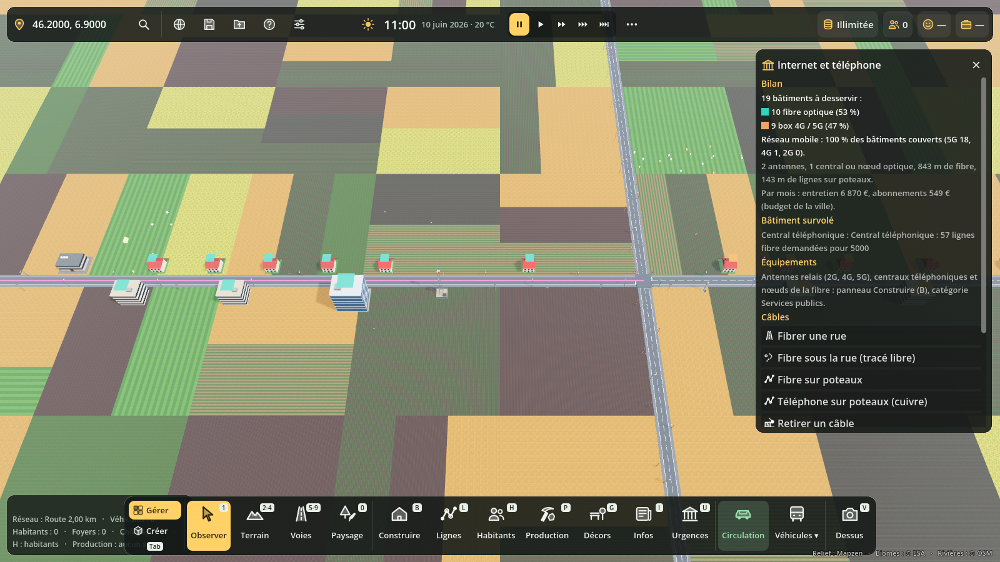

# Internet et téléphone

**Maj + O** ouvre le panneau **Internet et téléphone** (il devient aussi l'onglet
« Télécom » du panneau Réseaux, touche **O**, quand celui-ci est là). Code :
`scripts/reseaux/telecom.gd` (calcul), `telecom_types.gd` (bâtiments et modèles),
`telecom_panel.gd` et `telecom_vue.gd` (panneau). La mécanique de réseau
(tronçons, sources, raccordement, partage) est `ReseauBase`, commune avec
l'électricité, l'eau et les égouts.

## Équipements (Construire → Services publics)

| Bâtiment | Ce qu'il fait | Prix |
|---|---|---|
| Pylône 2G (GSM) | téléphone mobile et SMS jusqu'à **7 km**, 400 abonnés | 180 000 € |
| Pylône 4G | internet mobile 40 Mb/s jusqu'à **2,5 km** (1 500 abonnés), 2G jusqu'à 5 km | 260 000 € |
| Pylône 4G + 5G | 5G 300 Mb/s jusqu'à **900 m** (3 000 abonnés), 4G jusqu'à 2,5 km | 420 000 € |
| Petite antenne 5G | mât urbain, 500 Mb/s sur **450 m** (1 500 abonnés) | 90 000 € |
| Central téléphonique | départ du cuivre (téléphone fixe, ADSL) et de la fibre (5 000 lignes) | 900 000 € |
| Nœud de raccordement optique | armoire qui alimente 2 000 lignes de fibre | 220 000 € |

Les portées sont des ordres de grandeur réels : plus la fréquence est haute,
plus le débit est grand et la portée courte.

## Câbles

- **Cuivre** : toutes les routes reliées à un central portent le téléphone et
  l'ADSL, sans rien poser. Le débit ADSL baisse avec la distance au central :
  20 Mb/s à moins de 1 km, 12 à 2 km, 6 à 3 km, 3 à 4 km, 1 à 5 km, puis le
  téléphone seul.
- **Fibrer une rue** : un clic sur une route, la fibre (1 Gb/s) suit toute la
  rue (60 €/m). Elle doit toucher un central ou un nœud optique.
- **Fibre sous la rue** (tracé libre, 60 €/m), **fibre sur poteaux** (18 €/m),
  **téléphone sur poteaux** (cuivre, 12 €/m) : un clic par point, Échap ou clic
  droit pour finir. Les poteaux en bois (tous les 35 m) et leurs fils sont
  visibles : c'est la solution des fermes et des hameaux loin des routes.
- **Retirer un câble** : clic dessus.

Un bâtiment est raccordé si sa porte est à moins de **35 m** d'un câble (ou
d'une route, pour le cuivre). Une ligne par logement, une pour dix emplois.
Si les lignes demandées dépassent celles des centraux et nœuds d'un même
réseau, le débit est partagé.

## Mobile

Chaque bâtiment prend la meilleure génération qui le couvre (5G, puis 4G,
puis 2G) et, à génération égale, l'antenne la plus proche. Deux abonnés par
logement, un par emploi. Au-delà de la capacité de l'émetteur, il **sature** :
le débit baisse pour tout le monde (le panneau prévient). Le débit baisse
aussi en bord de zone. En 4G ou 5G, une box mobile peut servir d'internet à
la maison (60 % du débit mobile).

## Calques

- **Couverture mobile** : un disque par émetteur (2G jaune, 4G bleu, 5G violet).
- **Débit internet** : une pastille sur chaque bâtiment (fibre, ADSL rapide,
  box 4G / 5G, lent, rien).
- Les deux montrent les câbles posés (fibre en rose, cuivre en orange).

## Conséquences

Réglage **Admin (F10) → Internet et téléphone → Nécessaires** (activé par défaut) :

- **Habitants** : fibre +4 ; internet lent −4 ; pas d'internet −9 ; pas de
  réseau mobile −6 ; réseau saturé −2 (au plus −15). Par le fil « Avis des
  habitants » (groupe `avis_sources`) quand il est là, sinon directement dans
  la satisfaction de Population.
- **Entreprises** : sans internet, les bureaux tournent à 40 % et les autres
  à 80 % ; internet lent : 75 % et 92 %. Production lit ce facteur par le
  groupe `rendement_sources` (ouvert aux autres réseaux).
- **Budget** : entretien des antennes, centraux et câbles (groupe
  `budget_entretien`) et part des abonnements pour la ville, 3 € par ligne fixe
  et 1 € par abonné mobile et par mois (groupe `budget_recettes`).

## Sauvegarde

Section `telecom` : les câbles posés (fibre et cuivre). Les antennes et les
centraux sont des bâtiments, le service est recalculé au chargement.

## Tester

`godot --headless --path . --script res://tests/telecom_test.gd` ; captures :
`tests/telecom_vitrine.gd`.

## Pistes

Relief qui masque les antennes, antennes sur les toits et les châteaux d'eau,
pannes et usure des câbles avec le budget communal, opérateur privé qui équipe
tout seul les zones rentables, centres de données.
