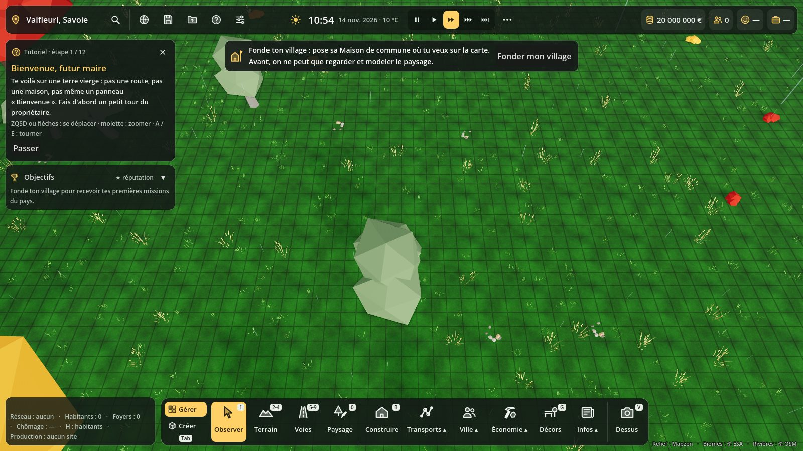
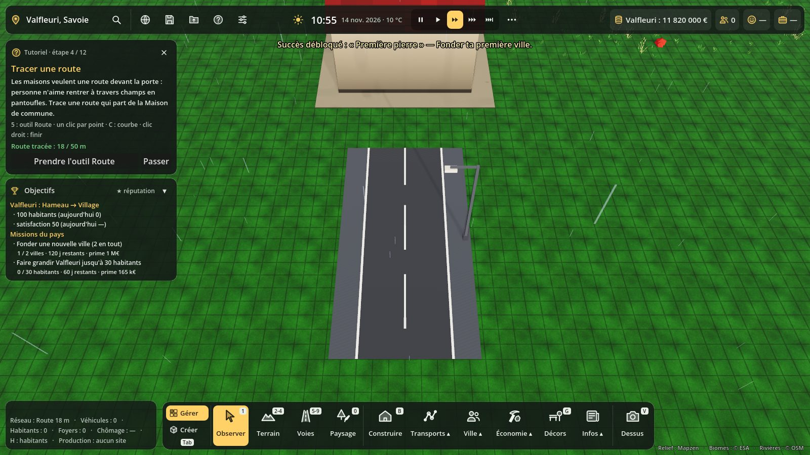

# Tutoriel guidé et objectifs à l'écran

Code : `scripts/tutoriel/` (`tutoriel.gd` = `Tutoriel`, nœud « Tutoriel » sous la scène Terre ; `tutoriel_carte.gd` = `TutorielCarte`, la carte en haut à gauche). Test : `tests/tutoriel_test.gd`. Captures : `tests/tutoriel_vitrine.gd`.

## Le tutoriel

Une partie neuve lancée depuis le globe commence par un **tutoriel guidé**, si la case « Tutoriel guidé » du globe est cochée (elle l'est par défaut). Une carte en haut à gauche donne **une étape à la fois** :

| # | Étape | Elle se valide quand… |
|---|---|---|
| 1 | Bienvenue, futur maire | la caméra a bougé (ZQSD, molette, A / E) |
| 2 | Fonder ton village | la Maison de commune est posée |
| 3 | Tes fondateurs | le panneau Maj+H a été ouvert (sautée s'il n'y a pas de fondateurs) |
| 4 | Tracer une route | 50 m de route sont tracés |
| 5 | Zoner des logements | une zone résidentielle est posée |
| 6 | Du courant et de l'eau | une source d'électricité et une source d'eau sont posées (sautée si les réseaux ne sont pas obligatoires) |
| 7 | Laisser le temps faire | 5 habitants ont un vrai toit (les fondateurs sous la tente ne comptent pas) |
| 8 | Du travail pour tous | une zone commerciale ou industrielle, ou un bâtiment qui emploie |
| 9 | Une école | une école est posée |
| 10 | Surveiller la caisse | le budget (M) a été ouvert |
| 11 | Tes objectifs | le panneau Objectifs (Maj+J) a été ouvert |
| 12 | Tu es maire ! | bouton « Terminer » |

- Chaque étape a un **bouton d'action** qui fait le premier geste (ouvrir la fenêtre de fondation, prendre l'outil Route, ouvrir Construire → Zonage ou Réseaux ou Services, accélérer le temps, ouvrir le budget ou les objectifs).
- **Passer** saute l'étape ; la **croix** arrête le tutoriel.
- Une étape déjà faite est sautée toute seule (sauf celles qui demandent un geste : caméra, panneaux, temps).
- Pendant le tutoriel, la fenêtre « Fonder ton village » ne s'ouvre plus d'office au début : c'est l'étape 2 qui la propose, après le tour de la caméra.
- Ton : réaliste avec une touche d'humour (« personne n'aime rentrer à travers champs en pantoufles »).

## Les objectifs à l'écran

Sous le tutoriel (et seuls une fois le tutoriel fini), un cadre **Objectifs** résume :
- le **rang** de la ville gérée (celle que regarde la caméra) et ce qui manque pour le suivant (Hameau → Village → Bourg…) ;
- les **missions du pays** en cours, avec leur progrès, les jours restants (en orange sous 7 jours) et la prime ;
- la réputation du pays en étoiles.

Tout vient de `Objectifs` (`scripts/pays/objectifs.gd`) : la carte ne calcule rien elle-même. Clic sur « Objectifs » : panneau Maj+J. ▾ replie le cadre (gardé dans la sauvegarde). La carte est masquée en mode Créer, dans l'atelier et quand le panneau des coordonnées est ouvert.

## Réglages (F10 → Aide)

- **Tutoriel guidé** : le cocher relance le tutoriel (il reprend à la première étape pas faite) ; il se décoche tout seul quand le tutoriel est fini ou arrêté. Aussi sur le globe, sous « Réglages… ».
- **Objectifs à l'écran** : afficher ou masquer le cadre des objectifs.

Une partie sauvegardée avant le tutoriel le charge sans tutoriel.

## Sauvegarde

Section `tutoriel` : `{version, actif, etape, faits: [ids], replie}`. Les réglages `tutoriel` et `objectifs_ecran` sont dans la section `reglages`.

## Ajouter une étape

Ajouter une entrée à `Tutoriel.ETAPES` (`id`, `titre`, `texte`, `touches`, `action` facultative), puis un cas dans `est_faite()` (et dans `sans_objet()` si l'étape dépend d'un réglage). Le geste du bouton se code dans `terre_main._on_tuto_action()`.
