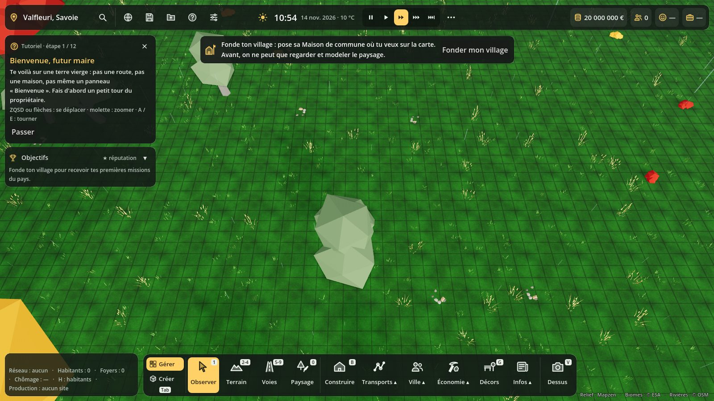
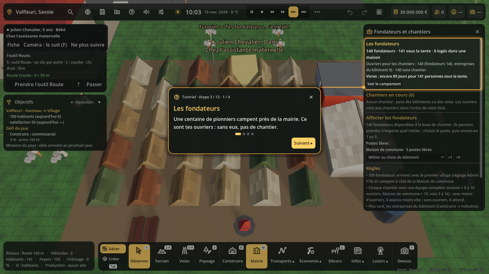
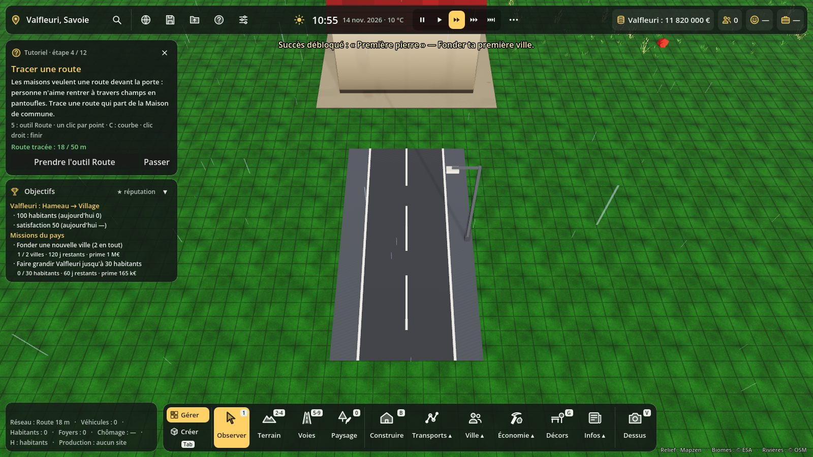

# Tutoriel guidé et objectifs à l'écran

Code : `scripts/tutoriel/` (`bulles_aide.gd` = `BullesAide`, les bulles au centre de l'écran ; `guide.gd` = `Guide`, les chapitres par fonction ; `guide_panel.gd` = `GuidePanel`, Ctrl+F1 ; `tutoriel.gd` = `Tutoriel`, nœud « Tutoriel » sous la scène Terre ; `tutoriel_carte.gd` = `TutorielCarte`, la carte en haut à gauche). Tests : `tests/tutoriel_test.gd`, `tests/bulles_test.gd` (bulles et guide ; avec `-- --dossier <dir>` et un affichage, il fait aussi les captures). Captures : `tests/tutoriel_vitrine.gd`.

## Le tutoriel

Une partie neuve lancée depuis le globe commence par un **tutoriel guidé**, si la case « Tutoriel guidé » du globe est cochée (elle l'est par défaut). Une carte en haut à gauche donne **une étape à la fois** :

| # | Étape | Elle se valide quand… |
|---|---|---|
| 1 | Bienvenue, futur maire | la caméra a bougé (ZQSD, molette, A / E) |
| 2 | Fonder ton village | la Maison de commune est posée |
| 3 | Tes fondateurs | le panneau Maj+H a été ouvert (sautée s'il n'y a pas de fondateurs) |
| 4 | Tracer une route | 50 m de route sont tracés |
| 5 | Zoner des logements | une zone résidentielle est posée |
| 6 | Courant, eau et égouts | une source d'électricité, une source d'eau et un traitement des égouts (lagunage, station, ou rejet) sont posés (sautée si les réseaux ne sont pas obligatoires) |
| 7 | Laisser le temps faire | 5 habitants ont un vrai toit (les fondateurs sous la tente ne comptent pas) |
| 8 | Du travail pour tous | une zone commerciale ou industrielle, ou un bâtiment qui emploie |
| 9 | Une école | une école est posée |
| 10 | Ramasser les poubelles | un dépôt de collecte et une décharge (ou un incinérateur) sont posés, chantiers compris (sautée si les déchets sont désactivés) |
| 11 | Surveiller la caisse | le budget (M) a été ouvert |
| 12 | Tes objectifs | le panneau Objectifs (Maj+J) a été ouvert |
| 13 | Tu es maire ! | bouton « Terminer » |

- Chaque étape a un **bouton d'action** qui fait le premier geste (ouvrir la fenêtre de fondation, prendre l'outil Route, ouvrir Construire → Zonage, Réseaux, Services ou Déchets, accélérer le temps, ouvrir le budget ou les objectifs).
- **Passer** saute l'étape ; la **croix** arrête le tutoriel.
- Une étape déjà faite est sautée toute seule (sauf celles qui demandent un geste : caméra, panneaux, temps).
- Pendant le tutoriel, la fenêtre « Fonder ton village » ne s'ouvre plus d'office au début : c'est l'étape 2 qui la propose, après le tour de la caméra.
- Ton : réaliste avec une touche d'humour (« personne n'aime rentrer à travers champs en pantoufles »).

## Les bulles d'aide (depuis le 2026-11-18)

Au lieu d'un grand texte, chaque explication est une **bulle au centre de l'écran** : un titre, deux phrases, les touches utiles. L'élément dont elle parle (un bouton de la barre, une section d'un panneau, la carte du tutoriel) est **encadré en orange**, le reste de l'écran est un peu assombri et un trait relie la bulle à l'élément. Si la bulle cachait l'élément, elle se pousse de l'autre côté. Les clics passent à travers le voile : on peut cliquer ce qui est montré. Boutons : ◂ Précédent, Suivant ▸ (ou « Compris » / « Terminer » à la dernière), la croix ferme.

- **Tutoriel** : chaque étape ouvre ses bulles (1 à 4) au début ; la carte en haut à gauche ne garde qu'une consigne courte, le progrès, le bouton d'action, **?** (revoir les bulles) et « Passer ». La dernière bulle a aussi le bouton d'action de l'étape. Une étape qui se valide pendant ses bulles (ex. « Tes fondateurs » quand la bulle ouvre le panneau) laisse les bulles finir, puis les bulles de l'étape suivante arrivent.
- **Guide du maire** (`Guide.CHAPITRES`, 19 chapitres) : Les bases, Fondateurs, Construire, Mairie, Budget, Habitants, Avis et élections, Réseaux, Lignes, Atelier, Ton personnage (vue au sol), Décors, Zoo, Musée, Parc d'attractions, Club de sport, Production, Pays, Objectifs.
  - La **première fois** qu'on ouvre la fonction (son panneau, le mode Créer, la vue au sol), une bulle propose « Nouveau : le zoo… Découvrir / Plus tard ». Pas de proposition pendant le tutoriel.
  - **Ctrl + F1** (ou F1 → ligne Ctrl + F1) : panneau **Guide du maire**, tous les chapitres par thème, ✓ pour ceux déjà vus, « Voir / Revoir », case « Proposer une visite quand je découvre une fonction », « Tout revoir ».
  - Chapitres vus et réglage gardés pour le joueur dans `user://guide.cfg` (pas dans la sauvegarde).
- La démo guidée utilise les mêmes bulles (vue au sol et lignes reprennent les chapitres du guide).

### Ajouter une bulle ou un chapitre

Une bulle est un dictionnaire : `titre`, `texte`, `touches` ; `panneau` (propriété de la scène Terre à ouvrir, ex. `zoo_panel`) ; `cible` (début du texte d'un Label ou d'un Button, début d'une infobulle, ou nom de nœud ; une liste = la première trouvée ; sans cible trouvée, tout le panneau est encadré) ; `racine` (autre propriété où chercher : `tuto_carte`, `parcours`, `fil_alertes`) ; `section` (un titre de section s'étend jusqu'à la section suivante, vrai par défaut) ; `creer` (passer en mode Créer) ; `action` ([texte, id]). Un chapitre : `id`, `titre`, `icone`, `theme`, `resume`, `declencheur` (`{"panneau": …}`, `{"mode": "creer"}`, `{"vue_sol": true}` ou `{}`), `bulles`. Une étape du tutoriel prend `bulles`, ou `chapitre` pour reprendre un chapitre du guide.

Chaque texte doit aussi aller dans `assets/langues/{en,de,it,es}.json` : `tests/bulles_test.gd` vérifie que toutes les bulles sont traduites.

## Les objectifs à l'écran

Sous le tutoriel (et seuls une fois le tutoriel fini), un cadre **Objectifs** résume :
- le **rang** de la ville gérée (celle que regarde la caméra) et ce qui manque pour le suivant (Hameau → Village → Bourg…) ;
- les **missions du pays** en cours, avec leur progrès, les jours restants (en orange sous 7 jours) et la prime ;
- la réputation du pays en étoiles.

Tout vient de `Objectifs` (`scripts/pays/objectifs.gd`) : la carte ne calcule rien elle-même. Clic sur « Objectifs » : panneau Maj+J. ▾ replie le cadre (gardé dans la sauvegarde). La carte est masquée en mode Créer, dans l'atelier et quand le panneau des coordonnées est ouvert.

## Réglages (F10 → Aide)

- **Tutoriel guidé** : le cocher relance le tutoriel (il reprend à la première étape pas faite) ; il se décoche tout seul quand le tutoriel est fini ou arrêté. Aussi sur le globe, sous « Réglages… ».
- **Objectifs à l'écran** : afficher ou masquer le cadre des objectifs.

Une partie sauvegardée avant le tutoriel le charge sans tutoriel.

## Sauvegarde

Section `tutoriel` : `{version, actif, etape, faits: [ids], replie}`. Les réglages `tutoriel` et `objectifs_ecran` sont dans la section `reglages`.

## Ajouter une étape

Ajouter une entrée à `Tutoriel.ETAPES` (`id`, `titre`, `texte` = consigne courte de la carte, `touches`, `action` facultative, `bulles` ou `chapitre`), puis un cas dans `est_faite()` (et dans `sans_objet()` si l'étape dépend d'un réglage). Le geste du bouton se code dans `terre_main._on_tuto_action()`.
