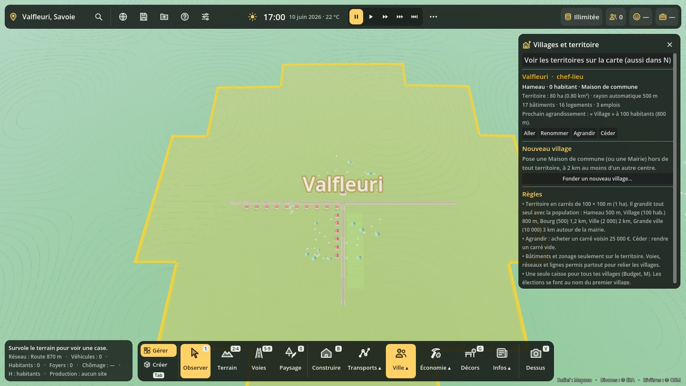
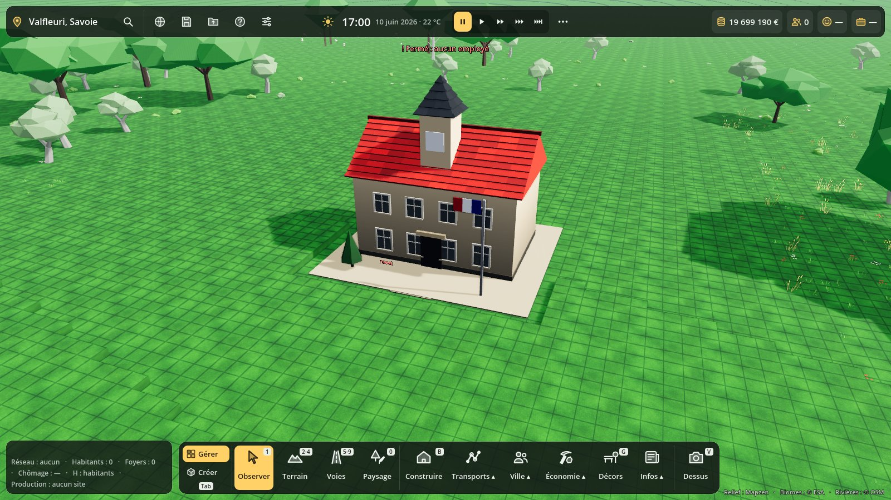
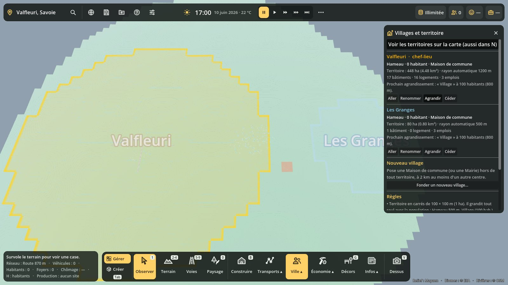

# Villages et territoire

Code : `scripts/communes/` (`communes.gd` = `Communes`, nœud « Communes » sous la scène Terre ; `villages_panel.gd` = panneau **Maj+M**). Test : `tests/communes_test.gd`.

## Fonder son village

Une partie lancée depuis le globe commence par la **fondation du village** :

1. Une fenêtre demande le **nom du village** (proposé : le nom du lieu choisi sur le globe).
2. « Choisir l'emplacement » met en main la **Maison de commune** (16 × 14 m, 300 000 €, clocheton, horloge et drapeau). Elle n'a **pas besoin de route** : c'est la première pierre. **R** pour tourner, clic droit pour annuler.
3. Dès qu'elle est posée, le village existe et reçoit son **territoire**.

Tant qu'aucun village n'est fondé, un bandeau en haut de l'écran le rappelle, et l'on ne peut que regarder et modeler le paysage : **ni bâtiment, ni zonage, ni voie**.

La grande **Mairie** (Construire → Services) fonde aussi un village, mais elle demande une route. Posée dans un village qui a déjà une mairie, la plus grande devient le **siège**, l'autre une **mairie annexe**. Si le siège est démoli, une mairie annexe prend le relais ; sans aucune mairie, le panneau l'indique (« sans mairie ») et il suffit d'en reposer une sur le territoire.

## Le territoire

- Il est fait de **carrés de 100 × 100 m** (1 ha), avec des frontières **automatiques** autour de la mairie.
- Au départ : tous les carrés à **500 m** autour de la mairie (environ 80 ha).
- Il **grandit tout seul** avec la population du village (paliers de l'Admin) :

| Palier | Habitants | Rayon autour de la mairie |
|---|---|---|
| Hameau | 0 | 500 m |
| Village | 100 | 800 m |
| Bourg | 500 | 1,2 km |
| Ville | 2 000 | 2 km |
| Grande ville | 10 000 | 3 km |

  Le territoire ne recule jamais, et il ne prend pas les carrés d'un autre village.
- **Agrandir** : le joueur achète un carré qui touche le territoire (25 000 €, multiplié par le réglage « coût des constructions »). La dépense est notée au budget (« Terrains annexés »).
- **Céder** : il rend un carré vide, sans bâtiment ni zone. Le carré de la mairie ne se cède pas.
- Les habitants d'un village sont ceux dont le logement est sur son territoire.

**Règles de construction** (réglage Admin « Bâtiments et zonage seulement sur le territoire ») :
- Bâtiments et zonage : seulement sur le territoire de ses villages. Les bâtiments qui poussent dans une zone restent donc dans le territoire.
- **Voies, réseaux, lignes et décors : partout**, pour pouvoir relier les villages.
- L'éditeur libre (blocs, murs et étages) n'est pas encore limité.

## Plusieurs villages

- **Fonder un nouveau village** (bouton du panneau) : on choisit un nom, puis on pose une Maison de commune **hors de tout territoire**, à **2 km au moins** du centre d'un autre village.
- Chaque village a ses chiffres dans le panneau : palier, habitants, superficie, bâtiments, logements, emplois, et le prochain agrandissement.
- **Une seule caisse** pour tous les villages du joueur (Budget, **M**). Des budgets séparés par commune pourront venir plus tard.
- Le **premier village** est le chef-lieu : c'est son nom qu'on lit dans les élections, les manifestations et l'actualité (`Avis.ville()`), et les cortèges marchent vers sa mairie.
- **Fusionner** : quand deux territoires se touchent, un bouton les réunit. Le village le plus peuplé garde son nom et sa mairie, et l'autre mairie devient une mairie annexe.

## Panneau Villages (Maj+M)

Il se trouve dans le menu **Ville** de la barre du bas. Il contient :
- un bouton pour voir les territoires sur la carte (aussi dans le panneau Cartes, **N** → Villages) ;
- une fiche par village, avec les boutons **Aller**, **Renommer**, **Agrandir** et **Céder** (clic sur un carré, clic droit ou Échap pour arrêter, carré vert = possible, rouge = impossible), et **Fusionner avec…** ;
- un bouton pour fonder un nouveau village ;
- un rappel des règles.

Les frontières sont dessinées par un muret translucide de la couleur du village, avec le nom du village au-dessus de la mairie. Elles s'affichent quand le panneau ou le calque est ouvert, et pendant la pose d'un bâtiment ou d'une zone.

## Réglages Admin (F10 → Construction)

- **Fonder un village (Maison de commune) avant de construire** : oui par défaut, non en « Bac à sable libre ».
- **Bâtiments et zonage seulement sur le territoire de ses villages** : oui par défaut, non en « Bac à sable libre ».

## Cartes en ligne (à venir avec le multijoueur)

Sur la carte mondiale, chaque joueur sera maire de **sa** ville. Le territoire servira à la gestion (impôts, élections, chiffres) mais **ne bloquera pas** les autres joueurs, pour garder la règle « pas de parcelles ». Il faudra un `Communes` par joueur.

## Sauvegarde

La section `communes` contient `{version, actif, next_id, villages: [{id, nom, bid, cx, cz, rayon, annexes, fonde, couleur, cases: [[x, z]…]}]}`.

Une **ancienne partie** sans cette section reçoit un village automatique, centré sur sa mairie (ou sur le centre des bâtiments s'il n'y en a pas), dont le territoire couvre tout ce qui est déjà construit ou zoné.

Une partie lancée sans passer par le globe (scènes de test, atelier) n'exige rien (`actif = false`) tant qu'aucun village n'est fondé.

## Pour les autres systèmes

- `Communes.instance`, `village_au_point(x, z)`, `village_du_batiment(bid)`, `villages[vid]`, `stats[vid]` (`hab`, `logements`, `emplois`, `batiments`, `palier`, `ha`).
- `Communes.est_fondateur(type)` : la clé `"fondateur": true` du catalogue, ou le rôle `mairie`.
- Les points d'accroche sont `BuildingSystem.extra_check` (en chaîne), `ZoneSystem.area_check(rect)` et `TransportSystem.build_gate()`.
